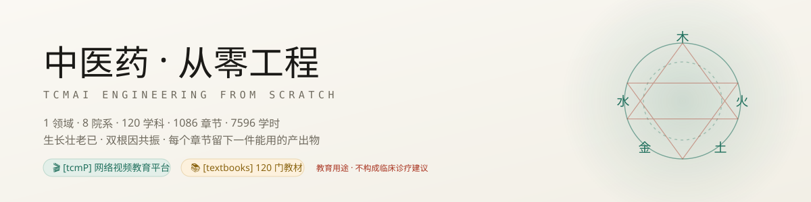
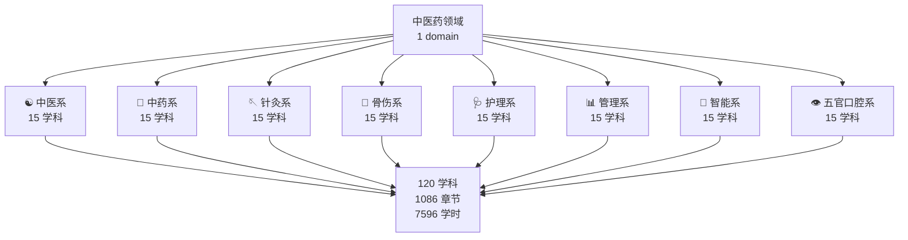
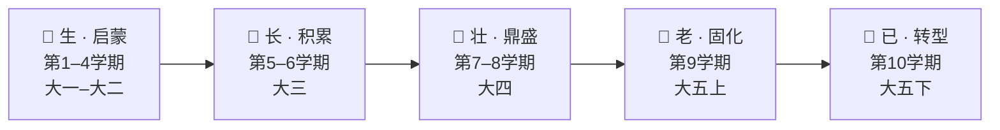

<p align="center">
  
</p>

<p align="center">
  <b>中医药 · 从零起步的工程化教育体系</b><br/>
  <sub>1 领域 · 8 院系 · 120 学科 · 10 学期 · 5 阶段（生长壮老已）</sub>
</p>

<!-- COUNTS:START (由 scripts/build_catalog.js 生成 — 请勿手工编辑) -->
**8** 院系 &nbsp;·&nbsp; **120** 学科 &nbsp;·&nbsp; **1086** 章节 &nbsp;·&nbsp; **7596** 学时 &nbsp;·&nbsp; 已建 **3** 章 &nbsp;·&nbsp; 视频 **3** / 教材章节 **1**
<!-- COUNTS:END -->

<p align="center">
  <a href="LICENSE"></a>
  <a href="ROADMAP.md"></a>
  <a href="departments/README.md"></a>
  <a href="platform/"></a>
  <a href="textbooks/"></a>
</p>

```text
░░░▒▒▒░░░▒▒▒░░░▒▒▒░░░▒▒▒░░░▒▒▒░░░▒▒▒░░░▒▒▒░░░▒▒▒░░░▒▒▒░░░▒▒▒░░░▒▒▒░░░▒▒▒░░░▒▒▒░░░▒▒▒░░░▒▒▒░░░▒▒▒░░░▒▒▒
```

> **从零起步，生长壮老已，终成医圣。**
>
> 中医药院校教的是"知道什么"，工程教育要的是"能造出什么"。这个项目把两者焊在一起：
> 一门学科，从经典原文出发，一路推到可运行的系统。120 门学科，1086 个章节，
> 每个章节都留下一个能塞进临床工作流的产出物 —— Prompt、Skill、Agent、MCP 服务或临床工具。
>
> 两类交付物：**[tcmP]** 网络视频教育平台 · **[textbooks]** 120 门学科教材。
>
> 免费，开源，MIT。在你自己的机器上跑。

---

## 这个项目解决什么问题

中医药数字化卡在两个断层上：

| 断层 | 表现 | 本项目的答案 |
|------|------|-------------|
| **语义断层** | 「肝主疏泄」写不进模型，因为它不是一个可计算对象 | 每个中医概念必须给出**形式化表示**，且能**回指**到经典原文 |
| **能力断层** | 会背方剂的人不会写代码，会写代码的人不懂辨证 | 120 门学科按学期排课，中医与工程双线并进，第 7 学期汇聚于「大语言模型与中医智能体」 |

传统教材止步于"理解"。这里每章都要跑得起来：**读原文 → 形式化 → 从零实现 → 用成熟库验证 → 留下产出物**。

---

## 内容设计：1 领域 → 8 院系 → 120 学科



| # | 院系 | 定位 | 学科 | 学时 | 章节 |
|---|------|------|------|------|------|
| 1 | ☯️ [中医系](departments/01-zhongyi/) | 理法方药的内核：基础理论、经典、临床各科 | 15 | 1062 | 150 |
| 2 | 🌾 [中药系](departments/02-zhongyao/) | 本草、方剂与中药全产业链 | 15 | 1026 | 144 |
| 3 | 🪡 [针灸系](departments/03-zhenjiu/) | 经络腧穴—刺法灸法—针灸治疗—推拿康复 | 15 | 954 | 136 |
| 4 | 🦴 [骨伤系](departments/04-gushang/) | 正骨理筋—骨病退变—运动损伤与康复工程 | 15 | 972 | 138 |
| 5 | 🩺 [护理系](departments/05-huli/) | 中医护理特色技术 + 现代护理全科能力 | 15 | 882 | 128 |
| 6 | 📊 [管理系](departments/06-guanli/) | 中医药治理、政策、教育与卫生信息化 | 15 | 792 | 118 |
| 7 | 🤖 [智能系](departments/07-zhineng/) | 中医 × AI：架构、数据、模型、设备与治理 | 15 | 990 | 140 |
| 8 | 👁️ [五官口腔系](departments/08-wuguan/) | 眼、耳鼻喉、口腔三科的经典辨证与现代诊疗 | 15 | 918 | 132 |
| | **合计** | | **120** | **7596** | **1086** |

完整清单与学期排课见 **[八院系地图](departments/README.md)** 与 **[ROADMAP.md](ROADMAP.md)**。

---

## 课程进度：生长壮老已 × 10 学期

参照 [ai-engineering-from-scratch](https://aiengineeringfromscratch.com/) 的 phase → lesson 进度模型，
本项目的进度轴不是"课程顺序"，而是**双根因共振**：知识积累（K）× 环境逼迫（E）。



| 阶段 | 学期 | 学年 | 环境逼迫 | 知识积累 | 产出类型 |
|------|------|------|---------|---------|---------|
| 🌱 生（启蒙） | 1–4 | 大一–大二 | ★★★★★ | ★★★☆☆ | 📋 概念卡 / 术语表 / Prompt 模板 |
| 🌿 长（积累） | 5–6 | 大三 | ★★★☆☆ | ★★★★★ | 🛠️ 辨证模板 / 知识库 / Skill |
| 🌳 壮（鼎盛） | 7–8 | 大四 | ★★☆☆☆ | ★★★★☆ | 🤖 智能体 / 🔌 MCP 服务 |
| 🍂 老（固化） | 9 | 大五上 | ★★★☆☆ | ★☆☆☆☆ | ⚙️ 临床轮转手册 / 系统 |
| 🔄 已（转型） | 10 | 大五下 | ★★★★☆ | ☆☆☆☆☆ | 🧰 毕业设计 / 工具箱 |

核心方程（与 [医圣成长 · tcm-textbooks](https://github.com/DayongCai) 同源）：

```math
K(t) = \sum_i 知识学分_i \cdot e^{-age_i / \tau_{knowledge}}
E(t) = \sum_i 环境逼迫_i \cdot e^{-age_i / \tau_{pressure}}
R(t) = K(t) \cdot E(t) \cdot \sin\!\big(\arctan2(K, E)\big)
\quad\text{当 } R > \theta \Rightarrow \text{涌现事件}
```

---

## 两类交付物

### 🎬 [tcmP] 网络视频教育平台

参照 `ai-engineering-from-scratch` 站点架构：静态站点 + 构建期数据管线 + 交互式课程页。

```text
site/            静态站点：课程目录 / 学科页 / 章节页 / 路线图 / 图灵式交互图
  build.js       curriculum.json + catalog.json + glossary → data.js
platform/        视频生产与播放：讲稿 → TTS 旁白 → 渲染 MP4 → 课程页嵌入
  courses/<dept>/<subject>/course.yaml   课程元数据 + 章节→视频映射
```

- 每章一集视频，讲稿由 `docs/zh.md` 派生，**单一事实来源**，不重复维护
- 交互式实验台：章节页内嵌可运行的 BUILD IT 代码
- 进度只存在浏览器本地，无需注册

```bash
npm run site     # 构建站点 → site/data.js
npm run serve    # 本地预览 http://localhost:7788
```

### 📚 [textbooks] 120 门学科教材

每章一份教材稿，与课程文档同源不同体：文档讲"怎么做"，教材讲"为什么这样做"。

```text
textbooks/<dept>/<subject>/
├── 00-前言.md
├── 01-第1章-<标题>.md      # 每章 ≈ 6000 字，附 Mermaid/SVG 图
├── figures/
└── build/                  # 由 scripts/build_book.js 汇成 PDF / EPUB 分卷
```

#### 已有外部教材稿（导入，非手写）

`textbooks/07-zhineng/05-zhongyi-zhishi-tupu/` 是由桌面资料 `中医知识树.xlsx`
**导入**的完整教材（4 篇 10 章 49 节）。这类教材稿是**生成物，不要手改**：

```bash
node scripts/import_knowledge_tree.js          # 重新导入
node scripts/import_knowledge_tree.js --check  # 只校核不写文件
```

导入层的机器可读产物（五级骨架、八域学科分布、出处指纹、与源体系的分歧项）在
`standards/knowledge-tree/`。与本院系体系「两端一致、中间不一致」的五项差异逐条记在
`tree-schema.json` 的 `discrepancies`，**未做任何自动对齐**。

---

## 章节契约（每章必须满足）

这是整个项目的质量门。`scripts/audit_curriculum.js` 在 CI 上强制校验：

```text
departments/NN-<dept>/MM-<subject>/
├── README.md            学科大纲（生成）
├── meta.json            机器可读元数据（生成）
├── chapters.json        章节索引（脚手架维护）
└── chapters/NN-<slug>/
    ├── docs/zh.md       MOTTO · PROBLEM · 双根因 · CONCEPT · BUILD IT · USE IT · SHIP IT
    ├── code/            main.* + 测试，自终止、退出码 0
    ├── quiz.json        恰好 6 题 = 1 pre + 3 check + 2 post
    └── outputs/         可复用产出物（prompt / skill / agent / mcp）
```

三层审计：

| 层 | 校验内容 | 阻断 |
|----|---------|------|
| L0 数据层 | `curriculum.json` 数量、唯一性、元组形状、取值域 | ✅ 是 |
| L1 结构层 | 目录与源数据对齐、命名规范、README/meta.json 齐备 | ✅ 是 |
| L2 契约层 | 已建章节的 docs/quiz/outputs 契约 | ✅ 是 |

```bash
npm run audit    # 三层审计
npm test         # 单元测试
npm run check    # audit + README 计数一致性
```

---

## 从哪开始

| 你的身份 | 建议入口 |
|---------|---------|
| 🥼 中医药专业学生 | 第 1 学期 [中医基础理论](departments/01-zhongyi/01-zhongyi-jichu-lilun/) → 按学期推进 |
| 💻 有编程基础的开发者 | 第 3 学期 [医学人工智能导论](departments/07-zhineng/01-yixue-rengong-zhineng-daolun/) 切入，按需回溯中医基础 |
| 🤖 AI 工程师 | 第 7 学期 [大语言模型与中医智能体](departments/07-zhineng/10-llm-yu-zhongyi-zhinengti/) 切入，逆向补中医语义 |
| 👩‍🏫 教材编者 | [templates/](templates/) + [CONTRIBUTING.md](CONTRIBUTING.md) 的章节契约 |
| 🎬 视频制作者 | [platform/README.md](platform/README.md) 的制作流水线 |
| 🏫 院校课程设计者 | [learning-paths/](learning-paths/) 的学分路径 |

第一次跑通，只需要 Node.js：

```bash
git clone <本仓库> && cd tcmai-engineering-from-scratch
node scripts/build_catalog.js
node departments/01-zhongyi/01-zhongyi-jichu-lilun/chapters/01-yin-yang-er-fenlei/code/main.js
```

第二行跑通之后，你已经用代码解释了「阴阳」。剩下 1085 个章节带你走到「医圣」。

想看站点但不想起服务器？打一个单文件快照，直接双击打开：

```bash
node site/pages.js && node site/build.js
node site/snapshot.js
# → site/snapshot/index.html （单文件，离线可用，无需服务器）
```

---

## 仓库结构

```text
tcmai-engineering-from-scratch/
├── curriculum.json           ← 单一事实来源：1领域/8院系/120学科
├── catalog.json              生成物：全量课程表 + 进度
├── README.md                 门面（计数块自动同步）
├── ROADMAP.md                院系/学科/章节状态追踪
├── CONTRIBUTING.md           贡献者与 AI agent 的操作手册（含章节契约）
├── departments/              8 院系 × 15 学科 × N 章节
├── learning-paths/           学分路径（临床型 / 工程型 / 科研型 / 教学型）
├── glossary/                 中医术语表 + AI 术语表 + 对照表
├── templates/                学科模板 / 章节模板 / quiz schema
├── scripts/                  Node 工具链（无第三方依赖）
├── site/                     [tcmP] 静态站点
├── platform/                 [tcmP] 课程与视频生产
├── textbooks/                [textbooks] 教材与出版流水线
├── tests/                    CI 门控与人机闭环审核
├── assets/                   横幅、知识树、图片
└── .github/workflows/        curriculum.yml（审计 / 计数同步 / 站点重建）
```

> **想把这份仓库改造成另一门领域的课程？** 见 [FORKING.md](FORKING.md) ——
> 从参考项目出发的实际流程、该保留与该替换的分界、不能省的质量门，
> 以及六条踩过的坑（每条附本仓库的真实数字）。

---

## 与上游项目的关系

| 上游 | 本项目继承 | 本项目改造 |
|------|-----------|-----------|
| [ai-engineering-from-scratch](https://aiengineeringfromscratch.com/) | phase→lesson 结构、章节契约、静态站点 + CI 重建、learning-paths、glossary、Build It / Use It 双段 | 领域从 AI 换成中医药；进度轴从"20 phase 线性"换成"8 院系 × 10 学期"；新增教材交付轨道 |
| [医圣成长 · tcm-textbooks](E:/医圣成长/tcm-textbooks) | 双根因共振模型、MOTTO/PROBLEM/CONCEPT/BUILD IT/USE IT/SHIP IT 章节骨架、生长壮老已五阶段、中医↔AI 桥梁表 | 从 22 课扩展到 120 学科 × 1086 章节；新增视频平台与教材出版两条交付线 |

---

## 许可

MIT License · 见 [LICENSE](LICENSE)

> 本项目是独立的社区教育项目，不代表任何院校、学会或监管机构的立场。
> 全部内容仅用于教育目的，**不构成临床诊疗建议**。任何基于本项目代码的临床决策，
> 必须由具备执业资格的医师复核。
