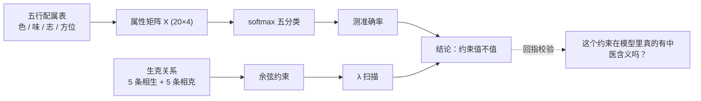

# 第 2 章 · 五行学说 → 多分类：从零实现 Softmax（并检验生克约束是否真的有用）

> **MOTTO:** 「五行：一曰水，二曰火，三曰木，四曰金，五曰土。」——《尚书·洪范》
>
> **PROBLEM:** 你知道五行是五类，于是写了个五分类器；但相生相克去哪了？你可能已经听过「纯 softmax 会丢掉关系」这句断言 —— 本章要做的第一件事，是**去测它到底对不对**。
>
> **双根因定位:** 环境逼迫(“答辩时被问『你的五行分类器和普通五分类器有什么区别』，答不上来”) + 知识积累(五行生克 × softmax 与关系正则 = 能自己设计并检验约束的建模能力)

**教材出处:** 教材·第2章·2.3 五行学说（五行特性与归类、生克制化、在医学中的应用三小节）；本章的五分类样本为教学构造。

## 课程信息

| 项目 | 内容 |
|------|------|
| 学科 | 中医基础理论 |
| 院系 | 中医系 |
| 章序号 | 02 / 10 |
| 所属阶段 | 🌱 生·启蒙 |
| 产出类型 | 📋 Prompt 模板 / 🛠️ Skill 文件 |
| 预估时长 | 4 小时 |

## 课程结构

```text
MOTTO  →  PROBLEM  →  CONCEPT  →  BUILD IT  →  USE IT  →  SHIP IT
一句话      痛点      原理+图解    从零实现     框架调用    产出工具
```

## 学习目标

- 从零实现 softmax（含减 max 的数值稳定写法），并解释不减 max 会在什么量级上溢出
- 把「相生 / 相克」写成一对**余弦约束**加进损失函数，手推其梯度
- 用 λ 扫描**测量**一个约束的实际效果，而不是相信断言
- 说清本章实验里「纯 softmax 已经满足生克一致性」的原因，并指出这暴露了表示层的什么问题
- 判断什么情况下应该加约束、什么情况下加约束只是自伤

<div data-figure="wuxing-cycle"></div>

## 核心概念

### 中医：五行与生克

《尚书·洪范》给出五行的名目与次序；《素问·五运行大论》等篇给出相生相克的关系：

```text
相生：木 → 火 → 土 → 金 → 水 → 木   （外圈，顺时针）
相克：木克土 · 土克水 · 水克火 · 火克金 · 金克木  （五角星）
```

关键在于**关系是学说的主体**。如果把五行当成 5 个互不相干的类，那这门学说就退化成了
一份五格清单 —— 它最有信息量的部分（哪两类互相促进、哪两类互相制约）全丢了。

### AI / 工程：Softmax 与关系正则

多分类用 softmax 把打分转为概率：

$$p_k = \frac{e^{z_k}}{\sum_{j=1}^{K} e^{z_j}}, \qquad z_k = \mathbf{w}_k^\top \mathbf{x} + b_k$$

数值稳定写法必须先减去最大值：

$$p_k = \frac{e^{z_k - \max_j z_j}}{\sum_j e^{z_j - \max_j z_j}}$$

把关系写成约束，最直接的一种是**约束类权重向量之间的夹角**：

$$\mathcal{L} = \underbrace{-\frac{1}{N}\sum_i \log p_{y_i}}_{\text{交叉熵}} + \lambda\Big[\sum_{(i,j)\in\text{生}} \max(0,\, m_s - \cos(\mathbf{w}_i,\mathbf{w}_j)) + \sum_{(i,j)\in\text{克}} \max(0,\, \cos(\mathbf{w}_i,\mathbf{w}_j) - m_k)\Big]$$

- 相生对：把两个方向**拉近**（余弦不小于 $m_s$）
- 相克对：把两个方向**推远**（余弦不大于 $m_k$）
- $\lambda$ 是这两者与分类准确率之间的交换率 —— 它不是免费的

### 对应关系

| 中医概念 | AI / 工程概念 | 桥梁（为什么可以这样翻译） | 级别 |
|---------|--------------|--------------------------|------|
| 五行 | 5 类多分类 | 类别数为 5，与五行名目一一对应 | **B** |
| 相生 | 类权重向量之间的**正**余弦约束 | 相生意味着两类在语义上互相促进 → 方向相近 | **B** |
| 相克 | 类权重向量之间的**负**余弦约束 | 相克意味着互相制约 → 方向相斥 | **B** |
| 五行配属表 | 属性矩阵（色/味/志/方位） | 通行配属表给出的正是这四组对应 | **A** |
| 「五位一体的整体观」 | 结构约束先验 | 五行不是 5 个独立标签，而是一个带边的系统 | **B** |
| 五行 = 五行分类器 | —— | ⚠️ **C 级类比**。只对了类别数，丢掉了全部关系。本章就是来测这个代价的 | **C** |



## BUILD IT：从零实现

两件事：softmax（带数值稳定），以及把生克写成可求导的 hinge 约束。

```javascript
function softmax(z) {
  const m = Math.max(...z);
  const e = z.map((v) => Math.exp(v - m));   // ← 减 max：正确性要求，不是优化
  const s = e.reduce((a, b) => a + b, 0);
  return e.map((v) => v / s);
}

// 相生: hinge(mSheng − cos)  相克: hinge(cos − mKe)
const c = cosine(W[i], W[j]);
const violation = wantAbove ? mSheng - c : c - mKe;
if (violation <= 0) return;                 // 满足约束就不产生梯度
// d(cos)/d(W[i]) = W[j]/(|W[i]||W[j]|) − cos·W[i]/|W[i]|²
```

跑起来：

```bash
node code/main.js
```

## 实测结果：断言被推翻了

这是本章最重要的部分。运行后的真实输出：

```text
特征共线检查: 四列次序完全一致 = 是 ⚠（结构上共线，见下文）

【A】纯 softmax（λ=0）
  训练准确率: 100.0%
  相生对平均余弦: 0.014 | 相克对平均余弦: -0.493 | 差 0.507
  关系一致性: 满足 ✅

【B】生克正则的 λ 扫描
  λ      准确率   相生均值   相克均值   差值
  0      100.0%   0.014      -0.493     0.507
  0.2    100.0%   0.448      -0.052     0.499
  0.5    95.0%    0.498      -0.009     0.507
  1      95.0%    0.529      0.056      0.474
  2      85.0%    0.513      0.079      0.434
  5      60.0%    0.477      0.057      0.420
```

**结论一：「纯 softmax 一定丢掉关系」在本数据上是错的。**
λ=0 时相生对的平均余弦（0.014）已经高于相克对（−0.493），差 0.507 > 0 —— 关系一致性已经满足。

**为什么？** 因为通行的五行配属表里，色、味、志、方位四个维度的次序**完全一致**：

| | 木 | 火 | 土 | 金 | 水 |
|---|---|---|---|---|---|
| 色 | 青 | 赤 | 黄 | 白 | 黑 |
| 味 | 酸 | 苦 | 甘 | 辛 | 咸 |
| 志 | 怒 | 喜 | 思 | 悲 | 恐 |
| 方位 | 东 | 南 | 中 | 西 | 北 |
| **序号** | 0 | 1 | 2 | 3 | 4 |

四列序号完全相同 ⇒ 特征矩阵**共线**。共线意味着最优解天然把五个类沿一个方向按次序排开；
而"沿一条轴排序"这件事，恰好自动让相邻类（相生）方向接近、隔一类（相克）方向相反。
**约束被数据的结构免费满足了。**

**结论二：约束不是免费的。**
加正则后关系差并没有变大（λ=0.5 时反而与 λ=0 同为 0.507），而准确率从 100% 一路掉到 λ=5 时的 60%。
在本数据上，这个约束**只带来代价，不带来收益**。

**结论三（本章真正要教的）：先测量，再断言。**
「加约束一定更好」和「纯 softmax 一定丢掉关系」是同一种毛病的两种说法 —— 都是没跑就下结论。
本章的产出不是"我给五行加了约束"，而是"我测出在这个表示下约束是冗余的，因为配属表共线"。

**那什么时候约束才有用？** 当特征表示**不共线**时 —— 例如用可学习的药性嵌入代替序数编码，
让每个类的方向独立确定，这时关系约束才会真正改变解。那是「中药药性·嵌入」章的题目。

### 本节翻译的代价与边界

必须显式写清，否则这门课就是只报喜不报忧：

**丢掉了什么**

| 丢失项 | 为什么是结构性的 |
|--------|----------------|
| 分类标签是**无序**的 | softmax 中五类地位完全平等；而五行的「相生有向、相克隔一」是有向约束，只能在损失函数里外加 |
| 「五位一体」的**整体性** | 五个输出头是并列关系，没有一个"整体层"来承载"生克制化作为整体才成立"这层含义 |
| 「太过」与「不及」 | 五行各有太过不及（如木旺、木虚），序数编码无法表达同一行的双向偏离 |

**不适用范围**

- 本数据是**构造的教学样例**，非临床数据集；输出的准确率、余弦值**不具备临床效力**。
- 本节的 λ 扫描结论**只在共线表示下成立**。换成独立特征或嵌入表示后，必须重跑扫描。
- 不构成任何诊疗建议。教学样例数据不能用于病人。

**一处必须排除的误用（C 级）**

> 「五行分类器 = 五行学说」—— 只对了类别数（5），丢掉了关系层。
> 本节的实验恰好证明：在共线表示下关系"免费"且约束无用；这说明**是表示而不是分类器在承载五行语义**。
> 把它当成"五行已经被 AI 学会了"是 C 级类比，不得进入任何临床输出路径。

## USE IT：框架调用

任何成熟框架里，加这项约束都只是 `loss = ce + lambda * reg` 一行。真正的工作量在于：

1. 设计可微的约束形式（hinge？KL？距离？）
2. 扫描 λ，画出「准确率 vs 关系差」的权衡曲线
3. 判断这条曲线是否值得走 —— 本课的例子告诉你，不总是值得

## SHIP IT：产出物

- [📋 Prompt 模板](../outputs/prompt-wu-xing-duo-fenlei.md) —— 让大模型在给出五行归类时，**必须同时给出所依据的配属维度**，并显式标注关系一致性
- [🛠️ Skill 文件](../outputs/skill-wu-xing-duo-fenlei.md) —— 把「加约束前先测基线」固化成一个可复用的实验流程

## 验证

```bash
node code/main.js
# Expected: 见上方「实测结果」代码块，退出码 0
```

```bash
node --test code/main.test.js
# Expected: 全部通过
```

> **边界声明**：本章示例数据为教学样例，**非临床数据集**；本章给出的任何模型输出均不构成诊疗建议，也不能替代执业医师的判断。

## 练习

见 [exercises.md](../exercises.md)。

## 进阶思考

1. 如果打乱某一列（例如把「味」的次序随机重排），共线性被破坏，λ 扫描的曲线会变成什么样？先预测再跑。
2. 用 one-hot 编码替代序数编码后，λ=0 的关系差会变成多少？为什么？
3. 「五位一体」这种整体观，除了余弦约束，还能用哪些可微形式表达？各自的代价是什么？
