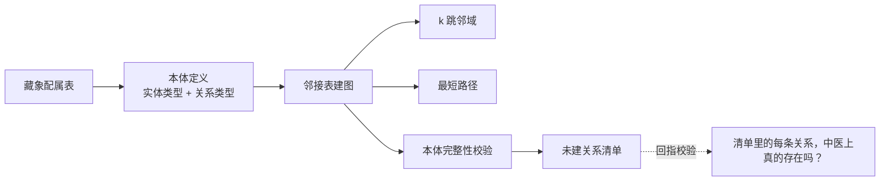

# 第 3 章 · 藏象学说 → 知识图谱：脏腑关系的图表示

> **MOTTO:** 「藏象何如？」——《素问·六节藏象论》
>
> **PROBLEM:** 你能背出「肝开窍于目、在志为怒、在体为筋」，但这些知识是散的。当病人说「我最近特别容易发怒，还老是流泪」，你没法系统地回答「这几点在藏象体系里怎么串起来」。
>
> **双根因定位:** 环境逼迫(“写病历只会罗列症状，串不成一个整体判断”) + 知识积累(藏象配属 × 图结构 = 能把「象」变成可遍历、可校验的关系网络)

## 课程信息

| 项目 | 内容 |
|------|------|
| 学科 | 中医基础理论 |
| 院系 | 中医系 |
| 章序号 | 03 / 10 |
| 所属阶段 | 🌱 生·启蒙 |
| 产出类型 | 📋 Prompt 模板 / 🛠️ Skill 文件 |
| 预估时长 | 4 小时 |

## 课程结构

```text
MOTTO  →  PROBLEM  →  CONCEPT  →  BUILD IT  →  USE IT  →  SHIP IT
一句话      痛点      原理+图解    从零实现     框架调用    产出工具
```

## 学习目标

- 说清「藏」与「象」的区别，以及为什么「象」本质上是关系而不是属性
- 先定义本体（实体类型 + 关系类型），再灌数据；说清反过来做会付出什么代价
- 从零实现邻接表、k 跳邻域、最短路径，并处理**边方向**
- 写出三项本体完整性校验，并把「哪些关系还没建」变成可枚举清单
- 解释为什么藏象与五行必须放在同一张图里 —— 拆成两张表会丢掉哪条路径

<div data-figure="zangxiang-graph"></div>

## 核心概念

### 中医：藏与象

《素问·五藏别论》：「所谓五藏者，藏精气而不泻也。」——「藏」指藏于内的脏腑功能。
「象」指这些功能表现于外的征象。

关键在于**藏象的核心是「联系」，不是「属性清单」**：

```text
肝：合胆 · 开窍于目 · 在志为怒 · 在体为筋 · 其华在爪 · 在液为泪 · 属木
```

每一条都是**一条边**，不是一个字段。肝之所以是「肝」，一半由它连着什么决定。
用表格存这些关系，你只能逐行查；用图存，你可以问「从『目』走两步能到哪」。

### AI / 工程：知识图谱

知识图谱的最小单元是三元组 `(头实体, 关系, 尾实体)`。落到实现上就是**邻接表**：

```javascript
g.out.get('肝')  // → [{ type:'开窍于', to:'目' }, { type:'在志为', to:'怒' }, ...]
g.in.get('目')   // → [{ type:'开窍于', from:'肝' }]
```

图上的三件事必须自己写一遍：

| 操作 | 用途 | 复杂度 |
|------|------|-------|
| k 跳邻域 | 「这个症状还能牵出什么」 | O(V+E) |
| 最短路径 | 「这两者怎么关联上的」 | O(V+E) |
| 本体校验 | 「哪些关系还没建」 | O(V+E) |

**方向性是要处理的真实问题。** 相克边只建「克」的方向（金克木）。当你反向查询
金与木的关系时，渲染时必须标注「逆向遍历」，否则会把「金克木」讲成「木克金」——
中医的方向讲反了，不是排版问题，是学术错误。

### 对应关系

| 中医概念 | AI / 工程概念 | 桥梁（为什么可以这样翻译） | 级别 |
|---------|--------------|--------------------------|------|
| 藏象配属（开窍于/在志为/在体为） | 三元组 / 有向边 | 每条配属天然是一个 `(脏, 关系, 象)` 三元组 | **A** |
| 相表里 | **对称**关系 | 脏与腑互为表里，两侧都要有边；只写一侧会让「从腑查脏」静默失败 | **A** |
| 五行生克 | 五行节点之间的有向边 | 相生/相克是五行节点上的边，而不是脏的属性 | **A** |
| 藏象 + 五行同图 | 本体整合 | 不整合就查不出「肝 → 悲」这条路；见下文实测 | **B** |
| 「象」 | 节点出边的集合 | 「象」就是「这个脏连出去的所有边」 | **B** |
| 藏象 = 器官图谱 | —— | ❌ **D 级误用**。藏象之「肝」是功能系统，与解剖肝脏非一对一，直接映射会造成系统性错误 | **D** |



## BUILD IT：从零实现

先定本体，再灌数据：

```javascript
const NODE_TYPES = ['脏', '腑', '官窍', '情志', '形体', '华', '液', '五行'];
const EDGE_TYPES = ['相表里', '开窍于', '在志为', '在体为', '其华在', '化为', '属五行', '相生', '相克'];
```

相表里是对称关系，两侧都要建边：

```javascript
addEdge(g, z.name, '相表里', z.fu);
addEdge(g, z.fu,   '相表里', z.name);   // ← 少这一行，从腑查脏会静默失败
```

最短路径要携带**真实边方向**：

```javascript
// 沿出边走：真实方向 n → e.to
{ next: e.to,   src: n,      dst: e.to, forward: true  }
// 沿入边走（逆向）：真实方向 e.from → n
{ next: e.from, src: e.from, dst: n,    forward: false }
```

跑起来：

```bash
node code/main.js
```

## 实测结果

```text
节点 40 个 | 边 50 条
实体类型: 脏 / 腑 / 官窍 / 情志 / 形体 / 华 / 液 / 五行
关系类型: 相表里 / 开窍于 / 在志为 / 在体为 / 其华在 / 化为 / 属五行 / 相生 / 相克

【一】五藏的配属（one-hop 出边）
  肝(木) 合胆 · 开窍于目 · 在志为怒 · 在体为筋 · 其华在爪
  心(火) 合小肠 · 开窍于舌 · 在志为喜 · 在体为脉 · 其华在面
  脾(土) 合胃 · 开窍于口 · 在志为思 · 在体为肉 · 其华在唇
  肺(金) 合大肠 · 开窍于鼻 · 在志为悲 · 在体为皮毛 · 其华在毛
  肾(水) 合膀胱 · 开窍于耳 · 在志为恐 · 在体为骨 · 其华在发

【二】k 跳邻域：从「目」出发
  1 跳 (1 个节点):
    距离 1: 肝
  2 跳 (7 个节点):
    距离 1: 肝
    距离 2: 胆 怒 筋 爪 泪 木

【三】最短路径查询（←type- 表示该边是逆向遍历，真实方向相反）
  目 → 泪 (2 跳, 含 1 条逆向): 目 ←开窍于- 肝 -化为→ 泪
  肝 → 悲 (4 跳, 含 2 条逆向): 肝 -属五行→ 木 ←相克- 金 ←属五行- 肺 -在志为→ 悲
  耳 → 小肠 (5 跳, 含 2 条逆向): 耳 ←开窍于- 肾 -属五行→ 水 -相克→ 火 ←属五行- 心 -相表里→ 小肠
  怒 → 骨 (5 跳, 含 3 条逆向): 怒 ←在志为- 肝 -属五行→ 木 ←相生- 水 ←属五行- 肾 -在体为→ 骨

【四】本体完整性校验
  六类配属齐备: 通过 ✅
  相表里对称: 通过 ✅
  五行分配唯一且覆盖: 通过 ✅
```

### 三个被实测暴露出来的问题

**问题一：相表里只写了一侧。**
第一版只建了 `脏 → 腑`，校验器立刻报出 5 项错误：

```text
胆 未回连 肝（相表里必须对称）
小肠 未回连 心（相表里必须对称）
...
```

这不是实现 bug，是**本体设计 bug** —— 在关系定义阶段就没说清「相表里是对称的」。
校验器的价值就在这里：它把本体设计的疏漏变成可枚举的清单。

**问题二：五行没进图，`肝 → 悲` 查不通。**
第一版只把五行当成脏的一个属性字段（`wuxing: '木'`），没有把五行建成节点。结果
`肝 → 悲` 报「不可达」。补上五行节点与相生/相克边之后，路径通了：

```text
肝 → 悲 (4 跳): 肝 -属五行→ 木 ←相克- 金 ←属五行- 肺 -在志为→ 悲
```

**这就是「藏象与五行必须放在同一张图里」的具体含义。** 拆成两张表，这条路就不存在了。
顺带说明：这条路靠的是**金克木**，遍历时是逆向走的，所以标记为 `←相克-`。

**问题三：边方向会被渲染反。**
第一版的输出是「木 → 金（相克）」，把「金克木」讲成了「木克金」。原因是路径渲染没有
区分真实方向与遍历方向。修正后输出 `木 ←相克- 金`。
中医里方向讲反不是排版问题 —— 相生方向反了，整个传变推演就错了。

### 观察：藏象配属的图直径很小

从「目」出发，2 跳就能覆盖 7 个节点（肝、胆、怒、筋、爪、泪、木）。这不是偶然 ——
藏象体系是一个**高度联通的小世界**。「怒」到「骨」只要 5 跳。这解释了为什么中医的
整体观不是修辞：在这张图上，任意两个节点之间确实只需要很少几步。

（注意：这是**拓扑距离**，不是因果距离。图上 5 跳不代表临床上「发怒会导致骨病」——
把拓扑距离误读为因果距离，是知识图谱最常见的滥用。）

### 本节翻译的代价与边界

**丢掉了什么**

| 丢失项 | 为什么是结构性的 |
|--------|----------------|
| 关系的**强度** | 图上只有「有边 / 无边」两种状态。而藏象配属的实际关联程度差异很大（「开窍于目」与「其华在爪」显然不同），图模型默认它们等权 |
| 关系的**条件性** | 「肝开窍于目」在正常生理下成立；病理状态下可能出现「肝火上炎见目赤」这类方向性更强的表现。基础图不区分生理与病理边 |
| **时间** | 藏象是一个功能系统，功能是有时序的（如「女子以肝为先天」随生命周期变化）。静态图没有时间轴 |
| 「藏」与「象」的**层次** | 本图把所有节点平铺。而「藏」是内藏的脏腑功能，「象」是外显的征象，两者在证据强度上并不对等 —— 图模型没有表达这一层 |

**不适用范围**

- 本图是**教学图谱**，只覆盖五藏的基础配属关系，不是完整的藏象本体。
- 图上的路径是**拓扑关联**，**不构成因果结论**，也**不构成任何诊疗建议**。
- 本课未收录六腑自身的功能关系（如「传化物」次序），因此涉及六腑的路径查询结果不完整。

**一处必须排除的误用（D 级）**

> 「藏象 = 器官知识图谱」—— 藏象之「肝」是功能系统，与解剖肝脏**不是一对一**关系。
> 直接按解剖器官建模会造成系统性错误：例如把「肝郁」理解为肝脏的病理改变。
> 这是本项目在 [bridge-map.md](../../../../../../glossary/bridge-map.md) 中列为 D 级的典型误用。

## USE IT：框架调用

用成熟图库（NetworkX / Neo4j / RDF 三元组库）做同样的事，接口不同但三件事不变：
邻域、路径、校验。真正的差别在**规模**：本课 40 节点 50 条边，手写足够；
真实的医案知识图谱是十万节点量级，那时才需要图数据库。

**不要在 40 个节点上引入 Neo4j。** 这是本章最实用的工程建议。

## SHIP IT：产出物

- [📋 Prompt 模板](../outputs/prompt-zang-xiang-tupu.md) —— 让大模型把症状串成藏象关系链，**每一步都必须标出关系类型**，并在跨五行时显式标注方向
- [🛠️ Skill 文件](../outputs/skill-zang-xiang-tupu.md) —— 藏象关系抽取与本体校验的固定流程

## 验证

```bash
node code/main.js
# Expected: 见上方「实测结果」代码块，退出码 0
```

```bash
node --test code/main.test.js
# Expected: 全部通过
```

> **边界声明**：本章示例数据为教学样例，**非临床数据集**；本章给出的任何模型输出均不构成诊疗建议，也不能替代执业医师的判断。

## 练习

见 [exercises.md](../exercises.md)。

## 进阶思考

1. 六腑除了相表里，还有「传化物」的次序（胃→小肠→大肠→膀胱）。加进图后，从「胃」到「膀胱」的路径会变短多少？
2. 如果要表达「肝气犯脾」（木克土），需要在图上加什么类型的边？它与已有的 `相克` 边是什么关系？
3. 藏象图的拓扑直径很小。这对「症状 → 证候」的自动推理是好事还是坏事？为什么？
