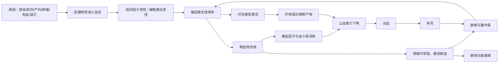

# 第 14 章 · 弥散性血管内凝血：凝血在前、纤溶在后

> **MOTTO:** 「弥散性血管内凝血是以微血管内微血栓形成、凝血因子与血小板消耗以及继发性纤溶亢进为主要特征的病理过程类别」——教材·第14章·14.1.1（《病理学·第14章·14.1.1》）
>
> **PROBLEM:** 「DIC 就是凝血功能坏掉了」——这句话把一件**有先后**的事说成了一件**同时**的事。真实的顺序是：先广泛形成微血栓（凝血被过度激活），把凝血因子与血小板消耗掉，然后纤溶被继发激活。于是同一个病程里，**血栓与出血并存**——这不是矛盾，而是时序的必然。答不出「现在凝血在前还是在后」，「DIC」就只是一个缩写。
>
> **双根因定位:** 环境逼迫（带教问「这个人一边长血栓一边出血，到底是凝还是溶」，学生只能答「都乱了吧」；换问「纤溶是原发还是继发」，就彻底断线）+ 知识积累（本章 12 个单元、20,757 字里，凝血命中 187 次、纤溶 105 次，且**12 个单元全部同时出现**这两词；微血栓 47 次却只分布在 10 个单元，「类别」331 次遍布全章——教材写的是同一件事的两个时相，不是两套知识）

**教材出处:** 教材·第14章（14.1 病因和发病机制、14.2 影响弥散性血管内凝血发生发展的因素、14.3 弥散性血管内凝血的分期和分型、14.4 功能代谢变化与表述要求，共 4 节 12 单元）。课程第 14 章与教材第 14 章一一对应。本章所有计数由 `code/main.js` 读 `standards/bingli/units.json` 现算。

## 课程信息

| 项目 | 内容 |
|---|---|
| 学科 | 病理学 |
| 院系 | 基础医学院 `09-jichu` |
| 章序号 | 14 / 21 |
| 教材章 | 第14章 弥散性血管内凝血（20,757 字 · 4 节 · 12 单元） |
| 全章规模 | 21 章 / 84 节 / 252 单元 / 428,867 字（教材口径） |
| 分析口径 | 三视角（病因 / 机制 / 形态）× 四层级（细胞 / 组织 / 器官 / 系统） |
| 产出类型 | Prompt 模板 / Skill 文件（见 outputs/） |
| 本书铁律 | 不写数值与单位与正常值——凡需数值，另立数据层 |

## 课程结构

```text
MOTTO  →  PROBLEM  →  CONCEPT  →  BUILD IT  →  USE IT  →  SHIP IT
一句话      痛点      时序+因果图   从零现算      读成结论     产出工具
```

## 一、定义里的三个动作

> 「弥散性血管内凝血是以微血管内微血栓形成、凝血因子与血小板消耗以及继发性纤溶亢进为主要特征的病理过程类别」——教材·第14章·14.1.1

拆成三个动作，每个动作对应一个可追问的位置：

| 动作 | 发生在哪里 | 追问什么 |
|---|---|---|
| 微血管内微血栓形成 | 微循环 | 促凝物质从哪来、走哪条途径进来 |
| 凝血因子与血小板消耗 | 血液本身 | 消耗到什么程度，「止血能力」为什么反而下降 |
| 继发性纤溶亢进 | 血液与血管壁 | 纤溶是**继发**的——它被谁激活、为什么滞后 |

三个动作有严格的先后：先有微血栓，才有消耗；先有凝血激活，才有纤溶继发。教材用「继发性」三个字把这条时序钉在定义里。读这一章的第一个动作，就是**把「DIC」还原成这条时序**，而不是记住三个并列的名词。

教材还给了一句位置说明：它在基本病理过程中位于凝血、抗凝与纤溶等功能失衡的交汇处，既常出现于其它疾病的病程之中，也可以作为一种相对独立的病理生理状态被认识。这句话解释了为什么本章的例子总带着别的病——它是「病中之病」。

## 二、病因：六类来源，一个汇合点

教材在 14.1.1 把病因按来源归纳，并强调它们汇合到共同的中间环节：

| 病因类别 | 促凝物质从哪来 | 教材强调的机制点 |
|---|---|---|
| 感染相关 | 病原及其代谢产物损伤内皮，内皮与单核吞噬细胞释放促凝物质 | 感染与凝血被「炎症」接上 |
| 组织损伤相关 | 受损组织释放组织因子 | 局部与全身同时被牵动 |
| 产科相关 | 胎盘与子宫相关组织损伤 + 妊娠期凝血抗凝的生理性改变 | 凝血激活与纤溶抑制并存，最复杂 |
| 肿瘤相关 | 肿瘤组织释放促凝物质、肿瘤细胞与血细胞相互作用 | 促凝物质来源的多样性 |
| 免疫与变态反应相关 | 抗原抗体复合物作用于血细胞与内皮 | 补体、激肽、凝血多系统同时被激活 |
| 其它疾病相关 | 血液、肝胆、心血管疾病影响凝血因子生成或血流状态 | 通过「生成 / 合成 / 流动」三条路偏移平衡 |

共同中间环节有四条：促凝物质进入血流、微血管内皮损伤、血小板与白细胞活化、抗凝与纤溶调节相对不足。**六类来源，四条汇合**——这就是本章的第一张因果骨架。

教材在 14.1.1 还加了一条时间维度的区分：有些因素在早期起**启动**作用，有些则在过程中通过加重微循环障碍起**促进**作用。这条区分很实用：分析一个病例时，先问「谁点的火」，再问「谁在浇油」，两者的处置含义完全不同（但本章不给处置）。

## 三、发病机制：两条启动途径，三处刹车失灵

> 「以组织因子为主的途径是较为重要的一类启动方式」——教材·第14章·14.1.2

教材把启动写成两条途径：

- **组织因子途径**：组织损伤或内皮与单核细胞受损 → 组织因子进入血流 → 与相应凝血因子结合 → 促进凝血酶生成。特点是启动直接，范围可扩散到全身。
- **接触激活途径**：血液与带负电荷表面接触（暴露的内皮下成分、异物表面、某些病原相关成分）→ 激活。特点是它与补体、激肽、纤溶三系统交叉，功能变化范围广。

两条途径之外，还有两个「放大器」：血小板（被激活后变形、聚集、释放，为凝血因子组装提供表面）与白细胞（释放组织因子与细胞因子，把炎症与凝血接上）。教材对血小板有一句很准的描述——它兼具「被激活」与「参与形成微血栓」的双重角色，且与凝血酶相互加强。

真正的转折在「刹车」这一侧。教材列了三处：

1. **抗凝系统受抑**：抗凝血酶系统、蛋白 C 系统、组织因子途径抑制物，分别从不同环节限制凝血酶。三者任一失灵，凝血酶生成就失去限制。
2. **纤溶时序紊乱**：早期纤溶酶原激活物释放相对不足（微血栓得以保留），后期内皮与组织释放增多（纤溶被继发激活）。
3. **清除功能不足**：单核吞噬细胞系统与肝脏清除活化凝血因子与纤维蛋白的能力下降（14.2 展开）。

值得单独记的一句是教材对纤溶的定性：

> 「纤溶系统的变化在发病过程中表现为先抑制后亢进的类别次序」——教材·第14章·14.1.2

「先抑制后亢进」五个字，把「为什么早期血栓多、后期出血多」解释完了。这是本章最省力的一个记忆锚点，也是考场上最容易写反的一处。

## 四、凝血与纤溶：不是并列，是时序

这是全章的核心关系，教材在 14.1.3 用整节讲它。

> 「凝血与纤溶的活性在时间上相互衔接，在强度上相互制约，共同维持血液流动与血管结构的稳定」——教材·第14章·14.1.3

生理状态下两者是**动态平衡**：凝血生成纤维蛋白封闭破损，纤溶清除多余纤维蛋白保持通畅。DIC 时这个平衡不是「两边都变强」，而是**先后失衡**：凝血在前、纤溶滞后，于是微血栓先生成、后被（部分）清除——而清除得太晚、太猛，就变成出血。

教材把这条关系拆成四层：

| 层次 | 内容 | 后果 |
|---|---|---|
| 时序 | 凝血在前，纤溶在后 | 微血栓有一段「被保留」的窗口 |
| 强度 | 纤溶酶既降解纤维蛋白，也降解纤维蛋白原与其它血浆蛋白 | 纤溶过度 → 止血结构被破坏 |
| 产物 | 纤维蛋白降解产物抑制单体聚合、干扰血小板聚集、限制凝血酶 | 出血进一步加重（产物本身抗凝） |
| 并存 | 血栓与出血同时出现 | 同一病程的两副面孔 |

最后一行是本章的现象学核心：**同一病人身上，微血栓让器官缺血，消耗与纤溶让止血失败**。教材说得很直白——「同一病理过程中血栓与出血并存的表现，正是凝血与纤溶关系被打破的直接反映」。

## 五、影响因素：三张条件表

14.2 三节讲「什么条件下更容易发生、更容易加重」。教材把它们分成三类，可以读成三张条件表：

| 影响因素 | 影响的是哪一环 | 关键关系 |
|---|---|---|
| 单核吞噬细胞系统功能受损 | 清除 | 促凝物质与活化凝血因子滞留时间延长 |
| 肝功能严重障碍 | 合成 + 清除 + 调节 | 凝血与抗凝**同时**下降，净效应取决于丧失的类别 |
| 血液高凝状态与微循环障碍 | 血液本身 + 流动条件 | 高凝使血栓易形成，淤滞使血栓易保留 |

第二条特别容易讲错。很多人以为「肝功能差 → 凝血因子少 → 不容易长血栓」，这只见了一半：肝脏同时合成抗凝蛋白（抗凝血酶、蛋白 C）与纤溶相关成分。教材的原话是「合成能力下降，凝血与抗凝的调节同时受损，其净效应取决于丧失的类别与程度，而不是单一方向的变化」。**这是一个「双向失衡」而不是「单向减弱」**——这句话值得单独背下来。

第三条则给出本章与第 13 章的接缝：微循环障碍加重 → 组织灌注受影响 → 缺氧与酸中毒 → 进一步激活凝血、抑制抗凝与纤溶 —— 休克与 DIC 互为因果。教材明确写了这条双向关系，本章的因果图上因此有一条跨章的边。

## 六、分期与分型：两张正交的网

14.3 三节最容易背成两串名词。其实它们是**两个不同的坐标轴**：

- **分期**（按功能状态的时间位置）：以高凝表现为主 → 以凝血因子与血小板消耗表现为主 → 以继发纤溶亢进表现为主。
- **分型**（按观察角度）：临床经过的缓急、机体代偿状态、受累范围、表现侧重。

> 「阶段类别之间的关系是连续与重叠，而不是彼此截然区分」——教材·第14章·14.3.1

这句话是分期的使用说明：分期不是时刻表，也不是分级；相邻阶段在功能变化上相互重叠，同一病例在不同时点可以同时见到相邻阶段的表现。教材反复强调「不写时限、不写级别名称」——因为一旦写成时限，分期就变成了判定标准。

分型的四个角度可以并成一张对照表：

| 分型角度 | 切出的类别 | 常见并存的病因类别 |
|---|---|---|
| 经过缓急 | 急剧 / 迁延 | 组织损伤、产科、严重感染 / 肿瘤、慢性病 |
| 代偿状态 | 代偿较充分 / 相对不足 | 与基础状态相关 |
| 受累范围 | 局部微血管 / 全身微血管 | 与促凝物质进入途径相关 |
| 表现侧重 | 出血为主 / 血栓为主 / 器官功能改变为主 | 与凝血纤溶失衡的时序相关 |

分期与分型的关系是「位置 × 角度」：分期说「现在在时间轴的哪一段」，分型说「从哪个角度看这件事」。两者结合能更完整地描述，但仍不能替代对具体病例的认识——教材在 14.3.1 与 14.3.2 各写了一遍这句话。

## 七、功能代谢：四个落点

14.4 三节把全章收到表现层，四个落点：

1. **出血**：消耗（凝血因子与血小板减少）+ 纤溶亢进（纤维蛋白被降解）+ 降解产物抗凝 + 微血管壁损伤，四条机制叠加。
2. **休克**：微血栓使回心血量减少、外周阻力改变、组织灌注受影响；休克时的缺氧与酸中毒又反过来激活凝血——双向。
3. **器官功能衰竭**：肾、肺、肝与胃肠道、中枢神经系统，各自的微血管分布决定了受累方式。
4. **微血管病性溶血**：红细胞在纤维蛋白网架间被机械性破坏。

> 「微血栓在微血管内广泛形成时，参与凝血的成分被持续消耗，血液在需要止血的场合反而难以形成足够的血凝块」——教材·第14章·14.4.1

这句话是「消耗」这一侧最凝练的表达，也是本章最容易出的判断题：**凝血被过度激活的结果，是止不住血**。

微血管病性溶血常被当成边角料，其实它是本章唯一一个「形态学线索」：

> 「它指红细胞在微血管内受到机械性因素作用而发生破坏的过程类别」——教材·第14章·14.4.3

教材特意区分了机制类别：机械性损伤，而非免疫性溶血或遗传性红细胞缺陷。这个区分在形态观察上有用——红细胞碎片是「微血管里有网」的间接证据，而不是「抗体攻击红细胞」的证据。

## 八、表述：六要素与边界

14.4.3 与 14.3 各节都反复写「只写类别与关系」。本章的边界清单比第 13 章更长，因为它多了一类对象：检验数值。教材的写法是把「不写什么」列成一张清单——凝血与纤溶各项指标的数值与单位、参考值与检验数值、分期与分型的级别名称、分级与分度的判定。然后是「不做什么」——不作诊断、不作病情与预后判定、不作正常与异常判定、不作疗效与优越性断言。

工程上这条边界的含义很具体：**本章可以产出「结构」，不能产出「阈值」**。结构包括：病因类别表、两条启动途径、三处刹车、凝血纤溶时序、分期与分型两个坐标轴、四个表现落点。阈值必须外挂，另立来源与校验。

## CONCEPT：DIC 作为一条时序因果图



图上有三条回到上游的边（I→D、K→G、N→I），它们分别对应「酸中毒再激活凝血」「降解产物抗凝」「休克加重缺氧」——这三条就是本章的自我加强结构。**注意 J 的位置**：纤溶不在 C 的旁边，而在 D 的下游。位置画错，整章就讲反了。

## BUILD IT：从零实现

`code/main.js` 做四件事，全部现算：

1. **规模与分布**：12 单元 / 4 节 / 20,757 字，每节字数一次列出。
2. **三视角 × 四层级**：形态 193、机制 172、病因 56；器官 211、系统 118、细胞 67、组织 33。两个「第一名」说明本章的落点在形态与器官。
3. **两条骨架的词频**：凝血 187、纤溶 105、微血栓 47、组织因子 6、类别 331、六要素 4。
4. **共现检验**：`cooccurrence()` 找出「凝血与纤溶同时出现」的单元——结果是 12 / 12。

第 4 项是本章专属的判据，也是本章最想证明的一件事：

```js
/** 凝血与纤溶「同单元共现」的单元：这条时序关系写在几个单元里 */
function cooccurrence(list) {
  return list
    .filter((u) => /凝血/.test(u.body || '') && /纤溶/.test(u.body || ''))
    .map((u) => u.sub);
}
```

12 / 12 的含义不是「教材啰嗦」，而是：**凝血与纤溶在本章不是两个章节，而是同一句话的两半**。如果某天教材改版，把纤溶单独挪到别处，这个数会掉下来，程序会立刻显示——这就是「现算」相对于「照抄」的价值。

## USE IT：把现算结果读成结论

- **凝血 187 次 vs 纤溶 105 次**：笔墨比例接近二比一。教材把主要篇幅给了「凝血怎么被启动」，纤溶更多是作为「后果与时序」出现。复习时不要把两者平均分配。
- **微血栓 47 次、分布在 10 个单元**：它不是 14.1.2 的专属词。分期（14.3）、表现（14.4）都在用它，说明「微血栓」是贯穿全章的对象，不是机制一节的例子。
- **病因只有 56 次（三视角中最低）**：本章不展开病因学推演，只做类别归纳。这与全书「病因作为主视角只有 4 个单元」的分布一致——病理学把病因写成分类，不写成分析。
- **六要素只落在 2 个单元（14.3.3、14.4.3）**：表述规范在本章是「收尾」，不是贯穿。读的时候要意识到这一点，别把 14.4.3 当成可有可无的附录。

## SHIP IT：产出物

- [Prompt 模板](../outputs/prompt-dic.md) —— 把「一边血栓一边出血」拆成时序四问
- [Skill 文件](../outputs/skill-dic.md) —— 时序判据 + 三处刹车 + 硬约束

## 十二个单元逐条

教材第 14 章有 12 个小节，正文按八个主题合并着讲。这一节把 12 个小节逐一摊开：每节一段，说清这一节在问什么、答案落在哪一层、与同章其它小节是什么关系。**没有并进主题的小节，在这里也必须有位置。**

#### 14.1.1 病因的类别

本节给定义与六类病因。定义有三个动作（微血栓、消耗、继发纤溶），病因有六类来源，汇合到四条中间环节（促凝物质入血、内皮损伤、血小板与白细胞活化、抗凝纤溶相对不足）。教材在此处加了一条时间维度的区分：启动作用与促进作用。学习动作：给每一类病因标出「促凝物质从哪来」，再标出它主要走哪条中间环节——同一类病因常同时走两条以上。

#### 14.1.2 发病机制

本节是本章最长的一节，讲两条启动途径（组织因子、接触激活）、两个放大器（血小板、白细胞）、三处刹车失灵（抗凝受抑、纤溶时序紊乱、清除不足），以及微循环障碍与酸中毒构成的自我加强环节。教材的收尾是一句整合：发病机制可理解为凝血过度激活、抗凝相对不足、纤溶时序紊乱与代谢产物堆积这几类变化的总和。这句话是把十个环节压成四个类别的关键，值得单独记。

#### 14.1.3 凝血与纤溶的关系

本节讲时序。生理状态下两者相互衔接、相互制约；DIC 时转为「先后失衡」，于是血栓与出血并存。教材把纤溶酶的双重作用（降解纤维蛋白、也降解纤维蛋白原）、降解产物的抗凝作用、激活物来源的差异逐条摊开。这一节是理解全章的钥匙：只要记住「凝血在前、纤溶在后」，14.3 的分期与 14.4 的表现都能推出来。

#### 14.2.1 单核吞噬细胞系统功能受损

本节讲清除。该系统包括血中单核细胞与肝、脾、骨髓、淋巴组织中的巨噬细胞，负责清除活化凝血因子、纤维蛋白（原）与内毒素、免疫复合物。功能受损的后果是促凝物质滞留、凝血酶生成失去限制。教材特别写了脾脏的作用（清除场所）与内毒素血症的相互促进，并把「清除」与「合成」「流动条件」并列成三个考察位置。

#### 14.2.2 肝功能严重障碍

本节讲肝脏的三重角色：合成（凝血因子 + 抗凝蛋白 + 纤溶成分）、清除（肝内巨噬细胞与肝细胞）、调节（纤溶的启动与终止）。核心判断是「净效应取决于丧失的类别与程度，而不是单一方向的变化」——肝功能差既可能促凝也可能抗凝，取决于哪一侧掉得更多。教材还写了门体循环与内毒素的牵连，以及肝内血流改变对微血栓形成条件的影响。

#### 14.2.3 血液高凝状态与微循环障碍

本节讲「血液本身」与「流动条件」两类影响因素。高凝状态分为生理性（妊娠）、代谢与流变学相关、免疫相关（抗磷脂抗体等）、遗传性四类；微循环障碍从血流、血管壁、血液三方面归纳。两者的关系是相互促进：高凝使血栓易形成，淤滞使血栓易保留。教材在此处写下与休克的双向关系，是本章与第 13 章的正式接口。

#### 14.3.1 分期的类别

本节讲三个阶段的类别：高凝表现为主、消耗表现为主、纤溶亢进表现为主。教材反复强调「只写类别，不写时限，不写级别名称」，并说明阶段之间连续重叠。它还给出分期与病因、与影响因素之间的两类关系：不同病因推进速度不同，影响因素存在时过渡可能更迅速。学习动作：把三个阶段写成「凝血 / 消耗 / 纤溶」三列，而不是「早 / 中 / 晚」三行。

#### 14.3.2 分型的类别

本节讲四个分型角度：经过缓急、代偿状态、受累范围、表现侧重。教材强调分型是「认识框架」，不是「对个体分等或排序」；分型与分期互补，与病因只存在大致对应。它还要求分型与分期分别登记，避免把两个坐标轴混成一个标签。学习动作：任取一个病例描述，分别给出它在分期轴与分型轴上的位置，并说明两个位置互不替代。

#### 14.3.3 临床类别的认识

本节是 14.3 的落点，讲「为什么同一过程表现差异大」。答案在时序：凝血与纤溶失衡的先后不同，表现重点就不同（出血为主 / 血栓为主 / 器官功能改变为主）。教材在此把六要素与边界要求一起写进来，并强调「认识的对象是类别与关系，判断的权限属于具备资质的人员」。这一节是「知识」与「权限」的分界线。

#### 14.4.1 出血与休克

本节讲两个相互联系的表现。出血的四条机制（消耗、纤溶亢进、降解产物抗凝、微血管壁损伤）与休克的机制（微血栓使回心血量减少、外周阻力改变）在这里并置，并给出双向关系：DIC 可以引起休克，休克也可以引起 DIC。教材的落点是「同一病理过程在不同环节上的表现」，这句话把「血栓与出血并存」从矛盾变成了必然。

#### 14.4.2 器官功能衰竭

本节按器官摊开：肾（微血管密集，滤过受影响）、肺（微血管丰富，气体交换受影响）、肝与胃肠道（功能与代谢叠加）、中枢神经系统（耐受特点）。教材把器官层面的机制归成三类：血液供应受限引起的缺氧性改变、微血栓与出血共同造成的结构损伤线索、器官调节功能紊乱。三类在不同器官中的组合方式不同，这就是「按器官分别描述」的理由。

#### 14.4.3 微血管病性溶血与表述边界要求

本节讲本章最特殊的一个表现，并把全章的边界收口。微血管病性溶血是红细胞在纤维蛋白网架间受机械作用而破坏，机制类别与免疫性溶血、遗传性红细胞缺陷不同。教材在这一节把六要素逐条解释了一遍（观察、描述、记录、分析、报告、复核），并把去标识化与脱敏的区别写清——两者是不同环节，不得混称。这一节篇幅不小，但它的性质是「规范」，不是「知识点」。

<!-- UNITNOTES:BEGIN 本节由 scripts/render_bingli_unit_notes.js 从 standards/bingli/unit-notes/ 生成，勿手改 -->

## 十二个小节：逐条落位

教材第 14 章 4 节 × 3 小节 = 12 个知识单元。这一节把它们逐一落位：每个单元一段，说清这一节在问什么、答案落在哪一层、与同章其它单元是什么关系。**没有被主题叙述点到的单元，在这里也必须有位置。**

#### 14.1.1 病因的类别

这一节问的是弥散性血管内凝血由哪些情形启动，答案落在概念与类别层。该过程是在多种病因作用下，凝血系统被激活、微血管内形成广泛微血栓，继而凝血因子与血小板大量消耗并伴纤溶亢进的过程类别。病因按来源可分感染性、创伤与手术、产科情形、恶性肿瘤、严重肝病与某些血液系统病变等类别。要点是病因只提供启动条件，是否发展取决于后面几节讨论的调节因素，因此病因相同而结局可以不同。界说之中还有一层须分辨：微血栓形成与凝血因子消耗并非两个独立事件，而是同一过程的前后两段，先形成而后消耗；故血栓与出血可以在同一情形中并存，看似矛盾而实为一贯。这一节为全章立下界说，与下一节的机制是前提与推演的关系。

#### 14.1.2 发病机制

这一节问的是凝血系统如何被启动并失去约束，答案落在机制层，是全章的枢纽。核心在凝血系统的激活以及凝血、抗凝与纤溶之间平衡的破坏，促凝物质来源不同，激活途径的类别也不同：以组织因子为主的途径是较重要的一条，另有内源性途径与血细胞来源的促凝作用。调节系统受影响的方式决定微血栓形成的部位与范围，也决定功能代谢变化出现的先后次序，因此同一病因可以走出不同的过程形态。机制的枢纽地位还体现在它决定了后面各节的次序：调节因素作用于启动之后的环节，分期描述启动之后的过程，后果则是过程走到末端的投影。这一节与前后两节连成一线：前节给启动条件，本节讲如何启动，后节讲启动之后凝血与纤溶如何互相牵连。

#### 14.1.3 凝血与纤溶的关系

这一节问的是凝血与纤溶这对相反的活动如何共处，答案落在关系层。生理状态下两者维持动态平衡：凝血生成纤维蛋白以封闭受损的血管，纤溶清除多余的纤维蛋白使管腔保持通畅，活性在时间上相互衔接、在强度上相互制约。该过程发生时平衡被打破：先有凝血的过度启动与微血栓形成，随后纤溶继发增强。要点是先凝后溶的次序，它解释了为什么同一过程既表现为血栓又表现为出血，两种表现并非互相否定，而是同一链条的两段。这一平衡观还有一处用处：判断某一表现属于凝血一侧还是纤溶一侧，须看它出现在过程的哪一段，而不只看它表现为血栓还是出血；同一表现放在不同段上，归属相反。这一节是前一节机制的延续，也是理解分期的钥匙。

#### 14.2.1 单核吞噬细胞系统功能受损

这一节问的是清除环节为何也算作影响因素，答案落在机制层。这一系统承担清除功能，其状态决定促凝物质、活化凝血因子与纤维蛋白在血液中滞留时间的长短。功能受损时清除能力下降，促凝因素在血中停留更久，微血栓更易形成与保留，过程的自行限制能力随之减弱。要点是把清除能力看作隐性的抗凝环节：它不出现在凝血级联的图示里，却直接决定过程能否自限，因此评估促发条件时不能只看促凝一侧。由此还可看出一处容易被低估的关联：清除能力受抑往往与肝、脾等器官的状态相连；故各调节因素并非彼此独立，而是借器官功能相互牵连，一处受损常牵动其余。这一节与前一节是正反两面，一讲如何启动，一讲为何不能及时收场。

#### 14.2.2 肝功能严重障碍

这一节问的是肝为何在这类情形中格外重要，答案落在机制层。肝在凝血与抗凝调节中处于枢纽位置：既合成凝血所需的蛋白，也合成限制凝血的抗凝蛋白，还参与清除活化的凝血因子。功能严重障碍时，促凝与抗凝两个方向的合成都受影响，且清除能力下降，结果是双向失衡而非单向倾斜，凝血与出血的倾向同时增强。要点是肝病情形下既易形成微血栓又易出血，原因正在这一个枢纽上，两个方向的风险同源。这一枢纽地位还解释了一处表面矛盾：同一情形下既出现微血栓又出现出血倾向，并非两个病因各自所致，而是同一次失衡的两个方向，故不能分而治之。这一节与上一节同属调节因素，区别在于前者影响清除，本节同时影响生成与清除。

#### 14.2.3 血液高凝状态与微循环障碍

这一节问的是血液与血流两方面各提供什么条件，答案落在机制层。高凝状态指血液凝固倾向相对增强的功能状态，它提供的是倾向；微循环障碍使血流条件有利于微血栓在微血管内形成与保留，包括血流缓慢、淤滞与酸中毒方向的内环境改变，它提供的是机会。两者相互促进，构成过程持续进展的血液学与流变学基础。要点是二者缺一时微血栓的量与分布都会不同：只有倾向而无流变条件，血栓难以在微血管内停留；只有流变条件而无倾向，激活也难以广泛展开。两者的关系还提示分析的次序：先辨血液一侧的倾向从何而来，再辨血流一侧的条件如何形成；两问各有来源，混在一处便说不清主次，也说不清为何同一病因的分布不同。这一节把前两节的调节因素补全。

#### 14.3.1 分期的类别

这一节问的是这一连续过程如何被划分为便于认识的阶段，答案落在过程类别层。分期按凝血、抗凝与纤溶的相对状态，以及微血栓形成与止血功能下降的相对关系来划分，通常分为高凝期、消耗性低凝期与继发性纤溶亢进期。分期的作用是把连续变化归纳为阶段类别，不给出固定的时间安排，也不以钟点标注进程。要点是三期的名称已经说明主线：先凝即高凝，再耗即低凝，后溶即纤溶，名称本身即是机制的缩写。分期还有一处限度：它描述的是相对状态而非绝对刻度；故同一期内凝血与纤溶可以并存，只是相对强弱不同，读分期时须保留这一层弹性，不必强求整齐。这一节与前一章的调节因素相接，说明那些因素作用之后过程会沿什么次序展开。

#### 14.3.2 分型的类别

这一节问的是同一过程为何在不同情形下形态不同，答案落在类别关系层。分型的依据包括临床经过的缓急，可分急性、亚急性与慢性等类别，还包括机体代偿状态、受累范围与表现侧重。分期与分型从不同角度描述同一过程，是互补而非替代的关系：分期讲走到哪一步，分型讲以什么方式展开，两者交叉才定位得准。判读时先分期定阶段，再分型定表现类别，两步不能合并，因为同一阶段可以有不同型，同一型也可以跨过数个阶段。两轴交叉的用处在于把同类情形区分开来：同一阶段而分型不同，说明代偿状态与受累范围不同，因而应对的着力点也不同；这正是分型与分期并列而不合并的理由。这一节与前一节是纵横两轴的关系。

#### 14.3.3 临床类别的认识

这一节问的是面对具体情形时应认识到什么程度，答案落在关系层，并明确分工。讨论从功能与代谢变化的类别与关系出发，理解该过程在不同情形下表现形式的差异，而不是对个体情况作出判断。表现形式的多样性来自三个方面：主导环节不同、代偿状态不同、受累范围不同，三者组合决定表现的重心落在血栓一侧还是出血一侧。要点是认识类别、不作判断这条分工：认识的对象是类别与关系，判断的权限属于具备资质的人员。这一分工还有一层现实的理由：表现形式的差异来自过程本身的条件组合，而个体情形的判断需要过程之外的信息，两者所需材料不同，故不能由前者推出后者。这一节把分期与分型收在使用分寸上，与前一节是知识与限度的分工。

#### 14.4.1 出血与休克

这一节问的是同一过程为何既形成血栓又引起出血，答案落在机制层与关系层。出血反映止血功能受损，休克反映循环功能受累，二者通过微循环障碍与凝血失衡彼此牵连。出血机制可按类别归纳三条：凝血因子与血小板被消耗使凝固能力下降；继发纤溶亢进使已形成的纤维蛋白被降解；微血管壁的损伤使完整性受损。三条并存才解释既凝又出血这个看似矛盾的现象，单取一条都不足以说明。三者之中，消耗与纤溶属过程之内，血管壁损伤则常与病因相连；故出血既可能是过程的结果，也可能是启动条件的一部分，分析时须分别归位，不可一概而论。这一节把前一节的分期判断转为后果讨论，也为下一节的器官受累作铺垫。

#### 14.4.2 器官功能衰竭

这一节问的是这一过程如何在器官层面留下损害，答案落在关系层。微血栓的分布决定血液供应受影响的范围，凝血因子与血小板的消耗及纤溶亢进又使器官内出血倾向增加，两类改变叠加造成功能与代谢障碍的类别差异。肾较易受累，微血栓使局部灌注下降；肺、肝、脑与肾上腺亦有各自的方式，或表现为交换障碍，或表现为代谢与调节功能的改变。要点是同一过程在器官层面既可表现为缺血性损害，也可表现为出血性损害，二者可以并存于同一器官。这一并存还有一处含义：同一器官的缺血与出血可以相互加重，缺血削弱屏障，出血又减少灌注，故器官层面的损害往往比单一机制所推想的更重。这一节与前一节是两种后果的分述，与下一节则是把损害推到血液本身。

#### 14.4.3 微血管病性溶血与表述边界要求

这一节问的是红细胞为何会在这一过程中被破坏，并把全章的口径收在一处，答案落在机制层与规范层。微血管病性溶血指红细胞在微血管内受机械性因素作用而被破坏的过程类别，其发生与微血管内纤维蛋白沉积及内皮损伤直接相关：纤维蛋白网架使红细胞通过时受到牵拉而破碎，溶血因而是微血栓形成的伴随结果而非独立事件。边界要求与前几节一致：只写类别与关系，不写数值与单位与分级、分期、分度，不作诊断、病情与预后判定。溶血这一环还说明一处关系：它与微血栓同源，故其出现提示微血管内已有纤维蛋白沉积，这一提示属于机制层面的推断，而非对个体情形的判断。机制与边界在本节合并收口，使全章自界说至后果首尾相合。

<!-- UNITNOTES:END -->

## 代价与边界

- **引文是教材正文，不是经典。** 引用格式为「教材·第N章·N.M.K」。教材谈中医学处是学科对话，不是古籍引文。
- **分期丢掉了时限，分型丢掉了级别。** 教材明确不写时限、不写级别名称；代价是读完能判断「在哪个时相」，不能判断「到第几天」。需要时程与分级的场景必须另立数据层。
- **类别丢掉了阈值。** 全章 12 个单元的数值型命中为 0（`code/main.js` 复算）。代价是「分期与分型」不能直接当评分表；收益是它不会因教材改版而静默过期。
- **词频只描述写法，不描述难度。** 凝血 187 次、纤溶 105 次只说明笔墨分布，不说明纤溶不重要——恰恰相反，纤溶滞后是本章的关键时序。
- **因果图是抽象，参数是缺的。** 图能画出三条自加强边，但给不出速率与阈值——**教材不给值**，要用这张图做仿真或预警，参数必须另行标定并注明「不从本书推」。
- **边界声明**：本章只解释教材的类别与关系，**不写数值与单位与正常值，不作正常与异常判定，不构成诊断或用药依据**；任何个体的状态判断须由具备资质的人员依现行规范作出。

## 运行与验证

```bash
# 1) 现算本章规模、三视角与四层级、两条骨架的词频与共现
node code/main.js

# 2) 单测：10 项断言（12/4/20757 · 421 · 429 · 数值 0 · 凝血 187 / 纤溶 105 · 共现 12/12）
node --test code/main.test.js

# 3) 本章自检（六文件 + 引文逐字 + quiz + 单测 + 教学边界 + 数值零容忍）
cd /e/tcmai-engineering-from-scatch && node scripts/check_bingli_chapter.js 14-dic
```

`node code/main.js` 的真实输出（节选）：

```text
教材规模: 第14章 20757 字 · 4 节 · 12 单元 · 平均每单元 1730 字
口径核验: 本章 12 单元的数值型命中 0 处（底本 valueLike = 0，复算而不是照抄声明）
  形态  193 次
  机制  172 次
  病因   56 次
  器官  211 次
  系统  118 次
  细胞   67 次
  组织   33 次
  凝血　　　　  187 次 · 12 个单元
  纤溶　　　　  105 次 · 12 个单元
  微血栓　　　   47 次 · 10 个单元
凝血与纤溶同单元共现：12 / 12
```

（原文每行还带一个占比，此处按「本书不给百分比数值」的口径省去；占比可由 `node code/main.js` 现看。）

自检通过时打印「✓ 通过」，并给出 `docs 非空白 / 教材引文 / 教材第14章 20757 字 / 数值 0 处` 四项计数。若某条引文与教材正文差一个字，自检会直接报「引文找不到」，不会静默放过。

## 免责

本章为病理学教学材料。文中所有概念、分类与关系，取自教材《病理学》第 14 章的表述与 `standards/bingli` 的机器可读层；数字为程序现算，规则已在文中写明。

本章不提供任何诊断、治疗或用药建议，不给出正常值与参考范围，也不对任何个体的状态作出正常或异常的判断。文中出现的「分期」「分型」「时序」均为机制层面的说明，不能替代临床评估。若出现身体不适或急症，请立即就医。

## 图注（可独立阅读）

本课图版未随教材提供，**图注先行**：下列图注各自成文，不看图也能读；正文提图只写图号（如「图 14-1 图注」）。

**图 14-1　14.1 病因和发病机制（形态与机制示意图）**

> 图注：本图分三段呈现14.1 病因和发病机制——① 14.1.1 病因的类别；② 14.1.2 发病机制；③ 14.1.3 凝血与纤溶的关系。
> ① 部位与切面：限于教材第 14 章 14.1 节所界定的范围，不扩展到相邻区域。
> ② 方位与参照：三段按教材叙述顺序排列；形态类以14.1.1 病因的类别为一端、14.1.3 凝血与纤溶的关系为另一端，14.1.2 发病机制居中；过程类则按先后相承。
> ③ 可见与不可见：可见者为三段的顺序与相互关系；不可见者为细胞水平的超微结构、分子细节与一切量值参数（本课不给）。
> ④ 判据：只读本图注、不看图，也能复述这三段并说出它们的相互关系，即算读懂本节。
> 出处：教材·第 14 章·14.1.1（图注据教材文字写就；教材未附原图，图版待补）。
> 正文回指：正文提图只写图号（「图 14-1 图注」），不写「见「图 14-4 图注」」「见「图 14-4 图注」」。

**图 14-2　14.2 影响弥散性血管内凝血发生发展的因素（形态与机制示意图）**

> 图注：本图分三段呈现14.2 影响弥散性血管内凝血发生发展的因素——① 14.2.1 单核吞噬细胞系统功能受损；② 14.2.2 肝功能严重障碍；③ 14.2.3 血液高凝状态与微循环障碍。
> ① 部位与切面：限于教材第 14 章 14.2 节所界定的范围，不扩展到相邻区域。
> ② 方位与参照：三段按教材叙述顺序排列；形态类以14.2.1 单核吞噬细胞系统功能受损为一端、14.2.3 血液高凝状态与微循环障碍为另一端，14.2.2 肝功能严重障碍居中；过程类则按先后相承。
> ③ 可见与不可见：可见者为三段的顺序与相互关系；不可见者为细胞水平的超微结构、分子细节与一切量值参数（本课不给）。
> ④ 判据：只读本图注、不看图，也能复述这三段并说出它们的相互关系，即算读懂本节。
> 出处：教材·第 14 章·14.2.1（图注据教材文字写就；教材未附原图，图版待补）。
> 正文回指：正文提图只写图号（「图 14-2 图注」），不写「见「图 14-4 图注」」「见「图 14-4 图注」」。

**图 14-3　14.3 弥散性血管内凝血的分期和分型（形态与机制示意图）**

> 图注：本图分三段呈现14.3 弥散性血管内凝血的分期和分型——① 14.3.1 分期的类别；② 14.3.2 分型的类别；③ 14.3.3 临床类别的认识。
> ① 部位与切面：限于教材第 14 章 14.3 节所界定的范围，不扩展到相邻区域。
> ② 方位与参照：三段按教材叙述顺序排列；形态类以14.3.1 分期的类别为一端、14.3.3 临床类别的认识为另一端，14.3.2 分型的类别居中；过程类则按先后相承。
> ③ 可见与不可见：可见者为三段的顺序与相互关系；不可见者为细胞水平的超微结构、分子细节与一切量值参数（本课不给）。
> ④ 判据：只读本图注、不看图，也能复述这三段并说出它们的相互关系，即算读懂本节。
> 出处：教材·第 14 章·14.3.1（图注据教材文字写就；教材未附原图，图版待补）。
> 正文回指：正文提图只写图号（「图 14-3 图注」），不写「见「图 14-4 图注」」「见「图 14-4 图注」」。

**图 14-4　14.4 功能代谢变化与表述要求（形态与机制示意图）**

> 图注：本图分三段呈现14.4 功能代谢变化与表述要求——① 14.4.1 出血与休克；② 14.4.2 器官功能衰竭；③ 14.4.3 微血管病性溶血与表述边界要求。
> ① 部位与切面：限于教材第 14 章 14.4 节所界定的范围，不扩展到相邻区域。
> ② 方位与参照：三段按教材叙述顺序排列；形态类以14.4.1 出血与休克为一端、14.4.3 微血管病性溶血与表述边界要求为另一端，14.4.2 器官功能衰竭居中；过程类则按先后相承。
> ③ 可见与不可见：可见者为三段的顺序与相互关系；不可见者为细胞水平的超微结构、分子细节与一切量值参数（本课不给）。
> ④ 判据：只读本图注、不看图，也能复述这三段并说出它们的相互关系，即算读懂本节。
> 出处：教材·第 14 章·14.4.1（图注据教材文字写就；教材未附原图，图版待补）。
> 正文回指：正文提图只写图号（「图 14-4 图注」），不写「见「图 14-4 图注」」「见「图 14-4 图注」」。
