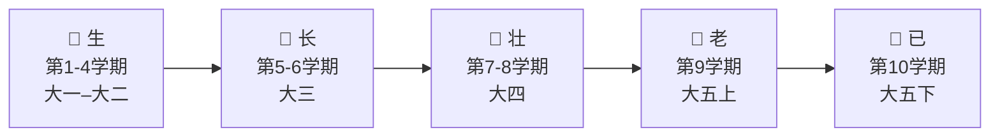

# 八院系 · 院系地图

> 1 领域（中医药）· 8 院系 · 120 学科 · 10 学期 · 5 阶段

## 生长壮老已 × 学期

## 院系总览

| # | 院系 | 学科 | 学时 | 章节目标 | 已建章节 | 状态 |
|---|------|------|------|---------|---------|------|
| 1 | ☯️ [中医系](01-zhongyi/) | 15 | 1062 | 150 | 4 | 🚧 |
| 2 | 🌾 [中药系](02-zhongyao/) | 15 | 1026 | 144 | 1 | 🚧 |
| 3 | 🪡 [针灸系](03-zhenjiu/) | 15 | 954 | 136 | 1 | 🚧 |
| 4 | 🦴 [骨伤系](04-gushang/) | 15 | 972 | 138 | 1 | 🚧 |
| 5 | 🩺 [护理系](05-huli/) | 15 | 882 | 128 | 1 | 🚧 |
| 6 | 📊 [管理系](06-guanli/) | 15 | 792 | 118 | 1 | 🚧 |
| 7 | 🤖 [智能系](07-zhineng/) | 15 | 990 | 140 | 1 | 🚧 |
| 8 | 👁️ [五官口腔系](08-wuguan/) | 15 | 918 | 132 | 1 | 🚧 |

## 学期排课视图

| 学期 | 阶段 | 学年 | 学科数 | 学时 | 章节目标 |
|------|------|------|-------|------|---------|
| 第 1 学期 | 🌱 生·启蒙 | 大一–大二 | 3 | 162 | 26 |
| 第 2 学期 | 🌱 生·启蒙 | 大一–大二 | 5 | 360 | 50 |
| 第 3 学期 | 🌱 生·启蒙 | 大一–大二 | 11 | 702 | 100 |
| 第 4 学期 | 🌱 生·启蒙 | 大一–大二 | 16 | 1062 | 150 |
| 第 5 学期 | 🌿 长·积累 | 大三 | 21 | 1368 | 194 |
| 第 6 学期 | 🌿 长·积累 | 大三 | 29 | 1890 | 268 |
| 第 7 学期 | 🌳 壮·鼎盛 | 大四 | 26 | 1584 | 228 |
| 第 8 学期 | 🌳 壮·鼎盛 | 大四 | 9 | 468 | 70 |
| 第 9 学期 | 🍂 老·固化 | 大五上 | 0 | 0 | 0 |
| 第 10 学期 | 🔄 已·转型 | 大五下 | 0 | 0 | 0 |

### 各学期学科明细

#### 第 1 学期 · 🌱生（3 门 / 162 学时）

| 学科 | 院系 | 类型 | 学时 |
|------|------|------|------|
| [中医基础理论](01-zhongyi/01-zhongyi-jichu-lilun/) | 中医系 | Core | 72 |
| [医古文](01-zhongyi/02-yi-gu-wen/) | 中医系 | Core | 54 |
| [中国医学史](01-zhongyi/03-zhongguo-yixue-shi/) | 中医系 | Reference | 36 |

#### 第 2 学期 · 🌱生（5 门 / 360 学时）

| 学科 | 院系 | 类型 | 学时 |
|------|------|------|------|
| [中药学](02-zhongyao/01-zhongyaoxue/) | 中药系 | Core | 90 |
| [药用植物学](02-zhongyao/02-yaoyong-zhiwu-xue/) | 中药系 | Core | 54 |
| [经络学](03-zhenjiu/01-jingluo-xue/) | 针灸系 | Core | 72 |
| [中医护理学基础](05-huli/01-zhongyi-huli-jichu/) | 护理系 | Core | 72 |
| [基础护理学](05-huli/02-jichu-huli-xue/) | 护理系 | Core | 72 |

#### 第 3 学期 · 🌱生（11 门 / 702 学时）

| 学科 | 院系 | 类型 | 学时 |
|------|------|------|------|
| [中医诊断学](01-zhongyi/05-zhongyi-zhen-duan-xue/) | 中医系 | Core | 90 |
| [内经选读](01-zhongyi/06-neijing-xuandu/) | 中医系 | Core | 72 |
| [方剂学](02-zhongyao/03-fangjixue/) | 中药系 | Core | 90 |
| [中药资源学](02-zhongyao/04-zhongyao-ziyuan-xue/) | 中药系 | Reference | 54 |
| [腧穴学](03-zhenjiu/02-shuxue-xue/) | 针灸系 | Core | 90 |
| [针灸医籍选](03-zhenjiu/03-zhenjiu-yiji-xuan/) | 针灸系 | Reference | 54 |
| [中医气功学](03-zhenjiu/04-qigong-xue/) | 针灸系 | Reference | 36 |
| [健康评估](05-huli/03-jiankang-pinggu/) | 护理系 | Core | 54 |
| [中医护理技术](05-huli/04-zhongyi-huli-jishu/) | 护理系 | Build | 54 |
| [中医养生学](05-huli/05-zhongyi-yangsheng-xue/) | 护理系 | Core | 54 |
| [医学人工智能导论](07-zhineng/01-yixue-rengong-zhineng-daolun/) | 智能系 | Core | 54 |

#### 第 4 学期 · 🌱生（16 门 / 1062 学时）

| 学科 | 院系 | 类型 | 学时 |
|------|------|------|------|
| [中医体质学](01-zhongyi/04-zhongyi-tizhi-xue/) | 中医系 | Core | 54 |
| [伤寒论](01-zhongyi/07-shanghanlun/) | 中医系 | Core | 90 |
| [中药鉴定学](02-zhongyao/05-zhongyao-jianding-xue/) | 中药系 | Build | 72 |
| [中药化学](02-zhongyao/06-zhongyao-huaxue/) | 中药系 | Core | 90 |
| [推拿学](03-zhenjiu/05-tuina-xue/) | 针灸系 | Clinic | 72 |
| [推拿手法学](03-zhenjiu/06-tuina-shoufa-xue/) | 针灸系 | Build | 54 |
| [刺法灸法学](03-zhenjiu/07-cifa-jiufa-xue/) | 针灸系 | Core | 72 |
| [中医运动学](04-gushang/01-zhongyi-yundong-xue/) | 骨伤系 | Core | 54 |
| [骨伤解剖学](04-gushang/02-yao-shang-jiepou/) | 骨伤系 | Core | 72 |
| [中医心理学](05-huli/06-zhongyi-xinli-xue/) | 护理系 | Core | 54 |
| [医学统计学](06-guanli/01-yixue-tongjixue/) | 管理系 | Core | 72 |
| [中医药政策与法规](06-guanli/02-zhongyiyao-zhengce-fagui/) | 管理系 | Core | 54 |
| [中医软件架构学](07-zhineng/02-zhongyi-ruanjian-jiagou-xue/) | 智能系 | Build | 72 |
| [中医智能设备与可穿戴设备](07-zhineng/03-zhongyi-zhineng-shebei/) | 智能系 | Build | 72 |
| [耳鼻喉解剖生理学](08-wuguan/01-erbihou-jiepou-shengli/) | 五官口腔系 | Core | 54 |
| [口腔解剖生理学](08-wuguan/02-kouqiang-jiepou-shengli/) | 五官口腔系 | Core | 54 |

#### 第 5 学期 · 🌿长（21 门 / 1368 学时）

| 学科 | 院系 | 类型 | 学时 |
|------|------|------|------|
| [金匮要略](01-zhongyi/08-jingui-yaolue/) | 中医系 | Core | 72 |
| [温病学](01-zhongyi/09-wenbing-xue/) | 中医系 | Core | 72 |
| [中医内科学](01-zhongyi/10-zhongyi-neike-xue/) | 中医系 | Clinic | 108 |
| [中药药理学](02-zhongyao/07-zhongyao-yaoli-xue/) | 中药系 | Core | 72 |
| [中药炮制学](02-zhongyao/08-zhongyao-paozhi-xue/) | 中药系 | Build | 54 |
| [中药药剂学](02-zhongyao/09-zhongyao-yaoji-xue/) | 中药系 | Core | 72 |
| [针灸治疗学](03-zhenjiu/08-zhenjiu-zhiliao-xue/) | 针灸系 | Clinic | 90 |
| [康复医学基础](03-zhenjiu/09-kangfu-yixue-jichu/) | 针灸系 | Core | 54 |
| [中医骨伤科学基础](04-gushang/03-gushang-kexue-jichu/) | 骨伤系 | Core | 72 |
| [创伤急救学](04-gushang/04-chuangshang-jijiu-xue/) | 骨伤系 | Clinic | 54 |
| [运动医学与损伤防护](04-gushang/05-yundong-yixue/) | 骨伤系 | Build | 54 |
| [内科护理学](05-huli/07-neike-huli-xue/) | 护理系 | Clinic | 90 |
| [外科护理学](05-huli/08-waike-huli-xue/) | 护理系 | Clinic | 72 |
| [中医管理学](06-guanli/03-zhongyi-guanli-xue/) | 管理系 | Core | 54 |
| [卫生事业管理](06-guanli/04-weisheng-shiye-guanli/) | 管理系 | Core | 54 |
| [中医文化传播学](06-guanli/05-zhongyi-wenhua-chuanbo/) | 管理系 | Reference | 36 |
| [中医自然语言处理](07-zhineng/04-zhongyi-ziran-yuyan-chuli/) | 智能系 | Build | 72 |
| [中医知识图谱](07-zhineng/05-zhongyi-zhishi-tupu/) | 智能系 | Build | 72 |
| [中医面部望诊学](08-wuguan/03-zhongyi-mianbu-wangzhen/) | 五官口腔系 | Build | 54 |
| [眼科光学与验光](08-wuguan/04-yanke-guangxue-yanguang/) | 五官口腔系 | Build | 54 |
| [中医五官科经典选读](08-wuguan/05-zhongyi-wuguan-jingdian/) | 五官口腔系 | Reference | 36 |

#### 第 6 学期 · 🌿长（29 门 / 1890 学时）

| 学科 | 院系 | 类型 | 学时 |
|------|------|------|------|
| [中医外科学](01-zhongyi/11-zhongyi-waike-xue/) | 中医系 | Clinic | 72 |
| [中医妇科学](01-zhongyi/12-zhongyi-fuke-xue/) | 中医系 | Clinic | 72 |
| [中医儿科学](01-zhongyi/13-zhongyi-erke-xue/) | 中医系 | Clinic | 72 |
| [中药分析学](02-zhongyao/10-zhongyao-fenxi-xue/) | 中药系 | Build | 72 |
| [中药药代动力学](02-zhongyao/11-zhongyao-yaodai-donglixue/) | 中药系 | Build | 54 |
| [道地药材与产地加工](02-zhongyao/12-daodi-yaocai/) | 中药系 | Reference | 54 |
| [实验针灸学](03-zhenjiu/10-shiyan-zhenjiu-xue/) | 针灸系 | Build | 72 |
| [物理治疗与运动康复](03-zhenjiu/11-wuli-zhiliao/) | 针灸系 | Build | 54 |
| [耳穴诊治学](03-zhenjiu/12-erxue-zhenduan-xue/) | 针灸系 | Build | 54 |
| [中医正骨学](04-gushang/06-zhongyi-zhenggu-xue/) | 骨伤系 | Clinic | 90 |
| [中医筋伤学](04-gushang/07-zhongyi-jinshang-xue/) | 骨伤系 | Clinic | 72 |
| [骨伤科手法治疗学](04-gushang/08-gushang-shoufa-zhiliao/) | 骨伤系 | Build | 72 |
| [骨科影像诊断学](04-gushang/09-guke-yingxiang-zhenduan/) | 骨伤系 | Build | 72 |
| [妇产科护理学](05-huli/09-fuchanke-huli-xue/) | 护理系 | Clinic | 54 |
| [儿科护理学](05-huli/10-erke-huli-xue/) | 护理系 | Clinic | 54 |
| [社区护理学](05-huli/11-shequ-huli-xue/) | 护理系 | Build | 54 |
| [医院管理学](06-guanli/06-yiyuan-guanli-xue/) | 管理系 | Clinic | 72 |
| [中医教育学](06-guanli/07-zhongyi-jiaoyu-xue/) | 管理系 | Build | 54 |
| [健康服务与管理](06-guanli/08-jiankang-fuwu-guanli/) | 管理系 | Build | 54 |
| [医疗保险与卫生经济](06-guanli/09-yiliao-baoxian-jingji/) | 管理系 | Reference | 54 |
| [中医智能辨证系统](07-zhineng/06-zhongyi-zhineng-bianzheng/) | 智能系 | Build | 72 |
| [医学图像处理与舌诊客观化](07-zhineng/07-yixue-tuxiang-shezhen/) | 智能系 | Build | 72 |
| [脉诊客观化与信号处理](07-zhineng/08-maizhen-keguanhua/) | 智能系 | Build | 72 |
| [中医大数据分析](07-zhineng/09-zhongyi-dashuju-fenxi/) | 智能系 | Build | 54 |
| [中医眼科学](08-wuguan/06-zhongyi-yanke-xue/) | 五官口腔系 | Clinic | 72 |
| [中医耳鼻喉科学](08-wuguan/07-zhongyi-erbihou-xue/) | 五官口腔系 | Clinic | 72 |
| [中医口腔科学](08-wuguan/08-zhongyi-kouqiang-kexue/) | 五官口腔系 | Clinic | 72 |
| [口腔内科学](08-wuguan/09-kouqiang-neike-xue/) | 五官口腔系 | Clinic | 72 |
| [眼科影像与检查技术](08-wuguan/10-yanke-yingxiang-jiancha/) | 五官口腔系 | Build | 54 |

#### 第 7 学期 · 🌳壮（26 门 / 1584 学时）

| 学科 | 院系 | 类型 | 学时 |
|------|------|------|------|
| [中医证候学](01-zhongyi/14-zhongyi-zhenghou-xue/) | 中医系 | Build | 72 |
| [中医各家学说](01-zhongyi/15-zhongyi-gejia-xueshuo/) | 中医系 | Reference | 54 |
| [中成药与临床用药](02-zhongyao/13-zhongchengyao-linchuang/) | 中药系 | Clinic | 72 |
| [中药配伍与禁忌](02-zhongyao/14-peiwu-yu-jinji/) | 中药系 | Build | 54 |
| [针刀医学](03-zhenjiu/13-zhendao-yixue/) | 针灸系 | Clinic | 54 |
| [针灸镇痛与麻醉](03-zhenjiu/14-zhenjiu-zhentong-mazui/) | 针灸系 | Build | 54 |
| [中医康复学](03-zhenjiu/15-zhongyi-kangfu-xue/) | 针灸系 | Clinic | 72 |
| [脊柱病学](04-gushang/10-jizhu-bing-xue/) | 骨伤系 | Clinic | 72 |
| [关节病学](04-gushang/11-guanjie-bing-xue/) | 骨伤系 | Clinic | 72 |
| [骨质疏松与退行性疾病](04-gushang/12-guzhishusong-tuibian/) | 骨伤系 | Build | 54 |
| [中医整脊学](04-gushang/13-zhongyi-zhengji-xue/) | 骨伤系 | Clinic | 54 |
| [急危重症护理学](05-huli/12-jiwei-zhengzheng-huli/) | 护理系 | Clinic | 72 |
| [护理管理学](05-huli/13-huli-guanli-xue/) | 护理系 | Reference | 36 |
| [护理伦理与法规](05-huli/14-huli-lunli-fagui/) | 护理系 | Reference | 36 |
| [医学信息管理](06-guanli/10-yixue-xinxi-guanli/) | 管理系 | Build | 54 |
| [医院信息化与病案管理](06-guanli/11-yiyuan-xinxihua-bingan/) | 管理系 | Build | 54 |
| [中医药标准化](06-guanli/12-zhongyiyao-biaozhunhua/) | 管理系 | Build | 54 |
| [临床科研方法学](06-guanli/13-linchuang-keyan-fangfa/) | 管理系 | Build | 54 |
| [大语言模型与中医智能体](07-zhineng/10-llm-yu-zhongyi-zhinengti/) | 智能系 | Build | 90 |
| [中医机器人学](07-zhineng/11-zhongyi-jiqiren-xue/) | 智能系 | Build | 54 |
| [数字人体与虚拟仿真](07-zhineng/12-shuzi-renti-xuni-fangzhen/) | 智能系 | Build | 54 |
| [中医多模态数据融合](07-zhineng/13-zhongyi-duomotai-ronghe/) | 智能系 | Build | 72 |
| [口腔颌面外科学](08-wuguan/11-kouqiang-hemian-waike/) | 五官口腔系 | Clinic | 72 |
| [口腔修复学](08-wuguan/12-kouqiang-xiufu-xue/) | 五官口腔系 | Clinic | 72 |
| [口腔正畸学](08-wuguan/13-kouqiang-zhengji-xue/) | 五官口腔系 | Clinic | 72 |
| [中医嗓音医学](08-wuguan/14-zhongyi-sangyin-yixue/) | 五官口腔系 | Build | 54 |

#### 第 8 学期 · 🌳壮（9 门 / 468 学时）

| 学科 | 院系 | 类型 | 学时 |
|------|------|------|------|
| [中药新药研发](02-zhongyao/15-zhongyao-xinyao-yanfa/) | 中药系 | Build | 72 |
| [康复工程与支具学](04-gushang/14-kangfu-gongcheng-zhiju/) | 骨伤系 | Build | 54 |
| [骨伤康复评定](04-gushang/15-gushang-kangfu-pingding/) | 骨伤系 | Build | 54 |
| [护理研究与循证护理](05-huli/15-huli-yanjiu-zhengxun/) | 护理系 | Build | 54 |
| [中医药知识产权与成果转化](06-guanli/14-zhishichanquan-zhuanhua/) | 管理系 | Reference | 36 |
| [中医国际教育与传播](06-guanli/15-zhongyi-guojijiaoyu/) | 管理系 | Reference | 36 |
| [医学数据安全与隐私保护](07-zhineng/14-yixue-shuju-anquan-yinsi/) | 智能系 | Build | 54 |
| [中医AI伦理与治理](07-zhineng/15-zhongyi-ai-lunli-zhili/) | 智能系 | Build | 54 |
| [中医美容与皮肤治疗学](08-wuguan/15-zhongyi-meirong-pifu/) | 五官口腔系 | Build | 54 |

#### 第 9 学期 · 🍂老（0 门 / 0 学时）

_本阶段为临床轮转 / 毕业设计，不安排常规学科_

#### 第 10 学期 · 🔄已（0 门 / 0 学时）

_本阶段为临床轮转 / 毕业设计，不安排常规学科_

## 排课负载说明

学期负载在课程表设计中天然不均衡（第 6 学期最高），因为本表按**院系主修**横向切分。
实际教学由 `learning-paths/*.json` 中的学分路径与跨院系选修规则再做配平，
详见 [learning-paths/](../learning-paths/README.md)。
