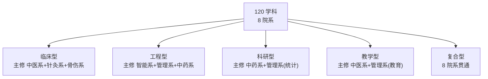

# 学分路径

120 门学科不是让人全修一遍的清单。不同身份的人走不同的路径 —— 同样的课程，
不同的**顺序、深度与交付侧重**。

| 路径 | 面向 | 学期跨度 | 学科数 | 学时 | 核心交付 |
|------|------|---------|-------|------|---------|
| [临床型](clinical-track.json) | 中医临床医师方向 | 1–9 | 61 | 4140 | 临床决策支持评估与批判 |
| [工程型](engineering-track.json) | 中医药 AI 工程师 | 1–10 | 31 | 2106 | 中医领域全栈系统 |
| [复合型（本项目主线）](intelligent-tcm-track.json) | 智能中医方向 | 1–10 | 63 | 4248 | 智能中医全栈闭环系统 |
| [科研型](research-track.json) | 中医药科研人员 | 1–10 | 27 | 1782 | 真实世界中医研究 |
| [教学型](teaching-track.json) | 中医教师与教材编者 | 1–8 | 32 | 1944 | 一门学科的完整教材 |

## 路径与院系的关系



路径**不是系**。一个学生属于某个院系，但可以按另一条路径选课。
院系是组织归属，路径是能力目标。

## 路径文件结构

```json
{
  "id": "clinical-track",
  "title": "临床型",
  "audience": "面向……",
  "outcome": "毕业时能……",
  "semesters": [1, 9],
  "route": [
    {
      "semester": 1,
      "stage": "sheng",
      "reason": "为什么这一学期学这些",
      "subjects": ["01-zhongyi/01-zhongyi-jichu-lilun"]
    }
  ],
  "capstone": { "title": "……", "deliverable": "……", "criteria": ["……"] }
}
```

`subjects` 用 `<院系slug>/<学科slug>` 引用。校验由 `tests/test_learning_paths.js` 负责：
**任何引用了不存在的学科，测试直接失败。**

## 配平规则

`departments/README.md` 显示各学期负载不均（第 6 学期最高）。实际排课靠本目录的路径文件配平：

1. **路径内同学期可互换**：同一学期、同一 `type` 的学科，可按院系开设能力互换。
2. **跨院系选修**：非主修院系的 `Build` 类学科优先作为选修吸收。
3. **临床学期（9–10）不排常规课**：仅保留轮转与毕业设计。
4. **单学期上限**：路径内不超过 8 门 / 600 学时。

## 新增一条路径

1. 复制一个现有文件改名，写好 `id` / `audience` / `outcome` / `capstone`。
2. `route` 里逐学期列 `subjects`（用真实 slug，别猜）。
3. 跑校验：

```bash
node tests/test_learning_paths.js
node scripts/build_catalog.js
```

4. 回到本文件顶部的表格里加一行。
