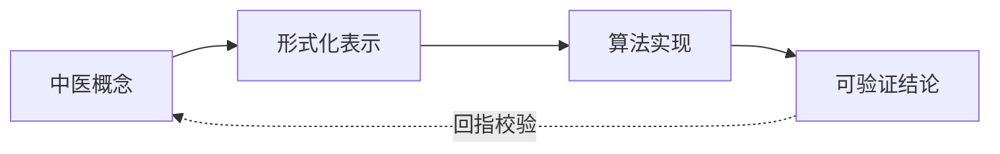

# 第 NN 章 · 【章节标题】

> **MOTTO:** 【一句经典原文或核心箴言。必须可核查出处，写清书名与篇名。】
>
> **PROBLEM:** 【一句话点明学习者的痛点。用学习者自己的语言，不要用教科书的语言。】
>
> **双根因定位:** 环境逼迫(“【具体场景的压力，例如：跟诊时说不出辨证依据】”) + 知识积累(【知识点 A】×【知识点 B】= 【涌现能力】)

## 课程信息

| 项目 | 内容 |
|------|------|
| 学科 | 【学科名】 |
| 院系 | 【院系名】 |
| 章序号 | 【NN】 / 【学科章节目标数】 |
| 所属阶段 | 【🌱生·启蒙 / 🌿长·积累 / 🌳壮·鼎盛 / 🍂老·固化 / 🔄已·转型】 |
| 产出类型 | 【📋 Prompt / 🛠️ Skill / 🤖 Agent / 🔌 MCP / ⚙️ 系统】 |
| 预估时长 | 【X】 小时 |

## 课程结构

```text
MOTTO  →  PROBLEM  →  CONCEPT  →  BUILD IT  →  USE IT  →  SHIP IT
一句话      痛点      原理+图解    从零实现     框架调用    产出工具
```

## 学习目标

- 【动词开头，4–6 条。每条都要能在本页末尾「验证」段被检验】
- 【例：能用不超过 20 行代码，把「阴阳」判别写成一次二分类，并说出权重含义】

## 核心概念

### 中医：【核心中医概念】

【3–5 句话。必须引用可核查的经典条文或教材定义，写清出处。】

### AI / 工程：【对应的技术概念】

【3–5 句话。给出数学形式与直觉解释。数学形式用 $...$，独立公式用 $$...$$。】

### 对应关系

| 中医概念 | AI/工程概念 | 桥梁（为什么可以这样翻译） |
|---------|------------|--------------------------|
| 【概念 1】 | 【概念 1】 | 【转化逻辑；必须能反向回指到左列概念】 |
| 【概念 2】 | 【概念 2】 | 【转化逻辑】 |
| 【概念 3】 | 【概念 3】 | 【转化逻辑】 |

> 本学科桥梁：**【从 curriculum.json 的 bridge 字段复制】**



## BUILD IT：从零实现

【讲清要做什么、为什么不用现成库。代码带中文注释，只用白名单依赖。】

```javascript
// 【关键代码】
```

## USE IT：框架调用

【用成熟库做同一件事，证明 BUILD IT 的结论正确。对比两者的输出。】

```javascript
// 【框架调用】
```

## SHIP IT：产出物

- [📋 Prompt 模板](outputs/prompt-<slug>.md)
- [🛠️ Skill 文件](outputs/skill-<slug>.md)

## 验证

```bash
node code/main.js
# Expected:
# ═══ 【本章标题】 ═══
# 【预期输出，逐行写清】
# 退出码 0
```

## 练习

见 [exercises.md](exercises.md)。

## 进阶思考

1. 【如果把数据规模扩大 10 倍会怎样？】
2. 【这个模型在哪些临床场景会失效？为什么？】
3. 【如何融入更多辨证维度而不破坏可解释性？】
