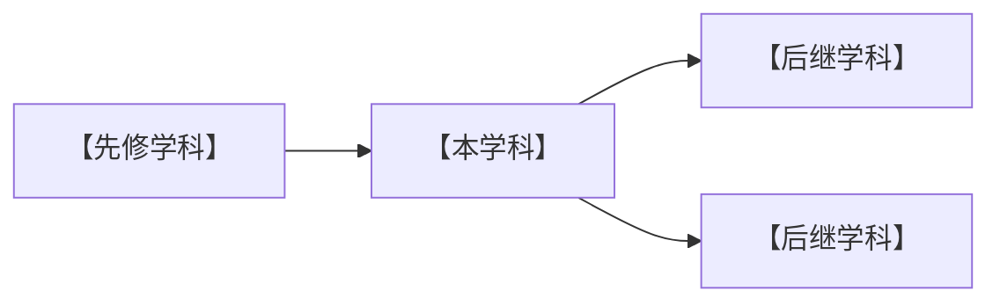

# 【学科中文名】 · 学科大纲

> **英文名:** Subject English Name
>
> **院系:** 【院系名】
>
> **中医 → AI 桥梁:** 【从 curriculum.json 复制】

| 项目 | 内容 |
|------|------|
| 类型 | Core / Build / Reference / Clinic |
| 学期 | 第 N 学期（【🌱生·启蒙】） |
| 学时 | 【N】 |
| 章节目标 | 【N】 |
| 学科编号 | 【NNN】 / 120 |

## 一、学科定位

【这一门学科在整个中医药培养体系里承担什么。它上承哪门学科，下接哪门学科，
缺了它后面哪些内容会塌。3–5 句话，不要复述培养方案的套话。】

## 二、中医 → AI 桥梁

```text
【从 curriculum.json 的 bridge 字段复制】
```

每一个传统概念，都要被翻译成一个可计算、可验证的工程对象：
中医概念给出**语义与约束**，AI/工程方法给出**表示与算法**。两者必须能互相回指。

## 三、章节地图（目标 N 章）

| # | 章节 | 中医概念 | 工程对象 | 状态 |
|---|------|---------|---------|------|
| 01 | 【标题】 | 【概念】 | 【对象】 | ⬚ |

## 四、先修与后继



## 五、教材交付 [textbooks]

【本学科的教材定位：是主干教材、实验指导，还是工具书。目标字数与图表数量。】

## 六、平台交付 [tcmP]

【本学科视频课程的组织方式：按章分集，还是按技能点分集。是否需要配套实验台。】

## 七、进度

| 指标 | 当前 | 目标 |
|------|------|------|
| 章节 | 0 | 【N】 |
| 视频 | 0 | 【N】 |
| 教材字数 | 0 | ≈【N×6000】 |

> 状态字形：⬚ 未开始 · 🚧 进行中 · ✅ 完成
