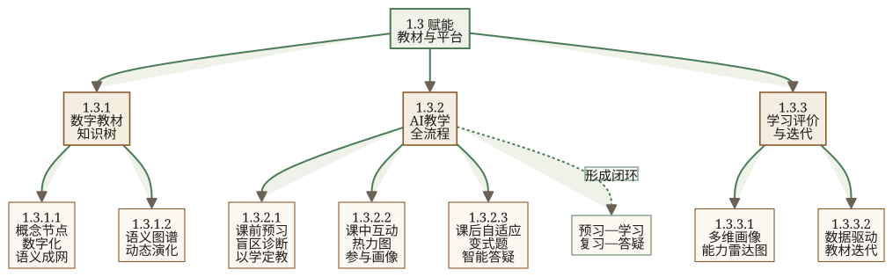
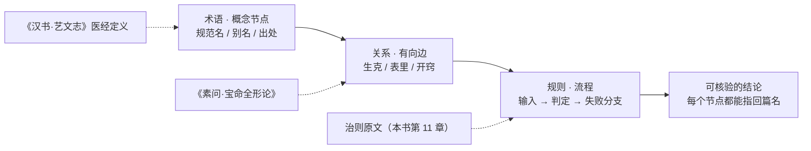

# 第 1 章 · 绪论与AI时代学习体系

> **源**：`qhzy-中医基础理论.xlsx` · 表「1绪论」 · 源文 2,978 字
> **抽取**：`node scripts/import_textbooks.js --only 中医基础理论` · sha256 `870b004ea34b4ec2…` · 2026-10-21
> **层次**：本文件下段是**源教材正文层** —— 节次取自源表的结构列，文字未改写、未压缩、未抽样；文末是**改写层**（`REWRITE:BEGIN/END` 块内 N.1–N.5 + 小结 + 思考题 + 延伸阅读），门见 `tests/test_jichu_textbook.js`。

---

【网络校准·2026-08-07】十四五规划教材绪论增设'中医学的主要思维方式'(象思维、司外揣内、类比推演),本版在 1.3 节体现;哲学基础三学说表述统一为'气一元论、阴阳学说、五行学说'。

1.1 学科对象与地位

1.1.1 定义与范畴

1.1.1.1 核心概念界定

中医基础理论是研究与阐述中医学基本概念、基本原理和基本规律的学科。它以中国古代哲学的气、阴阳、五行学说为方法论，以藏象、经络、精气血津液神为核心内容，探讨人体的生理活动、病理变化及其与自然环境的关系。该理论不仅是中医学的理论基石，更是连接中医哲学思维与临床实践的逻辑桥梁。

1.1.1.2 理论体系构成要素

本教材将理论体系拆解为四大核心模块：哲学基础（精气阴阳五行）、生理基础（藏象、经络、气血津液）、病理基础（病因、发病、病机）及防治原则。区别于传统教材，本版引入“病证单元”作为最小编写颗粒度，将抽象的生理病理概念具象化为可教学的临床问题模块，如“咳嗽的病机单元”或“疼痛的辨证单元”，实现理论与临床的无缝衔接。

1.1.2 学科体系位置

1.1.2.1 与临床各科联系

作为中医药学科的“地基”，中医基础理论为临床各科提供通用的认知模型。中医诊断学依据其理论确立辨证纲领，中药学与方剂学依据其指导药物配

1.1.2.2 百二十门学科枢纽

在中医药行业120门学科体系中，本课程处于核心枢纽地位。它向上承接中国传统文化与中医医史文献，向下辐射针灸推拿、养生康复及中药制药等应用学科。通过构建标准化的知识图谱，本课程已成为连接基础研究与临床应用的必经节点，是实现中医药教育现代化、标准化的关键一环。

1.2 发展简史

1.2.1 理论体系形成

1.2.1.1 《内经》奠基意义

战国至秦汉时期问世的《黄帝内经》，标志着中医基础理论体系的正式确立。该书构建了“天人合一”的整体观念，确立了“藏象学说”与“经络学说”的解剖生理框架，提出了“病机十九条”及“治未病”思想。《内经》不仅是一部医学典籍，更是中国古代哲学的医学表达，奠定了中医独特的思维模式。

1.2.1.2 秦汉学术特征

秦汉时期呈现“理法方药”初步完备的特征。张仲景《伤寒杂病论》创造性地确立了“辨证论治”原则，将理论与临床紧密结合；同时，《神农本草经》建立了中药学理论体系。这一时期形成了以《内经》《难经》《伤寒论》《神农本草经》为代表的“中医四大经典”，构建了中医基础理论的基本范式，至今仍是学科发展的源头活水。

1.2.2 充实发展时期

1.2.2.1 金元四大家争鸣

宋金元时期，中医理论进入学派争鸣的繁荣阶段。刘完素主张“火热论”，张从正倡导“攻邪论”，李杲创立“脾胃论”，朱震亨力倡“相火论”与“阳有余阴不足”。金元四大家从不同角度丰富了脏腑病机学说，打破了汉代以来的经学束缚，体现了中医理论在继承中的批判性发展，为后世温病学派的兴起奠定了基础。

1.2.2.2 温病学派创新

明清时期，温病学派异军突起，突破了“伤寒”一统外感热病的局面。叶天士创立“卫气营血辨证”，薛生白详论“湿热病”，吴鞠通提出“三焦辨证”。温病学派明确了温病与伤寒在病因、病机及治法上的区别，极大地丰富了外感热病的辨证体系，使中医基础理论在急性传染病防治领域达到了新的高度。

## 1.3 AI赋能教材与平台

### 1.3.1 数字教材与知识树

#### 1.3.1.1 概念节点数字化

本教材突破纸质载体限制，将所有核心概念（如“气”“肝阳上亢”）转化为数字化知识节点。每个节点包含定义、别名、英文术语、古籍原文、现代研究及关联图谱。通过语义标注技术，将离散的知识点串联成网，形成可检索、可计算、可推理的中医基础理论知识树，解决了传统教材知识结构线性化、难以关联的问题。

#### 1.3.1.2 语义网络图谱

基于知识树构建语义网络图谱，直观展示概念间的逻辑关系。例如，点击“肾”，系统自动关联“藏精”“主骨”“生髓”“通于冬气”等上下游节点。图谱支持动态演化，随着学术研究进展，新发现的关联路径可被实时纳入，确保教材内容的时效性与科学性，为AI辅助推理提供底层数据结构支持。

### 1.3.2 AI教学全流程

#### 1.3.2.1 课前智能预习测评

依托教育平台，学生在课前接收个性化的预习包。AI系统根据学生画像（如专业背景、既往成绩），推送适配难度的微课与阅读材料。预习结束后，系统进行前置诊断测评，精准识别学生的知识盲区（如对“五行生克”的理解偏差），并将结果反馈给教师端，实现“以学定教”。

#### 1.3.2.2 课中实时互动画像

课堂教学引入多模态交互技术。教师发起实时答题或辨证推演任务，系统即时捕捉学生的作答轨迹与犹豫时长，生成课堂热力图。对于高频错误点，AI助教自动调取相关案例进行针对性讲解。同时，系统实时更新每位学生的课堂参与度与理解度画像，帮助教师动态调整授课节奏。

#### 1.3.2.3 课后自适应反馈

课后，AI系统根据课堂表现布置自适应作业。对于掌握较好的学生，推送拓展性难题；对于薄弱环节，系统自动回灌基础知识点并生成变式题。此外，平台提供24小时智能答疑服务，利用自然语言处理技术解答学生疑问，形成“预习—学习—复习—答疑”的闭环反馈机制，显著提升学习效率。

### 1.3.3 学习评价与迭代

#### 1.3.3.1 多维能力画像

改变单一的期末笔试评价模式，建立多维能力评价体系。平台综合考量学生的知识掌握度（客观题得分）、思维逻辑性（辨证路径合理性）、概念辨析力（语义相似度匹配）及临证决断力（虚拟仿真操作）。最终生成可视化的“学生能力雷达图”，不仅反映学习结果，更揭示思维短板，为个性化培养提供依据。

#### 1.3.3.2 教学数据驱动优化

建立教学大数据驾驶舱，汇聚全周期的学习行为数据。通过分析错题分布、停留时长、互动频次等数据，精准定位教材的难点与晦涩之处。教研团队据此定期修订教材内容，优化知识树结构，甚至调整AI算法的权重参数。这种“数据驱动—教材迭代—教学改进”的机制，确保了教材始终处于自我进化的良性循环之中。

【qhzy 增补·2026-08】新增 1.4 节: 对齐岐黄智医分布式网络编程体系。

1.4 分布式学习环境与多端接入

1.4.1 教材运行的三服务器+四台式机环境

1.4.1.1 华为云·华为硬·浪潮·GitHub·台式机

本教材及 120 门系列教材运行于岐黄智医分布式网络编程体系: 华为云服务器(114.115.211.254)承载公网入口(看板/API/PWA), 华为硬服务器(192.168.1.12)承载 Gateway 调度与容器批量生成, 浪潮服务器(192.168.0.102)承载计算后端与知识图谱, GitHub 仓库(qhzytcm/tcmP)承载版本与 CI/CD 门禁, 局域网四台台式机(T1-T4)作为 L4 作者/审稿分布式工作台。学生通过手机 PWA 或台式机浏览器接入, 教师通过看板管理教学。

1.4.2 教材内容的多端消费形态

1.4.2.1 纸质/PDF/Excel/API 四形态

同一教材内容以四形态分发: 纸质出版(双序+四级目录)、PDF 电子书(供阅读)、Excel 工作簿(本文件, 供编写与图谱注入)、API 端点(供六者 Agent 与 APP 消费)。四形态由同一知识源(病证单元库)派生, 保证一致性。

1.4.2.2 知识树的云端同步

教材知识树变更经 Git 提交→CI/CD 门禁→自动同步至华为云与浪潮图谱库, 多端实时一致。离线时四台式机可本地批注, 联网后回传合并——"随时随地、弱网可用"原则。

---

> **免责声明**：本教材内容仅用于教育与科研，不构成任何诊疗建议。
> 本文件由 `scripts/import_textbooks.js` 从源工作簿生成，请勿手改 —— 需要修改请改源工作簿后重跑。

<!-- REWRITE:BEGIN -->
## 本章要回答的问题

一门两千年前的学问，凭什么能被装进「概念节点 + 知识图谱 + 学习画像」这套当代工程里？换句话说：中医基础理论这门课的**对象**到底是什么 —— 是几段原文、一套术语，还是一套可以被机器复用的结构？

## N.1 概念与出处

本章的四个概念，出处都能落到篇名一级：

| 概念 | 出处（书名·篇名） | 本章源节 |
|---|---|---|
| 医经的研究对象 | 《汉书·艺文志·方技略》：「医经者，原人血脉、经络、骨髓、阴阳、表里，以起百病之本，死生之分。」 | 绪论段（`1.3` 之前） |
| 人禀天地之气而生 | 《素问·宝命全形论》：「人以天地之气生，四时之法成。」 | 绪论段 |
| 医道的知识范围 | 《素问·气交变大论》：「夫道者，上知天文，下知地理，中知人事，可以长久。」 | 绪论段 |
| 教材即知识树 | 本课程的设计选择（非原典）：概念节点化、语义网络化 | `1.3.1` |
| 教学即闭环 | 本课程的设计选择：课前测评 → 课中画像 → 课后反馈 | `1.3.2` |

读这张表要留意一件事：**前三条是原典，后两条是本项目的工程主张**。两者不在同一层，不许混着引 —— 原典能逐字核，工程主张只能核产物（节点表、图谱、画像接口）。这正是本教材与一般教材的分界线：凡是「我们这样设计」的话，都要给出可复算的落点。

## N.2 为什么可以这样翻译

中医学的表述不是定理系统，而是**术语 + 关系 + 规则**三件套：

1. **术语**（气、阴阳、藏象、经络）—— 有定义，但定义常以「象」给出，而非以「属加种差」给出；
2. **关系**（阴阳对立互根、五行生克、脏腑表里）—— 是约束，不是等式；
3. **规则**（辨证论治的步骤、治则治法）—— 是流程，允许分叉与回溯。

三件套对应三种表示，这是本章翻译的全部理由：

- 术语 → **概念节点**（node）：每个节点至少带三个字段：规范名、别名、原文出处（篇名）；
- 关系 → **有向边**（edge）：边必须标明关系类型（生 / 克 / 表里 / 开窍），不许只写「相关」；
- 规则 → **流程**（flow）：每一步都要写清输入、判定条件、失败分支。

为什么这三层能对上？因为《汉书·艺文志》给医经下的定义，本身就是「以起百病之本，死生之分」—— 一个**从征象回溯到根据**的推理任务。凡推理任务都可以拆成「对象—关系—步骤」，中医学不例外。

判据只有一条，且必须能被别人复核：**每个节点能指回篇名，每条边能指回原文的并列句，每个流程步骤能指回治则原文**。做不到，就不是翻译，是改写。

图从左往右读，但要求倒过来验：**任何一层都要能回落到最下面那行原文**。回落不了的，就是本轮设计没做完的地方。

## N.3 这个翻译丢掉了什么

三条，按丢失程度排：

**一、丢掉了「人身性」。** 中医的许多判断依赖师承与临证手感 —— 同一句「脉弦」，不同医家指下的分寸不同。节点表能把「脉弦」建成一个术语，却装不进那双手。承认这一点，才不会把知识树当成老师。

**二、丢掉了术语的历史漂移。** 「气」在《内经》多指物质与功能的统一，在理学语境里又偏向形上之本；本课程选一个义项建节点，就必然压掉其他义项。压掉的那部分不会消失，它会以「同一术语、两处不同解释」的形式在检索时冒出来 —— 所以节点必须留「别名 + 出处」两栏，供人回查。

**三、丢掉了修辞作为记忆装置。** 「阴胜则阳病，阳胜则阴病」的对称句式，本身就是记忆法。表格化之后信息没少，记性变差 —— 这不是技术的失败，是媒介的代价。

还有一件容易被忽略的：知识树把「学什么」切成节点，天然偏向**可命名**的内容；而临证最要紧的往往是被命名之前的那层模糊地带。凡是图谱画不出来的地方，本书一律标「未收录」，不硬塞。

## N.4 与相邻学科的接口

| 学科 | 用到本章的什么 | 以什么形式用 |
|---|---|---|
| 中医诊断学 | 术语表与关系约束 | 四诊所得先归一到本章的规范名，再进辨证 |
| 中药学 | 概念节点的属性字段 | 药物的性味归经挂在同一套节点上 |
| 中国医学史 | 术语的年代与版本 | 每个节点的「出处」要能追到版本，避免以今释古 |
| 计算机（本体工程） | 节点 / 边 / 流程三层 | 直接对应本体—图数据库—工作流，不需要另造一套隐喻 |

接口的硬约定只有一条：**跨学科引用同一概念时，用本章的规范名，不用各科的口语别名**。别名可以存在于检索层，但不能进入判断层。

## N.5 争议与本项目立场

**争议一：该不该把中医形式化？** 反对意见认为，形式化即还原论，会把整体观切碎；支持意见认为，不形式化就无法大规模教学与复核。

本项目立场：**本书只做索引层，不做替代判断。** 形式化的是「可命名的部分」，明确标注「未收录」的部分才是整体观真正住的地方。判断权始终留给执业医师，这一点写进每章的免责句，不是客套。

**争议二：AI 辅助教学会不会削弱思维训练？** 一种担心是：学生直接问系统要答案，跳过推理。

本项目立场：以**可核验的产出**考核，而不以「有没有用 AI」考核。学生提交的必须是一条能回查到篇名的结论；系统给的建议若无出处，视为未完成。技术改变的是路径，不是标准。

> **免责声明**：本章为教学与工程说明，不构成诊断或治疗建议。临床判断须由执业中医师结合四诊与患者具体情况作出。

## 思考题

1. 本章把「学科对象」拆成术语、关系、规则三层。请指出哪一层最难形式化，并说明你的理由是否需要新的表示手段。
2. 「已经建立节点」与「已经理解概念」，在考核上如何区分？请设计一个能区分二者的作业。
3. 若某个术语在两部原典中含义不同，节点表应建一个节点还是两个？给出判据，并说明它会影响哪些下游学科。

## 延伸阅读

- 《汉书·艺文志·方技略》—— 医经定义的最早表述，本章 N.1 表第一行出处
- 《素问·宝命全形论》—— 人与天地相应的总纲
- 《素问·气交变大论》—— 「上知天文，下知地理，中知人事」的知识范围
- 本仓库 `textbooks/README.md` —— 章契约与「改写层丢掉了什么」一节的由来
<!-- REWRITE:END -->
