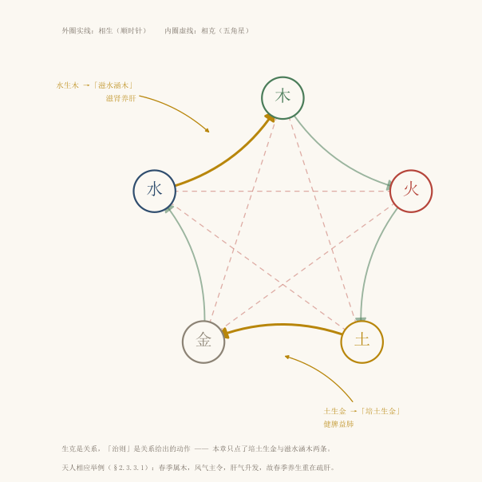

# 第 3 章 · 哲学基础与思维方法

> **源**：`qhzy-中医基础理论.xlsx` · 表「2哲思」 · 源文 3,207 字
> **抽取**：`node scripts/import_textbooks.js --only 中医基础理论` · sha256 `870b004ea34b4ec2…` · 2026-10-21
> **层次**：本文件是**源教材正文层** —— 节次取自源表的结构列，文字未改写、未压缩、未抽样。改写层（N.3「这个翻译丢掉了什么」/ N.5「争议与本项目立场」）尚未撰写，见 `textbooks/README.md` 章契约。

---

【网络校准·2026-08-07】'精气学说'按十四五规划教材表述为'气一元论';建议增补'气一元论、阴阳学说、五行学说的关系'(三者关系小节)。

2.1 精气学说

2.1.1 精气的基本概念

2.1.1.1 气的物质性与运动性

气是构成宇宙万物的最基本物质，具有无形与有形的双重属性。无形指气弥散且肉眼难见的状态；有形指气凝聚而成的具体实体。气处于永恒的运动之中，古人称之为“气机”，其基本形式表现为升、降、出、入。气的运动产生变化，称为“气化”，万物借此而生生不息。在中医理论中，气既是生命物质的统称，也是脏腑功能的动力表征。

2.1.1.2 精的贮藏与化生

精（精气）是气的精华部分，源于先天而充养于后天。先天之精禀受于父母，藏于肾，主生长发育与生殖；后天之精源于水谷，由脾胃运化生成，输布于五脏六腑。精与气互为资生：精可化气，气能生精。AI知识图谱将“精”节点与“DNA”“干细胞”等现代医学概念建立弱关联映射，辅助理解其作为“生命遗传物质与能量储备”的物质基础地位。

2.1.2 精气学说在医学中的应用

2.1.2.1 解释生命的产生与消亡

精气学说认为，天地之气交感是生命起源的根本。“人以天地之气生，四时之法成”，人体是一个不断与自然界进行物质能量交换的开放系统。当精气充盈调和则生命活力旺盛；精气耗竭则生

2.1.2.2 阐释人体的生理活动

人体的生长壮老已全过程，均由精气盛衰决定。精藏于脏腑，气行于经络，共同维持“阴平阳秘”的健康状态。若精气不足，则出现“气虚”“精亏”等病理状态。AI系统将采集学生的体质辨识数据，自动匹配对应的“精气盛衰曲线”，帮助学生理解个体差异背后的物质基础逻辑。

2.2 阴阳学说

2.2.1 阴阳的属性与归类

2.2.1.1 阴阳的对立制约与互根互用

阴阳是对自然界相互关联的某些事物或现象对立双方属性的概括。对立制约指阴阳双方相互对抗、相互制约，维持动态平衡（如寒热制衡）；互根互用指阴阳双方相互依存、互为根本，任何一方都不能脱离另一方而单独存在（如“孤阴不生，独阳不长”）。平台内置阴阳动态平衡沙盘，学生可调节参数观察对立与互根关系的破裂如何导致病理状态。

2.2.1.2 事物阴阳属性的相对性

事物的阴阳属性不是绝对的，而是相对的、可变的。这种相对性表现在两方面：一是阴阳在一定条件下可以相互转化（如寒极生热）；二是阴阳具有无限可分性（如昼为阳，上午为阳中之阳，下午为阳中之阴）。AI训练集收录了大量自然与生理现象，通过聚类算法辅助学生理解复杂事物的阴阳归类逻辑。

2.2.2 阴阳消长与转化

2.2.2.1 阴阳消长平衡的规律

阴阳消长指阴阳双方不是静止不变的，而是处于不断的增减运动之中。在一定限度内，这种消长是正常的，如四季寒暑更替。若消长超出限度，则导致阴阳失调，引发疾病。教材通过时间序列图表，展示生理状态下阴阳消长的周期性波动与病理状态下的异常波动，训练学生对“度”的把握能力。

2.2.2.2 阴阳相互转化的条件

阴阳转化指在一定的条件下，阴可以转化为阳，阳也可以转化为阴。重阴必阳，重阳必阴；寒极生热，热极生寒。这种转化往往发生在事物发展变化的“物极”阶段。AI系统模拟极端环境下的生理反应（如

2.2.3 阴阳学说在中医学的应用

2.2.3.1 说明组织结构与生理功能

根据阴阳属性，人体上部为阳、下部为阴；体表为阳、体内为阴；背为阳、腹为阴；六腑为阳、五脏为阴。生理功能上，兴奋、温煦属阳，抑制、滋润属阴。平台利用3D人体解剖模型，通过切换阴阳显示模式，让学生直观掌握人体结构的阴阳分布规律。

2.2.3.2 用于病理分析与疾病诊断

疾病的发生发展归根结底是阴阳失调。阳偏盛则见实热证，阴偏盛则见实寒证；阳偏衰则见虚寒证，阴偏衰则见虚热证。诊断上，“善诊者，察色按脉，先别阴阳”。AI辅助诊断模块训练学生通过面色、脉象等外在征象，推断内在的阴阳盛衰状况，确立“阴病治阳，阳病治阴”的治疗原则。

2.3 五行学说

2.3.1 五行特性与归类方法

2.3.1.1 五行的特性归纳

五行即木、火、土、金、水五种物质的运动变化。古人将其特性归纳为：“木曰曲直”（生长、升发、条达），“火曰炎上”（温热、升腾），“土爰稼穑”（生化、承载、受纳），“金曰从革”（沉降、肃杀、收敛），“水曰润下”（寒凉、滋润、下行）。教材平台建立了五行特性矢量图，将抽象的文字描述转化为可视化的物理属性向量，降低理解门槛。

2.3.1.2 取象比类与推演络绎

五行归类主要采用两种方法：取象比类法，即从事物的形象中找出能反映本质的特有征象，与五行特性相类比以确定归属（如肝喜条达故属木）；推演络绎法，即根据已知某事物的五行属性，推演归纳与其相关的其他事物的五行属性（如肝合胆、主筋、开窍于目，故胆、筋、目皆属木）。AI通过图像识别与自然语言处理，辅助学生从古籍文献中自动提取五行归类的逻辑线索。

2.3.2 五行的生克制化

#### 2.3.2.1 正常状态下的相生相克

五行相生指木生火、火生土、土生金、金生水、水生木，表示事物间的资生、助长关系；相克指木克土、土克水、水克火、火克金、金克木，表示事物间的制约、拮抗关系。生中有克，克中有生，维持着自然界的动态平衡。平台通过系统动力学模型，模拟五脏系统在相生相克机制下的稳态运行，一旦某一环节断裂，系统即发出失衡预警。

#### 2.3.2.2 异常状态下的相乘相侮

当五行平衡被打破，便会出现异常病理变化。相乘指相克太过，超过正常制约程度（如木旺乘土）；相侮指反向克制，即被克的一方反过来欺侮主克方（如木虚金侮）。AI病例库收录了大量相乘相侮的典型案例，训练学生识别复杂的病理传变链条，如“肝病传脾”（木乘土）或“肺病及肝”（金侮木）。

### 2.3.3 五行学说在中医学的应用

#### 2.3.3.1 构建天人相应的整体观

五行学说将自然界的五方、五季、五气、五味与人体的五脏、五体、五官等联系起来，构建了“天人相应”的大系统。例如，春季属木，风气主令，人体肝气随之升发，故春季养生重在疏肝。AI环境数据接口可实时接入气象数据，结合学生体质数据，推送符合“天人合一”理念的季节性养生建议。

#### 2.3.3.2 指导疾病的诊断与治疗

诊断上，五行理论用于综合分析色、脉、症的内在联系，如面见青色、喜食酸味、脉弦多为肝病。治疗上，依据五行生克规律确立治则，如“培土生金”（健脾益肺）、“滋水涵木”（滋肾养肝）。平台提供五行治则推演器，学生输入病机，系统自动生成多种合法的治疗方案，并评估各方案的优劣与适用场景。

## 2.4 AI辅助中医思维训练

### 2.4.1 逻辑模型的可视化呈现

#### 2.4.1.1 阴阳五行动态演示模型

针对初学者难以理解抽象哲学概念的痛点，平台开发了沉浸式VR演示模块。学生可“进入”阴阳太极图内部，观察阴阳二气的对流与转化；也可操控五行元素的流动，直观感受相生相克的力学关系。这种具象化的呈现方式，有效弥合了古代哲学思维与现代逻辑思维之间的鸿沟。

#### 2.4.1.2 取象比类思维路径图谱

取象比类是中医最核心的思维方法之一。AI系统构建了“征象—属性—归类”推理图谱。例如，输入“风”的特征（善行数变），系统自动关联“风邪致病”的特点（病位游移、变幻无常），进而关联“祛风”药物（如防风、羌活）的药性。通过反复训练，帮助学生掌握“司外揣内”的推理逻辑。

### 2.4.2 智能纠错与概念辨析

#### 2.4.2.1 常见逻辑谬误识别

初学者常犯“机械类比”“以偏概全”等逻辑错误。AI批改系统建立了中医逻辑谬误库，能自动识别学生在辨证分析中出现的逻辑漏洞。例如，学生若仅根据“口渴”就断定为“热证”，系统会提示忽略了“口干不欲饮”的寒饮内停证，引导学生进行全面辨析。

#### 2.4.2.2 核心概念混淆预警

针对“气与血”“阴虚与阳虚”“相乘与相侮”等易混淆概念，平台设置了概念辨析雷达。在日常练习中，一旦系统检测到学生对概念的使用出现摇摆或错误，立即触发预警机制，推送针对性的辨析微课与对比练习题，直至学生彻底厘清界限，防止错误概念固化。

---

> **免责声明**：本教材内容仅用于教育与科研，不构成任何诊疗建议。
> 本文件由 `scripts/import_textbooks.js` 从源工作簿生成，请勿手改 —— 需要修改请改源工作簿后重跑。
