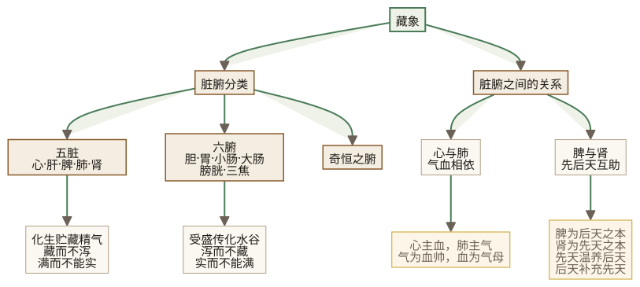
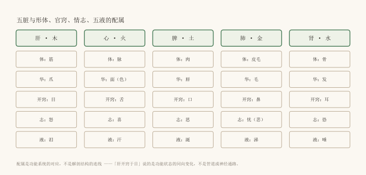
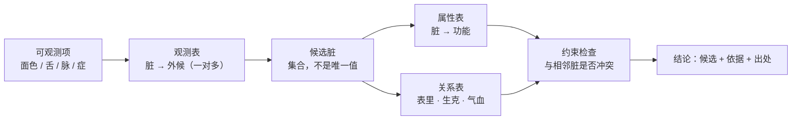

# 第 4 章 · 藏象系统

> **源**：`qhzy-中医基础理论.xlsx` · 表「3脏腑」 · 源文 4,067 字
> **抽取**：`node scripts/import_textbooks.js --only 中医基础理论` · sha256 `870b004ea34b4ec2…` · 2026-10-21
> **层次**：本文件下段是**源教材正文层** —— 节次取自源表的结构列，文字未改写、未压缩、未抽样；文末是**改写层**（`REWRITE:BEGIN/END` 块内 N.1–N.5 + 小结 + 思考题 + 延伸阅读），门见 `tests/test_jichu_textbook.js`。

---

【网络校准·2026-08-07】权威目录'五脏'含附篇(心附心包络、肾附命门),'奇恒之府'含女子胞附精室;另有'人体的生命活动与五脏调节'(神志/血液/呼吸/消化/水液/生长生殖六维)可作 3.6 节扩展。

## 3.1 藏象概论

### 3.1.1 藏象的基本概念

#### 3.1.1.1 “藏”与“象”的内涵解析

“藏”，指藏于体内的脏腑器官与精气；“象”，指脏腑功能活动反映于外的征象及与外界环境的通应现象。藏象学说不局限于西医解剖学的脏器实体，更侧重于功能态的考察。例如，“心”不仅指心脏实体，更囊括了主血脉、主神明的综合功能系统。AI平台将“藏”定义为后台运行的功能程序，将“象”定义为前端输出的可视化信号（如面色、脉象、舌象），帮助学生建立“黑箱理论”的认知模型。

#### 3.1.1.2 藏象学说的形成基础

藏象学说主要基于“以象测藏”的观察法、临床疗效的反证法及古代解剖知识的结合。古人通过对尸体解剖的直观观察（“其死可解剖而视之”），结合对活体生理、病理现象的反复观测，逐渐构建了脏腑概念。现代教材引入数字孪生技术，在虚拟空间中构建人体脏腑的数字镜像，通过模拟生理参数变化，动态展示“象”的变化，印证古代观察的科学性。

### 3.1.2 脏腑分类与功能特点

#### 3.1.2.1 五脏的化生贮藏功能

五脏（心、肝、脾、肺、肾）的共同生理特点是化生和贮藏精气，藏而不泻，满而不能实。它们主持着人体的生长、发育、生殖及生命活动。在AI知识树中，五脏被设定为系统的核心处理器，负责接收、转化、存储生命所需的各种精微物质（气血阴阳），其运行状态决定了整个系统的稳定性。

#### 3.1.2.2 六腑的受盛传化功能

六腑（胆、胃、小肠、大肠、膀胱、三焦）的共同生理特点是受盛和传化水谷，泻而不藏，实而不能满。其功能类似于工业生产中的流水线，负责对饮食物进行受纳、腐熟、消化、吸收及糟粕排泄。平台通过物流仿真算法，模拟水谷在六腑中的传导过程，直观展示“以通为用，以降为顺”的生理特性。

### 3.1.3 五脏与形体、官窍、情志的配属

> **补写层** —— 本节为补齐藏象学说的核心配属而补写，不是源工作簿正文。
> 依据《素问·阴阳应象大论》《素问·五脏生成》《素问·宣明五气》诸篇的五脏配属条文。
> 补写的原因：藏象学说的要义是「藏居于内，形见于外」，若不写清五脏与形体、官窍、情志的
> 对应关系，「以表知里」这一诊断路径就失去落点。源工作簿的本章只写了各脏的生理功能，
> 未展开配属，此处补足。改动只增不改：源正文一字未动，补写独立成节。

藏象学说观察人体的方式，不是把脏腑当成解剖学上的孤立器官，而是把每一脏看成一个功能系统，
并认为这个系统在体表有确定的投射位置。五脏虽然深居于内，其精气却外达于五体、上荣于五华、
开窍于五官、发露为五志、化为五液。这些投射不是比喻，而是被当作可以察看的征象：
望面色、看毛发爪甲、问情志变化，都是在读这些投射。

五脏与五体、五华、五窍、五志、五液的配属如下（五窍一栏用「开窍于」的通行表述）：

| 五脏 | 五体 | 五华 | 开窍于 | 五志 | 五液 |
|---|---|---|---|---|---|
| 肝 | 筋 | 爪 | 目 | 怒 | 泪 |
| 心 | 脉 | 面（色） | 舌 | 喜 | 汗 |
| 脾 | 肉 | 唇 | 口 | 思 | 涎 |
| 肺 | 皮毛 | 毛 | 鼻 | 忧（悲） | 涕 |
| 肾 | 骨 | 发 | 耳 | 恐 | 唾 |

这张表的来源是《素问·阴阳应象大论》的五脏序列——东方生风、风生木、木生酸、酸生肝、肝生筋，
肝主目；南方生热……心主舌；中央生湿……脾主口；西方生燥……肺主鼻；北方生寒……肾主耳。
五体与五华出自《素问·五脏生成》「心之合脉也，其荣色也；肺之合皮也，其荣毛也；肝之合筋也，
其荣爪也；脾之合肉也，其荣唇也；肾之合骨也，其荣发也」。五志出自《素问·阴阳应象大论》各脏
「在志为」诸条，五液出自《素问·宣明五气》「五脏化液：心为汗，肺为涕，肝为泪，脾为涎，
肾为唾」。

配属关系在临床上有两条直接用途。其一是定位：某一官窍或形体的异常，先按此表回推到脏。
目疾多从肝求，舌与面色多从心求，口与唇多从脾求，鼻与皮毛多从肺求，耳与发骨多从肾求。
其二是推断病性：五志过极伤相应之脏（怒伤肝、喜伤心、思伤脾、忧伤肺、恐伤肾），
反过来某一脏的精气盛衰也会表现为情志的偏颇。这两条都不是把症状直接等同于脏病——
按本项目的口径，配属提供的是「往哪里查」的方向，不是诊断结论；结论由具备资质的人员作出。

配属表有一个必须说清的限度：它是**功能系统的对应**，不是解剖结构的连线。中医的「肝开窍于目」
不等于解剖学上肝脏与眼球之间存在管道或神经通路，它陈述的是肝的功能状态与目的功能状态之间
存在稳定的同向变化。把配属关系读成解剖对应，是本章最容易被误读的地方，也是本项目在
「这个翻译丢掉了什么」一节里要专门交代的内容。

## 3.2 五脏系统

### 3.2.1 心系统

#### 3.2.1.1 心主血脉的生理机制

心气充沛是推动血液运行的根本动力。心气充足，则血管充盈，面色红润，脉搏和缓有力；心气虚衰，则血流迟缓，面色苍白，脉细弱或结代。AI生理仿真模块设定了“心泵功能曲线”，学生可通过调节心气、心血的数值，观察血管阻力、血流速度及血压的联动变化，深刻理解“心主血脉”的物理基础。

#### 3.2.1.2 心藏神的精神意识活动

心主宰人的精神、意识、思维活动，故称“五脏六腑之大主”。心血充盈，则神志清晰，思维敏捷；心血不足，则失眠、健忘、多梦。平台利用脑电波（EEG）模拟数据，将不同情绪状态下的脑电波特征与中医“心神”状态相关联，辅助学生理解“七情内伤首先犯心”的神经生物学基础。

### 3.2.2 肺系统

#### 3.2.2.1 肺主气与司呼吸的功能

肺主呼吸之气，吸入清气，呼出浊气；肺主一身之气，参与宗气的生成并调节全身气机。肺失宣降，则出现咳喘、胸闷、少气懒言。AI呼吸系统模型模拟了肺泡气体交换过程，展示了宗气（氧气+水谷精气）的生成机制，以及肺如何通过呼吸运动影响全身气机的升降出入。

#### 3.2.2.2 肺朝百脉与主宣发肃降

肺辅佐心脏运行血液（朝百脉），并通过宣发（向外向上）将卫气和津液布散至体表，通过肃降（向内向下）将津液下输至肾与膀胱。若宣发失常，可见无汗、皮肤水肿；若肃降失常，可见咳喘、小便不利。平台通过流体动力学模拟，展示肺气在不同压力梯度下的布散路径，帮助学生理解“通调水道”的机制。

### 3.2.3 脾系统

#### 3.2.3.1 脾主运化的消化吸收机制

脾将水谷化为精微并转输至全身。包括运化水谷（消化吸收）和运化水液（水代谢）。脾虚运化失职，则见腹胀、泄泻、食欲不振、水肿。AI消化系统模型详细展示了小肠吸收后的营养物质如何经由脾的“转输”功能输送至肝、心、肺、肾等脏器，直观呈现了“脾为后天之本，气血生化之源”的物质代谢基础。

#### 3.2.3.2 脾主统血的固摄作用

脾气具有统摄血液在脉中运行而不溢出脉外的功能。若脾气虚弱，统摄无权，则出现各种出血症（如便血、尿血、崩漏），且血色淡，病程长。平台通过血管通透性模拟，对比正常脾气固摄与脾气虚不摄状态下的红细胞分布，帮助学生理解“气能摄血”的微观病理机制。

### 3.2.4 肝系统

#### 3.2.4.1 肝主疏泄的情志调节作用

肝具有疏通、畅达全身气机的功能。疏泄正常，则气机调畅，情志舒畅，气血调和；疏泄失常，则见情志抑郁或急躁易怒，胸胁胀痛。AI情绪识别模块通过摄像头捕捉学生面部表情，结合心率变异性（HRV）数据，模拟肝疏泄功能对自主神经系统的影响，将抽象的“气机”具象化为可量化的生理指标。

#### 3.2.4.2 肝藏血的调节血量功能

肝具有贮藏血液和调节血量的功能。活动时，肝向外周输布血液；休息时，血归于肝脏。肝血不足，则见视物模糊、肢体麻木、月经不调。平台通过血液循环动力学仿真，模拟人体在静息与运动时，肝脏血流量分配比例的动态变化，验证了“肝为血海”的生理调节功能。

### 3.2.5 肾系统

#### 3.2.5.1 肾藏精的主生长发育生殖

肾精是构成人体和维持生命活动的最基本物质。肾精充足，则生长发育正常，生殖功能健全；肾精亏虚，则见发育迟缓、早衰、不孕不育。AI生长曲线模型模拟了从幼年到老年的生理变化，将“齿、骨、发”的生长状态与肾精盛衰挂钩，帮助学生掌握“肾主骨生髓”的时间生物学特征。

#### 3.2.5.2 肾主水液与主纳气功能

肾具有主持和调节全身水液代谢的作用（肾主水），并能摄纳肺吸入的清气，防止呼吸表浅（肾主纳气）。肾虚气化失司，则见水肿、小便不利；肾不纳气，则见喘息气短。平台通过肾脏滤过与重吸收仿真，展示尿液生成的调节过程，并结合呼吸肌电信号，模拟肾气对呼吸深度的影响。

## 3.3 六腑与奇恒之腑

### 3.3.1 六腑的生理功能

#### 3.3.1.1 胆贮精汁与助消化

胆附于肝，贮存和排泄胆汁。胆汁又称“精汁”，来源于肝之余气，有助于脾胃消化。胆气升发，则消化正常；胆气郁结，则见口苦、黄疸。平台模拟了胆囊收缩与Oddi括约肌舒张的协调性动作，展示胆汁排放进入十二指肠的过程，辅助理解“肝胆相表里”。

#### 3.3.1.2 胃受纳腐熟与通降

胃主受纳腐熟水谷，将饮食物初步消化成食糜，并以通降为顺。胃气上逆，则见恶心、呕吐、嗳气。AI胃动力模型模拟了胃蠕动波的传导及胃排空速率，展示了胃气强弱对食物消化与排空速度的决定性作用，印证了“胃气为本”的诊断学思想。

### 3.3.2 奇恒之腑的生理特点

#### 3.3.2.1 脑为元神之府

脑是精髓和神明汇集之处，主宰精神、意识、思维。脑的功能依赖于肾精的充养和气血的濡润。平台通过神经突触连接模拟，将中医“肾精充脑”理论与现代医学的脑神经网络发育相联系，探讨先天禀赋对智力发育的影响机制。

#### 3.3.2.2 女子胞主月经与孕育

女子胞（子宫）是发生月经和孕育胎儿的器官。其生理功能与肾精、天癸、冲任二脉密切相关。平台构建了女性激素分泌周期模型，模拟雌激素、孕激素在月经周期中的波动，以及这些波动如何受中医“肾气—天癸—冲任”轴的调控，实现了中西医妇科内分泌理论的对接。

## 3.4 脏腑之间的关系

### 3.4.1 脏与脏之间的关系

#### 3.4.1.1 心与肺的气血相依

心主血，肺主气。心推动血液运行，需肺气辅佐；肺吸清吐浊，需心血运载。气为血帅，血为气母。AI心肺循环模型展示了肺换气与体循环的耦合关系，当模拟肺气虚（摄氧能力下降）时，系统自动反馈心输出量下降及口唇发绀的病理现象，生动诠释了“气促血行”的生理病理联系。

#### 3.4.1.2 脾与肾的先后天互助

脾为后天之本，肾为先天之本。先天温养激发后天，后天补充培育先天。脾虚化源不足，则肾虚精亏；肾虚火不生土，则脾失健运。平台通过营养代谢与遗传因子交互模型，模拟了先天基因缺陷（肾精不足）与后天营养不良（脾气虚弱）对生长发育的交互影响，强化了“补脾不如补肾，补肾须兼补脾”的治疗逻辑。

### 3.4.2 腑与腑及脏腑配合关系

#### 3.4.2.1 六腑以通为用的协同性

六腑以通为用，以降为顺。胃降则小肠受盛，小肠分清泌浊则大肠传导，三焦通利则水液运行。一腑不通，则影响他腑。AI构建了消化道压力梯度模型，模拟食物残渣在肠道内的推进过程，直观展示“通”的重要性，以及一处梗阻引发的连锁反应。

#### 3.4.2.2 脏腑表里络属的生理联系

脏与腑通过经脉相互络属，构成表里关系（如脾与胃、肺与大肠）。生理上相互配合，病理上相互影响。例如，肺与大肠相表里，肺气肃降有助于大肠传导，大肠通畅有助于肺气肃降。平台通过肠-肺轴微生物组分析，展示了肠道菌群失调如何影响肺部免疫状态，为中医表里理论提供了现代微生态学证据。

## 3.5 藏象知识的数字化表达

### 3.5.1 脏腑功能图谱构建

#### 3.5.1.1 五脏系统功能关联矩阵

基于大数据挖掘，构建五脏功能的高维关联矩阵。矩阵中不仅包含脏腑间的生理联系（如肝主疏泄助脾运化），还包含病理传变路径（如肝病传脾）。AI算法通过挖掘历代医案数据，自动计算各脏腑间的关联权重，生成可视化的“脏腑亲密度”热力图，帮助学生快速识别核心病机网络。

#### 3.5.1.2 症状—脏腑失调映射模型

建立症状体征与脏腑功能失调的映射字典。例如，输入“腰膝酸软”，系统自动关联“肾精亏虚”；输入“胁肋胀痛”，关联“肝气郁结”。平台利用贝叶斯概率网络，根据症状的并发频率，计算特定脏腑病变的后验概率，辅助学生进行鉴别诊断，提高辨证的准确率。

### 3.5.2 AI驱动的虚拟仿真教学

#### 3.5.2.1 三维脏腑生理机能动画

利用高精度3D建模技术，制作可交互的脏腑解剖与生理动画。学生可在虚拟环境中“剥离”组织，观察脏腑的内部结构；也可缩放时间轴，观察脏腑功能的动态变化（如心脏的收缩舒张、胃肠的蠕动消化）。这种沉浸式体验极大提升了学生对抽象藏象概念的感性认知。

#### 3.5.2.2 藏象失衡的病理推演系统

该系统允许学生人为设定病理参数（如“心火上炎”或“脾阳不振”），系统随即自动推演出一系列连锁病理反应。例如，设定“肝失疏泄”，系统自动演示肝气横逆犯脾、气滞血瘀、化火生风等一系列演变过程。这种“如果—那么”式的推演训练，有效培养了学生的中医临床逻辑思维能力和预见性。

---

> **免责声明**：本教材内容仅用于教育与科研，不构成任何诊疗建议。
> 本文件由 `scripts/import_textbooks.js` 从源工作簿生成，请勿手改 —— 需要修改请改源工作簿后重跑。

<!-- REWRITE:BEGIN -->
## 本章要回答的问题

「藏」在里、「象」在外，中间那条对应关系，凭什么成立？把它画成「脏腑—功能—征象」的三层图之后，我们究竟是说清楚了它，还是只是把说不清的地方挪到了边上？

## N.1 概念与出处

| 概念 | 出处（书名·篇名） | 本章源节 |
|---|---|---|
| 藏象的定义与问法 | 《素问·六节藏象论》：「心者，生之本，神之变也；其华在面，其充在血脉。」 | `3.1.1` |
| 五脏六腑的功能分野 | 《素问·五脏别论》：「所谓五脏者，藏精气而不泻也，故满而不能实；六腑者，传化物而不藏，故实而不能满也。」 | `3.1.2`、`3.3.1` |
| 十二官的职能命名 | 《素问·灵兰秘典论》：「心者，君主之官也，神明出焉。」 | `3.2.1` |
| 脏腑之间的配属 | 《素问·六节藏象论》诸脏“其华／其充／通于某气”句式 | `3.4.1` |
| 藏象的数字表达 | 本项目的设计选择（非原典）：关联矩阵 + 症状映射 | `3.5.1` |

读这张表要把「句式」当证据看：《六节藏象论》给每个脏都配了「其华—其充—通于某气」三件，这不是修辞，是**固定的三元组**。凡是原典用固定句式反复给出的内容，就是它自己已经结构化过一次的东西 —— 我们的工作只是把这层结构显式化，而不是替它发明结构。

## N.2 为什么可以这样翻译

藏象的推理形状是「从外到内的一次反查」，可以拆成三张表：

1. **脏 → 功能**（心主血脉、主神明；肺主气、司呼吸……）—— 这是**属性表**；
2. **脏 → 外候**（其华在面、开窍于舌、在液为汗……）—— 这是**观测表**；
3. **脏 → 脏**（表里、生克、气血相依）—— 这是**关系表**。

三张表合起来就是一个可反查的图：给定一组外候（面赤、舌尖红、脉数），沿观测表的边回溯到脏，再用关系表检查是否与相邻脏的约束冲突。这正好对应本章 `3.5.1` 所讲的「五脏功能关联矩阵」—— 矩阵的行是脏、列是可观测项，格内是该脏在该项上的可能表现。

关键一步是**允许一对多**。同一个「面色赤」既可能指心火，也可能指阳明热盛。凡把观测表做成一対一的系统，都会在真实病人身上崩掉；所以矩阵的每个格子里存的是候选集合，不是唯一答案。

图的读法：**从外候进入，从约束出来**。中间那三个节点都不许收敛成一个答案 —— 收敛留给医师。

还有一个必须写在表示层的细节：**配属冲突怎么处置**。当观测表给出「面赤 → 心火」而关系表显示「心火未涉脾」时，两条约束并不矛盾；但若观测表同时给出「面赤 → 阳明热盛」，而阳明属胃（与脾相表里），系统就必须把两条候选并列，并把「何者优先」交回给四诊合参。凡是系统在此处自作主张地排序，都是把教材的推理换成了自己的推理 —— 这是本课程最不能接受的一种越权。

## N.3 这个翻译丢掉了什么

**一、丢掉了「象」的时间维度。** 「其华在面」描述的是常态；病程中的面色变化是动态序列，而表里只有静态格。同一个面色，上午与傍晚的意义可以不同。本书的处理是加「时相」字段，但字段再多也补不回连续变化。

**二、丢掉了脏腑概念的「功能簇」性质。** 「脾」不等于解剖学的脾：它包含运化、统血、升清、主肌肉等一簇功能，且这一簇在历代有伸缩。把「脾」做成一个节点，必须注明是哪一簇；否则跨学科引用时会在无声处走形。

**三、丢掉了「象」的互文。** 面、舌、脉、症之间是相互印证的，不是彼此独立的证据。矩阵化会诱导我们把它们当独立特征做加权 —— 而原典的用法是「合参」，即相互校验。这一点在算法上表现为：证据不必独立同分布，相关性本身就是信息。

**四、丢掉了「藏」的不可见性。** 藏象之所以叫藏象，前提是「藏」不可直接观察。图谱把脏画成节点之后，容易让人误以为节点就是实体。因此本书在脏节点上加一句固定注解：**此节点是功能与配属的集合，不是器官实体**。

## N.4 与相邻学科的接口

| 学科 | 用到本章的什么 | 以什么形式用 |
|---|---|---|
| 中医诊断学 | 观测表（脏 → 外候） | 四诊结果落表，得到候选脏 |
| 经络腧穴学 | 脏腑—经络的表里配属 | 经脉归属作为约束条件 |
| 中药学 | 归经字段 | 药物的归经直接复用脏节点 |
| 中医内科学 | 脏腑病机的骨架 | 病位判定以本章节点为单位 |
| 数据工程 | 关联矩阵与症状映射 | 见 `3.5.1`、`3.5.2` 的实现说明 |

## N.5 争议与本项目立场

**争议一：藏象是解剖的还是功能的？** 一派主张藏象源于古代解剖观察，另一派主张它是功能模型的集合。

本项目立场：**按功能簇建节点，解剖对应关系只在「别名 / 备注」里写，不进入判断层。** 理由是：一旦把节点等同器官，藏象学说内部那些「一脏多能、多脏共能」的表述立刻自相矛盾。

**争议二：矩阵化会不会把辨证变成打分？** 有学者担心，量化会掩盖「合参」的判断艺术。

本项目立场：矩阵只用于**检索候选**，不用于排序打分。凡是要给出「最可能」的地方，必须同时给出被排除项与被排除的理由 —— 只报一个答案的辨证系统，在本书里视为不合格。

> **免责声明**：本章为教材说明，不构成诊断或治疗建议。藏象配属的临床使用须由执业中医师结合四诊与患者具体情况判断。

## 本章小结

1. 藏象的可翻译性来自原典自己的固定句式：其华—其充—通于某气，是三元组，不是修辞。
2. 三层表（属性 / 观测 / 关系）合起来才构成可反查的图；观测表必须一对多。
3. 丢掉的是时间维度、功能簇的伸缩、象的互文与「藏」的不可见性。
4. 本项目只把矩阵当检索层，不当打分器；节点是功能集合，不是器官。

## 思考题

1. 「其华在面」与「开窍于舌」属于同一类观测吗？若不是，观测表该分几列？
2. 若两位医家对「脾」的功能簇取法不同，节点应合并还是分列？说明它对归经的影响。
3. 请举一个「面赤」被误判的例子，并指出系统应在哪一步拦下它。

## 延伸阅读

- 《素问·六节藏象论》—— 「藏象何如」的原始问法与三元组句式
- 《素问·五脏别论》—— 五脏「藏精气而不泻」与六腑「传化物而不藏」的分野
- 《素问·灵兰秘典论》—— 十二官职能命名，藏象的政制隐喻
- 本仓库 `standards/jichu/units.json`（章 3 段）—— 本章源节索引
<!-- REWRITE:END -->
