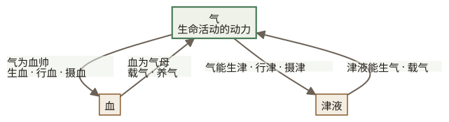
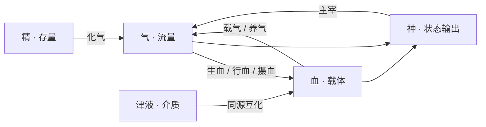

# 第 5 章 · 精气血津液神

> **源**：`qhzy-中医基础理论.xlsx` · 表「4精神」 · 源文 4,581 字
> **抽取**：`node scripts/import_textbooks.js --only 中医基础理论` · sha256 `870b004ea34b4ec2…` · 2026-10-21
> **层次**：本文件下段是**源教材正文层** —— 节次取自源表的结构列，文字未改写、未压缩、未抽样；文末是**改写层**（`REWRITE:BEGIN/END` 块内 N.1–N.5 + 小结 + 思考题 + 延伸阅读），门见 `tests/test_jichu_textbook.js`。

---

【网络校准·2026-08-07】'精气血津液神'与规划教材一致(神并入本单元,不单独成章);'气'节含元气/宗气/营气/卫气四类,与权威目录'精、气、血、津液'结构吻合。

## 4.1 精

### 4.1.1 精的分类与代谢

#### 4.1.1.1 先天之精与后天之精的来源

精是构成人体和维持生命活动的最基本物质。先天之精禀受于父母，藏于肾，具有繁衍生命、决定体质的作用；后天之精源于水谷，由脾胃运化生成，输布于五脏六腑，滋养全身。两者在肾中融合为一，统称肾精。AI代谢模型将先天之精定义为初始常量，后天之精定义为动态变量，模拟不同饮食结构对后天之精的补充效率，以及后天之精对先天之精的滋养程度。

#### 4.1.1.2 精的贮藏、施泄与化生

肾为“封藏之本”，主藏精。精的施泄有两种形式：一是分次排泄生殖之精，主生殖繁衍；二是布散全身，滋养脏腑，主生长发育。若肾失封藏，则见遗精、滑胎、早衰。平台通过负反馈调节仿真，模拟下丘脑-垂体-性腺轴（HPG轴）如何调控生殖之精的生成与排泄，直观展示中医“肾藏精”与现代内分泌调控机制的对应关系。

### 4.1.2 精的生理功能

#### 4.1.2.1 繁衍生命与濡养脏腑

精是生命的原始物质，男女生殖之精结合，构成新的生命体。出生后，肾精不断充养脏腑，促进骨骼生长、脑髓充盈。平台通过生长曲线拟合，将儿童身高、牙齿萌出时间及智力发育水平与肾精数值挂钩，辅助学生理解“肾精主生长发育”的量化指标。

#### 4.1.2.2 化血、化气、化神的源泉

精能化血（精血同源），精能生气（精气互生），精能化神（积精全神）。精亏则血虚、气虚、神衰。AI知识图谱构建了“精-气-血-神”转化金字塔，展示精作为底层资源的转化路径。例如，输入“大出血”事件，系统自动触发“精亏”预警，因为血去精亏，体现了“夺血者无汗，夺汗者无血”的中医原理。

## 4.2 气

### 4.2.1 气的生成与运动

#### 4.2.1.1 元气、宗气、营气、卫气的生成

元气根于肾，由肾精化生；宗气聚于胸中，由肺吸入的清气与脾胃运化的水谷精气结合而成；营气行于脉中，源于水谷精微的清柔部分；卫气行于脉外，源于水谷精微的慓悍部分。平台通过资源分配算法，模拟人体如何将有限的水谷精微分配给不同的气，当脾胃功能受损（输入“泄泻”指令）时，系统展示营卫之气生成减少的动态过程。

#### 4.2.1.2 气机升降出入的运动形式

气的运动称为气机，基本形式为升、降、出、入。脏腑气机各有特点：脾气主升，胃气主降；肺气宣发（出）与肃降（入）。气机调畅，则脏腑功能协调；气机失调，则见气滞、气逆、气陷、气闭。AI流体动力学模型模拟了胸腔与腹腔的压力变化，展示呼吸运动中肺气的宣降与脾胃升降的协同关系，帮助学生理解“气机调畅”的物理学意义。

### 4.2.2 气的主要功能

#### 4.2.2.1 推动作用与温煦作用

气具有激发和推动生长发育、脏腑功能及血液运行的作用（推动）；气能产热，维持体温恒定（温煦）。气虚则见发育迟缓、畏寒肢冷、血行迟缓。平台通过能量代谢仿真，将ATP生成速率与“阳气”数值关联，当模拟“阳虚”状态时，系统自动降低基础代谢率和产热量，导致体温下降和酶活性降低。

#### 4.2.2.2 防御作用与固摄作用

气护卫肌表，抵御外邪（防御）；气控制液态物质（血、津液、精液）不无故流失（固摄）。卫气不足则易感冒，气虚不摄则见自汗、出血、遗尿。AI免疫系统模

## 4.3 血

### 4.3.1 血的生成与运行

#### 4.3.1.1 脾胃生化与肾精化血

血主要由营气和津液组成，源于脾胃运化的水谷精微（“中焦受气取汁，变化而赤是谓血”）。此外，肾精可化血（精血同源）。饮食摄入不足或脾胃功能减退，则血虚。平台通过造血原料供应链模型，模拟铁、叶酸、维生素B12等微量元素在“水谷精微”中的占比，及其对红细胞生成的影响，印证“脾胃为气血生化之源”。

#### 4.3.1.2 心主血、肺助血、肝藏血的运行机制

血液运行依赖于多个脏腑的协同：心气推动（泵血）、肺气辅佐（朝百脉）、肝主疏泄（调畅气机）与藏血（调节血量）、脾主统血（固摄）。任一环节失常均可导致血瘀或出血。AI心血管循环模型模拟了不同病理状态下的血流动力学变化，如心气虚导致射血分数下降，肝血瘀滞导致门静脉高压，使学生直观理解“心主血脉”的系统工程特性。

### 4.3.2 血的生理功能

#### 4.3.2.1 濡养滋润全身脏腑组织

血含有丰富的营养物质，循行全身，濡养五脏六腑、四肢百骸。血虚失养，则见面色萎黄、爪甲枯槁、肌肤干燥、头晕眼花。平台通过微循环灌注仿真，展示毛细血管密度与血氧饱和度对组织营养状态的影响，当模拟“血虚”或“血瘀”时，系统自动标记缺血缺氧的组织区域（如指甲、口唇），辅助理解“血虚生风”的微观机制。

#### 4.3.2.2 神志活动的物质基础

血是神志活动的物质基础，“血脉和利，精神乃居”。血虚或血热扰心，均可导致神志异常，如失眠、健忘、烦躁、谵妄。AI脑功能成像模拟展示了不同血红蛋白浓度与脑电活动的相关性，当模拟“心血虚”时，系统呈现大脑皮层慢波活动增加（嗜睡、乏力），当模拟“热入营血”时，呈现快波活动增强（躁狂、谵语）。

## 4.4 津液

### 4.4.1 津液的代谢过程

#### 4.4.1.1 津液的生成与输布

津液来源于饮食水液，由脾胃运化，上输于肺，通过肺的宣发输布至皮毛，通过脾的转输与肾的气化布散至全身。津液代谢涉及肺、脾、肾、三焦等多个脏腑。平台通过体液平衡调节模型，模拟饮水后体液渗透压的变化，以及抗利尿激素（ADH）和醛固酮的分泌如何调节肾小管重吸收，展示中医“肾主水液”与神经内分泌调节的一致性。

#### 4.4.1.2 肺脾肾三焦在津液代谢中的作用

肺为水之上源，主行水；脾居中焦，主运化水液；肾为主水之脏，主气化；三焦为水道。肺失宣降则水泛高原（水肿），脾失健运则湿浊内生，肾阳不足则水液停聚。AI构建了三焦水道流体网络，学生可通过堵塞不同节点（如“肺气壅塞”或“肾阳虚衰”），观察水液潴留的部位（如眼睑、下肢或全身），理解“其本在肾，其标在肺，其制在脾”的理论。

### 4.4.2 津液的生理功能

#### 4.4.2.1 滋润濡养与充养血脉

津液质地清稀，分布于体表、孔窍，起滋润作用；质地稠厚，分布于关节、脏腑，起濡养作用。津液入脉，可充养血脉，调节血液黏稠度。津液不足，则见口干舌燥、皮肤干燥、大便干结。平台通过皮肤水合度与黏膜湿润度传感器数据模拟，量化评估津液盈亏，辅助理解“燥邪伤津”的临床表现。

#### 4.4.2.2 调节机体阴阳平衡

津液属阴，具有凉润、制约阳热的作用。津液充足，则体温恒定，不燥不热；津液亏损，则阳热相对亢奋，出现虚热内生。AI热力学模型模拟了体液蒸发散热过程，当模拟“大汗伤津”时，系统初期呈现体温升高（阳热相对亢奋），后期因气随津脱而出现血压下降和体温不升，深刻揭示了津液在阴阳平衡中的双重角色。

## 4.5 神

### 4.5.1 神的分类与含义

#### 4.5.1.1 广义之神与狭义之神

广义之神是人体生命活动的主宰及其外在征象的总称，涵盖生理、心理及病理状态；狭义之神特指人的精神、意识、思维活动，即心主神明。平台通过多模态数据采集（面部表情、语音语调、肢体动作、眼动轨迹），构建“神”的量化评估模型，将中医“得神”、“失神”、“假神”等定性描述转化为可分析的定量指标。

#### 4.5.1.2 五神、五志与五脏的关系

五神（神、魂、魄、意、志）分属五脏：心藏神，肝藏魂，肺藏魄，脾藏意，肾藏志。五志（喜、怒、思、悲、恐）亦分属五脏。情志过激，直接损伤相应脏腑。AI情感计算模型分析了不同情绪状态下的自主神经反应（心率变异性、皮肤电反应、呼吸频率），验证了“怒伤肝”、“思伤脾”等情志致病理论的生理学基础。

### 4.5.2 神的功能与表现

#### 4.5.2.1 主宰生命活动与意识思维

神是人体一切生理活动的最高调控中心。神旺则生机旺盛，反应灵敏；神衰则萎靡不振，反应迟钝。平台通过脑电图（EEG）与功能性近红外光谱（fNIRS）数据模拟，展示大脑前额叶皮层活动与“心神”状态的关联，探讨“心主神明”与大脑皮层高级功能的对应关系。

#### 4.5.2.2 情志活动对健康的影响

正常的情志活动是脏腑功能正常的表现；突然、强烈或持久的情志刺激，则成为致病因素（七情内伤）。如暴怒伤肝，导致肝气上逆；过度思虑伤脾，导致脾气郁结。AI心理应激模型模拟了慢性压力对下丘脑-垂体-肾上腺轴（HPA轴）的持续激活，导致皮质醇水平升高，进而引起免疫抑制、代谢紊乱和脾胃功能障碍，为“因病致郁”和“因郁致病”提供了生物化学证据。

## 4.6 精气血津液神的关系

### 4.6.1 气与血的关系

#### 4.6.1.1 气为血帅：生血、行血、摄血

气能生血（气化作用促进血液生成），气能行血（推动血液运行），气能摄血（固摄血液不溢出脉外）。气虚

#### 4.6.1.2 血为气母：载气、养气

血是气的载体，气必须依附于血（或津液）才能在体内运行；血同时滋养气，为气的功能活动提供营养。血虚则气无所附，导致气衰。AI构建了“气-血绑定模型”，当模拟大出血时，系统自动演示“气随血脱”的连锁反应，即血容量下降导致回心血量减少，进而引起血压下降和休克，印证了“血为气之母”的临床意义。

### 4.6.2 气与津液的关系

#### 4.6.2.1 气能生津、行津、摄津

气能促进津液生成（脾胃气化），推动津液输布（肺脾肾功能），固摄津液排泄（卫气温分肉，司汗孔开合）。气虚则津亏、水停、多汗。平台通过汗腺分泌调节仿真，模拟气虚卫外不固时，汗液不受控制地外泄，导致脱水；同时模拟气虚推动无力时，组织间隙液回流受阻，形成水肿。

#### 4.6.2.2 津液能生气、载气

津液是气的重要来源之一（津液气化生血，血生气）；津液亦是气的载体。津液大量丢失，则气随之耗散。AI通过脱水与休克模拟，展示严重呕吐、腹泻导致津液暴脱时，伴随出现的气虚症状（乏力、气短、脉微），以及由此引发的“气随津脱”危象，强调了补液在治疗气脱证中的重要性。

## 4.7 AI辅助物质能量代谢教学

### 4.7.1 生理过程动态模拟

#### 4.7.1.1 气血运行三维可视化

利用虚拟现实（VR）技术，构建人体微循环全景模型。学生可“潜入”血管内，观察红细胞携氧运输、白细胞吞噬病原体及血小板凝血的全过程。系统实时显示血氧饱和度、pH值及代谢产物浓度，将抽象的“气血运行”具象化为可观察、可测量的物理化学过程，加深对“气主煦之，血主濡之”的理解。

#### 4.7.1.2 津液代谢通路仿真

基于流体力学原理，模拟水液在人体内的吸收、转运、分布与排泄全过程。学生可追踪一杯水从口腔摄入，经胃肠道吸收进入血液循环，再经由呼吸、汗液、尿液排出的完整路径。通过改变参数（如“环境温度”或“运动量”），观察津液分布的动态调整，直观理解“津液代谢”的动态平衡机制。

### 4.7.2 异常状态的智能推演

#### 4.7.2.1 气虚、血虚、阴虚、阳虚的演变路径

AI系统预设了“精气血津液失衡演化树”。学生选择初始病理节点（如“长期饮食不规律”），系统自动推演其后续发展路径：脾气虚→气血生化无源→血虚→血不养心→心悸失眠→心脾两虚。系统根据概率权重，展示多种可能的演变分支，培养学生动态、发展的临床思维。

#### 4.7.2.2 气滞、血瘀、痰饮的形成机制

通过分子动力学模拟，展示微观层面的病理变化。例如，模拟高脂血症时，低密度脂蛋白（LDL）在血管壁沉积，引发炎症反应，导致血管内皮损伤和血小板聚集（血瘀）；模拟呼吸道黏液腺分泌亢进，黏液清除率下降，形成痰液（痰饮）。将宏观的“气滞血瘀”与微观的细胞分子事件联系起来，提升学生对病理机制的认识深度。

---

> **免责声明**：本教材内容仅用于教育与科研，不构成任何诊疗建议。
> 本文件由 `scripts/import_textbooks.js` 从源工作簿生成，请勿手改 —— 需要修改请改源工作簿后重跑。

<!-- REWRITE:BEGIN -->
## 本章要回答的问题

精、气、血、津液、神，这五个词看起来像五种「东西」。可它们当中，有的确实是物质，有的其实是过程，有的是状态。把它们都建成同一个层级的节点，会不会从第一步就把它们揉成同一类？

## N.1 概念与出处

| 概念 | 出处（书名·篇名） | 本章源节 |
|---|---|---|
| 精为生命之本 | 《灵枢·本神》：「生之来谓之精，两精相搏谓之神。」 | `4.1.1` |
| 气的生成与宣发 | 《灵枢·决气》：「上焦开发，宣五谷味，熏肤，充身，泽毛，若雾露之溉，是谓气。」 | `4.2.1` |
| 气的失常为百病之始 | 《素问·举痛论》：「百病生于气也。」 | `4.2.2` |
| 血濡养形体 | 《素问·五脏生成》：「肝受血而能视，足受血而能步，掌受血而能握，指受血而能摄。」 | `4.3.2` |
| 津液的输布通路 | 《素问·经脉别论》：「饮入于胃，游溢精气，上输于脾，脾气散精，上归于肺，通调水道，下输膀胱。」 | `4.4.1` |
| 神为血气之所养 | 《素问·八正神明论》：「血气者，人之神，不可不谨养。」 | `4.5.2` |
| 气血相随 | 《灵枢·营卫生会》论营卫同行之道 | `4.6.1` |
| 代谢过程的仿真 | 本项目的设计选择（非原典）：气血运行可视化 | `4.7.1` |

这张表最值得注意的是「气」的两条出处并列：一条讲**生成与宣发**（决气），一条讲**失常即病**（举痛论）。同一个「气」，前一条当物质与功能讲，后一条当病理枢机讲。凡是把气只建成一个属性的系统，都必然在其中一条上失准。

## N.2 为什么可以这样翻译

这五个概念不在同一个逻辑层级，翻译时**先分层，再建节点**：

| 概念 | 逻辑类型 | 表示方式 | 判据 |
|---|---|---|---|
| 精 | 存量（stock） | 带「来源 / 贮藏 / 施泄」三字段的资源 | 能回答「还剩多少、从哪来、往哪去」 |
| 气 | 流量 + 动力（flow + driver） | 带方向与时序的流，附推动/温煦/固摄/防御四类作用 | 能回答「往哪走、推动什么」 |
| 血 | 载体（carrier） | 依附于脉道的运载介质 | 能回答「载什么、到哪里」 |
| 津液 | 介质（medium） | 分布于体表与体腔的液体环境 | 能回答「润何处、由谁输布」 |
| 神 | 状态输出（state） | 由四者共同决定的可观测状态 | 能回答「整体在什么状态」 |

分成 stock / flow / carrier / medium / state 五类，好处是**关系可以直接写成约束**：精可化气（stock → flow）、气能生血（flow → carrier）、血为气母（carrier → flow）、津血同源（medium ↔ carrier）、血气者人之神（stock + flow → state）。这些箭头都是原典明写的句子，不是我们加的。

反过来说，若把五者都建成平级节点、只用「相关」连边，则「气能生血」与「血能载气」两条方向相反的因果会被压成同一条无向边 —— 那是表示层的错误，不是理论的错误。

图的要点是**箭头方向就是因果方向**，且相反方向必须单独画一条 —— 这正是 `4.6.1` 所讲的「气为血帅 / 血为气母」两句话的图形化。

再补一句操作层的约定：图上每个节点都必须带「可观测项」。精不可直接观测，它以发脱、齿摇、生长发育迟缓等外候出现；气不可直接观测，它以声低、乏力、畏寒等出现。凡是标不出观测项的节点，在本课程里只能作教学概念，不能进检索层 —— 这条约定防止我们把「不可测」的东西当成「已测」。

## N.3 这个翻译丢掉了什么

**一、丢掉了「气」的一身多相。** 元气、宗气、营气、卫气，是同一概念在不同部位与功能上的名称。分层建节点会逼我们决定「气」是一个节点还是四个节点。本书取折中：一个父节点 + 四个子节点，父节点只作检索入口，不承载判断。

**二、丢掉了「神」的不可量化。** 神是状态输出，但原典对神的描述全是质的（得神、失神、假神），没有量的刻度。我们的「状态」字段只能用枚举值，一旦有人给它配分数，就超出了原典。

**三、丢掉了血与津液的边界模糊。** 「津血同源」意味着二者在病理上可以互损，临床上「先血后水、先水后血」的次序也有讲究。双向边能表达互化，表达不了次序。

**四、丢掉了一句关键的口语经验。** 「气有余便是火」这类判断，本质是流量过载的定性描述；系统能标「过载」，标不出「火」这个语义跳跃。凡是这类跳跃，本书一律保留原词，不改写成「过热」。

## N.4 与相邻学科的接口

| 学科 | 用到本章的什么 | 以什么形式用 |
|---|---|---|
| 中医诊断学 | 气血津液辨证的分型 | 直接复用本章的 stock/flow 字段 |
| 中药学 | 补气、养血、生津、安神的功效归位 | 功效动词映射到本章五类的操作 |
| 方剂学 | 君臣佐使与「气血双补」的配伍逻辑 | 用关系边检查配伍是否成对 |
| 生理学（现代） | 代谢与循环的对照 | 只做对照，不做等同 |
| 数据工程 | 状态推演与可视化 | 见 `4.7.2` 的异常推演说明 |

## N.5 争议与本项目立场

**争议一：气是物质还是功能？** 这是本课程最老的争论。物质论者举「熏肤充身泽毛」，功能论者举「百病生于气」。

本项目立场：**气是「流量 + 动力」，两者不可分开建节点。** 只建物质会把「百病生于气」讲成一句空话；只建功能会把「若雾露之溉」的具象抹掉。折中的代价已在 N.3 第一条写明。

**争议二：神是否应纳入基础理论的「物质」序列？** 有意见认为神属心理范畴，与精气血津液不同质。

本项目立场：**神作为状态输出纳入，但不作为可补之「物」纳入。** 「安神」是操作，「神是一种物质」不是本书的命题。

> **免责声明**：本章为教材说明，不构成诊断或治疗建议。凡涉补益、攻伐的具体用药，须由执业中医师辨证后决定。

## 本章小结

1. 五个概念不在同一逻辑层级：精存量、气流量、血载体、津液介质、神状态。
2. 关系必须写成有向约束，方向即因果；反向关系单独建边。
3. 丢掉的是气的一身多相、神的不可量化、津血互化的次序与语义跳跃。
4. 本项目保留原词，不做「科学化」改写；跳跃处标「保留原词」，供人判断。

## 思考题

1. 「气能生血」与「血能载气」若用一条无向边表示，会在哪个临床场景下给出错误结论？
2. 元气、宗气、营气、卫气，父节点该承载什么、不该承载什么？
3. 请为「神」设计一个只有枚举值、没有分数的状态字段，并说明它如何支持「得神 / 失神」的判断。

## 延伸阅读

- 《灵枢·本神》—— 精、神、魂、魄、意、志的定义链
- 《灵枢·决气》—— 一气六名的原始分法（精、气、津、液、血、脉）
- 《素问·举痛论》—— 「百病生于气也」的九气为病
- 《素问·经脉别论》—— 津液输布的通路描述
- 本仓库 `standards/jichu/units.json`（章 4 段）—— 本章源节索引
<!-- REWRITE:END -->
