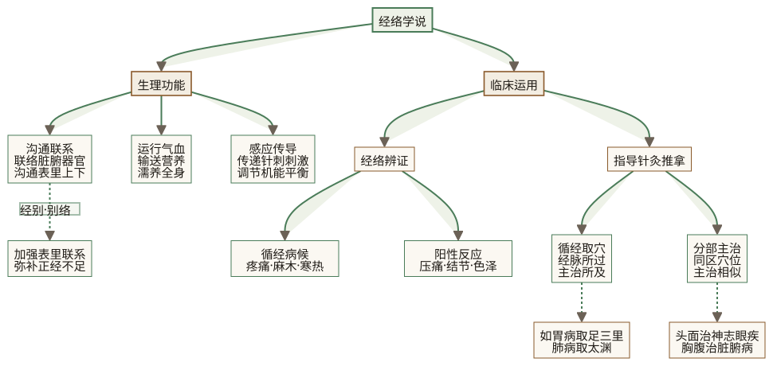

# 第 6 章 · 经络系统

> **源**：`qhzy-中医基础理论.xlsx` · 表「5经络」 · 源文 4,245 字
> **抽取**：`node scripts/import_textbooks.js --only 中医基础理论` · sha256 `870b004ea34b4ec2…` · 2026-10-21
> **层次**：本文件是**源教材正文层** —— 节次取自源表的结构列，文字未改写、未压缩、未抽样。改写层（N.3「这个翻译丢掉了什么」/ N.5「争议与本项目立场」）尚未撰写，见 `textbooks/README.md` 章契约。

---

【网络校准·2026-08-07】权威目录经络章另含'经络的生理功能'与'经络学说的应用'两节(本版 5.5 已覆盖应用,5.1.1.2 已含生理功能);十二经脉含'十二经循行歌'可作附录。

## 5.1 经络概论

### 5.1.1 经络的概念与组成

#### 5.1.1.1 经脉与络脉的结构层次

经络是人体内运行气血、联络脏腑肢节、沟通内外上下的通道系统。经脉是主干，深而在里，贯通上下，包括十二正经与奇经八脉；络脉是分支，浅而在表，纵横交错，包括十五别络、浮络与孙络。AI平台将经络系统建模为多层生物网络：经脉是骨干光缆，络脉是接入网线，气血是传输信号，脏腑是服务器节点，以此模拟信息的高效传递与资源调配。

#### 5.1.1.2 经络系统的生理功能

经络具有三大核心功能：沟通联系（联络脏腑器官，沟通表里上下）、运行气血（输送营养，濡养全身）、感应传导（传递针刺等刺激信号，调节机能平衡）。平台通过生物电信号传导仿真，模拟针刺“得气”后，神经冲动沿特定路径（经络线）传导的速度与衰减规律，验证经络的“传导性”特征。

### 5.1.2 经络学说的形成与发展

#### 5.1.2.1 古代解剖与临床实践的积累

经络学说源于古人对解剖结构的直观观察（“经脉十二，络脉十五”）及对针灸、导引等临床疗效的反复验证。长期的医疗实践中，古人发现体表特定部位与内脏病变存在固定联系，逐渐归纳出经络循行路线。AI通过古籍文本挖掘算法，对《内经》《难经》等典籍中的经络描述进行词频分析和语义网络构建，还原经络理论从零散经验到系统学说的演化历程。

#### 5.1.2.2 现代对经络实质的探索

现代研究从神经、体液、免疫等多角度探讨经络实质。主流假说包括：神经传导说（经络与神经干分布相关）、体液循环说（经络与淋巴或组织液流动相关）、筋膜结缔组织说（经络是富含神经感受器的筋膜链）。平台集成红外热成像与电阻抗扫描数据，可视化展示循经感传现象及低电阻特性，为学生提供客观的科研视角。

## 5.2 十二经脉

### 5.2.1 十二经脉的命名与分布

#### 5.2.1.1 手足三阴三阳的命名规律

十二经脉根据脏腑归属、阴阳属性及行走部位命名。如“手太阴肺经”，即表示该经脉分布于手部、属阴、隶属于肺脏。阴经属脏，阳经属腑；阴经行于四肢内侧，阳经行于四肢外侧。AI构建命名规则推理引擎，学生输入“足”“阳”“胃”三个关键词，系统自动生成“足阳明胃经”并关联其属性，强化记忆逻辑。

#### 5.2.1.2 体表循行部位的规律性

十二经脉在体表的分布具有对称性（左右各一）和连续性。头面部：阳明经行于面额，少阳经行于侧头，太阳经行于头顶及后头；躯干部：少阴经行于胸腹，阳明经行于胸腹及背部，太阳经行于背部。平台通过AR（增强现实）叠加技术，学生使用平板对准人体模型，即可透视皮下经络走向，直观掌握“分布规律”。

### 5.2.2 十二经脉的走向与交接

#### 5.2.2.1 手三阴从胸走手规律

手三阴经（肺、心包、心）均起于胸部（属脏），循行于上肢内侧，终止于手指末端。具体为：手太阴肺经从胸走手拇指，手厥阴心包经从中胸走手中指，手少阴心经从胸走手小指。AI动画模拟气血流注方向，以粒子流形式展示气血从胸腔出发，沿手臂内侧流向指尖的动态过程，验证“从胸走手”的物理路径。

#### 5.2.2.2 足三阳从头走足规律

足三阳经（胃、胆、膀胱）均起于头部（下络脑），循行于躯干及下肢外侧，终止于

### 5.2.3 十二经脉的流注次序

#### 5.2.3.1 肺寅大卯胃辰宫的流注序列

十二经脉气血流注始于寅时（3-5点）手太阴肺经，依次相传：肺经→大肠经→胃经→脾经→心经→小肠经→膀胱经→肾经→心包经→三焦经→胆经→肝经，终于丑时（1-3点）足厥阴肝经，次日寅时复始。AI时钟模拟器将时间生物学引入经络教学，学生拨动虚拟时钟，观察不同时辰气血旺盛的经脉及其对应的脏腑功能峰值，理解“子午流注”理论。

#### 5.2.3.2 气血在经脉中的循环灌注

气血在十二经脉中循环往复，如环无端，构成人体生命活动的能量循环圈。任何一个环节的阻滞都会导致气血运行失常。平台通过环形流体动力学模型，模拟气血在闭合回路中的流动。当模拟“针刺合谷穴”时，系统展示气血流注速度在局部加快，并通过神经反射调节远端（如头面部）的血流分布，体现经络的整体调节功能。

## 5.3 奇经八脉

### 5.3.1 奇经八脉的特点与功能

#### 5.3.1.1 督脉总督一身之阳经

督脉行于后背正中，多次交会手足三阳经，故称“阳脉之海”。其主要功能是总督诸阳，调节全身阳经气血，并与脑、脊髓、肾密切相关。AI构建了“阳气调控中心”模型，将督脉视为人体阳气的“主干道”，当模拟“督脉亏虚”时，系统展示全身各阳经气血水平普遍下降，出现畏寒、倦怠等阳虚症状。

#### 5.3.1.2 任脉总任一身之阴经

任脉行于前正中线，多次交会手足三阴经，故称“阴脉之海”。其主要功能是总任诸阴，调节全身阴经气血，并主胞胎，与生殖功能相关。平台通过生殖系统激素调节仿真，模拟任脉气血充盈对子宫内膜增厚及卵泡发育的影响，将“任主胞胎”与现代生殖内分泌学联系起来。

### 5.3.2 冲脉、带脉及其他奇经

#### 5.3.2.1 冲脉为十二经脉之海

冲脉上渗诸阳，下灌三阴，与十二经脉相通，故称“十二经脉之海”或“血海”。其功能主要是调节十二经气血，并促进生殖功能。AI血流动力学模型展示冲脉作为中央分流器的角色，根据机体需求，动态调节向各经脉分配的气血流量，尤其在女性月经周期中，冲脉的“蓄溢”功能尤为显著。

#### 5.3.2.2 带脉约束纵行诸经

带脉环腰一周，如腰带般约束纵行的诸经。其功能主要是约束纵行经脉，主司下肢运动，并关乎妇女的带下病。平台通过力学平衡仿真，模拟带脉松弛时，纵行经脉（如足三阴经）失去约束而下陷，导致内脏下垂（如子宫脱垂、胃下垂）或带脉失约而致带下增多，直观展示“约束”作用的力学机制。

## 5.4 经别、经筋与皮部

### 5.4.1 经别与络脉的生理功能

#### 5.4.1.1 加强表里两经的联系

十二经别是十二经脉别出的正经，深入体腔，加强与脏腑的联系；十五别络是经脉分出的支脉，加强表里两经在体表的联系。AI网络拓扑分析将经别视为深层局域网，络脉视为表层无线网，两者协同工作，确保信息在脏腑与体表之间高效传递，尤其在病理状态下，经别能发挥“迂回绕道”的代偿作用。

#### 5.4.1.2 弥补正经循行的不足

正经循行有其固定路线，难以覆盖全身所有部位。经别与络脉的广泛分布，弥补了这一不足，使经络系统更加周密。例如，足太阳膀胱经别“别入肛中”，补充了正经不入肛门的空缺。平台通过盲区覆盖模拟，展示经别与络脉如何填补正经网络的“信号死角”，确保全身无死角地被气血濡养。

### 5.4.2 经筋与皮部的分布特点

#### 5.4.2.1 经筋联缀百骸与维络周身

经筋是十二经脉之气结聚散络于筋肉关节的系统，主运动，具有约束骨骼、屈伸关节的功能。平台通过骨骼肌动力学模型，将经筋与肌肉的起止点、肌腱韧带及神经支配相对应，模拟“筋结点”在运动中的受力情况，解释“宗筋主束骨而利机关”的生物力学原理。

#### 5.4.2.2 皮部作为机体的屏障

皮部是十二经脉功能活动反映于体表的部位，是机体的第一道防线。卫气循行于皮部，抵御外邪。AI皮肤微生物组与免疫屏障仿真展示了皮部作为免疫哨点的功能，当外邪（如细菌、病毒）侵袭时，皮部局部的免疫细胞（朗格汉斯细胞）迅速激活，并通过经络系统向内部预警，体现了“邪客于皮则腠理开”的病理过程。

## 5.5 经络学说的临床应用

### 5.5.1 经络辨证的方法

#### 5.5.1.1 经气失常的病候分析

经络辨证主要通过分析经络循行路线的异常（如疼痛、麻木、寒热）及所属脏腑的功能失调来判断病位。如牙痛循经放射至颈部，多为阳明经病变；腰痛伴下肢后侧痛，多为太阳经病变。AI症状地图系统允许学生点击人体模型上的疼痛区域，系统自动高亮显示经过该区域的候选经脉列表，并根据伴随症状进行概率排序，辅助定位诊断。

#### 5.5.1.2 循经辨证的诊断思路

循经辨证强调“有诸内必形诸外”，通过观察经络穴位处的阳性反应（压痛、结节、色泽变化）来推断内在脏腑病变。例如，足厥阴肝经原穴太冲处压痛，常提示肝气郁结或肝阳上亢。平台集成高精度触觉反馈设备，学生在虚拟穴位上进行触诊，能感受到模拟的“结节感”或“空虚感”，并结合视觉反馈学习穴位诊断技巧。

### 5.5.2 指导针灸推拿治疗

#### 5.5.2.1 循经取穴的原则

“经脉所过，主治所及”是循经取穴的基本原则。如胃病取足三里（胃经），肺病取太渊（肺经）。AI智能取穴导航系统根据输入的病证（如“偏头痛”），自动筛选出相关的经络（少阳、阳明、太阳），并推荐该经上的核心穴位（如风池、率谷、合谷），同时展示针刺方向与深度，提供精准的操作指引。

#### 5.5.2.2 分部主治的规律

同一区域的穴位具有相似的治疗作用。如头面部的穴位多治神志、眼疾；胸腹部的穴位多治脏腑病；腰背部的穴位多治局部及脏腑病。平台通过聚类分析算法，对古今医案中的取穴数据进行挖掘，总结出不同区域穴位的主治效能谱，帮助学生理解穴位主治的规律性，避免死记硬背。

## 5.6 经络系统的数字化教学

### 5.6.1 三维循行图谱构建

#### 5.6.1.1 基于AR/VR的经络展示

利用AR/VR技术，构建沉浸式经络学习环境。学生佩戴VR头盔，可进入人体内部的虚拟空间，近距离观察经脉在骨骼、肌肉、脏腑间的立体走行；或通过AR眼镜，将虚拟的经络叠加在真实的人体模特或同学身上，实现“透视”效果。这种具象化的展示方式，极大降低了经络学习的空间想象难度。

#### 5.6.1.2 经络—脏腑—症状关联热图

平台建立经络—脏腑—症状多维数据库。当学生选择某一脏腑（如“肺”），系统自动生成热图，高亮显示与之相关的经络（手太阴肺经、手阳明大肠经等）及其循行路线，并列出该经络常见的临床症状（如咳嗽、气喘、肩背痛）。反之，点击症状也能反推可能的经络病变，实现双向智能关联。

### 5.6.2 AI辅助经络辨识训练

#### 5.6.2.1 经络走向智能测试系统

系统随机生成经络循行路线片段（如“从食指末端沿前臂桡侧上行”），要求学生从多个选项中选出正确的经脉名称。AI根据学生的答题情况，智能分析其对经络走向的记忆薄弱点，并针对性地推送强化训练题。对于复杂的经络交接关系，系统提供动态动画分解，分步演示气血流注的衔接过程。

#### 5.6.2.2 穴位定位的机器视觉辅助

结合计算机视觉技术，开发穴位定位辅助工具。学生使用手机或平板拍摄自身或他人的特定部位（如小腿），系统自动识别解剖标志（如胫骨、腓骨、踝骨），并在屏幕上精确标注出目标穴位（如足三里、三阴交）的位置及取穴方法。通过实时反馈与纠正，帮助学生快速掌握准确的取穴技能，为针灸推拿实践打下坚实基础。

---

> **免责声明**：本教材内容仅用于教育与科研，不构成任何诊疗建议。
> 本文件由 `scripts/import_textbooks.js` 从源工作簿生成，请勿手改 —— 需要修改请改源工作簿后重跑。

