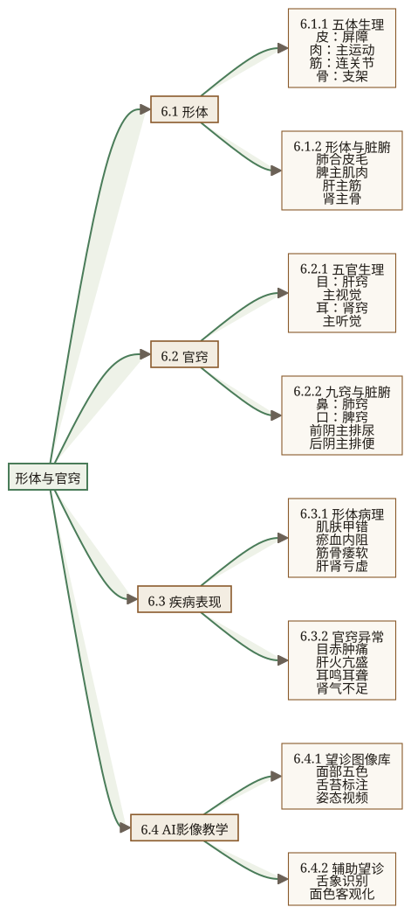
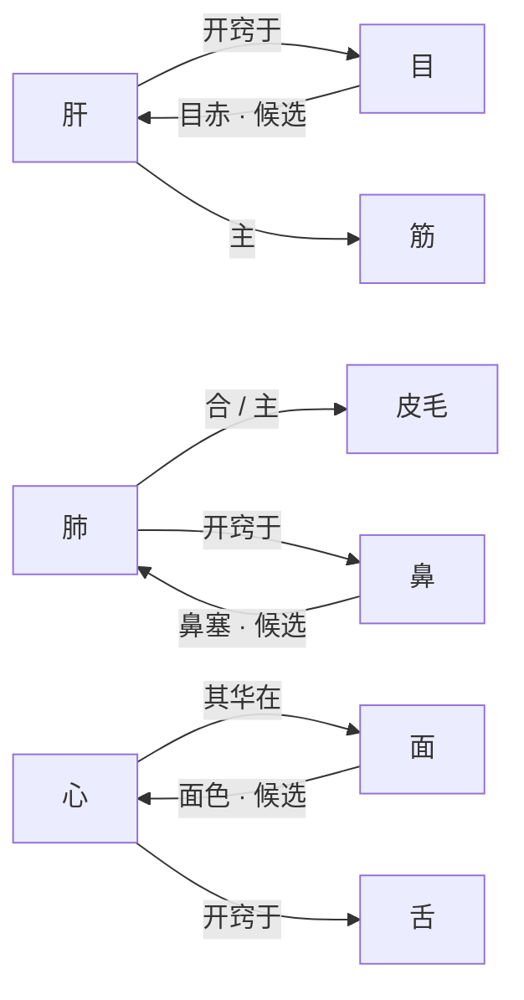

# 第 7 章 · 形体与官窍

> **源**：`qhzy-中医基础理论.xlsx` · 表「6体窍」 · 源文 2,754 字
> **抽取**：`node scripts/import_textbooks.js --only 中医基础理论` · sha256 `870b004ea34b4ec2…` · 2026-10-21
> **层次**：本文件下段是**源教材正文层** —— 节次取自源表的结构列，文字未改写、未压缩、未抽样；文末是**改写层**（`REWRITE:BEGIN/END` 块内 N.1–N.5 + 小结 + 思考题 + 延伸阅读），门见 `tests/test_jichu_textbook.js`。

---

【网络校准·2026-08-07】权威目录将'形体官窍'置于藏象章内(形体/官窍/五脏外华);本版独立成章便于病证单元编写,体例差异已在『新目录』校准区说明。

## 6.1 形体

### 6.1.1 皮、肉、筋、骨、脉的生理

#### 6.1.1.1 皮肤的屏障与感知功能

皮肤位于体表，为“五体”之表，具有防御外邪、调节津液代谢、感知冷热痛痒的功能。中医认为“肺合皮毛”，皮肤的润泽与开阖依赖于卫气与津液的濡养。AI平台通过皮肤微环境传感器模拟，实时监测表皮温度、湿度及经皮水分流失率（TEWL），将“卫气司开合”量化为皮肤屏障功能的动态指标，辅助理解汗出异常（如自汗、盗汗）的病理机制。

#### 6.1.1.2 肌肉的主持运动功能

肌肉（分肉）主司运动，保护内脏，依赖于脾运化的水谷精微充养。脾气健运，则肌肉丰满壮实，四肢活动有力；脾虚不运，则肌肉瘦削，四肢倦怠。平台通过肌电信号（EMG）仿真，模拟肌肉收缩时的电信号变化。当输入“脾气虚”参数时，系统展示运动神经元募集减少、肌纤维兴奋阈值升高，导致肌力下降和易疲劳的现象，验证“脾主肌肉”的科学内涵。

### 6.1.2 形体与脏腑的关系

#### 6.1.2.1 肺合皮毛与脾主肌肉

肺宣发卫气于皮毛，温养肌肤，调节汗孔开阖；脾运化精微以充养肌肉。若肺气虚，则卫外不固，易感外邪，且皮肤干燥无泽；若脾气虚，则肌肉萎缩，四肢乏力。AI构建了“肺-脾-形体”关联模型，展示蛋白质合成代谢（脾）与表皮免疫功能（肺）的协同作用，解释了为何慢性呼吸系统疾病常伴有皮肤粗糙及骨骼肌消耗。

#### 6.1.2.2 肝主筋与肾主骨

筋膜（肌腱、韧带）连接关节，主司运动，赖肝血濡养；骨骼为人身支架，赖肾精充养。肝血充足，则筋膜柔韧，运动灵活；肾精充足，则骨骼坚固，骨髓充盈。平台利用骨骼应力分析仿真，模拟不同骨密度下的承重能力。当模拟“肾精亏虚”时，骨小梁结构稀疏，骨折风险增加；模拟“肝血不足”时，关节囊润滑度下降，活动度受限。

## 6.2 官窍

### 6.2.1 五官的生理功能

#### 6.2.1.1 目为肝之窍与视觉功能

目主视觉，能辨五色，其功能依赖于五脏六腑之精的濡养，尤以肝血为甚（肝开窍于目）。肝肾阴虚，则目涩昏花；肝火上炎，则目赤肿痛。AI视觉成像模拟展示了视网膜电图（ERG）在不同肝血状态下的波形变化，以及瞳孔对光反射的灵敏度调节，将“肝受血而能视”转化为可量化的神经电生理指标。

#### 6.2.1.2 耳为肾之窍与听觉功能

耳主听觉，其灵敏性依赖于肾精的充养（肾开窍于耳）。肾精充足，则听力聪敏；肾精亏虚，则耳鸣耳聋。平台通过纯音听阈测试模拟，展示不同年龄阶段（肾精盛衰曲线）的听力损失图谱，特别是高频听力下降与“肾气虚”的高度相关性，为“肾和则耳能闻五音”提供听觉生理学证据。

### 6.2.2 九窍与脏腑精气的关系

#### 6.2.2.1 口鼻与肺脾的密切联系

鼻为肺窍，主嗅觉，是气体出入的门户；口为脾窍，主味觉，是水谷摄入的入口。肺气宣畅，则嗅觉灵敏；脾气健运，则食欲旺盛，口味正常。AI构建了嗅觉-味觉传导通路模型，模拟气味分子与味蕾受体结合后的神经冲动传导路径，以及肺脾精气对嗅球与味蕾细胞代谢的支持作用，解释了感冒（肺气失宣）为何伴有鼻塞流涕与口淡乏味。

#### 6.2.2.2 前后二阴与肾肠的功能关联

前阴（尿道与外生殖器）主排尿与生殖，后阴（肛门）主排便。肾主二便，司开合；大肠主传导糟粕；小肠主泌别清浊。肾阳虚衰，则尿频、失禁或阳痿；大肠湿热，则肛门灼热、下痢脓血。平台通过排泄动力学仿真，模拟逼尿肌与括约肌的协调收缩，以及肠道蠕动波的推进，展示“肾司二便”在神经-肌肉调控层面的具体表现。

## 6.3 形体官窍的疾病表现

### 6.3.1 形体的常见病理改变

#### 6.3.1.1 肌肤甲错与瘀血内阻

肌肤甲错指皮肤粗糙、干燥、角化过度，状如鱼鳞，多因瘀血内阻，肌肤失养所致。常见于慢性疾病或血瘀证患者。AI图像识别系统训练学生识别皮肤纹理的微细改变，并结合微循环灌注成像，展示毛细血管袢顶淤血、血流减慢等微观病理变化，将宏观的“肌肤甲错”与微观的“微循环障碍”建立可视化联系。

#### 6.3.1.2 筋骨痿软与肝肾亏虚

筋骨痿软表现为肢体无力、关节活动受限，甚则瘫痪，多因肝肾亏虚，筋骨失养所致。小儿囟门迟闭、成人腰膝酸软均属此类。平台通过骨密度与肌肉横截面积测量模拟，对比健康人与“肝肾亏虚”患者的影像学差异，量化评估“骨痿”与“筋弛”的形态学指标，辅助理解痿证的病理基础。

### 6.3.2 官窍的异常征象

#### 6.3.2.1 目赤肿痛与肝火亢盛

目赤肿痛、羞明多泪，多为肝火上炎或风热侵袭肝经所致。常伴有烦躁易怒、头痛眩晕。AI眼底照相分析系统自动识别结膜充血分级及视网膜血管迂曲程度，并结合眼压监测数据，评估“肝火”对眼部微循环及眼内压的影响，为“肝开窍于目”的病理诊断提供客观依据。

#### 6.3.2.2 耳鸣耳聋与肾气不足

耳鸣如蝉鸣或潮声，耳聋不闻外声，多因肾精亏虚或肾气不足，耳窍失养所致。常伴有腰膝酸软、头晕健忘。平台通过耳声发射（OAE）与听觉脑干诱发电位（ABR）仿真，模拟耳蜗毛细胞受损及听神经传导通路障碍的电生理特征，将中医的“肾虚耳鸣”与现代听力学检查指标进行映射，提升辨证的精准度。

## 6.4 形体官窍的AI影像教学

### 6.4.1 望诊图像数据库建设

#### 6.4.1.1 面部五色、舌苔变化的标注

构建大规模中医望诊标准化图像库，涵盖面部五色（青、赤、黄、白、黑）、舌苔（厚薄、润燥、腐腻、颜色）及形体姿态等特征。每张图像均经过专家标注，并关联对应的病机诊断（如“面色萎黄—脾虚湿蕴”）。AI深度学习模型通过对海量图像的学习，能够自动提取望诊特征，辅助学生建立视觉诊断直觉。

#### 6.4.1.2 形体姿态异常的视频采集

采集不同病证下的形体姿态视频数据，如“角弓反张”（痉病）、“半身不遂”（中风）、“步履蹒跚”（痿证）等。平台利用计算机视觉姿态估计技术，自动识别人体关键点（如肩、肘、膝、踝），绘制骨架运动轨迹，量化分析步态周期、关节活动度及姿势对称性，将传统的“望形态”转化为可测量的运动学参数。

### 6.4.2 计算机辅助望诊训练

#### 6.4.2.1 舌象特征的自动识别算法

开发智能舌诊辅助系统，学生上传舌象照片，系统自动分割舌质与舌苔区域，识别舌色（淡红、淡白、红绛、青紫）、苔色（白、黄、灰黑）、苔质（厚、薄、腻、燥）及舌形（胖大、裂纹、齿痕）。系统通过对比标准图谱，给出辨证参考，并对学生的肉眼辨识结果进行打分与纠错，显著提高望诊教学效率。

#### 6.4.2.2 面色、形态的客观化评价

利用皮肤光学检测技术（如分光光度计、多光谱成像），将面部色泽转化为Lab色彩空间数值，消除环境光线干扰，实现面色判定的标准化。同时，结合3D面部重建技术，量化分析面部浮肿、眼眶凹陷等形态特征。AI系统通过综合分析这些客观数据，对学生的望诊结论进行验证与反馈，推动中医诊断从经验描述向客观量化迈进。

---

> **免责声明**：本教材内容仅用于教育与科研，不构成任何诊疗建议。
> 本文件由 `scripts/import_textbooks.js` 从源工作簿生成，请勿手改 —— 需要修改请改源工作簿后重跑。

<!-- REWRITE:BEGIN -->
## 本章要回答的问题

「肝开窍于目、肺合皮毛」这类话，是解剖上的连接，还是功能上的从属？如果把它画成一条从脏到官的箭头，读者会不会误以为这是一根神经或血管？

## N.1 概念与出处

| 概念 | 出处（书名·篇名） | 本章源节 |
|---|---|---|
| 五体分属五脏 | 《素问·痿论》：「肺主身之皮毛，心主身之血脉，肝主身之筋膜，脾主身之肌肉，肾主身之骨髓。」 | `6.1.2` |
| 官窍与脏腑通应 | 《灵枢·脉度》：「肺气通于鼻，肺和则鼻能知臭香矣；心气通于舌，心和则舌能知五味矣。」 | `6.2.2` |
| 开窍配属 | 《素问·金匮真言论》：「东方青色，入通于肝，开窍于目，藏精于肝。」 | `6.2.1` |
| 形体官窍的病理征象 | 《素问·痿论》论痿证由五脏气热所致 | `6.3.1` |
| 望诊图像标注 | 本项目的设计选择（非原典）：望诊图像库 | `6.4.1` |

## N.2 为什么可以这样翻译

「开窍」「合」「主」三个动词，看起来同义，实际是三种不同的关系，必须分开建边：

| 动词 | 关系类型 | 例子 | 能否双向 |
|---|---|---|---|
| 主 | 功能统属 | 肺主皮毛 | 单向 |
| 合 | 功能配合 | 肺合皮毛 | 单向 |
| 开窍于 | 精气通达 | 肝开窍于目 | 单向 |
| 其华在 | 荣枯外显 | 心其华在面 | 单向 |

四类都是**从脏到外的单向关系**，但可观测性不同：「其华在」可直接望见，「开窍于」要靠功能测（目能视否），「主」要靠间接推断（皮毛的卫外能力）。这张表的价值在于：它把「看得见的」与「推得出的」分开，正好对应诊断时的证据强度分级。

反向的那条边（外 → 脏）也真实存在：目赤多责肝火，鼻塞多责肺气。但反向不是「开窍」的逆运算，而是**辨证时的候选生成**：同一外候可指向多个脏，因此反向边必须是一对多。

图的读法：**上行是理论配属（确定），下行是临床反查（候选）**。两种箭头不能合并，合并就会把「目赤即肝火」当成定理。

还有一层不能省：**同一官窍的多个候选之间要有强度差**。目赤的三个候选（上焦热、肝火、阴虚火旺）在证据强度上并不相等：目赤兼头痛脉弦者偏肝火，兼口渴便干者偏上焦热，兼干涩夜甚者偏阴虚。这种差别不能靠给候选打一个总分来体现 —— 它靠的是**附加条件**。所以本课程的做法是给每条反查边加「共见条件」字段：单个外候只生成候选，加上共见条件才排序。

## N.3 这个翻译丢掉了什么

**一、丢掉了「窍」之间的联动。** 目、耳、鼻、口、二阴并非各自独立，临床上常见「耳目同病」「口鼻同病」。四类单向边表达不了这种跨窍联动。

**二、丢掉了形体与官窍的层次差。** 皮毛、肌肉、筋、骨是「体」，目、舌、口、鼻、耳、二阴是「窍」，两者在病位上不同层。图上若同级并列，取穴与用药的层次判断就失去依据。

**三、丢掉了「开窍」的条件性。** 「肝和则目能辨五色」—— 前提是「和」。关系边只写了「肝 → 目」，没写「肝不和则目病」。这一层条件在图上通常被省略，而临床上一半的判断恰恰来自它。

**四、丢掉了外候的客观化困难。** 面色、舌象的判读依赖光线、设备与经验。图像库能积累样本，但标谁的判读、用什么标准标，这个问题不解决，数据库只是分歧的堆积。

**五、丢掉了「官窍」的感觉功能本身。** 「目能视、耳能听」是功能状态，不是形态特征。望诊图像能记录形态（目赤、目胞浮肿），却记录不了视力模糊这一主诉 —— 而后者往往才是病人真正的不适。因此本章的观测表必须同时容纳「他觉所见」与「自觉所苦」两类字段，二者不可互相替代。

## N.4 与相邻学科的接口

| 学科 | 用到本章的什么 | 以什么形式用 |
|---|---|---|
| 中医诊断学 | 望诊的五官分属 | 外候 → 候选脏的反查表 |
| 针灸学 | 官窍的局部取穴 | 窍位与经络的对应 |
| 中药学 | 引经与归经 | 药物作用部位与本章关系边对齐 |
| 五官科各科 | 专科定位 | 复用本章节点，不另立一套 |
| 数据工程 | 图像标注与特征抽取 | 见 `6.4.1`、`6.4.2` 的实现说明 |

这张接口表里最容易出错的是与五官科的对接：专科习惯用解剖部位命名（结膜、鼓膜、鼻甲），本章节点用的是中医功能名（目、耳、鼻）。两套名字必须建立**显式的对照表**，且对照表只做检索桥接，不许反向改写专科结论 —— 一旦让「目」去接管「结膜」的全部含义，专科积累的客观检查结果就会被重新解释成藏象证候。

## N.5 争议与本项目立场

**争议一：开窍配属是生理联系还是归类习惯？** 有学者认为它是五行归类的产物，未必有生理机制；也有学者主张确有功能通路（如肝—目的营养联系）。

本项目立场：**按「可观察的功能联系」建边，不宣称机制。** 例如「肝开窍于目」写作「肝血不足则可致目涩视昏」，这是可观察的相关，不是解剖通路。

**争议二：望诊客观化会不会取代医者？** 反对者认为图像判读的标准化会抹掉个体经验。

本项目立场：**只做辅助标注与一致性统计，不做自动诊断。** 系统输出「这张舌象在三位判读者中的分歧点」，而不是「这张舌象是脾虚」。

> **免责声明**：本章为教材说明，不构成诊断或治疗建议。望诊结论须由执业中医师结合四诊合参作出。

## 本章小结

1. 「主、合、开窍于、其华在」是四类不同关系，必须分开建边，且都是单向。
2. 反向边是辨证反查（一对多候选），不是关系的逆运算。
3. 丢掉的是窍间联动、形体与官窍的层次差、「和」这一条件与客观化困难。
4. 本项目按可观察的功能联系建边，明确不宣称机制、不自动诊断。

## 思考题

1. 「肺合皮毛」与「肺主皮毛」若合并成一条边，会丢掉什么信息？
2. 「肝和则目能辨五色」的条件该如何写进边，才能让系统识别「肝不和」的情形？
3. 同一个外候（目赤）指向上焦热、肝火、阴虚三类，系统应如何组织候选而不误导？

## 延伸阅读

- 《素问·痿论》—— 五体分属五脏的系统表述
- 《灵枢·脉度》—— 「肺气通于鼻」等官窍通应原文
- 《素问·金匮真言论》—— 五方—五脏—开窍的归类表
- 本仓库 `standards/jichu/units.json`（章 6 段）—— 本章源节索引
<!-- REWRITE:END -->
