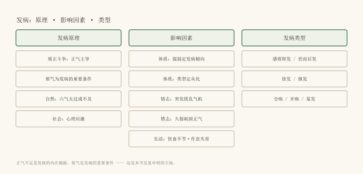

# 第 9 章 · 发病

> **源**：`qhzy-中医基础理论.xlsx` · 表「8发病」 · 源文 3,698 字
> **抽取**：`node scripts/import_textbooks.js --only 中医基础理论` · sha256 `870b004ea34b4ec2…` · 2026-10-21
> **层次**：本文件是**源教材正文层** —— 节次取自源表的结构列，文字未改写、未压缩、未抽样。改写层（N.3「这个翻译丢掉了什么」/ N.5「争议与本项目立场」）尚未撰写，见 `textbooks/README.md` 章契约。

---

【网络校准·2026-08-07】'发病'独立成章与规划教材一致(发病原理/发病因素/发病类型);权威目录部分版本将'发病机理'并入病机章,本版维持独立章体例。

## 8.1 发病原理

### 8.1.1 邪正斗争与发病

#### 8.1.1.1 正气抗邪的主导作用

发病是正气与邪气相互抗争的结果。正气充盛，抗邪有力，则邪不可干；正气虚弱，抗邪无力，则邪犯人体。正气在发病中起主导作用，决定着发病的倾向性、病位的深浅及病情的轻重。AI平台构建“邪正对抗模拟器”，将正气量化为免疫活性、代谢水平、应激能力等综合指数，邪气量化为致病微生物毒力、理化刺激强度等。学生可调节参数，观察正胜邪退（不发病或病情轻）与邪胜正衰（发病或病情重）的动态博弈过程。

#### 8.1.1.2 邪气致病的必要条件

邪气是发病的重要条件。即使正气相对充足，若遭遇强烈的致病因素（如剧毒、烈性传染病），亦可突破人体防御而发病。此外，邪气的性质、侵入途径及作用部位也直接影响发病特点。平台通过病原体入侵仿真，模拟不同毒力的病毒（如流感病毒vs.新冠病毒）突破呼吸道黏膜屏障、逃避免疫监视及在细胞内复制的过程，直观展示“邪气”作为外部攻击因子的破坏力。

### 8.1.2 环境与发病的关系

#### 8.1.2.1 自然环境的季节性影响

自然环境的季节性变化（如六气太过或不及）是发病的重要诱因。春温、夏暑、秋燥、冬寒，不同季节的气候特点易导致相应病邪侵袭。例如，冬季寒冷，易感寒邪；夏季暑湿，易感暑湿疫邪。AI整合历史气象数据与疾病监测数据，绘制“季节性发病热力图”，展示流感、哮喘、心脑血管疾病在不同月份的发病率波动，验证“春善病鼽衄，仲夏善病胸胁，长夏善病洞泄寒中，秋善病风疟，冬善病痹厥”的中医发病学规律。

#### 8.1.2.2 社会环境与心理应激

社会环境的剧烈变动（如战争、经济危机、公共卫生事件）及长期处于高强度心理应激状态，可导致情志失调、饮食不节、起居失常，从而降低正气，诱发疾病。平台通过社会心理应激指数模型，分析失业率、社会支持度、生活事件压力评分等指标与抑郁症、高血压、消化性溃疡等疾病发病率的相关性，将中医“七情内伤”与社会医学、心身医学联系起来。

## 8.2 影响发病的因素

### 8.2.1 体质因素

#### 8.2.1.1 体质强弱与发病倾向

体质是正气在个体身上的综合体现。体质强壮者,正气充足,不易发病;体质虚弱者,正气不足,易感邪发病。按《灵枢·阴阳二十五人》,五形之人各有易病倾向:木形之人易病肝(足厥阴),火形之人易病心(手少阴),土形之人易病脾(足太阴),金形之人易病肺(手太阴),水形之人易病肾(足少阴);且能春夏不能秋冬者感而病生于相应脏腑。AI构建'五形人—脏腑易感图谱',基于望形态/五音/时令数据评估个体发病倾向(现代九分法体质数据可作量化参考)。

#### 8.2.1.2 体质类型与易感病证

体质不仅影响发病与否,还决定疾病的证候类型(从化)。同感一种邪气,因体质阴阳偏倾不同,可表现为不同的病证:素体阳虚者感邪后多从寒化,素体阴虚者多从热化;五形之人感邪亦各从其脏气(如木形之人肝气易郁,感邪易病肝经)。平台通过同病异证模拟,展示相同病原体感染不同体质模型(五形人×阴阳偏倾)后机体免疫反应及临床表现的差异,印证'从化'理论。

### 8.2.2 情志因素

#### 8.2.2.1 突发情志刺激的发病机制

突然而强烈的情志刺激（如惊恐、暴怒、极度悲伤）可瞬间扰乱气机，导致气血逆乱，引发急性发病。例如，暴怒可导致血压骤升，诱发脑卒中；过度惊恐可导致气机下陷，出现晕厥、尿失禁。AI通过情绪诱发与生理反应监测仿真，模拟突发情绪刺激下，交感神经-肾上腺髓质系统及下丘脑-垂体-肾上腺皮质轴（HPA轴）的剧烈激活，导致心率、血压、血糖的快速变化，揭示“惊则气乱”、“恐则气下”的即时病理生理效应。

#### 8.2.2.2 长期情绪压抑的累积效应

长期、慢性的不良情绪（如焦虑、抑郁、思虑过度）可持续损耗正气，降低免疫功能，导致慢性发病或加重病情。例如，长期精神压力大可导致慢性胃炎、肠易激综合征、肿瘤等。平台通过慢性应激模型，模拟长期心理压力下，HPA轴持续激活导致的皮质醇水平升高、免疫抑制、神经内分泌失调及氧化应激增加，解释“郁证”、“虚劳”等慢性疾病的发病机制。

### 8.2.3 生活因素

#### 8.2.3.1 饮食习惯与作息规律

饮食不节（过饥过饱、不洁、偏嗜）及作息失常（熬夜、睡眠不足、缺乏运动）是当代重要的发病诱因。长期高脂高糖饮食可导致肥胖、糖尿病、心血管疾病；长期熬夜耗伤阴血，易致阴虚火旺。AI通过生活方式风险评估模型，综合分析个体的饮食结构、睡眠质量、运动频率等数据，预测其未来5-10年内患代谢综合征、心脑血管疾病的风险概率，并提供个性化的生活方式干预建议。

#### 8.2.3.2 运动量与身体抵抗力

适度运动能增强正气，提高抗病能力；缺乏运动则导致气血运行迟缓，脏腑功能减退，抵抗力下降。但过度运动亦会耗伤气血，适得其反。平台通过运动生理学仿真，模拟不同强度运动（有氧、无氧）对

## 8.3 发病类型

### 8.3.1 感邪即发与伏而后发

#### 8.3.1.1 急性传染病的暴发特点

感邪即发指感受病邪后立即发病，多见于外感病，尤其是急性传染病（疠气）。其特点是发病急、病情重、传变快。例如，流感、霍乱、鼠疫等，感染后潜伏期短，迅速出现高热、毒血症等症状。AI通过传染病动力学模型（如SEIR模型），模拟急性传染病在易感人群中快速传播、病例数指数级增长的暴发过程，展示“感邪即发”的流行病学特征及隔离防控的重要性。

#### 8.3.1.2 伏邪温病的隐匿过程

伏而后发指感受病邪后，并不立即发病，而是潜伏于体内，经过一段时间（或遇诱因）后才发病。多见于“伏气温病”（如春温、伏暑）及某些寄生虫病、肿瘤。其特点是初期无症状或症状轻微，后期突然加重。平台通过潜伏期病理变化模拟，展示病毒（如疱疹病毒、HIV）在体内潜伏期间，如何逃避免疫监视，并在机体抵抗力下降时重新激活并大量复制的过程，解释“伏而后发”的生物学机制。

### 8.3.2 徐发与继发

#### 8.3.2.1 慢性病的渐进性发展

徐发指起病缓慢，病程较长，症状逐渐加重。多见于内伤杂病，如慢性胃肠炎、肝硬化、慢性肾炎、肺结核等。其发病常与长期不良生活习惯、体质因素及慢性感染有关。AI通过慢性病进展模型，模拟长期吸烟导致慢性支气管

#### 8.3.2.2 原发病引发继发病变

继发指在原发疾病的基础上，继而发生新的疾病。例如，病毒性肝炎继发肝硬化，肝硬化继发肝癌；糖尿病继发视网膜病变、肾病、神经病变。平台通过并发症预测模型，分析原发疾病的病理生理改变如何导致其他脏腑或系统的功能障碍，展示疾病传变的复杂性，帮助学生理解“先安未受邪之地”的防治原则。

### 8.3.3 合病、并病与复发

#### 8.3.3.1 两经或两脏同时受病

合病指两经或两个以上的脏腑同时受邪发病。例如，太阳与阳明合病（既有恶寒发热，又有腹满便秘）；脾胃同病（既有恶心纳呆，又有腹胀便溏）。并病指一经或一脏的病证未愈，另一经或另一脏又出现病证。例如，太阳病未解，又出现少阳病证（太阳少阳并病）。AI通过多系统受累仿真，模拟严重感染或中毒时，多个脏腑（如心、肺、肾、脑）同时或相继出现功能障碍（MODS）的过程，直观展示“合病”、“并病”的危重性。

#### 8.3.3.2 疾病初愈后的再次发作

复发指疾病初愈或病情稳定后，因某种诱因导致原有疾病再次发生。常见诱因包括：复感新邪、食复（饮食不当）、劳复（过度劳累）、药复（停药不当）、情复（情绪波动）。平台通过复发风险预警模型，监测患者康复期的各项指标（如炎症因子、免疫功能、生活方式），识别可能导致复发的危险因素，并提前发出预警，指导学生进行康复期调护。

## 8.4 AI预测发病风险

### 8.4.1 基于大数据的发病预警

#### 8.4.1.1 个体健康画像与风险评估

整合个体的基因组学、代谢组学、微生物组学、生活方式、环境因素及电子健康档案等多维度数据，构建精细化的“个体健康画像”。AI算法通过深度学习，识别其中的风险模式，对未来患病风险进行量化评估（如预测5年内患2型糖尿病的风险为30%）。这种个性化风险评估，超越了传统的基于单一指标的粗略判断，为精准预防提供依据。

#### 8.4.1.2 群体发病趋势的智能监测

利用大数据分析技术，实时监测区域内人群的就诊数据、用药数据、检验检查数据及网络舆情

### 8.4.2 个性化预防方案推荐

#### 8.4.2.1 体质辨识后的养生指导

基于AI五形人辨识结果,为不同体质人群提供个性化养生指导。例如,对木形之人(肝气易郁),推荐疏肝条达的饮食情志调养;对水形之人(肾气易虚),推荐温肾填精、避寒湿的方案;对土形之人,重健脾节食以防痰湿。平台通过自然语言生成技术自动生成通俗易懂的养生建议,并兼容现代九分法量化数据(标注'现代认识,不改中基原义')。

#### 8.4.2.2 高危人群的干预策略

针对具有特定疾病高风险的人群，制定精准的干预策略。例如，对高血压高危人群，推荐低盐饮食、规律运动、戒烟限酒，并定期监测血压；对肿瘤高危人群，推荐进行特定的肿瘤筛查（如低剂量螺旋CT筛查肺癌、胃肠镜检查筛查消化道肿瘤）。AI系统可自动生成干预计划表，并通过手机APP发送提醒，督促用户执行，实现从风险评估到干预管理的闭环。

---

> **免责声明**：本教材内容仅用于教育与科研，不构成任何诊疗建议。
> 本文件由 `scripts/import_textbooks.js` 从源工作簿生成，请勿手改 —— 需要修改请改源工作簿后重跑。

