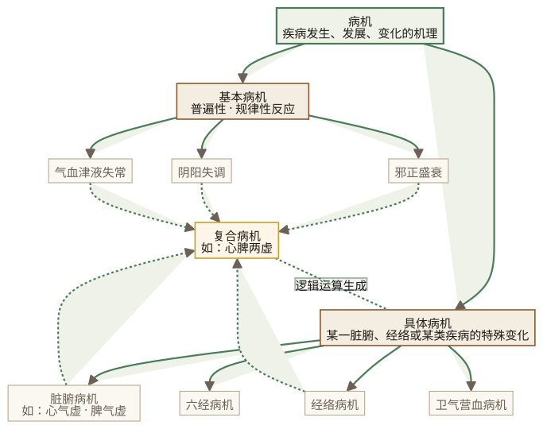

# 第 10 章 · 病机

> **源**：`qhzy-中医基础理论.xlsx` · 表「9病机」 · 源文 6,926 字
> **抽取**：`node scripts/import_textbooks.js --only 中医基础理论` · sha256 `870b004ea34b4ec2…` · 2026-10-21
> **层次**：本文件是**源教材正文层** —— 节次取自源表的结构列，文字未改写、未压缩、未抽样。改写层（N.3「这个翻译丢掉了什么」/ N.5「争议与本项目立场」）尚未撰写，见 `textbooks/README.md` 章契约。

---

【网络校准·2026-08-07】权威目录病机章含'内生五气病机'(风气内动/寒从中生/湿浊内生/津伤化燥/火热内生)与'疾病的传变、转归';本版 9.3.4 已增补内生五气(见下),9.2 已含邪正盛衰与转归。

## 9.1 病机概论

### 9.1.1 病机的概念与层次

#### 9.1.1.1 基本病机与具体病机

病机即疾病发生、发展、变化的机理，是中医辨证的核心依据。基本病机指机体对致病因素产生的普遍性、规律性反应，包括邪正盛衰、阴阳失调、气血津液失常等；具体病机指某一脏腑、经络或某一类疾病（如六经病机、卫气营血病机）的特殊病理变化。AI平台将病机建模为分层推理引擎：底层为基本病机（如“气虚”），上层为具体病机（如“心气虚”、“脾气虚”），通过逻辑运算生成复合病机（如“心脾两虚”）。

#### 9.1.1.2 病机十九条的临床意义

《素问·至真要大论》提出的“病机十九条”是中医辨证论治的纲领性文献，归纳了五脏、六淫致病的主要特征。如“诸风掉眩，皆属于肝”、“诸湿肿满，皆属于脾”。AI通过古籍文本挖掘与临床数据验证，对病机十九条进行现代化解读，建立症状集群与脏腑病机的映射模型，辅助学生快速掌握辨证要领，并在临床实践中动态修正与扩充。

### 9.1.2 疾病发生发展的普遍规律

#### 9.1.2.1 邪正盛衰的动态平衡

疾病的发生发展是邪正双方力量对比消长的过程。邪盛则病进，正盛则病退。这种斗争贯穿疾病始终，决定了疾病的虚实性质（“邪气盛则实，精气夺则虚”）及转归预后。AI通过动态博弈模型，模拟疾病过程中正气（防御力）与邪气（攻击力）的数值变化，展示疾病从轻到重、从实到虚或从虚转实的演变轨迹，帮助学生理解“动态平衡”的哲学内涵。

#### 9.1.2.2 阴阳失调的核心地位

阴阳失调是疾病发生发展的内在根本原因，贯穿于一切疾病过程的始终。寒热、虚实、表里等病机变化，均可归结为阴阳偏盛偏衰、互损格拒或亡失。AI构建“阴阳平衡监测仪”，将复杂的生理生化指标（如体温、血压、pH值、氧化应

## 9.2 邪正盛衰

### 9.2.1 虚实病机的形成

#### 9.2.1.1 实证：邪气盛则实

实证是指邪气亢盛，正气尚未虚衰，正邪激烈抗争的病理状态。常见于外感病初期、中期，或痰饮、瘀血、食积等病理产物蓄积。临床表现多见高热、烦躁、腹痛拒按、脉实有力等。AI通过炎症风暴仿真，模拟细菌毒素大量释放导致的全身过度炎症反应（实证），展示细胞因子风暴、组织损伤及器官功能障碍的微观过程，印证“邪气盛”的病理本质。

#### 9.2.1.2 虚证：精气夺则虚

虚证是指正气亏虚，邪气不盛或已衰，正邪抗争无力的病理状态。常见于慢性疾病、急性病后期或先天禀赋不足。临床表现多见神疲乏力、心悸气短、面色无华、脉虚弱等。AI通过免疫衰老模型，模拟随着年龄增长或慢性消耗，免疫细胞数量减少、功能下降（正气虚），导致机体抵抗力减弱、易感染、修复能力差的生理改变，验证“精气夺”的病机特点。

### 9.2.2 邪正盛衰与疾病转归

#### 9.2.2.1 正胜邪退与病情好转

正胜邪退指正气奋起抗邪，邪气逐渐消退，疾病向愈。表现为症状减轻、体温恢复正常、食欲增进、脉象趋缓。AI通过康复轨迹预测模型，基于患者初始正气水平、治疗干预措施及营养支持情况，模拟疾病康复的可能路径与时间节点，帮助学生理解“养正积自除”的治疗理念，并树立战胜疾病的信心。

#### 9.2.2.2 邪胜正衰与病情恶化

邪胜正衰指邪气过盛，正气不支，疾病进行性加重。表现为高热持续、神志昏迷、呼吸急促、脉微欲绝。严重者可出现亡阴、亡阳等危候。平台通过危重症预警系统，监测生命体征（心率、血压、血氧饱和度、尿量）及实验室指标（乳酸、电解质、凝血功能），当指标触及预设阈值时，自动发出病情恶化预警，提示需立即采取抢救措施，体现“救阴敛阳”的急救思想。

## 9.3 阴阳失调

### 9.3.1 阴阳偏盛

#### 9.3.1.1 阳盛则热（实热证）

阳邪侵犯人体，或机体阳气病理性亢盛，导致机能亢奋，产热过多。症见高热、面赤、口渴、脉洪数。AI通过发热机制仿真，模拟感染或非感染性炎症导致下丘脑体温调定点上移，引起产热增加（代谢亢进）、散热减少（血管收缩）的生理过程，直观展示“阳盛则热”的能量代谢异常。

#### 9.3.1.2 阴盛则寒（实寒证）

阴邪侵犯人体，或机体阴气病理性亢盛，导致机能抑制，产热不足。症见畏寒肢冷、面色苍白、腹痛喜暖、脉沉紧。AI通过低温生理学模型，模拟寒冷环境或阳虚状态下，机体产热减少（代谢率下降）、散热增加（血管扩张）的反应，验证“阴盛则寒”的体温调节障碍。

### 9.3.2 阴阳偏衰

#### 9.3.2.1 阳虚则寒（虚寒证）

机体阳气虚损，温煦、推动功能减退，产热不足。症见畏寒肢冷、精神萎靡、小便清长、舌淡胖。AI通过甲状腺功能减退仿真，模拟甲状腺激素分泌减少导致的全身代谢率下降、产热不足、心率减慢等病理改变，将“阳虚则寒”与现代内分泌疾病联系起来。

#### 9.3.2.2 阴虚则热（虚热证）

机体阴液亏耗，滋润、濡养功能减退，阳气相对偏亢。症见午后潮热、盗汗、五心烦热、舌红少苔。AI通过脱水与代谢紊乱模型，模拟严重呕吐、腹泻或慢性消耗导致体液丢失、血液浓缩、代谢废物堆积的病理状态，展示“阴虚则热”的微观物质基础。

### 9.3.3 阴阳互损与转化

#### 9.3.3.1 阴损及阳与阳损及阴

阴阳互根互用，一方亏虚，日久必导致另一方亦虚。阴损及阳，如肾阴虚久，无以资助阳气生化，发展为阴阳两虚；阳损及阴，如肾阳虚久，无以化生阴液，亦致阴阳两虚。AI通过阴阳转化动力学模型，模拟长期阴虚状态下，机体代偿性阳气消耗，或长期阳虚状态下，阴液化生乏源的动态过程，帮助学生理解“阴中求阳，阳中求阴”的配伍原理。

#### 9.3.3.2 阴阳格拒与亡阴亡阳

阴阳格拒指阴阳偏盛至极，将对方排斥于外，形成真寒假热或真热假寒的复杂病机。亡阴、亡阳则是阴阳离决的危殆阶段。AI通过休克病理生理仿真，模拟失血性休克早期（阴竭阳无所附，见四肢厥冷、冷汗淋漓、脉微欲绝的亡阳证）与晚期（阴阳俱竭，生命垂危）的演变过程，强调“阴阳离决，精气乃绝”的严重后果。

## 9.4 气血津液失常

### 9.4.1 气虚

#### 9.4.1.1 气虚的形成原因

气虚多因先天不足、后天失养（饮食失调、劳倦内伤）、久病耗损所致。主要涉及元气、宗气、卫气、营气的亏虚。AI通过营养代谢与能量消耗模型，模拟长期营养不良或慢性消耗性疾病导致蛋白质合成减少、ATP生成不足，进而引起全身各脏腑功能减退的病理生理改变，量化评估“气虚”的程度。

#### 9.4.1.2 气虚的全身与局部表现

气虚则推动、温煦、防御、固摄功能减退。全身表现：神疲乏力、少气懒言、自汗、易感冒；局部表现：心悸（心气虚）、纳呆（脾气虚）、咳喘（肺气虚）、腰膝酸软（肾气虚）。平台通过多系统功能评估矩阵，将气虚的全身症状与各脏腑特异性表现进行关联分析，帮助学生全面掌握气虚的病机特点。

### 9.4.2 气机失调

#### 9.4.2.1 气滞、气逆、气陷、气闭、气脱

气机失调包括多种形式：气滞（运行不畅，见胀痛）、气逆（上升太过，见呕恶、咳喘）、气陷（上升不及，见内脏下垂）、气闭（阻滞不通，见昏厥）、气脱（外泄不止，见冷汗淋漓）。AI通过流体动力学仿真，模拟气体或液体在不同压力梯度下的流动状态，类比气血在经络脏腑中的运行。例如，模拟“气滞”如同管道狭窄导致流体受阻，“气逆”如同泵力过强导致流体反流。

#### 9.4.2.2 气机失调对脏腑的影响

不同脏腑的气机失调各有特点：肺失宣降（咳喘）、肝失疏泄（胁痛、抑郁）、脾胃升降失常（恶心、腹胀）、心脉痹阻（胸痹）。平台通过脏腑气机交互网络，展示一脏气机失调如何影响他脏。例如，肝气郁结（气滞）可横逆犯脾，导致脾失健运（气陷），形成“肝脾不调”的病机链条。

### 9.4.3 血的失常

#### 9.4.3.1 血虚的形成与临床表现

血虚多因失血过多、化源不足（脾胃虚弱）或久病耗损所致。症见面色萎黄、唇甲色淡、头晕眼花、心悸失眠。AI通过血液流变学与造血功能仿真，模拟红细胞计数、血红蛋白浓度下降导致的携氧能力降低，以及由此引起的组织缺氧、能量代谢障碍，将“血虚”与现代贫血症联系起来。

#### 9.4.3.2 血瘀、出血的病机分析

血瘀指血液运行迟缓、不畅或停滞，多因气虚推动无力、气滞血行受阻、血寒凝滞、血热煎熬或外伤出血。症见刺痛、肿块、紫暗。出血指血液不循常道，溢于脉外，多因热迫血妄行、气虚不摄血或瘀血阻滞脉络。AI通过微循环观测仿真，展示毛细血管血流速度减慢、红细胞聚集、血小板血栓形成等血瘀征象，以及血管破裂、血液外渗的出血过程。

### 9.4.4 津液代谢失常

#### 9.4.4.1 津液不足与干燥失润

津液不足多因燥热灼伤、大汗、大吐大下或长期摄入不足所致。症见口干舌燥、皮肤干枯、大便干结、小便短少。AI通过脱水程度评估模型，根据体重下降百分比、皮肤弹性、黏膜湿润度等指标，量化评估津液亏损的程度，并模拟不同补液方案对恢复体液平衡的疗效。

#### 9.4.4.2 水湿痰饮内停与潴留

水湿痰饮内停多因肺失宣降、脾失运化、肾失气化或三焦水道不利所致。症见水肿、痰多、胸闷脘痞、苔腻脉滑。AI通过组织间隙液体积聚仿真，模拟淋巴回流障碍或血浆胶体渗透压下降导致的组织水肿，以及呼吸道、消化道黏液分泌过多的病理状态，直观展示“痰湿”的形成机制。

## 9.5 脏腑病机

### 9.5.1 五脏病机

#### 9.5.1.1 心的阳气虚衰与血脉瘀阻

心阳不振，则温煦推动无力，见心悸、胸闷、形寒肢冷；血脉瘀阻，则见胸痛、唇甲青紫、舌紫暗。AI通过心血管动力学模型，模拟心输出量下降、外周阻力增加、冠状动脉供血不足等病理改变，将“心阳亏虚”与“心血瘀阻”与现代心力衰竭、冠心病联系起来。

#### 9.5.1.2 肺的宣降失常与水液停滞

肺气失宣，则见咳嗽、气喘、鼻塞；肺失肃降，则见胸闷、小便不利、水肿。长期宣降失常，可致水液代谢障碍，形成痰饮。平台通过呼吸力学仿真，模拟支气管痉挛、肺泡表面活性物质减少导致的通气/血流比例失调，以及右心衰竭导致的肺循环淤血，验证“肺主行水”的功能。

### 9.5.2 六腑病机

#### 9.5.2.1 胃失和降与胆汁外溢

胃气上逆，则见恶心、呕吐、嗳气、呃逆；胆汁排泄不畅，则见口苦、黄疸。AI通过胃肠动力与胆道压力仿真，模拟胃排空延迟、幽门梗阻、奥迪氏括约肌痉挛等病理状态，展示胃失和降与胆汁反流的力学机制。

#### 9.5.2.2 膀胱气化不利与小便异常

膀胱气化失司，则见小便不利、尿少、水肿，或小便频数、尿急尿痛。平台通过尿液生成与排泄模型，模拟肾小球滤过率下降、肾小管重吸收障碍或尿路梗阻导致的排尿异常，将“膀胱气化不利”与现代肾脏疾病、泌尿系统疾病联系起来。

## 9.6 病证单元的病机分析

### 9.6.1 咳嗽的病机单元

#### 9.6.1.1 外感咳嗽：肺卫受邪，宣降失司

外感六淫（尤以风寒、风热、风燥为多）侵袭肺卫，肺气失宣，清肃失常，气道不利，发为咳嗽。初起多伴表证（恶寒、发热、头痛）。AI通过呼吸道上皮损伤与修复模型，模拟病毒或细菌感染导致气道上皮细胞脱落、炎症介质释放、咳嗽感受器敏感性增高的病理过程，验证“肺失宣降”是外感咳嗽的核心病机。

#### 9.6.1.2 内伤咳嗽：脏腑功能失调，累及于肺

脏腑功能失调，内邪干肺，亦可致咳。如肝火犯肺（木火刑金），见咳嗽阵作、痰黄黏稠、胸胁胀痛；痰湿蕴肺，见咳嗽痰多、色白黏稠、胸闷脘痞；肺阴亏虚，见干咳少痰、潮热盗汗。平台通过多脏腑交互影响模型，展示肝失疏泄、脾失运化、肾失摄纳如何间接导致肺的功能紊乱，形成“五脏六腑皆令人咳”的病机网络。

### 9.6.2 胃痛的病机单元

#### 9.6.2.1 肝气犯胃：气机郁滞，胃失和降

情志不遂，肝气郁结，横逆犯胃，胃气阻滞，失于和降。症见胃脘胀痛、痛连两胁、嗳气频作、每因情志诱发或加重。AI通过脑-肠轴交互作用模型，模拟应激状态下，中枢神经系统（杏仁核、下丘脑）激活，通过自主神经（交感神经兴奋）抑制胃肠蠕动、减少胃黏膜血流，导致胃黏膜屏障功能削弱，引发胃痛，印证“肝气犯胃”的神经生物学基础。

#### 9.6.2.2 脾胃虚弱：运化无力，胃络失养

素体脾胃虚弱，或饮食劳倦损伤脾胃，运化无力，胃络失于濡养。症见胃脘隐痛、喜温喜按、空腹痛甚、得食则缓、纳呆乏力。平台通过胃黏膜屏障功能仿真，模拟胃酸分泌过多、幽门螺杆菌感染或NSAIDs药物损伤导致胃黏膜糜烂、溃疡的病理过程，将“脾胃虚弱”与现代胃炎、消化性溃疡的病理改变相联系。

### 9.6.3 眩晕的病机单元

#### 9.6.3.1 肝阳上亢：风阳上扰，清窍被蒙

素体阳盛，或恼怒焦虑，肝郁化火，肝阳上亢，风阳升动，上扰清窍。症见眩晕耳鸣、头目胀痛、面红目赤、急躁易怒、失眠多梦。AI通过前庭系统与自主神经功能模型，模拟血压升高、脑血管痉挛、前庭神经元异常放电导致的眩晕发作，以及伴随的交感神经兴奋症状（心率加快、血压升高），验证“肝阳上亢”的病理生理特征。

#### 9.6.3.2 气血亏虚：脑髓失养，清阳不展

久病不愈，耗伤气血，或脾胃虚弱，化源不足，导致气血两虚，脑髓失养，清阳不升。症见眩晕动则加剧、劳累即发、面色萎黄、神疲乏力、心悸少寐。平台通过脑血流灌注与氧代谢模型，模拟贫血或低血压状态下，脑组织供血供氧不足，导致神经元功能抑制，引发眩晕的微观机制，将“气血亏虚”与现代脑供血不足、贫血性眩晕联系起来。

## 9.7 AI病机推理引擎

### 9.7.1 病机知识图谱构建

#### 9.7.1.1 症状—证候—病机关系网络

构建大规模病机知识图谱，以“病机”为核心节点，向上连接“症状”、“体征”、“病史”，向下连接“证候”、“治法”、“方药”。例如，“咳嗽”症状节点连接“外感风寒”、“痰湿蕴肺”等病机节点；“肝气犯胃”病机节点连接“柴胡疏肝散”等治法和方药节点。通过图数据库技术，实现病机关系的可视化查询与推理路径展示。

#### 9.7.1.2 病机演变的动态模型

基于系统动力学原理，构建病机演变动态模型。模拟疾病发展过程中，不同病机之间的转化关系。例如，初始为“外感风寒”，若治疗不当，可入里化热，演变为“肺热壅盛”；若迁延不愈，耗伤肺气，又可演变为“肺气亏虚”。AI通过时序数据分析，学习病机演变的规律，预测疾病可能的传变路径，为早期干预提供依据。

### 9.7.2 智能辨证训练系统

#### 9.7.2.1 模拟病例的辨证路径评分

开发智能辨证训练系统，提供大量标准化模拟病例。学生需根据病例信息（症状、体征、舌象、脉象）进行辨证分析，推断病机。系统根据学生推理的逻辑性、准确性及完整性进行自动评分，并给出反馈。例如，对于“咳嗽痰黄、胸痛、舌红苔黄腻、脉滑数”的病例，系统期望学生推断出“痰热壅肺”的病机，并解释推理依据。

#### 9.7.2.2 复杂病机（虚实夹杂、寒热错杂）的识别

针对临床常见的复杂病机（如“上热下寒”、“表寒里热”、“气虚血瘀”），系统设计了专门的训练模块。通过多维度特征提取与融合算法，训练学生识别看似矛盾的症状组合背后的统一病机。例如，对于“既有口干咽痛（上热），又有便溏肢冷（下寒）”的患者，引导学生识别“寒热错杂”的病机本质，并理解“交通心肾”、“清上温下”的治疗思路。

### 9.3.4 内生五气病机(网络校准补充): 内生五气是脏腑阴阳气血失调所化生的内风、内寒、内湿、内燥、内火之病理状态。①风气内动: 肝阳化风(眩晕肢麻、卒然仆倒)、热极生风(高热抽搐、角弓反张)、阴虚风动(手足蠕动)、血虚生风(肢麻筋惕);②寒从中生: 阳气虚衰,温煦失职,虚寒内生,见畏寒肢冷、腹冷痛、便溏;③湿浊内生: 脾失健运,水湿停聚,见脘痞、苔腻、水肿;④津伤化燥: 津液亏耗,失于滋润,见干咳、便秘、皮肤干燥;⑤火热内生: 阳气过亢化火、邪郁化火、五志过极化火、阴虚火旺。内生五气与六淫外邪相对,是'内伤杂病'病机的关键环节。

【qhzy 增补·2026-08】新增 9.6.4 高血压病机单元: 对齐兼容性思维流 Top10 病证单元(原发性高血压·肝阳上亢证)与 ICD-11 B21 高血压 BA00。

9.6.4 高血压的病机单元

9.6.4.1 肝阳上亢: 阳亢风动, 气血上冲

情志失调、忧郁恼怒, 肝失疏泄, 气郁化火, 肝阳上亢, 气血上冲于头, 发为眩晕头痛。症见头晕胀痛、面红目赤、急躁易怒、失眠多梦、口苦、舌红苔黄、脉弦数。西医侧: 原发性高血压"病因不明"属排除性诊断, CCB/β受体阻滞剂等药物存在冠脉盗血、撤药反跳、干咳等不良反应(停药率 30%-80%)——"诊断明确而病因不定"的结构性困境, 恰是兼容性思维流第①局的用武之地。平台通过血流动力学模型, 模拟外周阻力升高、RAAS 激活、交感兴奋的病理过程, 将"肝阳上亢"与血压升高的血流动力学改变相联系。

9.6.4.2 阴虚阳亢: 阴不制阳, 虚阳上浮

久病阴亏, 水不涵木, 阴不制阳, 虚阳上浮。症见眩晕耳鸣、头目胀痛、腰膝酸软、五心烦热、舌红少苔、脉弦细数。对应病证单元 BZ-B21-Z10(高血压·肾阴虚证), 治法滋阴潜阳, 方以六味地黄丸加减(滋肾阴)合天麻钩藤饮意(平肝阳)。此单元演示"异病同证"检索: 与眩晕·肾阴虚共享证候编码, 但病机侧重肾水不足、水不涵木。

9.6.4.3 痰湿内阻: 脾失健运, 清阳不升

恣食肥甘, 脾失健运, 聚湿生痰, 痰浊中阻, 清阳不升, 浊阴不降。症见眩晕头重、胸闷恶心、食少多寐、苔白腻、脉濡滑。多见于痰湿体质(王琦九分法·痰湿质), 与第12章体质辨识形成跨章闭环。对应 BZ-B21-Z06(高血压·湿热蕴结证)检索线索: 苔黄腻、脉滑数。

---

> **免责声明**：本教材内容仅用于教育与科研，不构成任何诊疗建议。
> 本文件由 `scripts/import_textbooks.js` 从源工作簿生成，请勿手改 —— 需要修改请改源工作簿后重跑。
