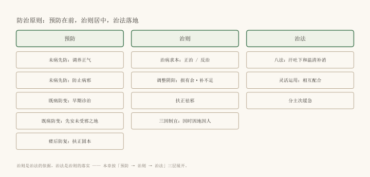

# 第 11 章 · 防治原则

> **源**：`qhzy-中医基础理论.xlsx` · 表「10治则」 · 源文 4,374 字
> **抽取**：`node scripts/import_textbooks.js --only 中医基础理论` · sha256 `870b004ea34b4ec2…` · 2026-10-21
> **层次**：本文件是**源教材正文层** —— 节次取自源表的结构列，文字未改写、未压缩、未抽样。改写层（N.3「这个翻译丢掉了什么」/ N.5「争议与本项目立场」）尚未撰写，见 `textbooks/README.md` 章契约。

---

【网络校准·2026-08-07】'养生与防治'在权威目录中为合一章(养生/预防/治则);本版拆为第10章防治原则+第11章养生康复,体例差异已在『新目录』校准区说明。

## 10.1 预防

### 10.1.1 未病先防

#### 10.1.1.1 调养正气：顺应自然、锻炼身体、调摄精神

未病先防的核心在于增强正气，提高抗邪能力。顺应自然指根据四时气候变化调整起居（如“春夏养阳，秋冬养阴”）；锻炼身体指通过导引、太极拳、八段锦等促进气血流通；调摄精神指保持心情舒畅，避免七情过激。AI平台构建“正气指数”动态监测模型，整合可穿戴设备采集的心率变异性（HRV）、睡眠结构、日常活动量及情绪问卷数据，实时评估个体正气状态，并推送个性化的养生建议（如“今日阳气偏弱，建议晨练晒背15分钟”）。

#### 10.1.1.2 防止病邪：讲究卫生、药物预防、避免疫毒

在增强正气的同时，亦需避免病邪侵袭。讲究卫生包括饮食清洁、起居环境通风；药物预防指在特定季节或疫病流行时，服用具有辟秽解毒功效的中药（如流感季节服用板蓝根、夏季服用藿香正气水）；避免疫毒指远离传染源，必要时采取隔离措施。AI通过环境病原监测数据接口，实时获取空气质量、花粉浓度、传染病疫情等信息，结合用户体质，发出“避邪”预警（如“今日PM2.5超标，建议佩戴口罩外出”），并推荐预防性中药方剂。

### 10.1.2 既病防变

#### 10.1.2.1 早期诊治：阻断病邪深入

疾病初期，病位浅、病情轻、正气尚盛，及时诊治可阻断病邪深入。中医强调“上工治未病，不治已病”，即强调早期诊断、早期治疗的重要性。AI通过症状早期预警模型，分析用户日常健康数据（如体温波动、心率异常、睡眠质量下降），识别疾病的早期微弱信号，提示用户就医，避免延误病情。例如，通过持续监测静息心率变异性下降，预警潜在的病毒性心肌炎风险。

#### 10.1.2.2 先安未受邪之地：截断传变途径

掌握疾病传变规律，在病变未波及之前，预先扶助相关脏腑，防止疾病传变。如《金匮要略》云：“见肝之病，知肝传脾，当先实脾”。AI基于病机传变知识图谱，模拟疾病在不同脏腑间的传变路径。当系统识别出“肝气郁结”病机时，自动提示“需警惕脾土受克”，并推荐健脾理气方药（如逍遥散加减），实现智能化的“既病防变”指导。

### 10.1.3 瘥后防复

#### 10.1.3.1 扶正固本：调理气血阴阳

疾病初愈，正气尚虚，需继续调理，巩固疗效，防止复发。重点在于调理气血阴阳，恢复脏腑功能。如热病后多伤阴，宜滋阴清热；汗下后多伤阳，宜温阳益气。AI通过康复期健康画像，对比患者康复前后及与健康人群的生理指标差异，制定个性化的康复方案。例如，针对新冠康复患者，根据肺功能、心肺耐力及疲劳程度评估结果，推荐呼吸训练、八段锦及益气养阴食疗方。

#### 10.1.3.2 调摄生活：慎起居、节饮食、远房帏

康复期生活调摄至关重要。慎起居指作息规律，避免过劳；节饮食指清淡易消化，避免肥甘厚味、辛辣刺激；远房帏指节制房事，保精养气。AI通过行为模式分析，监测患者康复期的睡眠时长、饮食结构、运动强度及性生活频率，识别可能导致复发的不良行为（如熬夜、暴饮暴食），并及时发出警示，引导健康生活方式。

## 10.2 治则

### 10.2.1 治病求本

#### 10.2.1.1 正治：寒者热之、热者寒之

正治是逆其证候性质而治的一种常用治则，适用于病情轻浅、证候本质与现象一致的病证。寒证用温热药，热证用寒凉药，虚证用补益药，实证用攻伐药。AI通过治则治法

#### 10.2.1.2 反治：热因热用、寒因寒用

反治是顺从疾病假象而治的一种特殊治则，适用于病情复杂、证候本质与现象不完全一致的病证。如“热因热用”：内真寒而外假热，用温热药治疗假热；“寒因寒用”：内真热而外假寒，用寒凉药治疗假寒。AI通过真假寒热鉴别模型，训练学生识别复杂的“真寒假热”或“真热假寒”证。系统提供包含矛盾症状（如“虽恶寒但口渴喜冷饮”）的病例，要求学生辨析本质，选择正确的反治方法。

### 10.2.2 调整阴阳

#### 10.2.2.1 损其有余：实则泻之

针对阴阳偏盛的实证，采用“损其有余”的方法。阳偏盛则清热泻火（如白虎汤），阴偏盛则温阳散寒（如附子理中汤）。AI通过阴阳平衡动态仿真，模拟不同治疗手段对阴阳偏盛状态的纠正过程。例如，输入“清热泻火”干预，系统展示阳热指标下降、阴阳差值缩小的动态曲线，直观呈现“损其有余”的效果。

#### 10.2.2.2 补其不足：虚则补之

针对阴阳偏衰的虚证，采用“补其不足”的方法。阴虚则滋阴（如六味地黄丸），阳虚则补阳（如金匮肾气丸）。AI特别强调“阴中求阳”、“阳中求阴”的配伍智慧。在推荐补阳方剂时，系统会提示加入少量补阴药（如金匮肾气丸中用干地黄、山茱萸），以促进阳气生化；推荐补阴方剂时，提示加入少量补阳药（如六味地黄丸中用桂枝、附子），以推动阴液化生。

### 10.2.3 扶正祛邪

#### 10.2.3.1 扶正：适用于虚证

扶正即扶助正气，增强体质，提高抗病能力，适用于虚证或虚实夹杂以虚为主的病证。常用方法包括益气、养血、滋阴、温阳等。AI通过扶正疗效预测模型，根据患者正气虚损程度，预测不同扶正方法（如补气vs补血）的预期效果。例如，对于“气血两虚”患者，系统可能建议先补气以生血（当归补血汤重用黄芪），再辅以补血药。

#### 10.2.3.2 祛邪：适用于实证

祛邪即祛除病邪，消除致病因素，适用于实证或虚实夹杂以实为主的病证。常用方法包括发汗、攻下、清热、化瘀、化痰、利湿等。AI通过祛邪力度评估模型，根据邪气盛衰程度，推荐适宜的祛邪强度。例如，对于年老体弱者的实证，系统会提示“攻邪勿伤正”，建议采用缓攻或攻补兼施策略，避免峻猛攻伐。

### 10.2.4 三因制宜

#### 10.2.4.1 因时制宜：春夏养阳、秋冬养阴

根据不同季节气候特点制定适宜治法。如夏季炎热，腠理开泄，慎用辛温发散；冬季寒冷，腠理致密，慎用寒凉伤阳。AI通过季节性用药推荐模型，结合实时气象数据，调整处方用药。例如，夏季开具麻黄汤时，系统会自动提示减少麻黄用量，或加入石膏、知母等清热药，以防过汗伤津。

#### 10.2.4.2 因地制宜：东南湿热、西北燥寒

根据不同地区的地理环境、生活习惯制定适宜治法。如东南沿海气候潮湿，多用祛湿药；西北高原气候干燥，多用润燥药。AI通过地域健康大数据分析，识别不同地区的常见病证谱及用药偏好。例如，系统会提示在四川地区治疗感冒，可适当增加紫苏、藿香等芳香化湿药的用量，以适应当地多湿的气候。

#### 10.2.4.3 因人制宜：年龄、性别、体质差异

根据患者年龄、性别、体质等个体差异制定适宜治法。如小儿稚阴稚阳,用药轻清,慎用峻剂;老人气血衰退,补益为主;女性有经带胎产特点,需兼顾养血调经。体质差异按《灵枢·阴阳二十五人》五形人辨之:木形之人疏肝为要、火形之人清心为要、土形之人健脾为要、金形之人润肺为要、水形之人温肾为要,并参时令宜忌。AI通过个体化治疗推荐系统,整合患者全维度信息生成方案。

## 10.3 治法

### 10.3.1 汗、吐、下、和、温、清、补、消

#### 10.3.1.1 汗法：开泄腠理，解除表邪

汗法通过发汗，使邪从汗解，适用于外感表证。AI通过发汗效果模拟，展示不同发汗药物（如麻黄、桂枝、荆芥、防风）对汗腺分泌、毛细血管扩张的影响，以及如何根据表寒、表热、表虚、表实的不同，选择合适的发汗强度和配伍。

#### 10.3.1.2 补法：补益气血阴阳，增强体质

补法针对各种虚损证候，通过补益气血阴阳，恢复脏腑功能。AI通过补益药效动力学模型，模拟补气药（如人参、黄芪）提高免疫功能、补血药（如当归、熟地）促进造血、补阴药（如麦冬、生地）改善代谢、补阳药（如附子、肉桂）增强能量代谢的过程，帮助学生理解不同补药的药理特点。

### 10.3.2 八法的灵活运用

#### 10.3.2.1 八法之间的相互配合

临床常需多种治法配合使用，如汗下并用（大柴胡汤）、温清并用（半夏泻心汤）、攻补兼施（黄龙汤）。AI通过治法组合优化算法，根据病机的复杂程度，推荐最佳的治法组合。例如，对于“少阳阳明合病”，系统自动推荐“和解少阳”与“内泻热结”相结合的治法（大柴胡汤法）。

#### 10.3.2.2 根据病情主次缓急选择

病情有主次，病势有缓急，治法应有先后。急则治其标（如大出血先止血），缓则治其本（如血

## 10.4 AI辅助诊疗决策

### 10.4.1 个性化治疗方案生成

#### 10.4.1.1 基于病机的治则治法推荐

AI系统首先通过病机推理引擎确定核心病机（如“肝郁脾虚”），然后基于知识图谱，自动匹配相应的治则（如“疏肝健脾”）和治法（如“疏肝解郁，健脾益气”）。系统会列出多个备选方案，并根据循证医学证据等级进行排序。

#### 10.4.1.2 考虑患者体质与环境因素的调整

在生成基础方案后,AI会进一步结合患者的体质类型(五形人:木形加疏肝、火形加清心、土形加健脾、金形加润肺、水形加温肾,现代九分法体质倾向可作量化参考)、年龄性别(如老年人用药减量)、地域环境(如南方多湿加用祛湿药)及季节气候(如冬季慎用寒凉),对基础方案进行智能化微调,确保治疗的精准性与安全性。

### 10.4.2 疗效预测与方案优化

#### 10.4.2.1 治疗反应的模拟与评估

AI通过虚拟临床试验模型，模拟患者在接受特定治疗方案后的预期反应。例如，输入“小柴胡汤”治疗“少阳证”，系统展示预计的症状改善曲线（如发热消退时间、食欲恢复时间）。若模拟结果显示疗效不佳或出现不良反应，系统会提示调整方案。

#### 10.4.2.2 不良反应的风险预警

AI系统内置药物相互作用数据库和不良反应监测模型。在推荐处方时，自动检查是否存在“十八反”、“十九畏”等配伍禁忌，以及药物过敏史。对于具有潜在肝肾毒性的药物（如雷公藤、附子），系统会提示监测相关指标，并设定安全剂量上限，最大限度保障用药安全。

## 10.5 养生与康复指导

### 10.5.1 养生方案个性化定制

#### 10.5.1.1 基于体质辨识的膳食指导

AI根据阴阳二十五人辨识结果生成

#### 10.5.1.2 基于节气变化的起居导引

结合二十四节气，AI推送相应的养生要点。如“立春”时节，提示“夜卧早起，广步于庭”，推荐练习“嘘”字诀以养肝；“冬至”时节，提示“早卧晚起，必待日光”，推荐艾灸关元、涌泉以温肾。系统还会根据当日天气，调整运动强度建议。

### 10.5.2 康复路径智能规划

#### 10.5.2.1 功能恢复的阶段性目标设定

针对中风后遗症、骨折术后等康复患者，AI设定阶段性康复目标。例如，中风后第1个月目标为床上翻身坐起，第3个月目标为辅助下床行走。系统会根据患者的每日训练数据（如关节活动度、肌力等级），动态调整目标难度，保持挑战性与可达性的平衡。

#### 10.5.2.2 康复训练的实时反馈与纠错

结合动作捕捉技术，AI实时监测患者康复训练的动作规范性。例如，在指导“八段锦”练习时，系统通过摄像头捕捉用户动作，与标准动作库进行比对，实时提示“手臂抬高不足”、“膝盖弯曲角度过大”等错误，并给出纠正指导，确保康复训练的安全有效。

---

> **免责声明**：本教材内容仅用于教育与科研，不构成任何诊疗建议。
> 本文件由 `scripts/import_textbooks.js` 从源工作簿生成，请勿手改 —— 需要修改请改源工作簿后重跑。

