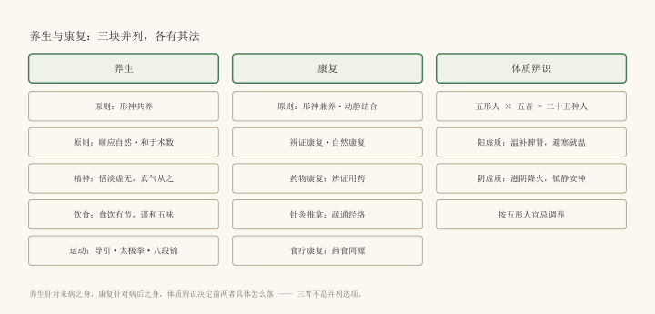

# 第 12 章 · 养生与康复

> **源**：`qhzy-中医基础理论.xlsx` · 表「11养康」 · 源文 5,256 字
> **抽取**：`node scripts/import_textbooks.js --only 中医基础理论` · sha256 `870b004ea34b4ec2…` · 2026-10-21
> **层次**：本文件是**源教材正文层** —— 节次取自源表的结构列，文字未改写、未压缩、未抽样。改写层（N.3「这个翻译丢掉了什么」/ N.5「争议与本项目立场」）尚未撰写，见 `textbooks/README.md` 章契约。

---

【网络校准·2026-08-07·复审修正】体质分类以《灵枢·阴阳二十五人》为纲(五形人×五音=二十五人,经典正统口径);王琦九分法(平和质/气虚质等)仅为现代体质研究参考,标注'现代认识,不改中基原义';本版 11.3 节已按此改写,建议后续升级为独立章时同样以阴阳二十五人为纲。

## 11.1 养生

### 11.1.1 养生的原则与方法

#### 11.1.1.1 形神共养：注重精神调摄与形体锻炼

养生需兼顾“形”（躯体）与“神”（精神），二者相辅相成。形健则神旺，神清则形健。精神调摄强调恬淡虚无、心态平和，避免过度情绪波动（七情内伤）；形体锻炼强调适度运动，如导引、太极拳、八段锦等，以疏通经络、流畅气血。AI平台通过可穿戴设备数据流，实时监测用户的心率变异性（HRV，反映精神状态）、每日步数及中高强度运动时长（反映形体活动），构建“形神健康指数”。当系统检测到HRV持续偏低（精神压力大）而运动不足时，自动推送“冥想放松+温和散步”的组合建议，实现形神共养的动态平衡。

#### 11.1.1.2 顺应自然：法于阴阳，和于术数

养生应遵循自然界阴阳消长规律及四季气候变化特点，即“法于阴阳”；同时采用正确的养生方法和技术，如呼吸吐纳、按摩导引等，即“和于术数”。AI整合气象局实时数据（温度、湿度、气压、空气质量指数）与中医运气学理论，生成“每日养生指南”。例如，在大暑节气且湿度超过80%时，系统判定为“暑湿困脾”，推送“荷叶冬瓜汤”食疗方及“按揉足三里、阴陵泉”的导引术，并建议避开正午高温时段运动。

### 11.1.2 常用养生方法

#### 11.1.2.1 精神养生：恬淡虚无，志闲少欲

精神养生是中医养生的最高境界，核心是减少私心杂念，保持乐观豁达的心态。《黄帝内经》云：“恬淡虚无，真气从之；精神内守，病安从来。”AI通过情绪识别API（分析语音语调、面部表情、打字速度及用词情感）评估用户的精神压力水平。当识别到持续焦虑或抑郁倾向时，系统启动“精神调摄模块”，推送舒缓音乐、正念减压音频、心理疏导短文，并引导用户进行“嘘、呵、呼、呬、吹、嘻”六字诀呼吸练习，以调畅气机，安

#### 11.1.2.2 饮食养生：食饮有节，谨和五味

饮食养生强调“食饮有节”（定时定量，不暴饮暴食）与“谨和五味”（合理搭配酸苦甘辛咸，不偏嗜）。AI构建个性化营养图谱，基于用户的体质类型（如痰湿体质忌肥甘厚味）、基础代谢率、日常活动量及健康目标（如减重、控糖），计算每日所需热量及各营养素比例。系统提供“智能食谱推荐”，不仅能推荐菜式，还能精确到食材克数、烹饪方法及进食时间。例如，为阳虚体质用户推荐“当归生姜羊肉汤”，并提示晚餐食用，以助阳气内敛。(体质倾向表述属现代临床参考,教材体质分类以《灵枢·阴阳二十五人》为纲)

#### 11.1.2.3 运动养生：导引、太极拳、八段锦

运动养生主张“形劳而不倦”，选择适合自身情况的柔和运动。传统功法如导引术（五禽戏）、太极拳、八段锦等，具有疏通经络、调和气血、强健筋骨的功效。AI通过动作捕捉与姿态识别技术（如手机摄像头或智能手环），对用户练习八段锦、太极拳的动作进行实时评分。系统能识别“两手托天理三焦”时手臂是否充分上举，“摇头摆尾去心火”时脊柱旋转幅度是否达标，并给出纠正意见，确保用户动作规范，达到最佳养生效果。

## 11.2 康复

### 11.2.1 康复的原则

#### 11.2.1.1 形神兼养与动静结合

康复过程同样遵循“形神兼养”原则，既要促进肢体功能恢复（形），又要关注心理状态调整（神）。同时强调“动静结合”：急性期或功能严重受损时需静养（制动），但病情稳定后需

#### 11.2.1.2 辨证康复与自然康复

辨证康复指根据患者的具体病情、体质及康复阶段，制定个性化的康复方案，而非千篇一律。自然康复则强调利用自然因素（如日光、空气、泉水）进行康复。AI基于全维度康复评估数据（包括西医诊断、中医辨证、肌力评级、平衡能力、ADL评分、心理状态等），生成“一人一案”的康复计划。例如，对脊髓损伤患者，若辨证为“气虚血瘀”，则在物理训练基础上，配合“益气活血”中药及艾灸；对骨折术后患者，利用自然日光促进维生素D合成，助力钙吸收。

### 11.2.2 常用康复方法

#### 11.2.2.1 药物康复：辨证用药促进恢复

药物康复是康复的重要手段，旨在调理脏腑气血，促进功能恢复。如中风后遗症常用补气活血通络之品（补阳还五汤），骨折术后常用接骨续筋、活血化瘀之品（复元活血汤）。AI通过康复用药知识图谱，关联“疾病-证候-体质-康复药物”。系统能根据患者康复阶段的病机变化（如初期以瘀血为主，后期以气血亏虚为主），动态调整处方。例如，对COPD康复期患者，从初期的“清肺化痰”逐步过渡到后期的“健脾益肺补肾”，并提示药物可能的副作用及监测指标。

#### 11.2.2.2 针灸推拿康复：疏通经络，调和气血

针灸（毫针、电针、艾灸）与推拿（按摩、关节松动术）通过刺激经络穴位，调节气血运行，促进神经功能重塑和肢体功能恢复。AI结合经络传感数据与肌电信号分析，优化针灸推拿方

#### 11.2.2.3 食疗康复：以食代药，调理脾胃

食疗康复利用食物的性味归经来调理身体，尤其适用于脾胃虚弱、不耐攻伐的患者。原则是“虚则补之，药食同源”。AI开发“康复食疗计算器”，根据患者的消化能力、营养需求及中医证候，推荐适宜的食疗方。例如，对胃大部切除术后患者，推荐“山药莲子粥”（健脾益胃，易于消化）；对肿瘤放化疗后骨髓抑制患者，推荐“阿胶枸杞炖瘦肉”（补血养阴）。系统会特别标注食物的烹饪要求（如烂、软、温）及进食禁忌。

## 11.3 体质辨识与健康管理

### 11.3.1 体质分类:以《灵枢·阴阳二十五人》为纲

#### 11.3.1.1 阴阳二十五人的判定(五形人×五音)

《灵枢·阴阳二十五人》以五行属性将人分为木、火、土、金、水五种类型(五形人),每形人再按五音(角、徵、宫、商、羽)及左右上下之异细分为五亚型,共二十五种人,是为'阴阳二十五人'。判定以望形态(面色、体形、头面肩背手足)、闻音声(五音)、察举止(行安地/行摇、疾心/安心)为依据,并参时令宜忌(能春夏不能秋冬 / 能秋冬不能春夏)。此分类直接对接五行藏象:五形人分属五脏(肝心脾肺肾),是'同气相求、因形辨病'的经典体质观,为病证单元'体质→易感病证'提供经典依据。AI平台可按五形人特征建立望诊-体形-五音-时令的多模态辨识模型(如面赤锐面小头多属火形、面白方面骨轻多属金形),与知识树'五行-五形-五脏'节点联动。

#### 11.3.1.2 五形人的基本特征(形态·性格·

① 木形之人(上角,似苍帝):苍色,小头,长面,大肩背,直身,小手足;有才,好劳心,少力,多忧劳于事;能春夏不能秋冬;易病肝(足厥阴肝经)——调养宜春夏疏肝条达,戒忧思过劳。② 火形之人(上徵,似赤帝):赤色,锐面小头,好肩背髀腹,小手足;行安地,疾心,行摇,肩背肉满;有气,轻财,少信,多虑,见事明,好颜,急心,不寿暴死;能春夏不能秋冬;易病心(手少阴心经)——调养宜清心安神,戒急怒。③ 土形之人(上宫,似上古黄帝):黄色,圆面,大头,美肩背,大腹,美股胫,小手足,多肉,上下相称;行安地,举足浮;安心,好利人,不喜权势,善附人;能秋冬不能春夏;易病脾(足太阴脾经)——调养宜健脾和胃,节饮食。④ 金形之人(上商,似白帝):方面,白色,小头,小肩背,小腹,小手足,如骨发踵外,骨轻;身清廉,急心,静悍,善为吏;能秋冬不能春夏;易病肺(手太阴肺经)——调养宜润肺敛气,避燥邪。⑤ 水形之人(上羽,似黑帝):黑色,面

五音对应五行:角(木)、徵(火)、宫(土)、商(金)、羽(水)。每形之人按五音及手足经脉左右上下之别分为五亚型:木形分大角、左角(判角)、釱角、太角、少角;火形分质徵(太徵)、少徵、右徵、质判;土形分太宫、加宫、少宫、左宫、众宫;金形分太商、釱商、右商、左商、少商;水形分太羽、少羽、众羽、桎羽(大羽)。五五二十五人,各有经脉比属与气禀特征,详见《灵枢·阴阳二十五人》原文'五形之人,二十五变者,众之所以相欺者是也'。教学上以五形人五纲为本、五音亚型为精进。

现代体质研究以王琦九分法为代表(平和质、气虚质、阳虚质、阴虚质、痰湿质、湿热质、血瘀质、气郁质、特禀质,见《中医体质分类与判定》ZYYXH/T157-2009)。此为现代认识,不改中基原义——教材以《灵枢·阴阳二十五人》为体质分类之纲,九分法作为现代量化辨识与健康管理的参考工具纳入知识树/AI教学节点,两者非替代关系,而是'经典为体、现代为用'的兼容并蓄(非零和局)。

### 11.3.2 基于阴阳二十五人的个性化养生

按五形人宜忌调养:木形之人春夏养肝、宜疏泄条达,食辛散(如薄荷、玫瑰花茶),忌忧思过劳;火形之人宜清心安神,食苦寒(如莲子心、苦瓜),忌急怒暴喜;土形之人宜健脾和胃,食甘平(如山药、薏米),节饮食勿过饱;金形之人宜润肺敛气,食甘润(如百合、银耳),避燥邪与悲忧;水形之人宜温肾填精,食咸温(如核桃、羊肉),避寒湿。再参五音亚型与体质强弱微调,并按时令(能春夏/能秋冬)与地域三因制宜。AI平台据五形人多模态辨识结果推送个性化养生方案,同时兼容现代九分法量化数据(附注'现代认识,不改中基原义')。

#### 11.3.2.1 阳虚质的温补调养

针对阳虚质，养生原则是“温补脾肾，避寒就温”。AI推荐温补类食物（羊肉、韭菜、核桃、生姜），温阳类中药（附子、肉桂、干姜），以及艾灸穴位（关元、命门、肾俞）。系统会特别提醒阳虚质人群在冬季及夜间注意保暖，避免冷水浴，并推荐“日光浴”疗法。运动方面，建议选择阳光充足的时段进行温和的有氧运动，如慢跑、太极，避免夜间剧烈运动耗伤阳气。

#### 11.3.2.2 阴虚质的滋润养护

针对阴虚质，养生原则是“滋阴降火，镇静安神”。AI推荐滋润类食物（鸭肉、银耳、百合、黑芝麻），滋阴类中药（麦冬、生地、沙参、枸杞子）。系统提示阴虚质人群避免辛辣燥热食物（辣椒、花椒、羊肉）及高温环境，保持居住环境湿润。运动方面，推荐选择瑜伽、游泳等静态或亲水运动，避免在烈日下暴晒和过度出汗，以防伤阴。

## 11.4 AI驱动的健康管理系统

### 11.4.1 全生命周期健康档案

#### 11.4.1.1 从出生到老年的健康数据追踪

AI系统构建个人全生命周期健康数字孪生体，持续追踪并记录个体从出生到老年的各类健康数据：新生儿期的Apgar评分、疫苗接种记录；儿童期的生长发育曲线（身高、体重、头围）；青少年期的视力、脊柱健康；成年期的体检报告、慢病管理数据；老年期的认知功能、跌倒风险评估等。这些数据形成连续的健康轨迹，为不同阶段的健康管理和疾病预防提供基线参考。

#### 11.4.1.2 生活方式与环境暴露记录

除了临床数据，系统还详细记录个体的生活方式数据（饮食结构、运动频率、睡眠质量、烟酒嗜好、心理压力水平）和环境暴露数据（居住地空气质量、饮用水质量、职业暴露史、旅行史）。AI通过大数据分析，识别生活方式和环境因素对健康的影响权重。例如，系统可能发现用户长期暴露于高浓度PM2.5环境与其慢性咳嗽的强相关性，从而提出改善室内空气质量或迁移居住地的建议。

### 11.4.2 智能养生方案推荐

#### 11.4.2.1 基于体质辨识的饮食运动建议

如前所述，AI核心优势在于个性化。系统定期（如每月或每季度）重新评估用户体质，根据最新的健康数据动态调整养生方案。例如，用户在经历一段高强度工作后，体质可能从“平和质”转为“气虚质”或“气郁质”，系统会自动更新推荐方案，增加补气或疏肝理气的食物与运动，并建议增加休息时间。这种动态调整确保了养生方案的时效性和针对性。(体质倾向表述属现代临床参考,教材体质分类以《灵枢·阴阳二十五人》为纲)

#### 11.4.2.2 节气养生的自动化提醒

AI将中医“天人相应”理论与现代日历结合，实现节气养生的自动化推送。在每个节气来临前1-2天，系统自动向用户发送该节气的养生要点。例如，在“霜降”节气，提示“天气渐冷，开始降霜，宜食柿子、栗子，注意保暖，尤其护膝；宜练‘按攒竹’以明目”。推送内容包含文字、图片、短视频（演示功法），形式多样，易于接受。

### 11.4.3 康复效果的智能评估

#### 11.4.3.1 功能恢复的量化指标监测

对于康复患者，AI通过物联网康复设备（如智能握力计、平衡测试仪、步态分析仪）自动采集功能恢复数据。系统设定关键绩效指标（KPIs），如“两周内患侧手握力提升10%”、“一个月内独立行走距离增加50米”。AI算法实时分析这些数据，生成功能恢复曲线，并与预期目标进行对比。若实际进展落后于预期，系统会分析原因（如训练强度不足、依从性差、出现并发症），并提示康复师调整方案。

#### 11.4.3.2 康复方案的动态调整

基于智能评估结果，AI支持康复方案的闭环优化。例如，中风患者在进行机器人辅助上肢训练时，系统根据患者每次训练的用力情况、完成度及疲劳程度，实时调整机器人的阻力系数和辅助力度。对于家庭康复，系统根据用户上传的每日训练视频和自评数据，远程指导患者调整动作难度或训练频次，确保康复过程安全、有效、可持续。

---

> **免责声明**：本教材内容仅用于教育与科研，不构成任何诊疗建议。
> 本文件由 `scripts/import_textbooks.js` 从源工作簿生成，请勿手改 —— 需要修改请改源工作簿后重跑。

