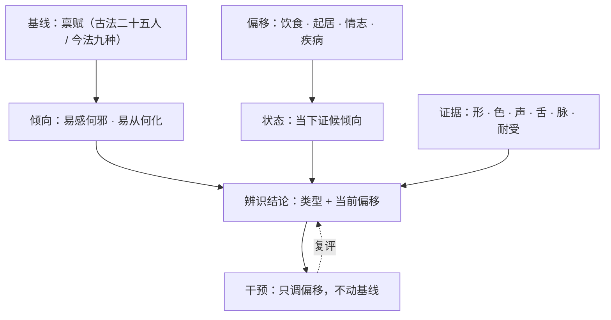

# 第 13 章 · 体质学说与体质辨识

> **源**：`qhzy-中医基础理论.xlsx` · 表「12体质」 · 源文 1,896 字
> **抽取**：`node scripts/import_textbooks.js --only 中医基础理论` · sha256 `870b004ea34b4ec2…` · 2026-10-21
> **层次**：本文件下段是**源教材正文层** —— 节次取自源表的结构列，文字未改写、未压缩、未抽样；文末是**改写层**（`REWRITE:BEGIN/END` 块内 N.1–N.5 + 小结 + 思考题 + 延伸阅读），门见 `tests/test_jichu_textbook.js`。

---

【网络校准·2026-08】"十四五"规划教材中"体质"为独立章(位于经络之后、病因之前); 本版依此升级: 原种子 11.3 小节(体质辨识与健康管理)扩为独立第12章。分类以《灵枢·阴阳二十五人》为纲(五形人×五音=二十五人), 王琦九分法为现代参考。

12.1 体质的概念与形成

12.1.1 体质的基本概念

12.1.1.1 体质的定义与内涵

体质是指人体生命过程中, 在先天禀赋和后天获得的基础上所形成的形态结构、生理功能和心理状态方面综合的、相对稳定的固有特质。体质表现为个体对某些病因和疾病的易感性, 以及疾病传变转归中的某种倾向性。体质是"证"形成的生理基础, 也是"同病异治""异病同治"的内在依据。

12.1.1.2 体质与证候、病机的关系

体质决定证候的从化: 同一致病因素, 因体质差异可出现不同证候。如感受寒邪, 阳虚体质者易从寒化, 阴虚体质者易从热化。体质是病机转化的内在条件, 体质辨识是"因人制宜"治则的落点——这与平台"病证单元(病×证)"双维度高度契合: 体质可视为"人"维度, 病证单元可视为"病×证"维度, 三者的笛卡尔积构成个性化诊疗空间。

12.2 体质的形成因素

12.2.1 先天因素

12.2.1.1 父母禀赋与遗传

先天禀赋是体质形成的基础。《灵枢·寿夭刚柔》言"人之生也, 有刚有柔, 有强有弱, 有短有长, 有阴有阳"。父母体质、孕育期调养、胎教环境共同决定子代体质的基调。

12.2.2 后天因素

12.2.2.1 饮食、起居、情志与地理

后天因素包括: ①饮食: 肥甘厚味酿生痰湿体质, 素淡饮食多成气虚体质; ②起居: 过劳伤气、过逸气滞; ③情志: 长期忧郁易成气郁体质; ④地理: 西北燥寒、东南湿热, 地域环境塑造地域体质特征; ⑤疾病与药物: 久病、误治可改变体质。

12.3 体质的分类

12.3.1 以《灵枢·阴阳二十五人》为纲

12.3.1.1 五行五形人

以五行属性将人为为木、火、土、金、水五形人, 各具形态、肤色、性格与易感疾病特征: 木形人(青、小头长面, 好有才, 劳心少力, 春夏感病易)、火形人(赤、锐面小头, 急心)、土形人(黄、圆面大头, 安心好利人, 耐秋冬)、金形人(白、方面小头, 身清廉, 耐秋冬)、水形人(黑、面不平大头)。五形人各具气质倾向, 与现代心理学气质类型可作教学类比。

12.3.1.2 五音二十五人

五形人各按五音(角、徵、宫、商、羽)再分五型, 合为二十五人, 细辨同形异质之差异。平台可将二十五人编码为体质节点(如"上角木形人"), 挂接易感病证单元, 实现"体质→病证"关联检索。

12.3.2 王琦九分法(现代参考)

12.3.2.1 九种基本体质

现代体质研究以王琦九分法为通行参考: 平和质、气虚质、阳虚质、阴虚质、痰湿质、湿热质、血瘀质、气郁质、特禀质。九分法以量表化、可量化为特征, 与《阴阳二十五人》的经典分类形成"经典为纲、现代为用"的双轨兼容——正是兼容性思维流"双轨表述"的体现。

12.3.2.2 经典与九分法的映射

对应关系(非严格一一对应): 木形人≈气郁/阴虚倾向, 火形人≈阴虚/湿热倾向, 土形人≈痰湿/气虚倾向, 金形人≈气虚/特禀倾向, 水形人≈阳虚/血瘀倾向。教材明示"映射为教学类比, 非中医定义"(tcmreviewer_ai 红线)。

12.4 体质与发病、辨证论治

12.4.1 体质与发病倾向

12.4.1.1 体质决定易感性与从化

体质决定个体对病邪的易感性: 阳虚质易感寒邪, 阴虚质易感热邪, 痰湿质易患眩晕、中风、消渴。体质亦决定发病后证候的从化方向与传变规律, 是"邪正盛衰"病机中"正"的个体化表达。

12.4.2 体质与辨证论治

12.4.2.1 因人制宜的治则落点

辨证论治须结合体质: 同是感冒, 气虚体质者须益气解表(参苏饮意), 阴虚体质者须滋阴解表(加减葳蕤汤意); 同是高血压, 痰湿质与阴虚质治法迥异。体质辨识使"三因制宜"之"因人"有可操作的判定标准。

12.5 体质辨识的AI实现(分布式平台落点)

12.5.1 体质辨识量表数字化

12.5.1.1 量表条目→结构化字段

将中医体质量表(如王琦体质量表60条目)转化为结构化字段, 存入平台知识图谱"体质"节点; 结合可穿戴设备数据(HRV、睡眠、舌象图像), 构建"体质动态画像"。

12.5.2 体质-病证关联推理

12.5.2.1 体质×病×证三维检索

平台 /bianzheng 端点扩展"体质维度": 输入(症状+体质类型) → 输出(证候候选 + 体质相关病机提示)。体质量表问卷结果经四台式机就近采集, 数据汇聚浪潮计算后端训练, 推理服务部署华为云。

12.5.2.2 教学闭环

学生以自身体质为案例完成"体质辨识→易感病证→养生方案"实练, 平台多维评价体系纳入"体质辨识准确率"指标, 反馈回流修订本章内容。

---

> **免责声明**：本教材内容仅用于教育与科研，不构成任何诊疗建议。
> 本文件由 `scripts/import_textbooks.js` 从源工作簿生成，请勿手改 —— 需要修改请改源工作簿后重跑。

<!-- REWRITE:BEGIN -->
## 本章要回答的问题

体质是「一个人本来的样子」，还是「他现在这个样子」？如果体质可以被调理改变，那它与「证候」的边界在哪里 —— 同一个「阳虚」，什么时候是体质，什么时候是证？

## N.1 概念与出处

| 概念 | 出处（书名·篇名） | 本章源节 |
|---|---|---|
| 人以形色分五类 | 《灵枢·阴阳二十五人》：「先立五形金木水火土，别其五色，异其五形之人，而二十五人具矣。」 | 本章源表「12体质」 |
| 五态之人 | 《灵枢·通天》：「盖有太阴之人、少阴之人、太阳之人、少阳之人、阴阳和平之人。」 | 源表「12体质」 |
| 生而有刚柔强弱 | 《灵枢·寿夭刚柔》：「人之生也，有刚有柔，有弱有强，有短有长，有阴有阳。」 | 源表「12体质」 |
| 因地制宜 | 《素问·异法方宜论》：「一病而治各不同，皆愈，何也？」 | 源表「12体质」 |
| 现代九种体质 | 当代学说（王琦等），**非原典**，须与古法分栏 | 源表「12体质」 |
| 体质辨识的工程化 | 本项目的设计选择：辨识流程与标签体系 | 本章 |

本章的底本只有 1,896 字，是全书最短的一章。短不必然是缺陷：体质学说在原典里本就分散（《灵枢》数篇各有角度），到现代才被系统化。所以本章的写法与其他章不同：**先把「原典说了什么」与「现代补了什么」分开，再谈工程**。

## N.2 为什么可以这样翻译

体质可以写成一个**先天的基线 + 后天的偏移**的二元结构：

| 成分 | 来源 | 是否可变 | 表示 |
|---|---|---|---|
| 基线（禀赋） | 父母、先天 | 基本不变 | 体质类型标签（古法 / 今法分栏） |
| 偏移（当前状态） | 饮食、起居、情志、疾病 | 可变 | 证候倾向（虚 / 实 / 寒 / 热） |
| 表现（可观测） | 形、色、声、舌、脉、耐受 | 部分可变 | 观测项集合 |

三者合起来才是「体质辨识」：**基线决定倾向，偏移决定当下，表现提供证据**。这也回答了本章开头的问题 —— 体质与证候的边界在于**时间尺度**：体质看长期倾向，证候看当下状态；长期偏移未纠正而反复出现同类证候，才可以反过来说「此人体质偏于某」。

判断「是可调还是不可调」，只需问一句：**去掉诱因后是否自行回平**。回平的是偏移，不回的是基线。这条判据简单，却能挡住大量「把病当体质、把体质当病」的误判。

图上「只调偏移，不动基线」这一句是本章的工程底线：**体质类型是解释框架，不是治疗对象**。

还有一层要在表示上分清的：**体质标签必须带「依据」。** 二十五人以形色声音为据，九种体质以量表条目为据；两者的依据不同，因此不能互为证据。系统里每个标签都要挂一条「依据来源」字段，指向具体的观测项或量表条目 —— 没有依据的标签只是印象。这一条看似繁琐，却是把「体质辨识」与「给人贴标签」区分开的唯一办法。

## N.3 这个翻译丢掉了什么

**一、丢掉了分型的连续性与重叠。** 二十五人与九种体质都是离散分类，而真实个体常跨类（既偏阳虚又偏痰湿）。分类表给你一个格子，人却坐在格子边上。

**二、丢掉了古法与今法的不可通约。** 二十五人以五行五音为纲，九种体质以临床特征为纲，两套体系没有一一对应关系。强行映射（例如把「木形之人」等同于「气郁质」）会同时歪曲两边。

**三、丢掉了体质的动态性。** 体质在长周期里也会变（年龄、久病、地域迁移）。教材常把它写成终身不变的标签，这是过度简化。

**四、丢掉了辨识的信度问题。** 不同医师对同一人的体质判断一致性有限。没有信度数据的分型，只能当参考，不能当结论。

**五、丢掉了「调体质」的慢变量特征。** 基线难改，意味着任何声称「三个月改变体质」的说法都需要更强的证据 —— 而教材目前给不出。

## N.4 与相邻学科的接口

| 学科 | 用到本章的什么 | 以什么形式用 |
|---|---|---|
| 中医诊断学 | 体质与证候的边界 | 判定「反复同证」是否提示体质倾向 |
| 中医养生学（第 12 章） | 体质分型 | 用于排除明显不宜的养生方式 |
| 中医内科学 | 体质与发病倾向 | 「同病异治」的个体差异解释 |
| 流行病学 | 分型的分布与信度 | 提供一致性统计，不提供诊断 |
| 数据工程 | 辨识流程与标签 | 见本章的标签体系说明 |

## N.5 争议与本项目立场

**争议一：体质分型应以古法还是今法为准？** 一派主张尊《灵枢》二十五人，一派主张用当代九种体质（有量表、有流行病学数据）。

本项目立场：**两法分栏并存，不做映射。** 古法用于理论教学与文献对照，今法用于可量化的辨识；两栏结果并列呈现，不合并成「某型人」。

**争议二：体质辨识能否作为临床决策依据？** 支持者认为它解释了「同病异治」；反对者认为信度不足，容易标签化。

本项目立场：**只作解释与排除，不作选方依据。** 系统可以提示「此人不耐寒凉」，不得提示「此人应用某方」。

> **免责声明**：本章为教材说明，不构成诊断或治疗建议。体质辨识结论仅供参考，任何治疗决策须由执业中医师结合四诊作出。

## 本章小结

1. 体质 = 先天基线 + 后天偏移 + 可观测表现；边界在于时间尺度，不在症状本身。
2. 可调与不可调的判据：去掉诱因后能否自行回平。
3. 古法（二十五人、五态）与今法（九种体质）分栏并存，不做映射。
4. 丢掉的是分类连续性、两法不可通约、体质动态性、辨识信度与「调体质」的慢变量属性。

## 思考题

1. 「反复出现同一证候」是否足以判定体质倾向？请补出必要的附加条件。
2. 若一个人的体质判断在两位医师间不一致，系统应如何呈现这一分歧而不误导？
3. 请为「古法 / 今法分栏」设计一个最小数据结构，使两栏能并列检索但不互相污染。

## 延伸阅读

- 《灵枢·阴阳二十五人》—— 五形二十五人的原始分类
- 《灵枢·通天》—— 五态之人的性格与形色描述
- 《灵枢·寿夭刚柔》—— 「有刚有柔，有弱有强」的个体差异表述
- 《素问·异法方宜论》—— 地域差异与治法不同
- 本仓库 `standards/jichu/units.json`（章 12 段）—— 本章源表索引
<!-- REWRITE:END -->
