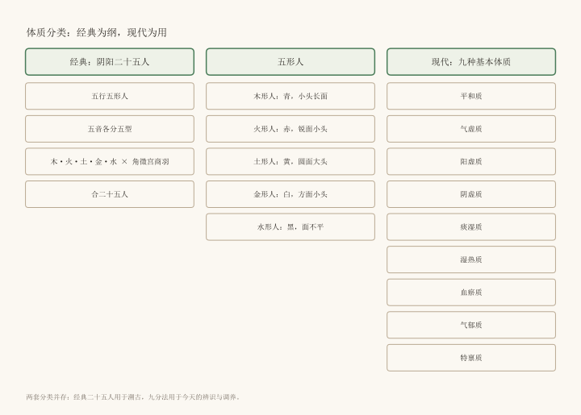

# 第 13 章 · 体质学说与体质辨识

> **源**：`qhzy-中医基础理论.xlsx` · 表「12体质」 · 源文 1,896 字
> **抽取**：`node scripts/import_textbooks.js --only 中医基础理论` · sha256 `870b004ea34b4ec2…` · 2026-10-21
> **层次**：本文件是**源教材正文层** —— 节次取自源表的结构列，文字未改写、未压缩、未抽样。改写层（N.3「这个翻译丢掉了什么」/ N.5「争议与本项目立场」）尚未撰写，见 `textbooks/README.md` 章契约。

---

【网络校准·2026-08】"十四五"规划教材中"体质"为独立章(位于经络之后、病因之前); 本版依此升级: 原种子 11.3 小节(体质辨识与健康管理)扩为独立第12章。分类以《灵枢·阴阳二十五人》为纲(五形人×五音=二十五人), 王琦九分法为现代参考。

12.1 体质的概念与形成

12.1.1 体质的基本概念

12.1.1.1 体质的定义与内涵

体质是指人体生命过程中, 在先天禀赋和后天获得的基础上所形成的形态结构、生理功能和心理状态方面综合的、相对稳定的固有特质。体质表现为个体对某些病因和疾病的易感性, 以及疾病传变转归中的某种倾向性。体质是"证"形成的生理基础, 也是"同病异治""异病同治"的内在依据。

12.1.1.2 体质与证候、病机的关系

体质决定证候的从化: 同一致病因素, 因体质差异可出现不同证候。如感受寒邪, 阳虚体质者易从寒化, 阴虚体质者易从热化。体质是病机转化的内在条件, 体质辨识是"因人制宜"治则的落点——这与平台"病证单元(病×证)"双维度高度契合: 体质可视为"人"维度, 病证单元可视为"病×证"维度, 三者的笛卡尔积构成个性化诊疗空间。

12.2 体质的形成因素

12.2.1 先天因素

12.2.1.1 父母禀赋与遗传

先天禀赋是体质形成的基础。《灵枢·寿夭刚柔》言"人之生也, 有刚有柔, 有强有弱, 有短有长, 有阴有阳"。父母体质、孕育期调养、胎教环境共同决定子代体质的基调。

12.2.2 后天因素

12.2.2.1 饮食、起居、情志与地理

后天因素包括: ①饮食: 肥甘厚味酿生痰湿体质, 素淡饮食多成气虚体质; ②起居: 过劳伤气、过逸气滞; ③情志: 长期忧郁易成气郁体质; ④地理: 西北燥寒、东南湿热, 地域环境塑造地域体质特征; ⑤疾病与药物: 久病、误治可改变体质。

12.3 体质的分类

12.3.1 以《灵枢·阴阳二十五人》为纲

12.3.1.1 五行五形人

以五行属性将人为为木、火、土、金、水五形人, 各具形态、肤色、性格与易感疾病特征: 木形人(青、小头长面, 好有才, 劳心少力, 春夏感病易)、火形人(赤、锐面小头, 急心)、土形人(黄、圆面大头, 安心好利人, 耐秋冬)、金形人(白、方面小头, 身清廉, 耐秋冬)、水形人(黑、面不平大头)。五形人各具气质倾向, 与现代心理学气质类型可作教学类比。

12.3.1.2 五音二十五人

五形人各按五音(角、徵、宫、商、羽)再分五型, 合为二十五人, 细辨同形异质之差异。平台可将二十五人编码为体质节点(如"上角木形人"), 挂接易感病证单元, 实现"体质→病证"关联检索。

12.3.2 王琦九分法(现代参考)

12.3.2.1 九种基本体质

现代体质研究以王琦九分法为通行参考: 平和质、气虚质、阳虚质、阴虚质、痰湿质、湿热质、血瘀质、气郁质、特禀质。九分法以量表化、可量化为特征, 与《阴阳二十五人》的经典分类形成"经典为纲、现代为用"的双轨兼容——正是兼容性思维流"双轨表述"的体现。

12.3.2.2 经典与九分法的映射

对应关系(非严格一一对应): 木形人≈气郁/阴虚倾向, 火形人≈阴虚/湿热倾向, 土形人≈痰湿/气虚倾向, 金形人≈气虚/特禀倾向, 水形人≈阳虚/血瘀倾向。教材明示"映射为教学类比, 非中医定义"(tcmreviewer_ai 红线)。

12.4 体质与发病、辨证论治

12.4.1 体质与发病倾向

12.4.1.1 体质决定易感性与从化

体质决定个体对病邪的易感性: 阳虚质易感寒邪, 阴虚质易感热邪, 痰湿质易患眩晕、中风、消渴。体质亦决定发病后证候的从化方向与传变规律, 是"邪正盛衰"病机中"正"的个体化表达。

12.4.2 体质与辨证论治

12.4.2.1 因人制宜的治则落点

辨证论治须结合体质: 同是感冒, 气虚体质者须益气解表(参苏饮意), 阴虚体质者须滋阴解表(加减葳蕤汤意); 同是高血压, 痰湿质与阴虚质治法迥异。体质辨识使"三因制宜"之"因人"有可操作的判定标准。

12.5 体质辨识的AI实现(分布式平台落点)

12.5.1 体质辨识量表数字化

12.5.1.1 量表条目→结构化字段

将中医体质量表(如王琦体质量表60条目)转化为结构化字段, 存入平台知识图谱"体质"节点; 结合可穿戴设备数据(HRV、睡眠、舌象图像), 构建"体质动态画像"。

12.5.2 体质-病证关联推理

12.5.2.1 体质×病×证三维检索

平台 /bianzheng 端点扩展"体质维度": 输入(症状+体质类型) → 输出(证候候选 + 体质相关病机提示)。体质量表问卷结果经四台式机就近采集, 数据汇聚浪潮计算后端训练, 推理服务部署华为云。

12.5.2.2 教学闭环

学生以自身体质为案例完成"体质辨识→易感病证→养生方案"实练, 平台多维评价体系纳入"体质辨识准确率"指标, 反馈回流修订本章内容。

---

> **免责声明**：本教材内容仅用于教育与科研，不构成任何诊疗建议。
> 本文件由 `scripts/import_textbooks.js` 从源工作簿生成，请勿手改 —— 需要修改请改源工作簿后重跑。

