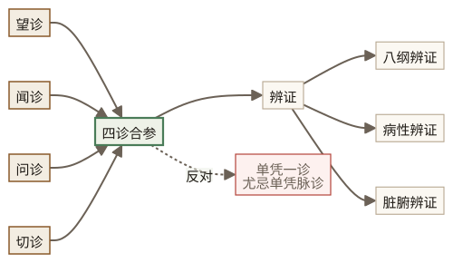

# 第 1 章 · 绪论与AI时代学习体系

> **源**：`qhzy-中医诊断学.xlsx` · 表「1绪论」 · 源文 2,398 字
> **抽取**：`node scripts/import_textbooks.js --only 中医诊断学` · sha256 `051d830a627c04cf…` · 2026-10-21
> **层次**：本文件是**源教材正文层** —— 节次取自源表的结构列，文字未改写、未压缩、未抽样。改写层（N.3「这个翻译丢掉了什么」/ N.5「争议与本项目立场」）尚未撰写，见 `textbooks/README.md` 章契约。

---

## 1.1 中医诊断学的研究对象与学科地位

### 1.1.1 中医诊断学的定义与范畴

#### 1.1.1.1 核心概念界定

中医诊断学是根据中医学理论体系，研究诊察病情、判断病种、辨别证候的基础理论、基本知识和基本技能的一门学科。它是中医学专业课程体系中的主干课程，是联系中医基础理论与临床各科之间的桥梁。其内容包括诊法（望、闻、问、切四诊）、辨证（八纲、病性、脏腑、经络、六经、卫气营血、三焦辨证）及病案书写三大部分。

#### 1.1.1.2 诊法与辨证的学科构成

中医诊断学由'诊法'与'辨证'两大板块构成：诊法研究收集病情资料的手段与方法，即望、闻、问、切四诊；辨证研究在四诊资料基础上辨别证候的思维方法。二者相互依存——诊法是辨证的前提，辨证是诊法的目的。本教材另设'诊断思路与病案'章，承接四诊与辨证，形成'诊—辨—断—案'完整闭环。

### 1.1.2 在中医药学科体系中的位置

#### 1.1.2.1 与中医基础理论及各临床科的联系

中医诊断学向上承接中医基础理论（阴阳五行、藏象、气血津液、病因病机），向下直接服务于内、外、妇、儿、针灸、推拿等临床各科。临床各科疾病的诊断与辨证均以四诊所得病情资料为起点，故本学科是临床诊疗活动的'入口'学科。

#### 1.1.2.2 在120门学科中的枢纽作用

在中医药行业120门学科体系中，中医诊断学处于承上启下的枢纽地位：它既是基础理论通向临床的'转换器'，也是疗效评价、科研设计、AI辅助诊疗等现代应用的'数据入口'。四诊资料的规范化采集与证候标准化，直接决定中药学、方剂学及循证评价的质量。

## 1.2 中医诊断学的发展简史

### 1.2.1 理论体系的形成时期

#### 1.2.1.1 《黄帝内经》的诊法奠基

《黄帝内经》奠定了中医诊断学的理论基础：确立了望闻问切四诊并用的原则，记载了望神、望色、察目、望舌、闻声、问病、切脉等诊法内容，并提出了'善诊者，察色按脉，先别阴阳''以我知彼，以表知里，以观过与不及之理，见微得过，用之不殆'等诊断原理，是诊法理论的奠基之作。

#### 1.2.1.2 《难经》《伤寒杂病论》的辨证贡献

《难经》首创独取寸口诊脉法，将寸口脉分为寸关尺三部以候脏腑；《伤寒杂病论》（张仲景）创立六经辨证体系，并详列各经病证的脉证提纲，同时确立了病、脉、证、治合参的诊疗模式；《中藏经》论脏腑虚实寒热辨证，为脏腑辨证的形成提供了雏形。

### 1.2.2 充实发展与近现代时期

#### 1.2.2.1 金元明清诊法辨证的发展

金元时期，刘完素、张从正、李杲、朱震亨四大家对诊法与辨证各有发挥，如李杲重脾胃内伤之脉证辨析；明清时期，《景岳全书》提出'十问歌'雏形，《伤寒舌鉴》《舌鉴辨正》专论舌诊，《脉经》之后脉学专著迭出，温病学家叶天士创卫气营血辨证、吴鞠通创三焦辨证，使辨证体系臻于完备。

#### 1.2.2.2 近现代中医诊断的标准化与客观化

近现代以来，中医诊断学向标准化、客观化方向推进：

## 1.3 中医诊断的基本原理与原则

### 1.3.1 三大基本原理

#### 1.3.1.1 司外揣内

司外揣内：通过观察机体外在的生理病理表现（外），推知内在脏腑气血的病变（内）。'视其外应，以知其内脏，则知所病矣。'舌、脉、色、形、神皆是内在脏腑功能状态的外在窗口，这是中医诊断学最根本的认识论原理。

#### 1.3.1.2 见微知著

见微知著：通过观察微小的、局部的变化，测知整体的情况。如舌边尖红赤可测知心火上炎，指纹的浮沉淡滞可测知小儿病位的表里与病性的虚实。局部是整体的缩影，是中医'生物全息'思想的体现。

#### 1.3.1.3 以常衡变

以常衡变：以正常人体的生理表现（常）为标准，衡量、判断异常变化（变）。如以正常脉象'胃、神、根'为准绳判别病脉，以五色常色为基准辨别病色。'常'的标准来自对健康人群的观察，是诊断的参照系。

### 1.3.2 三大基本原则

#### 1.3.2.1 整体审察

整体审察：诊断疾病时，既要诊察局部病变，更要审察整体状况——包括全身表现与局部表现的联系、脏腑经络之间的相互影响、人与自然环境和社会环境的关系，避免'头痛医头、脚痛医脚'的孤立片面思维。

#### 1.3.2.2 四诊合参

四诊合参：望、闻、问、切四诊从不同角度收集病情资料，各有侧重与局限，必须四诊并用、相互印证、综合分析，才能全面把握病情。'四诊合参'反对单凭一诊（尤忌单凭脉诊）草率断病，是保证诊断准确性的基本原则。

#### 1.3.2.3 病证结合

病证结合：疾病诊断（辨病）与证候诊断（辨证）相结合。辨病把握疾病全过程的根本矛盾，辨证把握现阶段的主要矛盾；同病异证、异病同证，均需病证双维度相互参照。本教材以ICD-11疾病编码与证候术语双轨锚定，落实病证结合原则。

## 1.4 AI赋能的教材形态与教学平台

### 1.4.1 数字教材与知识树构建

#### 1.4.1.1 诊断知识节点的数字化表达

数字教材将四诊知识拆解为可检索、可关联的知识节点：望诊（神、色、形、态、舌、排出物、指纹）、闻诊（声、气）、问诊（十问）、切诊（脉、按）等节点均配有定义、临床特征、鉴别要点与典型舌脉图片/视频。节点间以'诊法→症状→证候→病机'关系链接，构成诊断知识树。

#### 1.4.1.2 四诊-辨证概念关系的语义网络

语义网络图谱以'舌象-症状-证候-病机-治法'为核心关系边，如'舌紫暗有瘀斑——刺痛拒按——血瘀证——瘀血内阻——活血化瘀'。关系边必须符合中医逻辑（如'舌红绛=热入营血'而非统计相关），多义性与语境依赖（如'舌紫'既可见于血瘀亦可见于寒凝）必须保留。

### 1.4.2 AI参与教学全流程设计

#### 1.4.2.1 AI辅助舌诊/脉诊训练

AI辅助训练模块提供舌象图片标注练习、脉象波形模拟、面色辨识等交互场景，帮助学生反复训练四诊技能。AI输

#### 1.4.2.2 智能问诊辨证推演与批判性使用

智能问诊辨证推演模块以典型病案驱动，引导学生按'四诊合参→辨证→辨病→病证结合'流程推演，并展示AI辨证推理链的输入输出边界与不确定性来源；同时训练学生对AI结论的批判性审视——识别真寒假热、真实假虚等AI易误判场景，坚持'辅助决策+人工复核'。

---

> **免责声明**：本教材内容仅用于教育与科研，不构成任何诊疗建议。
> 本文件由 `scripts/import_textbooks.js` 从源工作簿生成，请勿手改 —— 需要修改请改源工作簿后重跑。
