# 凡例：这本辞典怎么读、怎么查、怎么接进程序

> 一句话：这是一本**可被程序读的证候辞典**。它不是把纸书排版搬进 Markdown，
> 而是先把书的目录读成一棵树，再给树装上编码、坐标与门禁，最后才写释义。

## 1 这本书的四个数字

| 层 | 数量 | 来源 | 能不能机械复算 |
|---|--:|---|---|
| 门（章级） | 12 | 目录「第N章 …门（A证B候）」 | 能（正则 + 逐门对账） |
| 类（块级） | 45 | 目录「第N节 …证类（Lnn）」 | 能 |
| 证（类目级） | 291 条 / 290 个码 | 目录「一、…证（Lnn-Zmm）」 | 能 |
| 候（亚目级） | 1866 条 / 1858 个码 / 320 个候号 | 目录「（一）…候（Lnn-Zmm-Hnnn）」 | 能 |

书内自述总数：「十二门、四十五类、二百九十一证、一千八百七十候」。目录实条与它的四处差异（寒 +1、湿 −1、饮 +2、食 +2）全部登记在 `standards/zhenghou-cidian/结构.json` 的 `校对.差异` 里 —— 对不上就写下来，不改数字去凑。

**第五个数字：原书正文层**。1864/1866 条候已逐条 OCR 落库（风门、寒门、暑门、湿门、燥门、火门、气门、瘀门、痰门、饮门、食门、虚证门），共 330.0 万字原文字数，带印张页码；每条含【通称】【病因病机】【证象组合】【主症】【副症】【宾症】【治则】【方症】【摘录】【病案】。

读书时记住三条：

1. **候表里的「原书」列**是印张号 —— 想看原话，翻那一页；`—` 表示这一门还没 OCR。
2. **「原书正文（OCR 节选）」块**是原书的**原话**（含 OCR 错字，未做润色），每证一块，块首写「本证 m/n 条候已录入」。
3. **证级那句「合成一句」不是原书病机** —— 它是用「位×性×态」三个语素拼出来的索引句，只用来检索与比对，不能当引文，也不能当诊断依据。

OCR 的错已经逐条记账，不藏：印张上的 L/Z 与目录不一致、目录有正文无、书内有目录无、同码两见，全部列在 `standards/zhenghou-cidian/缺口登记.json` 的 `正文层校勘` 里。

## 2 四级编码：ICD-11 同构，书内三码一字不改

```text
ICD-11 MMS   Chapter      →  Block       →  Category      →  Subcategory
本书          门 M01…M12    →  类 L01…L45   →  证 Lnn-Zmm     →  候 Lnn-Zmm-Hnnn
全码           M01-L01-Z01-H001
```

四条命名原则（照 ICD-11 Reference Guide §3.2.26 与 MMS 编码规则取用，可逐条落到本辞典）：

1. **单一主轴优先**：门按病性分（风/寒/暑/湿/燥/火/气/瘀/痰/饮/食/虚），不按病位分。位是第二轴，写在证名里。
2. **父子唯一归属**：一个证只能属于一个类，一个类只能属于一个门。若两者皆可，取更具体的那个（本书 `痰瘀证类 L30` 即在瘀门而不在痰门）。
3. **可扩展后缀**：候码 = 证码 + `-Hnnn`，追加不改父码。新增一个候不需要改动任何既有条目。
4. **同码同义、异义异码**：`L05-Z13` 在原书被「脾胃阴寒证」与「肺脾阴寒证」共用，是**原书编号冲突**。本层不改原码，只在扩展层记 `L05-Z13a / L05-Z13b`，并把它挂在 `校对.证码重复` 里报警。

## 3 三轴与张量

| 轴 | 取值 | 数量 | 在本辞典里的位置 |
|---|---|--:|---|
| 位 locus | 肺胃、肝脾……心营；清气、清阳、卫气…… | 22 证位 + 71 候位 | 证名前段 / 候名前段 |
| 性 cause·property | 12 门 + 45 类 | 57 | 所隶门 / 所隶类 |
| 态 property | 失宣、郁蒸、闭脱…… | 108 | 候名尾部 |

张量形状 `22×45×108`（位 × 类 × 态），实测非零格 **1052** 个。每个非零格的计数就是「这一类组合在书中出现了多少候」。

## 4 三种查法

| 你手里有的 | 怎么查 | 例 |
|---|---|---|
| 一个症状 | 先找位（哪一层），再找态（那一层出了什么错），最后落类 | 恶寒无汗＋脉浮紧 → 位＝肺卫，性＝风寒 → `M01-L01` |
| 一个古病名 | 用附录 C 的检索命令按「内含病例」反查 | `node scripts/zhenghou_query.js 肺卫风寒证` |
| **一句人话**（「我头晕、口苦」） | 查附录 D 的症状反查表，词项 → 位/性 → 候选证 | 见附录 D |
| 一个 ICD-11 码 | 用 TM1 四轴（locus/cause/property）反推本书的位与性 | 见附录 B |

## 5 读这本辞典的三个约定

1. **目录是底本，正文是释义**。所有码、条数、层级全部来自 `目录原文.txt`（2268 条，由 PDF 书签逐条落盘）。释义层（一句话、见症、治法、方）来自三张语素表，可拆回语素，**不是原书条文**。
2. **候级「合成一句」是检索用语，不是病机论述**。要病机，按目录页回查 PDF —— 我们只保证「找得到」，不假装「读完了」。
3. **不做诊疗建议**。这本辞典是给教学、编码、APP 数据层用的；任何临床使用都要回到四诊与原书正文。

## 6 与仓库其它层的关系

| 层 | 位置 | 关系 |
|---|---|---|
| 底本层（本辞典自有） | `standards/zhenghou-cidian/` | 目录原文 + 四级结构 + 三张语素表 + 张量 |
| 课程层 | `departments/01-zhongyi/14-zhongyi-zhenghou-xue/` | 12 章按三基编排（基本理论 1–4 · 基本方法 5–9 · 基本技能 10–12），由 `scripts/build_zhenghou_sanji.py` 生成；各论十二门在本书（教材层） |
| 跨课程派生层（旧） | `standards/zhenghou/证候库.json` | 四门临床课派生的 132 证，作为「另一套命名」的对照（见附录 B） |
| 规范层 | `standards/icd11/tm1/axes.json` | ICD-11 TM1 四轴词表（官方 472 条题名统计） |

## 7 一个例子走完四步（通俗版）

假设一个人说：「怕冷得厉害，不出汗，头和身上都疼，鼻子堵、流清鼻涕，脉浮而紧。」

| 步 | 问什么 | 回答 | 落到哪 |
|---|---|---|---|
| 1 门 | 起病急不急、有没有「动」（抖、晕、抽）、是不是从皮毛口鼻进来 | 起病急、鼻塞脉浮 → 外风 | 门 `M01` 风 |
| 2 类 | 兼的是寒还是热（怕冷重还是发热重、痰涕清还是黄、脉紧还是数） | 怕冷重、涕清、脉紧 | 类 `L01` 风寒 |
| 3 位 | 病在哪一层（肺卫？脾胃？肝胆？） | 鼻塞咳嗽＋脉浮 → 肺与卫表 | 证 `M01-L01-Z01` 肺卫风寒证 |
| 4 候 | 这一层的哪一步先坏（宣不出？降不下？堵住了？不够用？） | 该出汗没出汗、该宣发没宣发 | 候 `M01-L01-Z01-H001` 卫气失宣候 |

于是四步走完，得到一个**全码** `M01-L01-Z01-H001`，和一句治法动作：「宣」。
换一个症状会怎样？把「怕冷重」换成「发热重、咽痛、脉数」—— 第 2 步的类就从 `L01` 变 `L02`（风热），
全码变成 `M01-L02-Z01`。**两个证在码上只差一段，在张量上只差一维** —— 这就是「可计算」的全部含义：
鉴别不再是「两个词像不像」，而是「两条坐标差几格」。

注意这个例子**不是诊断**：它演示的是「四诊 → 坐标」的映射怎么走。真到病人身上，还要看舌、看脉、看体质、看病程。

## 8 插图：语义张量的十二张图

十二张图分四组：**结构**（图 1–2，编码与张量怎么搭）、**密度**（图 3–4，1052 个非零格落在哪）、**粒度**（图 5–6，291 证与 1866 候的粗细）、**工程**（图 7–12，状态机、APP 数据流、反查覆盖、危候热力、六段流水线、四层数据栈）。每张图都有源文件（`figures/*.mmd` / `*.py`），改数据重跑即重画。

### 图 1 四级编码与 ICD-11 同构

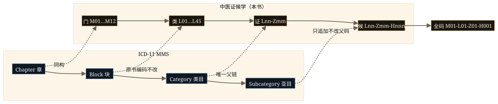

**图注**：左边是 ICD-11 MMS 的四层（Chapter → Block → Category → Subcategory），右边是本书的四层（门 M01…M12 → 类 L01…L45 → 证 Lnn-Zmm → 候 Lnn-Zmm-Hnnn）。两边的箭头一一对应，**下半部分的 `L/Z/H` 是原书编码，一字未改**，只在上头补了一层门码 —— 这正是「以 ICD-11 命名原则支撑」的落点：不是把中医塞进 ICD 的格子，而是让两套码共用同一种父子语法。

### 图 2 三轴怎么乘成一张张量

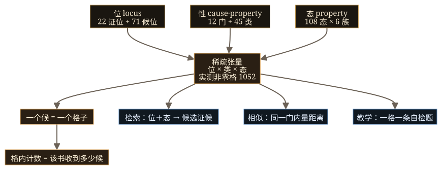

**图注**：位（22 证位 + 71 候位）× 性（12 门 + 45 类）× 态（108 态）三轴相乘，得到一张 22×45×108 的稀疏张量；实测非零格 **1052** 个。图中「一个候 = 一个格子」是关键：候不是新造的概念，它是张量里一个被点亮的坐标。APP 侧的「相似证候」就是在这张张量上量距离。

### 图 3 十二门 × 候位：密度落在哪一层

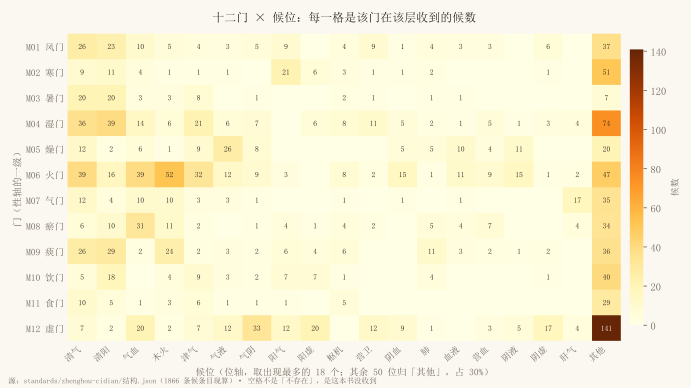

**图注**：热力的每一格是「某门下某候位出现的候数」。读法有两条：横向看，**清气与清阳**几乎在每一门都亮（说明「上焦/头面」是最常被描述的一层）；纵向看，湿门与虚门的整行最亮（25 证 249 候 / 44 证 307 候），这两门是全书的重心。空格（白色）不是「不存在」，是这本书没收到 —— 这就是本辞典的边界。

### 图 4 四十五类 × 态：每一类的「错法」指纹

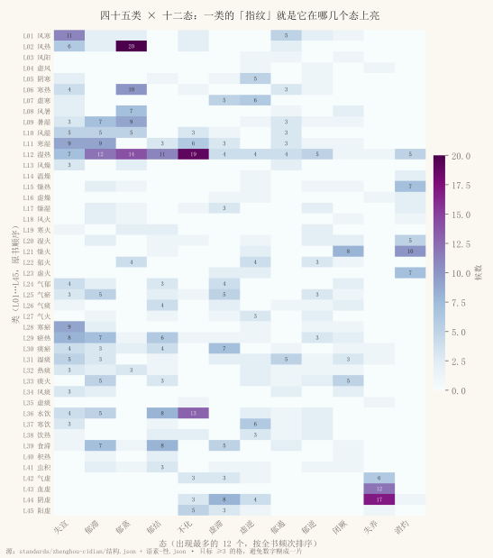

**图注**：每一行是一个类，每一列是一个态，格子里是候数。这张图可以被当成**指纹**读：风寒类（L01）的亮格集中在「失宣/郁遏」，湿热类（L12）集中在「郁蒸/郁滞」，虚证四类（L42–L45）集中在「虚郁/失养」。类的边界，在态分布上是可以被看见的。

### 图 5 二百九十一证在位 × 性平面上的分布

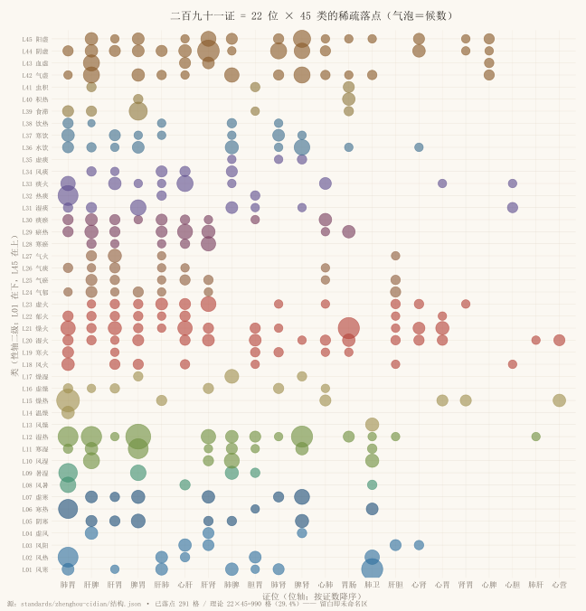

**图注**：横轴是 22 个证位（肺胃…心营），纵轴是 45 个类，气泡大小是该证的候数。一眼能看出三件事：① 位对集中在「肝×脾/胃」「肺×胃」一带，说明这本书的证候重心在中上二焦；② 火门（L18–L23）在纵轴上占据最长一段，且每一类都有多个位对落脚；③ 大量格子是空的 —— **291 证只覆盖了 22×45 个可能组合里的很小一部分**，空白处正是「还没被命名的证候」，也是后续扩展的候选区。

### 图 6 粒度：每证多少候，以及十个最高频的态

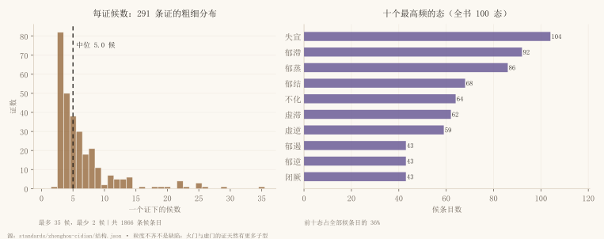

**图注**：左图是「每证候数」的分布（1 候到 25 候），中位数落在 5–6 候；右图是全书出现最多的十个态。两张图合起来回答一个问题：**这本辞典的条目粗细是否一致？**答案是「不一致，而且不该一致」—— 火门与虚门的证天然有更多子型，强行把每条都切成同样多候，只会制造不存在的区分。

### 图 7 传变状态机：本证 / 转证 / 变证 × 六个开关族

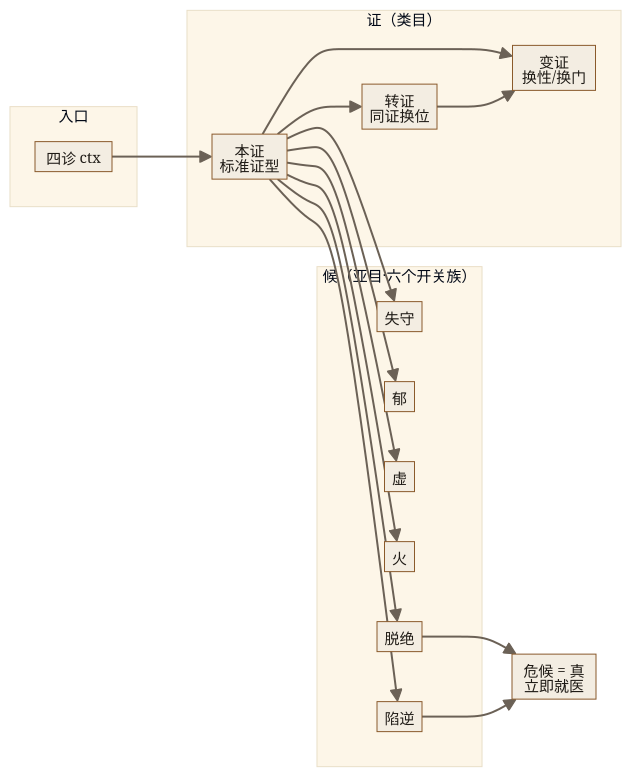

**图注**：证的三态（本证＝标准型、转证＝同证换位、变证＝换性换门）与候的六族（失守／郁／虚／火／陷逆／脱绝）画在一张图里。**箭头方向就是恶化方向**：越往「脱绝」走，越接近危候；`危候=true` 时必须从调理建议切成立即就医。这张图是把 1866 条候压成几个开关之后，工程上唯一需要写的转移逻辑。

### 图 8 APP 数据流：从一句人话到一条全码

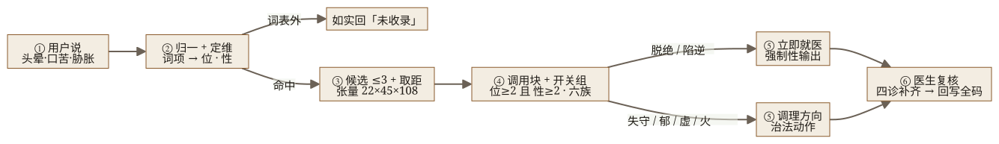

**图注**：六段流水线 —— 归一＋定维 → 候选＋取距 → 调用块＋开关组 → 分流（就医／调理）→ 医生复核 → 回写全码。**两条分叉是重点**：归一失败要如实回「未收录」（不许模糊匹配）；开关组命中「陷逆／脱绝」要直接切就医（不许走调理）。

### 图 9 百姓入口的覆盖：一个词能落多少条证

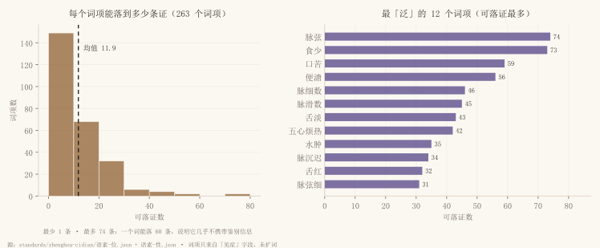

**图注**：左图是附录 D 那 264 个词项的「可落证数」分布，右图是最泛的 12 个词。读法：能落 40–60 条证的词（如「脉弦」「苔腻」）几乎不携带鉴别信息，只适合做**初筛**；能落 3–8 条证的词（如「背冷」「嗳腐吞酸」）才是**定位词**。APP 的排序应当先问定位词，再问泛词。

### 图 10 十二门 × 六族：危候长在哪一格

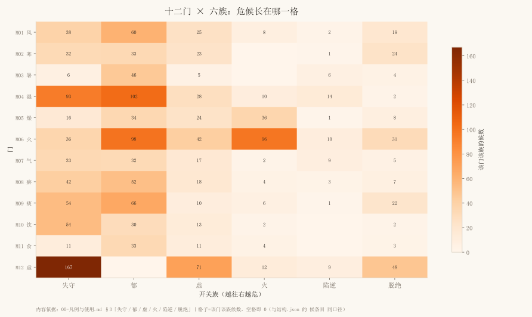

**图注**：行是十二门，列是六个开关族（失守→郁→虚→火→陷逆→脱绝，从左到右＝恶化方向）。格子是该门该族的候数，空格即 0，未做任何平滑。**读法两条**：① 任何一门只要「脱绝」列不为 0，这个门的算法就**必须**带危候直通就医的分支（见图 11 第⑤步）；② 行与行的差别说明「门」不是均质的——湿门与虚门的候集中在失守/郁，火门集中在火，所以同一个阈值套到十二门上一定有一半判错。这也是编码器阈值写死在附录 E.2 的原因。

### 图 11 从一句话主诉到「疾病证候单元」：一条像 CI 的流水线

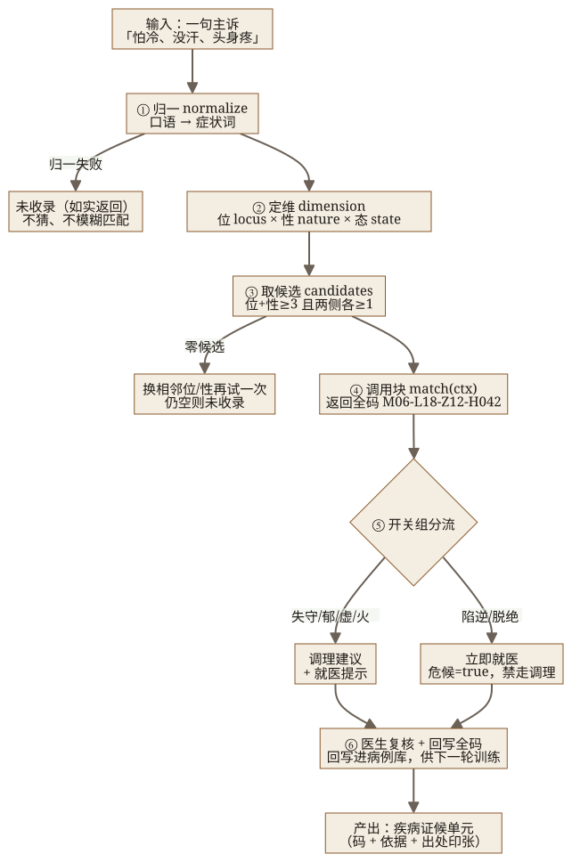

**图注**：六段流水线 = 归一 → 定维 → 取候选 → 调用块 → 分流 → 回写。把它画成 CI 的形状是有意的：每一步都有**输入契约、判定条件、失败分支**，失败分支只有两种合法结局——「换相邻维度再试一次」或「如实回未收录」，**不允许模糊匹配**。末段「回写全码」对应持续迭代：医生复核的结果回流成下一轮的训练样本。

### 图 12 四层数据栈：哪一层可以改，哪一层不许改

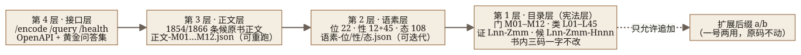

**图注**：自下而上四层是目录层（书内三码，宪法层，只能追加不能改）、语素层（位/性/态，可迭代）、正文层（OCR 转写，可重跑）、接口层（/encode 等，可替换）。**这条栈是给接手的人看的**：越往下越不许动 —— 改了原书码就再也回查不到纸书，而语素层与接口层随便改，只要 `--check` 还是绿的。

---

## 9 三块补篇层：附录 J / K / L

辞典之外，本书另有三层是后来补的母本（课程第 25–27 章与之对应），都做成了附录：

| 附录 | 层 | 一句话 | 关键数 |
|---|---|---|---|
| J | 证象学 | 证象＝单位病机；位×病机的 72 个合法格 + 108 个态 | 72 格（声明 75）· 可解释率 21.1% |
| K | 危候判据 | 词面判据：候名态根 + 治则用语，三档（厥脱/脱绝/陷逆） | 80 条命中 · 42 双证 · 181 候选 |
| L | 证—法—方 | 一候一条：治则首句 + 方症里的方名 | 1860 有方症 · 1563 取到方名 · 790 一候多方 |

三层都不是从别的书里抄来的：母本就是本书的附录一、语素表与每候的【治则】【方症】字段。
读完 K 再回头看附录 A 的门×族张量，就知道「脱绝列不为 0 → 必须带直通就医分支」那条不是修辞。

```
python scripts/build_zhenghou_sanji_supplement.py   # 生成三层 JSON
python scripts/verify_weihou_pages.py               # 危候 80 条回印张页复核
python scripts/build_zhenghou_cidian.py             # 重出本书（含附录 J/K/L）
```

**免责声明**：本辞典为教学与工程用途的证候结构重建，不构成医疗诊断或治疗建议。书中任何证候名的临床使用，均需由执业中医师结合四诊与患者具体情况判断。
