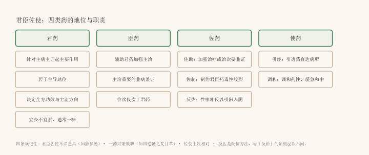

# 第 3 章 · 方剂的组成

> **源**：`qhzy-方剂学.xlsx` · 表「03 方剂的组成」 · 源文 15,267 字
> **抽取**：`node scripts/import_textbooks.js --only 方剂学` · sha256 `f94c2321fb657a09…` · 2026-10-21
> **层次**：本文件是**源教材正文层** —— 节次取自源表的结构列，文字未改写、未压缩、未抽样。改写层（N.3「这个翻译丢掉了什么」/ N.5「争议与本项目立场」）尚未撰写，见 `textbooks/README.md` 章契约。

---

## 3.1 组方原则(君臣佐使)

### 3.1.1 君臣佐使的含义

#### 3.1.1.1 君药、臣药

组方原则是方剂学的核心命题之一。所谓组方原则，即组织配伍药物以成方时所应遵循的基本法度，其具体内容便是君、臣、佐、使的配伍结构。这一理论源出《黄帝内经》，《素问·至真要大论》谓“主病之谓君，佐君之谓臣，应臣之为使”，对君药、臣药及佐使药的含义作了概括性的界定；该书虽仅载方十三首，却在治则治法与制方结构两方面为方剂学奠定了理论基础。此后，东汉张仲景《伤寒杂病论》以三百余首方剂垂范后世，其方大多有理有法、组方谨严、选药精当、主次分明；金人成无己著《伤寒明理论》，系统阐述《伤寒论》常用方二十首之组方原理及方药间的配伍关系，开方论之先河；金元以降，李杲等医家又就药量之轻重与君臣之位次多有发挥，谓“君药分量最多，臣药次之，使药又次之，不可令臣过于君”（李杲《脾胃论》），君臣佐使之说遂益臻细密。学习组方原则，首先要弄清君、臣、佐、使各自的职责与地位，再进而领会其在临证立法、析方与加减化裁中的意义。君药，是针对主病或主证起主要治疗作用的药物。它在方中居于主导地位，是方剂立法意图的直接体现者，也是全方功效与主治方向的确定者——麻黄汤以麻黄为君，故其功用为发汗解表、宣肺平喘；四君子汤以人参为君，故其功用为益气健脾；白虎汤以石膏为君，故其功用为清热生津；四逆汤以附子为君，故其功用为回阳救逆。君药是方中不可缺少之品，去之则方不复为方。就数量而言，君药宜少不宜多，通常以一味为妥，多则药力分散、方向不明，前人所谓“君臣有序”，正谓此意。然君药亦非一概只限一味，凡病情复杂、须多方面兼顾者，可设两味或两味以上君药，如三仁汤治湿温初起、湿重于热，以杏仁宣利上焦肺气、白豆蔻仁芳化中焦湿滞、薏苡仁渗利下焦湿邪，三仁分走上中下三焦而共为君药，以成宣上、畅中、渗下之局。反之，若方中只有一味药而无臣佐使之可分，如独参汤独用一味人参大补元气，用以救治大失血、大吐泻而致的元气虚脱、脉微欲绝之证，则君药便是全方，此即“君臣佐使不必悉具”之义。判断何者为君，当以药力为准，而不可以药味多少、用量大小机械划定。所谓药力，指药物在特定配伍环境中发挥治疗作用的方向与强度，其大小由药性之偏、用量之轻重与配伍之呼应三者共同决定。就用量言，君药用量通常相对偏重，如麻黄汤之麻黄三两、炙甘草汤之炙甘草四两，皆为方中最重之品；但用量最大者未必便是君药，如大承气汤以大黄四两为君，而厚朴用至半斤，用量在诸药之冠，其位却在佐使；又如麻杏石甘汤以石膏半斤为君，重在清泄肺中郁热而不取其辛散。可见君臣之位随病机之主次而定，药量只是参量之一，不可执一而论。此外，药物在方中的地位还受炮制与煎法的影响，如四逆汤之用生附子取其力峻，麻黄汤之先煮麻黄去上沫取其性缓，皆与君臣之位相配。臣药有两类职责。其一，辅助君药加强治疗主病或主证，即与君药功用相类而相须为用者。麻黄汤之桂枝，辛甘而温，解肌发表、温通经脉，助麻黄开腠理发汗而倍增其力；白虎汤之知母，苦寒而质润，既助石膏清阳明之热，又滋阴润燥以救已伤之津；四君子汤之白术，苦温健脾燥湿，助人参益气而健运中州；大承气汤之芒硝，咸寒软坚润燥，助大黄泻热通便而除燥屎；理中丸之干姜，大辛大热，温中祛寒，助人参以复中阳。此类臣药与君药同气相求，合用则力专而效宏。其二，针对重要的兼病或兼证起主要治疗作用者。小柴胡汤主治伤寒少阳证，以柴胡为君透达半表之邪，配黄芩为臣清泄半里之热，一散一清，恰对“往来寒热”之枢机不利，若仅用柴胡而无黄芩，则半里之热无从清解，方义即不完整；又如麻黄汤证若以喘咳痰多为主，则杏仁之外常须他药佐之，亦属此类兼治之意。此类臣药虽药力不及君药，然所主之兼证往往关乎全局，故其位次仅次于君药，不可轻去。识别君药，可循三条线索：一观其所主是否为该方主治之核心病机，二观其与他药的配伍是否为全方所倚，三观加减化裁之际是否为不可轻去之品。以此三条检验，则麻黄汤之麻黄、四君子汤之人参、白虎汤之石膏、大承气汤之大黄，皆可确指而无疑。至于臣药，犹须审其所主之兼证是否为该方适应证的重要组成部分，如小柴胡汤之黄芩所主之口苦、咽干、目眩与往来寒热，实为少阳证之必见，故其位不可轻动。君、臣既定，方剂的主治方向便已确定，此即“以法统方”在具体方剂中的落实。君、臣二类，共同构成方剂主治方向的主体。学习一首方剂，先辨其君，再审其臣，则全方立法之意与用药之专，已得其大半。至于佐药之佐助、佐制、反佐与使药之引经、调和，虽位居其次，却是使方剂由若干有效之药成为有序之方的关键，容下段详述。

#### 3.1.1.2 佐药、使药

佐药，是协助君、臣药以加强治疗作用，或直接治疗次要兼证，或用以制约君、臣药毒性、峻烈之性的药物。按其功用可分为三类。一为佐助药，即协助君、臣药加强治疗主病主证者，或直接治疗次要兼证者。麻黄汤之杏仁，苦温降利肺气，与麻黄之宣发相配，一宣一降而复肺气宣降之常，故能助君药平喘；桂枝汤之生姜、大枣，生姜辛温助桂枝以散风邪、和胃气而止呕，大枣甘温益气养营，二药佐助桂枝、芍药以调和营卫；银翘散中之桔梗，宣肺利咽，助君药以透邪外出，皆属此类。二为佐制药，即制约君、臣药毒性或峻烈之性者。十枣汤主治悬饮，用甘遂、大戟、芫花三味峻下逐水之品，其性猛而毒，故以大枣十枚为佐，益气护胃、缓和三药毒烈之性，使峻药缓攻而不伤中气；四逆汤中之炙甘草，既益气和中，又缓和附子、干姜辛烈之性并减附子之毒，亦兼佐制之功；大乌头煎之用白蜜，亦取蜜之甘缓以制乌头之毒。三为反佐药，即病重邪甚、可能拒药时，配用与君药性味相反而又能在治疗中起相成作用的药物。《素问·至真要大论》论治法有“甚者从之”之语，反佐即其配伍上的体现。白通汤以葱白四茎、干姜一两、附子一枚生用回阳救逆，治少阴病下利、脉微者；若服后利不止、厥逆无脉、干呕而烦，则于方中加入猪胆汁一合、人尿五合，即白通加猪胆汁汤，取二药咸寒苦降之性，引阳药入阴分，使热药不至为阴寒所格拒，此即反佐之典型。又如左金丸以黄连六两苦寒清泻肝火为君，配吴茱萸一两辛热之品为佐使，既制黄连之苦寒伤胃，又引黄连入肝经，寒热并用而相反相成，其理亦与反佐相通，惟其设方之意在于肝火犯胃之呕逆吞酸，非专为拒药而设。使药亦有二类。一为引经药，又称引经报使，即能引导诸药直达病所者。金元张元素分经报使之说，于后世影响颇广：太阳经多用羌活，阳明经用白芷，少阳经用柴胡，太阴经用苍术，少阴经用细辛，厥阴经用吴茱萸、川芎，巅顶痛用藁本。如九味羌活汤治外感风寒湿邪，方以羌活为君，配防风、苍术、细辛、川芎、白芷、生地黄、黄芩、甘草，按分经论治之义配伍，使药力达于太阳、阳明、少阳、太阴、少阴、厥阴诸经，故无论何经受邪而见恶寒发热、头痛身痛、肢体酸楚者，皆可随经加减用之，为“引经”之法在成方中的具体运用。二为调和药，即调和方中诸药之性、缓急和中者，多由甘草任之。麻黄汤之炙甘草，调和麻黄、桂枝、杏仁三药，并缓其发散之峻；调胃承气汤之炙甘草，与大黄、芒硝同用而变峻下为缓下；桂枝汤之炙甘草，调和桂枝、芍药之散收，并合生姜、大枣以和营卫，皆属使药调和之义。生姜、大枣亦常具调和营卫、安中和胃之功，于表剂中最称常用。关于使药，尚有两种情形须加说明。其一，引经药并非每方必备，如麻黄汤、四逆汤皆无专司引经之品，其药力直达病所乃由药性本身及配伍之势所决定，故不可谓无引经药即非良方。其二，引经与调和常由一味兼任，如九味羌活汤之甘草既调和诸药，又缓辛温发散之峻；又如川芎茶调散以清茶调服，茶叶清利头目，于方中兼有引经上达与监制辛温之义。至于佐药，其辨识之要在于问此药在方中解决了什么问题：疗兼证者为佐助，制毒制峻者为佐制，防格拒者为反佐，三者可单独出现，亦可一药兼具。运用君臣佐使之说，须注意以下几点。其一，君臣佐使并非每方俱备。方中只须君药一味者，如独参汤；只须君臣二味者，如左金丸、二至丸；方小而结构完整者，如四逆汤之君臣佐使三药兼备，层次虽简而法度周全。其二，一药可兼数职。四逆汤之炙甘草兼佐制、调和与益气三用；桂枝汤之炙甘草兼佐助与调和之义；九味羌活汤之甘草既调和诸药，又缓辛温发散之峻。故方解之际，须说明某药“以某用为主，兼有某用”，不可执一而定。其三，佐使药的主次是相对的。一药在甲方位居君药，在乙方或降为佐使，此即配伍环境之变，后文另有专论。其四，反佐法为配伍方法，与“反治”之治则层次不同：前者解决的是药入即拒、寒热格拒的问题，后者解决的是病机真伪、寒热真假的问题，二者不可混同。学习本节，应掌握“君定主治、臣辅君力、佐助佐制反佐、使引经调和”的基本框架，并能对具体方剂逐药归位、说明理由，如此方算真懂君臣佐使，而不止于记诵定义。

### 3.1.2 君臣佐使的临床意义

#### 3.1.2.1 组方的层次与法度

君臣佐使所揭示的，不只是一组名词，更是方剂内部的层次结构与组方法度。药物各有性味归经与功用专长，孤立地看，皆是一药之偏；一经配伍，其偏性即被安排在不同的位置，或为主帅，或为辅翼，或为约束，或为引导，各司其职而彼此呼应，遂形成一个有主次、有层次、有制约、有分工的整体。清·徐大椿《医学源流论·方药离合论》谓“药有个性之专长，方有合群之妙用”，说明的正是这一层次结构所产生的整体效能。现行教材主张以“药力”为依据阐述组方及配伍原理，即要求方解不停留于药味功效的罗列，而要进一步说明某药何以居君、何以居佐，其力之方向如何、强弱如何，与他药之间如何相须、相制、相畏、相杀。如此析方，方为究竟。就临床意义而言，君臣佐使之说大体有四个方面。第一，揭示方剂的立法意图。君药是治法的直接体现者，辨明君药，则本方治何病、主何证、用何方，一目了然。如大承气汤以大黄为君，其意在泻热通便、荡涤肠胃，故主治阳明腑实之痞、满、燥、实；虽厚朴用至半斤而行气除满之力甚著，然方之所主仍在泻热攻积，是以大黄为君、芒硝为臣、枳实与厚朴为佐使，层次分明而法度井然。又如小柴胡汤以柴胡为君，故知本方之主旨在于和解少阳、疏透枢机，而非专事清里或专事发汗。第二，指导临证立法与加减化裁。以法统方、方从法出，故临证加减时，君药一般不可轻去轻改；臣药可视兼证之有无而增损；佐使药则可依药性之峻缓、病位之高下而调整。第三，便于分析、理解与记忆方义。方解以君臣佐使为纲，逐层剖析，则全方之主治、配伍之特点、用药之轻重，皆可循阶而上，故曰“知其君臣佐使，则方义自明”。第四，保障用药安全。凡用峻猛或有毒之药，必设法以约束之——或配佐制之药以缓其毒烈，或配甘缓之品以护胃气，或改剂型、减用量以控其力，此皆君臣佐使之法度在安全层面的落实。层次与法度的核心，可以八字括之：主次分明，相须相制。以四逆汤为例，方中附子大辛大热，回阳救逆为君；干姜辛热，温中散寒、助附子以回阳为臣；炙甘草甘温，益气和中，既助姜、附回阳，又缓其辛烈、制附子之毒为佐使。三味之中，君药力专而峻，臣药助之而温中之力益宏，佐使药约束之而使药力持久而不伤正，层次虽简而法度周全，故为回阳救逆之基础方，后世之四逆加人参汤、参附汤、回阳救急汤多由此衍化。再以桂枝汤与麻黄汤相较：二方同治外感风寒表证，而立意与层次不同。麻黄汤证为风寒束表、卫阳被遏、营阴郁滞之表实证，见恶寒发热、无汗而喘、脉浮紧，故以麻黄发汗解表为君，桂枝助之，杏仁降利肺气以平喘，炙甘草调和而缓峻；桂枝汤证则为风寒袭表、营卫不和之表虚证，见恶风发热、汗出、脉浮缓或浮弱，故以桂枝解肌发表、温通卫阳为君，芍药益阴敛营为臣，散中有收，生姜助桂枝散邪、大枣益气养营为佐，炙甘草调和诸药为使。一实一虚，立法既异，君臣佐使之位亦随之而变，可见君臣佐使不是固定的药味标签，而是随证立法之后对药力的动态安排。同一味药处于不同的层次，方剂的作用方向、起效部位与缓急程度即迥然有别，这正是“方有合群之妙用”的底蕴所在。另须指出，层次法度不是抽象的原则，而是可以逐方检验的。读者不妨任取一首常用方，按君臣佐使逐一归位，再与教材方解比对，追问其异同之由，日久则析方之能自生。就教材体例而言，历代方书之所以皆以治法统属方剂，正因层次与法度关乎一方之成败：汪昂《医方集解》改按治法与功用归类，使“以法统方”的编纂体例趋于定型；现行教材下篇各论亦依功用分为解表、泻下、和解、清热诸剂，每首正方之方解皆以君臣佐使或药力为纲逐层剖析。分类之纲与方解之纲同出一源，把握此点，方剂之学便不再是方名与药味的罗列，而成为可以推演、可以比较、可以化裁的知识体系。现代拆方研究从另一角度印证了这一层次结构：把一首方按君、臣、佐、使拆分为若干组合，比较全方与拆方在药效上的差异，多可见全方优于拆方、君臣相配优于单用君药的结果，说明配伍所产生的效应不等于各药效用的简单相加。此类研究多以体外实验或动物实验为主，其结论属机制层面的提示，不能径直等同于临床疗效；方解的根本依据仍是中医学的理法，机制研究只能印证而不能替代方解。此点于学习方法尤为重要：先立君臣佐使之纲，再看现代研究的印证，二者两不相妨，方能既不失中医之本色，又不拒新知。就临证而言，层次分明之方，药味虽少而力专效著；层次紊乱之方，药味虽多而互相掣肘，故组方之要，先在定君臣之位，次在斟酌佐使之宜。

#### 3.1.2.2 方解结构(以麻黄汤为例)

所谓方解，即对方剂配伍原理的阐释，其任务是逐一说明方中诸药的功用、地位与彼此间的配伍关系，进而揭示全方功效之所以然。现行教材每首正方之下依次列出出处、组成、用法、功用、主治、证治机理、方解、运用、附方、鉴别、方论选录、医案举例、方歌等项，方解居其中而为一方的枢纽：上承主治与证治机理，下启运用与鉴别。学习一首方，若只记组成与主治而不明方解，则如持方而不知其所以然，临证稍有变化便无从措手；反之，若能讲清君臣佐使的关系，则功效主治皆有所归，加减变化亦有所据。方解的表达形式有疏有密，有繁有简，然其基本结构大体一致：先明主病主证，次辨君臣佐使，再析配伍特点，终明全方之功用。兹以麻黄汤为例，说明方解的基本结构。本方出自《伤寒论》，为治太阳伤寒表实证之代表方。组成：麻黄三两，去节；桂枝二两，去皮；杏仁七十个，去皮尖；炙甘草一两。用法：上四味，以水九升，先煮麻黄减二升，去上沫，内诸药，煮取二升半，去滓，温服八合，覆取微似汗，不须啜粥，余如桂枝法将息。先煮麻黄者，为减其悍气、去其上沫，以免服药后令人心烦；不须啜粥者，示本方发汗之力峻，得汗即止，不须再以谷气助汗。功用：发汗解表，宣肺平喘。主治：外感风寒表实证，症见恶寒发热、头痛身疼、腰痛、骨节疼痛、无汗而喘、舌苔薄白、脉浮紧。证治机理：风寒之邪外束肌表，卫阳被遏，营阴郁滞，故恶寒发热、无汗而身疼痛；肺主气而外合皮毛，邪束于表则肺气失宣，故见气喘。治当发汗解表以散其邪，宣降肺气以平其喘。方解：麻黄味辛微苦而性温，善开腠理、透毛窍以发汗解表，又能宣畅肺气而平喘，针对风寒束表、肺气不宣之主病主证，故为君药；桂枝辛甘而温，解肌发表、温通经脉，助麻黄以发汗散邪，又能温煦营血而缓头身之痛，为臣药；杏仁苦温，主降肺气，与麻黄之宣发相配，一宣一降而恢复肺气宣降之常，助君药平喘，为佐药；炙甘草甘温，调和诸药，既缓麻黄、桂枝发散之峻，又护中气而使汗出而不伤正，兼制杏仁降泄之偏，为使药。四药相合，辛温发散以解表，宣降相因以平喘，发汗解表、宣肺平喘之功乃成。其配伍要点有三：麻黄与桂枝相须为用，发汗之力倍增而散邪务尽；麻黄与杏仁一宣一降，宣降相因而喘平；炙甘草甘缓调和，监制辛散而顾护正气。四药两两成对，各得其宜，可以为方解之范式。若以之为式，则凡解表之剂，皆可循“何药开表、何药助汗、何药降逆、何药调和”之序而析。运用要点亦由方解而来。本方为辛温发汗之峻剂，使用时当注意：表虚自汗、外感风热、体虚外感者不宜使用；疮家、淋家、衄家、亡血家、汗家等素体阴血不足或津液亏耗者，虽见表证亦不可径发其汗，《伤寒论》列有汗禁诸条，临证须加辨识；本方发汗力强，以遍身微似汗为度，中病即止，不可过服，以免汗出过多而伤阳耗液。若兼湿邪而身体烦疼者，可加白术，即麻黄加术汤；若风湿在表而有化热之势者，可去桂枝之温、加薏苡仁之渗，即麻黄杏仁薏苡甘草汤；若表寒里热而无汗烦躁者，当加石膏，即大青龙汤；若咳嗽痰多而气逆者，可加降气化痰之品，即华盖散。凡此加减，皆须在辨明主证不变的前提下方可施用。还须说明，方解不必拘守君臣佐使一法。现行教材于方解中明言，未以君臣佐使一法尽释诸方，而根据制方者所据之法，兼综药力组方之法，并兼顾药性之升降浮沉与脏腑之喜恶，力求言简而意赅。故有以君臣佐使为纲者，如麻黄汤、四逆汤；有以药力之势、气味之升降为说者，于治燥、治风、祛湿诸剂中尤为可见。形式虽有不同，而欲揭示何药为主、何以为配、何以成此功用，则一以贯之。学习者宜以君臣佐使为基本入手之法，再逐步领会药力组方之理，切忌以固定格式去套所有的方。前述四药用量系汉代度量衡之旧制，现行教材于组成之后括注当今常用参考剂量，并说明原方用量与现代常用量之不同；麻黄、桂枝、杏仁、炙甘草的现代参考剂量分别为9g、6g、9g、3g（“十四五”规划教材现代用法）；其使用禁忌须对齐《中国药典》现行版本的规定。【本节要点】一、组方原则即君臣佐使的配伍结构，源出《素问·至真要大论》“主病之谓君，佐君之谓臣，应臣之为使”。君药针对主病主证起主要治疗作用，为方中核心；臣药辅君治主病主证，或主治重要兼证。佐药有佐助、佐制、反佐三义，使药有引经、调和二义；君臣佐使不必悉具，一药可兼数职。二、君臣佐使是方剂内部的层次与法度，主次分明、相须相制，可揭示立法意图、便于析方并保障安全；判断何者为君当以药力为准，不以用量机械划定。方解以君臣佐使为纲，如麻黄汤以麻黄为君、桂枝为臣、杏仁为佐、炙甘草为使，发汗解表、宣肺平喘。

## 3.2 方剂的组成变化

### 3.2.1 药味加减与药量增减的变化

#### 3.2.1.1 随证加减(主证不变)

方剂的组成虽有定法，而其用则在变。临证所见之病证，往往与方书所载不尽相同，或兼证丛生，或轻重有别，或体质迥异，故遣方用药必随证化裁，此即所谓“方之用，变也”。组成变化的基本形式有三：一为药味加减，二为药量增减，三为剂型更换；三者各有其法度，又常交互为用。本节先论药味加减与药量增减，下节论剂型更换与配伍环境的变化。就药味加减而言，又有两种情形：一为主证不变而随兼证增减次要药味，是为“随证加减”；二为药味增损之后主要功效随之改变、方名亦因之更易，是为“以法立方”。前者所变者小，后者所变者大，而其本皆在于以法统方。药味加减的第一种情形，是在主证不变、主药不变的前提下，随兼证之不同而增减次要药味，即所谓“方不变而药变”。此法最为常用，其要在所加减之药须与原方立意相合，且不夺君药之位。以桂枝汤为例，本方出自《伤寒论》，由桂枝三两、芍药三两、炙甘草二两、生姜三两、大枣十二枚组成，主治太阳中风证，见头痛发热、汗出恶风、鼻鸣干呕、脉浮缓或浮弱，功用解肌发表、调和营卫。临证若兼见项背强几几者，加葛根以升津舒筋、解肌发表，即桂枝加葛根汤；若兼见气喘者，加厚朴、杏仁以降气平喘，即桂枝加厚朴杏子汤；若发汗太过而见漏汗不止、恶风、小便难、四肢微急而难以屈伸者，加附子以温经复阳、固表止汗，即桂枝加附子汤；若脉促胸满者，则去芍药之酸敛，即桂枝去芍药汤；若兼腹痛而喜温喜按者，倍用芍药以缓急止痛，即桂枝加芍药汤。所加之药，或助散邪，或降肺气，或温阳，或升津，皆针对兼证而设；所去之药，皆因有碍于本证之机转。方中君臣之位未变，主治方向未变，所变者只在次要药味，故特名之曰随证加减。同一治法之下，随证加减而成一系列类方的情形，在解表剂中尤为典型。麻黄汤主治风寒表实、无汗而喘，若兼湿邪而身体烦疼，加白术以除湿，即麻黄加术汤；若风湿在表、身重而见化热之势，去桂枝之温、加薏苡仁之渗利，即麻黄杏仁薏苡甘草汤；若表寒里热而无汗烦躁，加石膏以清里热，即大青龙汤；若风寒束肺、痰阻气逆而咳嗽痰多，于麻黄、杏仁、甘草之外加紫苏子、橘皮、桑白皮、赤茯苓等以降气化痰，即《太平惠民和剂局方》之华盖散。诸方皆由麻黄汤化裁而出，而所主之证逐层扩展，治法亦由单纯辛温发汗而兼及除湿、兼及清热、兼及化痰止咳，可见加减得当，可使一首基础方衍生出适用于多种兼证的一系列方剂。此类类方群的存在，正是“方之用，变也”在教材中的体现，学习时应以基础方为枢，以兼证为目，循其加减之迹而求其立法之意。药味加减的第二种情形，是增损药味之后主要功效随之改变，方名亦因之更易。仍以麻黄汤为例，若去桂枝之辛温而加石膏之辛寒，则方由麻黄、杏仁、石膏、炙甘草四味组成，即麻黄杏仁甘草石膏汤。此方功用为辛凉宣泄、清肺平喘，主治外感风邪、邪热壅肺之证，见身热不解、咳逆气急、鼻煽口渴、脉浮而数、舌苔薄黄。较之麻黄汤，药只一味之更，而方之属性由辛温转为辛凉，主治由风寒表实转为肺热咳喘，是以方名亦随之而改。此正所谓味变则法变：加减已越出随证加减的界限，进入了以法立方、另设新方的层面。又如桂枝汤倍芍药加倍糖而为小建中汤，方意由解肌发表转为温中补虚、和里缓急，虽药味相去不远，而所主之证已入里入中，其例亦同。凡此皆提示：加减不可只看药味之增减，更须审视加减之后全方的功效与主治是否已被改变，若已改变，则须另立方名、另述方义，不可仍以原方名之。以基础方为枢而随证加减者，临床上又有几种常见形态：一为基础方加味，如四君子汤加陈皮为异功散，再加半夏为六君子汤，更入砂仁、木香为香砂六君子汤，层层加味而功用由补气渐及理气化痰；二为基础方加减而易名，如逍遥散加牡丹皮、栀子为丹栀逍遥散，由疏肝解郁兼及清泄肝热；三为两方合用，取各方之长以应复杂病机。无论何种形态，其尺度一以不失原方之法为准；若方名未改而其法已易，则名实不符，反致后人临证无从把握。随证加减虽属常法，然亦有其尺度。其一，须以原方主旨为尺度。加减而不离其法，方谓化裁；若加减之后与原方立意背道而驰，则非加减而是另制一方，当别立方名。其二，须审所加之药是否喧宾夺主。若因兼证而增药过多、用量过重，则方中主次不清，药力分散，反致全方方向不明。其三，兼证多而杂者，宜考虑合方或另择他方，不可一味叠加，所谓师其法而不泥其方。其四，加减之后仍须复核全方的功效、用量与配伍禁忌，凡涉及毒性药用量与十八反、十九畏等禁忌者，须对齐《中国药典》现行版本的有关规定。其五，名方之加减以原书所载加减法与后世公认的加味方为据，自创新加须有明确理据，并注明为临证变通，不可径称为某方之正加减。其六，药味加减往往与药量增减相伴而行，增药之际须酌减余药之量，以免全方药量陡增而失平和之度。掌握此六者，则随证加减可以灵活而不失法度，临证自能应手。

#### 3.2.1.2 药量变化改变功效(四逆汤/通脉四逆汤)

药量是药力的重要构成，也是方剂组成变化的另一枢纽。同一种药物，用量不同则其药力之强弱、作用之趋向乃至在方中的地位皆可不同；数味药物相同而分量互异，则君臣之位、主治之证亦随之而变。故前人论制方于分量极为讲究，谓药味相同而分量不同则主治亦异。药量变化改变功效的情形，可自分量微调、君臣易位、峻缓转换三个层次来理解；三者之中，微调最为常见，易位最能启人思路，峻缓转换则与临证安全关系最切。其一，分量微调以调其协同与制约之强弱。桂枝汤中桂枝与芍药等量，散中有收，故能和营卫而解肌发表；若倍用芍药，则酸敛之力胜于辛散，方意转为和里缓急，治太阴病腹满时痛，即桂枝加芍药汤；若增桂枝二两而芍药不动，则温通之力大增，方意转为温通心阳、平冲降逆，治奔豚气从少腹上冲心者，即桂枝加桂汤，方中桂枝之地位亦由君药而愈重，为温阳平冲之专司。药味未变而分量一改，作用方向便自不同，此即量变引起效变之浅层体现。此外，如补中益气汤以黄芪用量独重为君，升麻、柴胡用量极小，取其轻清升提以引清阳上行，升提之品量小则力专而不越位于君，亦示用量大小与药力方向之关系。其二，君臣易位以变其主治。此为药量变化中最能启人思路者，其典型莫如《金匮要略》之三方。小承气汤由大黄四两、厚朴二两、枳实三枚组成，重用大黄为君，意在泻热通便，主治阳明腑实之大便硬、谵语、潮热、胸腹痞满；厚朴三物汤以厚朴八两为君，大黄四两、枳实五枚为臣佐，重用厚朴意在行气除满，主治腹满痛而大便不通，其病在气滞而非燥实坚结；厚朴大黄汤以厚朴一尺、大黄六两、枳实四枚组成，厚朴与大黄并重而行气逐饮，主治支饮之胸满、咳逆、大便不通。三方药味全同而分量互异，遂使泻热、行气、逐饮之主治各别，君臣之位亦随之改易。可见药量在组方中的地位实不亚于药味本身，一首良方的分量安排，往往正是制方者立法用意之所在。其三，峻缓转换以适病势之轻重，其代表即四逆汤与通脉四逆汤。四逆汤出自《伤寒论》，由炙甘草二两、干姜一两半、附子一枚生用去皮破八片组成，用法为以水三升，煮取一升二合，去滓，分温再服；功用回阳救逆，主治少阴病之四肢厥逆、恶寒蜷卧、呕吐不渴、腹痛下利、神衰欲寐、脉沉微细，即心肾阳衰之寒厥证。方中附子大辛大热，回阳救逆为君；干姜辛热，温中散寒、助附子以回阳为臣；炙甘草益气和中，既助姜、附回阳，又缓其辛烈、制附子之毒，为佐使。通脉四逆汤药味与四逆汤全同，惟附子改用大者一枚，干姜增至三两，强人可四两，功用则由回阳救逆而为回阳通脉，主治少阴病阴盛格阳之证——下利清谷、里寒外热、手足厥逆、脉微欲绝、身反不恶寒而其人面色赤，或腹痛，或干呕，或咽痛，或利止而脉不出。何以加重姜、附而功效主治即变？盖四逆汤证为阳气衰微而尚能与阴寒相争，故回阳即可救逆；通脉四逆汤证则阴寒极盛于内、虚阳浮越于外，非重用姜、附不能破阴回阳、通达内外之脉，故附子取其大者、干姜增至三两，温阳之力倍宏而回阳通脉乃成。药同量异而效随量变，于此可见。与通脉四逆汤相类者，尚有四逆加人参汤之加人参以益气固脱、白通汤之去甘草加葱白以通阳，皆由四逆汤化裁，而所主之轻重深浅各有不同。此外，尚须辨明药量与服量之别。古方所载分量多为一日或一剂之总量，而具体服法又各不同：桂枝汤一剂而分三服，四逆汤则一剂而分温再服，理中丸一丸而日三四服。是以同为一两之药，其一次入腹之量因分服法而异；若以原方一剂之量径作一次顿服，则药力太过，易生变证。今之临证用方，多依原方比例折算为一日用量而分二至三次温服，其间虚实轻重之权衡，须以医嘱为凭，不可径以剂量数字相较而判其峻缓。药量变化还涉及峻药与缓药的相对分量，以及药量与用药安全的关系。一则，若方中峻药减量、缓药增量，则全方由峻转缓，可适应病势轻浅或体质虚弱者，如调胃承气汤以炙甘草与大黄、芒硝同用，变峻下而为缓下；若峻药增量，则方力更峻，须防伤正耗气。二则，用量的大小直接关系到用药安全，凡毒性或烈性药物，如附子、川乌、细辛、吴茱萸、大黄、甘遂、芫花、大戟等，其用量必须对齐《中国药典》现行版本的规定，并遵循先煎、久煎、去滓再煎以及控制服法等要求。以附子为例，现行药典规定其常用量为3～15g，且须先煎、久煎以减其毒（《中国药典》2025年版）；生附子力峻而毒，现代临床已少用，多改用制附子并延长煎煮时间。三则，用量还须与病势、体质、地域、季节相参：老人、小儿、孕妇及体虚者宜减量，久病、重证之需峻药者方可酌情增量，而增量的前提是安全有据，不可随意加码。药量之变看似细事，实为组方法度中最难拿捏而又最关紧要之处：量之得当，则药力恰中病所；量之失当，则或药过病所而伤正，或药不及病而无功。再者，药量之变常与炮制、用法相伴而行：附子生用取其力峻，制用则毒性减而力稍缓；干姜温中散寒，炮姜温经止血，二者之异亦在制法；大黄生用泻下，酒制则善行上焦而清上部之热。可见言药量变化，不可不与炮制、用法合观，方为全面。故临证遣药，既当遵原方之比例，又须随时权衡，所谓“圆机活法”，其要在分寸之间。

### 3.2.2 剂型更换与配伍环境的变化

#### 3.2.2.1 剂型变化与病情缓急(理中丸/人参汤)

剂型是方剂组成确定之后的进一步安排，它决定药力发挥的方式、部位与缓急，因而也是方剂变化的一种形式。前人谓“汤者荡也，丸者缓也”，又谓“散者散也”，即就剂型与药力缓急的关系而言。同一首方，药物组成与用量全同，只因剂型不同而功效主治缓急有别，临证须据病情之缓急、病位之高下、药性之峻缓而择用之。现行教材于每首正方之下列用法一项，其要义正在于此。其最为典型者，为《伤寒论》之理中丸与理中汤。二方组成全同：人参、干姜、炙甘草、白术各三两。理中丸作丸服之，原书捣筛，蜜和为丸，如鸡子黄许大，以沸汤数合和一丸，研碎温服，日三四次，夜二次，腹中未热者可增至三四丸，以腹中温为度。该书于此自注，谓其“然不及汤”，正说明丸剂力缓而持久，宜于病势较缓、需缓缓温养者。理中丸主治霍乱之头痛发热、身疼痛、寒多不用水者，以及脾胃虚寒之脘腹冷痛、呕吐不渴、下利清谷、舌淡苔白、脉沉细等。所谓丸者缓也，丸剂入于胃肠而缓缓化开，药力持续而平稳，于中焦虚寒之病最宜久服缓图。理中汤则煎汤而服，原书以水八升，煮取三升，去滓，温服一升，日三服，其力较速而能温中散寒、益气助阳，故又名人参汤，用治胸痹心中痞气、气结在胸、胸满、胁下逆抢心之属虚寒者，取其速温中阳而宣通胸阳之力。同一方剂而名称各别、剂型各异、所主亦自有不同，此即剂型变化之义。就学习方法言，此类同方异剂之例最宜并列比较：组成相同，故所治之病机有相通之处；剂型不同，故药力之缓急有异，适应之病势遂有轻重之别。以剂型之异而别主治者，在《伤寒论》中尚有多例。抵当汤与抵当丸均由大黄、水蛭、虻虫、桃仁组成，汤剂力峻而速，用治太阳蓄血之重证，见少腹硬满、小便自利、其人发狂、脉沉结；丸剂力缓而持久，用治蓄血之较缓者，见少腹满、小便自利、其人如狂，其法为煮丸连滓服之，意在缓攻。又大陷胸汤与大陷胸丸，同由大黄、芒硝、甘遂、葶苈子、杏仁等组成，汤治结胸之急重者，见心下痛、按之石硬、脉沉紧；丸治结胸之较缓而兼项强如柔痉状者，亦取丸者缓治之义。至于六味地黄丸之用为蜜丸，意在缓补肾阴、久服渐图，若改为汤剂则滋腻更甚、取效更速，其用亦自有别；五苓散、失笑散等之用为散剂，取其便于服用、取效较速；逍遥散之于丸剂，则便于久服调养。凡此皆见剂型与病势相配之理。选择剂型，大体有几条思路可循。其一，因病势之缓急：急重之证宜用汤剂，取荡涤之力速；病势缓而需长久调治者宜用丸剂、膏剂，取药力持久而服用方便。其二，因病位之高下与邪气之性质：外邪在表者宜汤剂、散剂以速散；欲使药力留于中下焦者，可取丸剂或散剂。其三，因药性之峻缓与毒性：峻毒之药配入丸散，既便于控制剂量，又可缓缓图之而减其峻烈，如十枣汤择平旦空腹服之、甘遂大戟之入丸散，皆取此意。其四，因患者之依从与病家之实际：丸散膏丹便于携带服用，汤剂则须临用煎煮，古方之所以丸散并行者，亦多出于此类实用之考虑。此外，现代尚有片剂、胶囊剂、颗粒剂、口服液、注射剂等，其制剂工艺、辅料选择、质量控制与生物利用度等问题均属《中药药剂学》的范畴，本课程只在剂型与病势相配、剂型与药力缓急的关系上作原则性的讨论，不涉及具体制剂工艺。就汤剂而言，剂型的准备还包括煎法：先煎者取其厚味或缓其毒性，如麻黄、附子之先煎；后下者取其气盛，如薄荷、砂仁之后下；包煎者取其液清，如滑石、旋覆花之包煎；烊化者取其胶质不粘，如阿胶、饴糖之烊化；另煎、冲服者取其贵重或易于散失，如人参、三七之另煎冲服。煎法得当与否，直接影响药力的强弱与方向，故前人谓“煎药之法，最宜深讲，药之效不效，全在乎此”。此类内容与剂型选择相为表里，本课程只提示要点，其详细操作规程另见本书煎服法一节。就丸剂而言，又有蜜丸、水丸、糊丸、浓缩丸之别，其崩解与吸收速度不同，药力之缓急亦随之有别，然此类差异属于药剂学范畴，本课程只取其大要。须特别提示者，剂型更换之后，原方的用量与服法亦须相应调整，不可径以原方剂量改作汤剂顿服。理中丸之改汤，丸剂每次一丸而日三四服，汤剂则每次一升而日三服，其间受药总量与受药节奏并不相同；若以丸剂总量改为一次煎服，则药力陡增而失其平稳之意。故临证变换剂型，当以药力相当为原则，或减其量，或缓其服，或以小剂频投，务必使药力与病势相称。古人谓“汤者荡也，丸者缓也”，语虽简略，实寓审慎调剂之意，学者不可忽之。

#### 3.2.2.2 配伍环境变化(同一药味在不同方中的角色)

同一味药物，在不同的方剂中往往扮演不同的角色，甚至发挥方向相反的作用，此即配伍环境对药物地位与功用的影响，亦为方剂组成变化之一端。方剂之所以为方而不为药之集合，其根本理由正在于此：药物的功用并非固定不变的标签，而是在特定的配伍环境中被确立、被限定、被转化。前人有“药之君臣，随方而异”之论，即指此意。故学习方剂，既要识单味药之性，更要识其在方中之用，二者不可偏废。试以甘草为例。甘草甘平，生用则清热解毒、润肺止咳，蜜炙则补中益气、缓急止痛，本为最寻常之品，而在不同方中则位次迥异。麻黄汤中之炙甘草为使药，调和麻黄、桂枝、杏仁三药，缓和发散之峻，使汗出而不伤正；炙甘草汤则径以甘草冠于方名，方中重用炙甘草四两为君，取其益气滋液、通经脉、利血气之长以复其脉，与生地黄、麦门冬、阿胶、麻仁、人参、桂枝、生姜、大枣相配，共成益气滋阴、通阳复脉之功；四逆汤中之炙甘草则为佐使，益气和中、制约附子之毒、缓和姜附之峻烈；芍药甘草汤以芍药、炙甘草各四两等分为方，二药相配而酸甘化阴、缓急止痛，甘草于方中与芍药同居君位，故有“甘草为君”之说；调胃承气汤以大黄、芒硝泻热通便，用炙甘草为使，变峻下而为缓下；桔梗汤以桔梗、甘草二味治咽痛，取生甘草清热解毒、利咽止痛之功，其位在佐使。同一味甘草，或为君，或为臣佐，或专司调和，或专主补益，或清热解毒，或缓急止痛，皆因其配伍对象与所处方义之不同而改易。此例示明：药物的地位与作用，是方剂整体所赋予的。再以大黄与桂枝为例。大黄苦寒沉降，为泻热通便之要药。在大承气汤中，大黄为君，配芒硝、枳实、厚朴而成峻下热结之剂，荡涤阳明腑实；在大黄附子汤与温脾汤中，大黄与附子、干姜、细辛等温热药相配，其苦寒之性为温药所制，取其实用而去其寒性，所谓去性存用，因而成为温下寒积之方；在茵陈蒿汤中，大黄为臣，与茵陈、栀子相配，通利大便以导湿热下行，用治湿热黄疸；在桃核承气汤、抵当汤中，大黄与桃仁、桂枝、芒硝或水蛭、虻虫相配，功在逐瘀泻热，泻下之意退居其次。桂枝辛甘而温，在桂枝汤中为君，解肌发表、调和营卫；在麻黄汤中为臣，助麻黄发汗以散表邪；在五苓散中为佐使，温阳化气以助化气行水，兼可解表；在苓桂术甘汤中，桂枝与茯苓相须为用，温阳化气、平冲降逆以治痰饮；在桂枝茯苓丸中，桂枝温通血脉，助桃仁、牡丹皮以活血化瘀。各教材与古今方书对具体方剂中君臣佐使的认定容有出入，然药物之位随方而变、同一药在不同方中所主不同，则为诸家所共许的结论。配伍环境之所以能改变药物的作用，其理有三。其一，同类相助：功用相近之药相配，即相须相使，则方向一致而力增其专，如麻黄与桂枝、石膏与知母、柴胡与黄芩、大黄与芒硝、人参与白术。其二，相反相成：性味功用相反之药相配，可成就单味药所不具备的新功用，如左金丸之黄连配吴茱萸，寒热并用而清肝泻火、降逆止呕；半夏泻心汤之黄连、黄芩配干姜、半夏，辛开苦降以调中焦之寒热错杂；桂枝汤之桂枝配芍药，散中有收以调和营卫；黄龙汤之泻下药配人参、当归，攻补兼施以扶正祛邪。其三，制约其偏：以相畏相杀之药制其毒性或峻烈之性，如生姜制半夏之毒，大枣缓甘遂、大戟、芫花之峻，甘草减附子之毒，白蜜缓乌头之毒。三者之中，前二者使方剂的作用得以扩展与强化，后者使方剂的作用得以约束与保全，共同构成方剂配伍的完整图景。又如同为石膏，在白虎汤中为君，配知母以清热生津，主治阳明气分热盛之四大证；在麻黄杏仁甘草石膏汤中则为臣佐，配麻黄、杏仁以清泄肺中郁热，主治邪热壅肺之喘咳；在越婢汤中与麻黄、生姜、大枣、甘草相配，用治风水恶风、一身悉肿而兼有郁热者，所主已由气分大热转为清透郁热。又如白芍，在桂枝汤中为臣，益阴敛营以和营卫；在四逆散中与柴胡、枳实、甘草相配，功在疏肝理脾、缓急止痛；在芍药甘草汤中与甘草同居君位，酸甘化阴而缓挛急；在真武汤中则佐附子、白术以利水而不伤阴。凡此皆见一药之用在方不在药，故方剂学之要，实在配伍。必须强调，配伍环境的变化自有其边界，不得逾越配伍禁忌与安全底线。十八反中，甘草反甘遂、大戟、海藻、芫花；乌头及附子反半夏、瓜蒌、贝母、白蔹、白及；藜芦反人参、沙参、丹参、玄参、细辛、芍药。十九畏亦列有诸般相畏之品。妊娠禁忌药、毒性药的用量与煎服要求，均须对齐《中国药典》现行版本的规定。凡临证欲仿前人之法而作新的配伍，须先核实是否触及禁忌，再权衡药力与病势是否相称，切不可因相反相成之说而轻试峻毒之配。此外，借助方剂知识图谱与拆方数据，可以辅助比较同一药物在不同方中的角色、用量与所主之证，此类工具只可辅助参考，其输出须经专业人员复核，最终选方必须经医师辨证确认，不可径以算法结论用于临床。【本节要点】一、组成变化有药味加减、药量增减、剂型更换三种形式。药味加减有二义：主证不变而随兼证增减次要药味者，如桂枝汤之加葛根、加厚朴杏仁、加附子，是为随证加减；药味增损而主要功效改变者，如麻黄汤去桂枝加石膏而为麻黄杏仁甘草石膏汤。二、药量增减可调协同制约之强弱、使君臣易位、令峻缓转换，如小承气汤、厚朴三物汤、厚朴大黄汤药同量异而主治各别，四逆汤与通脉四逆汤则回阳救逆与回阳通脉不同。剂型与配伍环境之变亦然：理中丸力缓、人参汤力速。凡加减变换，须守法度、合病势，并遵配伍禁忌与药典用量。

---

> **免责声明**：本教材内容仅用于教育与科研，不构成任何诊疗建议。
> 本文件由 `scripts/import_textbooks.js` 从源工作簿生成，请勿手改 —— 需要修改请改源工作簿后重跑。

<!-- REWRITE:BEGIN -->

## N.1 概念与出处

底本：《方剂学》第 3 章「方剂的组成」。正文逐字取自源工作簿（`E:/textbooks/qhzy-方剂学.xlsx`），本节只补判断层，不改正文。

## N.2 为什么可以这样翻译

君臣佐使要翻译成「角色—剂量—方向」三件事的耦合，而不是四个标签。

君药针对主证，剂量最大、方向最明确；臣药辅助君药或兼顾兼证；佐药有三类——佐助、佐制（制约君臣的偏性或毒性）、反佐（与君臣性味相反以取效）；使药引经或调和。角色不是按药味数排的，而是按它在方中的**作用方向与相对剂量**定的。

因此判据是「换一味药看整张方变不变」：换掉君药，方名与主治都变；换掉使药，方向可能不变但靶位变。这一条把「君臣佐使」从名次表变成了可检验的结构假设。判断君臣还可看「量效关系」：君药剂量通常显著高于同类药，若一药量小却称君，须给出理由。

## N.3 这个翻译丢掉了什么

本节丢掉了剂量的决定性：同一组药，君药量变则方名与主治都变，教材以组成列表为主，读者容易只看药味不看比例。

## N.4 与相邻学科的接口

本章的概念在相邻课程里被继续使用：

- **《中药学》**：单味药的性味功效是组方素材，本章回答「怎么配成方」；
- **《中医诊断学》**：辨证结论决定治法，是本方成立的上游；
- **《中医内科学》**：以方为治疗手段，本章提供方证对应的判据；
- **《中药药理学》**：配伍的科学内涵需实验解释，本章只写传统配伍与可核数据；
- **《方剂学实验》**：煎服法、剂型与含量测定在本课程中转为操作训练。

## N.5 争议与本项目立场

争议一：一方的君药能否有两味。存在君臣同用的方（如寒热并用）。本项目立场：承认并说明，但要求写清「各针对哪一路病机」。

争议二：佐制与反佐的边界。两者都在「用相反之性取效」，区别在目的。本项目立场：佐制为减毒减偏，反佐为引药入拒，正文分开举例。

争议三：使药是否必需。并非所有方都有明确使药。本项目立场：不强行给每方认定使药，缺则写「本方以使药不显」。另需说明：君臣佐使是分析工具，不是古方作者的写作格式，有些方按此法分析会出现角色模糊，应如实写「角色不显」。再者，使药缺失的方在分析时要说明「以何药代使」，否则读者会以为漏写了一味。

> **免责**：本章为教学整理，不构成诊断或治疗建议；方药的使用须由具备资质的中医师依辨证结果决定，剂量与配伍以现行药典与临床规范为准。

## 思考题

1. 君臣佐使是按药味数排的吗？真正的判据是什么？
2. 佐制与反佐的目的差别在哪？
3. 「换一味药看整张方变不变」这条判据怎么用？

## 延伸阅读

- 《方剂学》第 3 章「方剂的组成」（本章底本出处）。
- 《中国药典》一部（现行版）：成方制剂与用法用量
- 《方剂学》配套教材：方歌与方解部分

<!-- REWRITE:END -->
