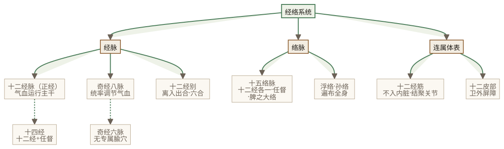
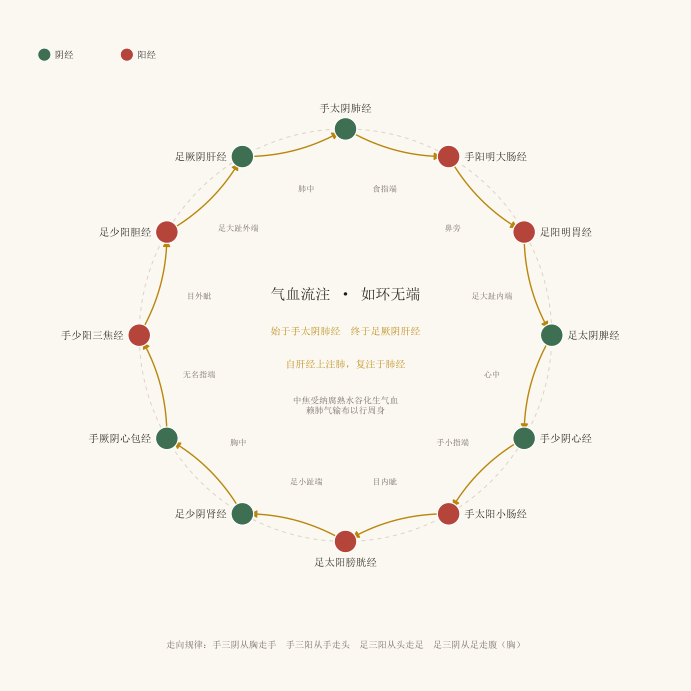

# 第 1 章 · 经络概述

> **源**：`qhzy-经络腧穴学.xlsx` · 表「01 经络概述」 · 源文 14,402 字
> **抽取**：`node scripts/import_textbooks.js --only 经络腧穴学` · sha256 `a630e66b5a4609ab…` · 2026-10-21
> **层次**：本文件是**源教材正文层** —— 节次取自源表的结构列，文字未改写、未压缩、未抽样。改写层（N.3「这个翻译丢掉了什么」/ N.5「争议与本项目立场」）尚未撰写，见 `textbooks/README.md` 章契约。

---

## 1.1 经络系统概述

### 1.1.1 经络的概念

#### 1.1.1.1 经络的定义与命名

经络，是经脉和络脉的总称，是人体内运行气血、联络脏腑、沟通内外、贯穿上下的通路。“经”有路径的含义，经脉贯通上下、沟通内外，是经络系统中的主干，深而在里；“络”有网络的含义，络脉是经脉别出的分支，较经脉细小，纵横交错，遍布全身，其中浮行于浅表部位者称浮络，最细小、难以计数者称孙络，浮而在表。经脉与络脉虽一干一支、一深一浅，但二者相互衔接、彼此贯通，共同构成一个如环无端、纵横交错的通道网络，把人体五脏六腑、四肢百骸、五官九窍、皮肉筋骨等组织器官联结成一个有机整体，气血津液正是凭借这一网络输布周身，发挥其濡养、温煦、卫护等作用。关于经脉与络脉的形态区别，古代医家早有明确论述，如《灵枢·脉度》记载：【原文】'经脉为里，支而横者为络，络之别者为孙。'（《灵枢·脉度》）指出经脉深居于里，是气血运行的主干；络脉是经脉支而横出的分支；由络脉再分出更为细小的分支，则为孙络。《灵枢·经别》又说：【原文】'经脉者，常不可见也。'【原文】'诸脉之浮而常见者，皆络脉也。'（《灵枢·经别》）说明经脉深伏体内、肉眼不易察见，浮行于浅表、肉眼可见的脉道皆属于络脉，可见古人对经脉、络脉在形态分布上深浅表里的区别已有朴素而清晰的认识。经络的命名有章可循：经脉依据其所联系的手足、阴阳属性及所属脏腑命名，如手太阴肺经、手阳明大肠经、足阳明胃经、足太阴脾经等；络脉则多以其别出之处的腧穴命名，如手太阴之络列缺、足阳明之络丰隆、任脉之络鸠尾、督脉之络长强、脾之大络大包等。经络的功能概括而言有四：一是运行气血，即气血通过经络的传注输布于全身，濡养脏腑组织；二是联络脏腑、沟通内外，即经络内连脏腑、外络肢节，使人体内外上下保持密切联系；三是抗御病邪、反映病候，即经络是病邪传变与脏腑病变反映于体表的途径；四是传导感应、调节平衡，即经络能传导针刺等刺激并调节脏腑气血的虚实盛衰。理解经络“内属于脏腑，外络于肢节”的总体特征，是学习经络学说、掌握针灸技能的基本功。需要特别指出的是，“经络”与“血脉”既有联系又有区别：经络是对人体气血运行通道及其功能联系规律的总括性认识，其内涵超越了解剖学意义上的血管、神经等单一结构，而是涵盖了循行路线、气血运行、脏腑联系、病候反映等多层面的功能系统。经络学说认为，经络不仅存在于体表，也深入体内，其循行路线“内属于脏腑，外络于肢节”，将表里、上下、前后联系为一个整体。这一整体观正是经络学说区别于一般解剖认识的根本所在，也是后世医家据以指导针灸临床、阐释病机、确定治则的理论基础。

#### 1.1.1.2 经络学说的学科地位

经络学说是阐述人体经络系统的循行分布、生理功能、病理变化及其与脏腑相互关系的一门学说，是中医理论体系的重要组成部分。它贯穿于中医学的生理、病理、诊断、治疗等各个方面，几千年来一直指导着针灸临床治病，同时也指导着中医各科的临床实践，在针灸学中的地位尤为突出。经络学说的形成，是古代医家通过长期的医疗实践，不断观察总结而逐步发现的。从文献资料分析，经络的发现主要通过以下途径：其一，针灸等刺激后感应传导现象的总结。古代医家在临床实践中观察到针刺穴位或一定部位时，患者会产生酸、麻、胀、重等主观感觉，称为“针感”，这种“针感”常沿着一定路线向远部传导，如《灵枢·邪气脏腑病形》指出：【原文】'中气穴，则针游于巷。'（《灵枢·邪气脏腑病形》）温灸时亦有热感由施灸部位向远处扩散。经过长期观察，古代医家逐步认识到人体各部有复杂而又有规律的联系通路，从而总结出经络分布的轮廓。其二，腧穴主治功效的总结。在长期的针灸临床实践中，古代医家发现腧穴不仅能治疗局部病证，还能治疗某些远隔部位的病证，而且这些主治范围基本相同的穴位往往有规律地排列在一条线路上，为经络的存在提供了佐证。其三，气功“行气”感的反复出现。气功古代称为“导引”“行气”，如《灵枢·官能》载：【原文】'缓节柔筋而心和调者，可使导引、行气。'（《灵枢·官能》）在导引、行气过程中，随着呼吸的调整、心神的内守、肢体的舒缓，常常出现“气”在体内有规律地流行的感觉，这种感觉的反复出现，有利于对经气的认识和经络的发现；长沙马王堆汉墓出土的帛书中，画有各种姿势的“导引图”与记载十一脉的文字连在一起，也说明导引、行气与经络的密切关系。其四，体表病理现象的总结。古代医家发现，当体内某一脏腑发生疾病时，体表相应部位可出现压痛、结节、皮疹、皮肤色泽改变等异常反应，如《素问·脏气法时论》记载：【原文】'心病者，胸中痛，胁支满'（《素问·脏气法时论》）；《灵枢·背腧》亦谓按其反应处，【原文】'按其处，应在中而痛解'（转引自《针灸学》新世纪第4版），说明脏腑有病会在体表相应部位出现反应。其五，解剖生理知识的启发。如《灵枢·经水》记载：【原文】'若夫八尺之士，皮肉在此，外可度量切循而得之，其死可解剖而视之。'（《灵枢·经水》）古代医家通过临床观察和对尸体的解剖，在一定程度上对内脏的位置、形态及某些生理功能有了直观认识，发现人体分布着许多与四肢相联系的管状和条索状结构。总之，经络发现的途径是多方面的，各种认识相互启发、互相佐证、彼此补充，从而使人们对经络的认识逐步完善。20世纪90年代，国家科技基础研究重大项目计划（攀登计划）将针灸经络列为研究重点（现代认识，不改经典原义），针灸经络研究已成为我国生命科学领域具有原创性的重要研究方向。

### 1.1.2 经络系统的组成

#### 1.1.2.1 经脉系统(十二经脉/奇经八脉/十二经别)

经络系统由经脉、络脉和连属于体表的十二经筋、十二皮部组成。其中经脉包括十二经脉、奇经八脉、十二经别；络脉包括十五络脉和难以计数的浮络、孙络等。十二经脉是经络系统的主体，是手三阴经（肺、心包、心）、手三阳经（大肠、三焦、小肠）、足三阳经（胃、胆、膀胱）、足三阴经（脾、肝、肾）的总称，又称“正经”。十二经脉左右对称地分布于人体，内属脏腑、外络肢节，每一条经脉都与其所属脏腑有特定的属络关系，并有固定的循行路线和腧穴，是气血运行的主要通道。奇经八脉指督脉、任脉、冲脉、带脉、阴维脉、阳维脉、阴跷脉、阳跷脉八条，因与十二经脉不同而别道奇行，故称奇经八脉。奇经八脉既不直属脏腑，除任、督二脉外又无专属腧穴和表里配合关系，其主要功能是统率、联络和调节十二经脉的气血。奇经八脉中的任脉和督脉各有其所属的腧穴，故与十二经相提并论，合称“十四经”，其他六条奇经则没有专门的腧穴。十二经别是十二正经别行深入体腔的支脉，由于经别均由十二经脉分出，故其名称也依十二经脉而定，即有手三阴、手三阳经别和足三阴、足三阳经别。十二经别的循行分布具有离、入、出、合的特点：多从四肢肘膝关节附近正经别出（离），经过躯干深入体腔与相关的脏腑联系（入），再浅出体表上行头项部（出），在头项部，阳经经别合于本经的经脉，阴经经别合于其相表里的阳经经脉（合），由此十二经别按阴阳表里关系会合成六组，称为“六合”。十二经别的作用主要有三：一是加强表里两经的联系，阴经经别多走向阳经经别并与之会合，使十二经脉表里两经之间增加了联系；二是加强经脉与脏腑的联系，经别进入体腔以后，大多数循行于该经脉所属脏腑，特别是阳经经别全部联系到其本经有关的脏和腑，也为临床常用的表里配穴法提供了理论依据；三是加强十二经脉与头部的联系，不仅阳经经别到达头部，阴经经别也合于头面，从而突出了头面部经脉和腧穴的重要性及其主治作用，也为手足三阴经中部分腧穴能够治疗头面和五官疾病，以及近代发展起来的头针、面针、耳针等奠定了理论基础。此外，经别还弥补了十二经脉分布的不足，扩大了经穴的主治范围，如足阳明经别的循行上通于心，沟通了心与胃之间的联系，为中医“和胃气以安心神”的治法提供了理论依据。十二经脉的名称、循行与脏腑属络，构成了经络系统的主干框架，故《灵枢》称“经脉者，所以能决死生，处百病，调虚实，不可不通”，历代医家皆以十二经脉为辨证论治之纲。经脉系统内部层次分明：十二经脉主运行气血之主干，奇经八脉主统率、调节气血之蓄溢，十二经别主加强表里两经及经脉与脏腑、头面的联系，三者相互配合，使经脉系统的功能趋于完善。临床运用上，凡属本经循行部位及其所属脏腑的病证，均可取本经及表里经腧穴治疗，而经别理论又扩大了经穴的主治范围，如手太阴经别合于手阳明经，故肺经某些腧穴亦可治疗大肠经循行部位的病证。

#### 1.1.2.2 络脉系统(十五络脉/孙络/浮络)与连属(经筋/皮部)

络脉系统包括十五络脉和难以计数的浮络、孙络。十二经脉和任脉、督脉各自别出一络，加上脾之大络，总计15条，称为十五络脉，分别以其所别出之处的腧穴命名。十五络脉的分布：十二经脉的别络在四肢肘膝关节以下本经络穴分出后，均走向其相表里的经脉；任脉的别络，从胸骨剑突下鸠尾分出后，散布于腹部；督脉的别络，从尾骨下长强分出后，散布于头部，并走向背部两侧的足太阳经；脾之大络，出于腋下大包穴，散布于胸胁部。全身络脉中，十五络脉较大；络脉中浮行于浅表部位的称为“浮络”，络脉最细小的分支称为“孙络”，遍布全身，难以计数。十五络脉为大络，有统属全身浮络、血络、孙络以渗灌血液、营养周身、贯通营卫的作用；根据络脉的分布特点，可以使十二经脉气血由线状流行逐渐扩展为网状弥散。十二经的络穴部位，即是各经络脉脉气的汇聚点和枢纽；任络、督络和脾之大络，沟通了腹、背和身侧的经气，输布气血以濡养全身。孙络、浮络纵横交错，网络周身，内而脏腑，外而五官九窍、四肢百骸，无处不到。如《灵枢·本脏》记载：【原文】'经脉者，所以行血气而营阴阳，濡筋骨，利关节者也。'（《灵枢·本脏》）循行于经脉中的营卫气血，正是通过络脉中布散全身的浮络、孙络而温养、濡润全身，维持人体正常生理功能的。络脉理论在临床上具有重要指导意义，如根据络脉病候和络脉沟通表里两经的特点，可选用络穴治疗络脉的虚实病证和表里两经的病变；诊察络脉颜色的变化，可测知脏腑经脉有关方面的病变；刺络拔罐以放出少许血液，可祛除络脉中的瘀滞，达到通畅气血、治疗疾病的目的。连属于经络系统的还有十二经筋与十二皮部。十二经筋是十二经脉之气结、聚、散、络于筋肉关节的体系，是附属于十二经脉的筋肉系统，皆隶属于十二经脉并随所辖经脉命名。十二经筋的循行分布与其所辖经脉体表通路基本一致，均从四肢末端走向头身，行于体表，不入内脏，分布成片，有结、聚、散、络的特点，结聚部位多在关节及肌肉丰厚处；经筋还有刚筋（阳筋）、柔筋（阴筋）之分，刚筋分布于项背和四肢外侧，柔筋分布于胸腹和四肢内侧。经筋的作用主要是约束骨骼，利于关节屈伸活动，以保持人体正常的运动功能，如《素问·痿论》曰：【原文】'宗筋主束骨而利机关也。'（《素问·痿论》）经筋为病，多有转筋、筋痛、弛纵等表现，针灸治疗多局部取穴，且多用针劫刺，如《灵枢·经筋》云：【原文】'治在针劫刺，以知为数，以痛为输。'（《灵枢·经筋》）十二皮部是十二经脉功能活动反映于体表的部位，也是络脉之气在皮肤所散布的部位，其分布区域以十二经脉体表的分布范围为依据，如《素问·皮部论》说：【原文】'皮者，脉之部也。'【原文】'凡十二经络脉者，皮之部也。'（《素问·皮部论》）十二皮部居于人体最外层，是机体的卫外屏障，有保卫机体、抗御外邪和反映病证的作用；针灸临床中，腧穴定位和刺法的操作都离不开皮部，各种灸法、挑刺、拔罐、穴位贴敷以及近代兴起的各种皮肤针法等，与皮部的关系都十分密切。

## 1.2 十二经脉

### 1.2.1 名称与分布规律

#### 1.2.1.1 十二经脉的名称与阴阳属性

十二经脉的名称是根据手足、阴阳、脏腑来命名的。首先用手、足将十二经脉分为手六经和足六经。根据中医理论，内属阴、外属阳，脏属阴、腑属阳，因此属于五脏和心包、分布于四肢内侧的经脉为阴经，属于六腑、分布于四肢外侧的经脉为阳经。根据阴阳消长的规律，阴阳又分为三阴（太阴、厥阴、少阴）、三阳（阳明、少阳、太阳）。十二经脉与脏腑有联属的关系，根据经脉联属的脏腑进一步命名，如联属于肺脏的为肺经，联属于大肠的为大肠经。根据上述命名规律，十二经脉的名称即为：手太阴肺经、手阳明大肠经、足阳明胃经、足太阴脾经、手少阴心经、手太阳小肠经、足太阳膀胱经、足少阴肾经、手厥阴心包经、手少阳三焦经、足少阳胆经、足厥阴肝经。由此可见，十二经脉的名称由手足、阴阳、脏腑三部分组成，其中“手”“足”标明经脉循行于上肢或下肢，“阴阳”标明经脉的阴阳属性，“脏腑”标明经脉所属络的脏腑，三者结合，便确定了每一条经脉的名称与归属。三阴三阳的划分体现了阴阳消长变化的不同程度：阴气初生为太阴，阴气渐盛为少阴，阴气将尽为厥阴；阳气初生为少阳，阳气渐盛为阳明，阳气最盛为太阳。手足三阴经与五脏及心包相联系，手足三阳经与六腑相联系，形成了阴经属脏、阳经属腑的基本格局。十二经脉的阴阳属性与其在四肢的分布位置密切相关，阴经分布于四肢内侧，阳经分布于四肢外侧，内为阴、外为阳，故《素问》有“内属于脏腑，外络于肢节”之论，这正是十二经脉命名的阴阳学基础。掌握十二经脉的名称与阴阳属性，是学习经脉循行、腧穴归经及经络辨证的首要前提，如手太阴肺经属阴、属脏，行于上肢内侧前缘，其病候多与肺系有关；足阳明胃经属阳、属腑，行于下肢外侧前缘，其病候多与胃肠有关，名称之中已蕴含经脉的基本信息。十二经脉的阴阳属性还与脏腑的表里相合关系相对应：五脏（心、肝、脾、肺、肾）及心包为阴，六腑（胆、胃、大肠、小肠、膀胱、三焦）为阳，故阴经属脏、阳经属腑，形成了六对表里相合的经脉。值得注意的是，手厥阴心包经与手少阳三焦经虽一属“脏”一属“腑”，但心包与三焦在功能上相互表里，共同主持人体气化与水液代谢，故亦列入正经之中。十二经脉的名称在针灸临床中应用极广，如“手太阴”“足阳明”等称谓既是经脉之名，又是辨证归经、循经取穴的语言工具；《内经》中大量以经脉命名的病证（如“肺胀”“胃脘痛”之类）均以经脉名称为纲，可见十二经脉名称具有深刻的临床意义。

#### 1.2.1.2 体表分布规律

十二经脉左右对称地分布于人体体表的头面、躯干和四肢。正立姿势、两臂自然下垂、掌心向内、拇指向前为标准体位。十二经脉中六条阳经分布于四肢外侧和头面、躯干，其中上肢外侧的是手三阳经，下肢外侧的是足三阳经，其分布规律是阳明在前、少阳在中（侧）、太阳在后。六条阴经分布于四肢内侧和胸腹，其中上肢内侧是手三阴经，下肢内侧是足三阴经。手三阴经的分布规律是太阴在前、厥阴在中、少阴在后。足三阴经在内踝上8寸以下分布规律是厥阴在前、太阴在中、少阴在后，在内踝上8寸以上，太阴交出厥阴之前，分布规律为太阴在前、厥阴在中、少阴在后。这一特殊分布规律的形成，与足三阴经在小腿部的循行交会有关：足厥阴肝经与足太阴脾经在内踝上8寸处前后交叉，足太阴脾经交出足厥阴肝经之前，从而形成上述分布格局。在头面躯干部，手足三阳经的分布亦循“阳明在前、少阳在侧、太阳在后”的规律：手足阳明经行于面部、前额及胸腹、下肢前外侧；手足少阳经行于侧头部、胁肋部及下肢外侧中间；手足太阳经行于后头部、项背部及下肢后外侧。手足三阴经除行于四肢内侧外，还分布于胸腹部：手三阴经从胸走手，行于胸腹部及上肢内侧；足三阴经从足走腹（胸），行于下肢内侧及腹胸部。任脉行于腹胸颏下正中，督脉行于腰背头面正中，其他奇经亦各有其分布区域。十二经脉在体表的分布规律，是循经取穴、分经辨证的重要依据。临床上根据病变部位所在的经络分布区域，即可判断病属何经，如头痛在前额者多与阳明经有关，在侧头部者多与少阳经有关，在后头部者多与太阳经有关；四肢、躯干不同部位的疼痛与感觉异常，同样可按经脉分布规律辨经论治。掌握“阳明在前、少阳在中、太阳在后”“太阴在前、厥阴在中、少阴在后”等分布规律，对于临床辨证归经与选穴施治具有直接的指导意义。十二经脉在四肢部的分布规律与其阴阳属性及循行方向密切相关：阳经行于四肢外侧，阴经行于四肢内侧，故《灵枢》有“外为阳、内为阴”之论。掌握体表分布规律，还须注意经脉与躯干的对应关系，如足阳明胃经行于胸腹正中线旁开2寸与4寸两条线，足太阴脾经行于胸腹正中线旁开4寸与6寸，足少阴肾经行于胸腹正中线旁开0.5寸，足厥阴肝经行于胁肋部等，这些躯干部的分布位置是腧穴定位的重要依据。此外，十二经脉的体表分布还与病候反映密切相关，经脉所过之处即为病候所现之处，临证时可根据疼痛、皮疹、条索状物等出现的部位判断所属经脉，从而为循经取穴提供依据。

### 1.2.2 走向交接与流注次序

#### 1.2.2.1 走向规律与交接规律

十二经脉循行走向的规律是：手三阴经从胸走手，手三阳经从手走头，足三阳经从头走足，足三阴经从足走腹（胸）。如《灵枢·逆顺肥瘦》所载：【原文】'手之三阴，从脏走手；手之三阳，从手走头；足之三阳，从头走足；足之三阴，从足走腹。'（《灵枢·逆顺肥瘦》）这一走向规律表明，手足阴阳经脉的循行方向并非任意，而是遵循“阴升阳降”的总体趋势：阴经自下（内）而上（外）行，阳经自上（外）而下（内）行，从而保证经气在人体内形成一个完整的循环。十二经脉相互交接的规律有三：其一，相表里的阴经与阳经在四肢末端交接。如手太阴肺经与手阳明大肠经交接于食指端，手少阴心经与手太阳小肠经交接于手小指端，手厥阴心包经与手少阳三焦经交接于无名指端；足阳明胃经与足太阴脾经交接于足大趾内端，足太阳膀胱经与足少阴肾经交接于足小趾端，足少阳胆经与足厥阴肝经交接于足大趾外端。其二，同名的阳经与阳经在头面部交接。如手阳明大肠经与足阳明胃经交接于鼻旁，手太阳小肠经与足太阳膀胱经交接于目内眦，手少阳三焦经与足少阳胆经交接于目外眦。其三，相互衔接的阴经与阴经在胸中交接。如足太阴脾经与手少阴心经交接于心中，足少阴肾经与手厥阴心包经交接于胸中，足厥阴肝经与手太阴肺经交接于肺中。十二经脉的走向与交接规律相互配合，使经气沿经脉周流不息：手三阴经从胸走手，在手指端与手三阳经相交；手三阳经从手走头，在头面部与同名足三阳经相交；足三阳经从头走足，在足趾端与足三阴经相交；足三阴经从足走腹（胸），在胸中与手三阴经相交，如此阴阳相贯、首尾相接，构成一个如环无端的循环系统。掌握走向与交接规律，有助于理解经气的运行方向、经脉之间的衔接关系以及气血流注的次序，也是分析“上病下取、下病上取”等取穴方法的重要理论基础。十二经脉走向规律的形成，有其深刻的生理意义。手三阴经从胸走手，是因为心肺居于胸中，胸为诸阴经之始；手三阳经从手走头，是因为诸阳经皆上会于头面；足三阳经从头走足，是因为阳经之气由上而下敷布；足三阴经从足走腹（胸），是因为脾、肝、肾三脏皆位于腹中及下焦，经气自下而上还归脏腑。如此阴阳上下相贯，气血如环无端地运行周身。临床上，根据走向规律可以理解针感的传导方向，如针刺手三阴经腧穴，针感多向胸、手方向传导；同时，走向规律也是分析“从阳引阴、从阴引阳”等治则以及络穴、郄穴等特定穴应用的理论基础。

#### 1.2.2.2 气血循环流注次序

十二经脉气血流注有一定规律。中焦受纳、腐熟水谷，化生水谷精微而生气血，所以十二经脉气血源于中焦。气血的运行，有赖于肺气的输布，因此十二经脉气血流注从手太阴肺经开始，由肺经逐经相传，形成周而复始、如环无端的流注系统，将气血周流全身，营养和维持各组织器官的功能活动。其流注次序是：气血流注始于手太阴肺经，然后交手阳明大肠经，再交足阳明胃经、足太阴脾经，继交手少阴心经、手太阳小肠经、足太阳膀胱经、足少阴肾经、手厥阴心包经、手少阳三焦经、足少阳胆经、足厥阴肝经，自肝经上注肺，再返回至肺经，重新再循环，周而复始。即依次为：手太阴肺经→手阳明大肠经→足阳明胃经→足太阴脾经→手少阴心经→手太阳小肠经→足太阳膀胱经→足少阴肾经→手厥阴心包经→手少阳三焦经→足少阳胆经→足厥阴肝经→手太阴肺经。如《灵枢·卫气》载：【原文】'阴阳相随，外内相贯'（《灵枢·卫气》），说明十二经脉阴阳表里相互贯通、气血循环如环无端。气血流注的次序与十二经脉的走向、交接规律密切相关：走向规律决定了各经气血运行的方向，交接规律保证了经气在经脉之间的传递，流注次序则把十二经脉连接成一个周而复始的整体循环。肺主气、朝百脉，故流注自肺经起始；肝藏血，主疏泄，故流注终于肝经而复注于肺，体现了气血“由肺而始、还归于肺”的循环特点。气血流注学说在临床上具有重要指导意义：其一，它说明了人体气血循环的整体性和连续性，是“十二经脉如环无端”理论的具体体现；其二，它提示了脏腑经脉之间气血盛衰的消长节律，后世据此发展出子午流注、灵龟八法等按时取穴方法，在针灸临床上用于择时施治；其三，流注次序还揭示了经脉病候传变的先后关系，如某一经气血失常，可通过流注关系影响下一经，从而为分析脏腑经脉的病理传变提供依据。气血流注次序反映了十二经脉之间的气血传递关系，具有重要的临床意义。其一，它说明了十二经脉气血流注是连续不断、周而复始的，任何一经的气血失常都会影响其流注的后续经脉，故临床上既可从本经论治，也可从流注次序的上下经论治，如肝经病证可考虑从胆经、肺经入手调理。其二，流注次序以肺为始、以肝为终而复归于肺，体现了“肺朝百脉”“肝主疏泄”的生理特点，也提示肺系病证在气血运行中的枢纽地位。其三，子午流注针法即依据气血流注的时辰节律按时开穴，如肺经当令于寅时、大肠经当令于卯时等，是经络学说时间节律思想的具体运用，迄今仍在针灸临床中使用。

### 1.2.3 表里关系

#### 1.2.3.1 阴阳表里络属

十二经脉在体内与脏腑相联属。脏腑有表里相合的关系，十二经脉之阴经和阳经亦有明确的脏腑属络和表里关系，其中阴经属脏络腑、主里，阳经属腑络脏、主表。具体而言：手太阴肺经属肺络大肠，手阳明大肠经属大肠络肺；足阳明胃经属胃络脾，足太阴脾经属脾络胃；手少阴心经属心络小肠，手太阳小肠经属小肠络心；足太阳膀胱经属膀胱络肾，足少阴肾经属肾络膀胱；手厥阴心包经属心包络三焦，手少阳三焦经属三焦络心包；足少阳胆经属胆络肝，足厥阴肝经属肝络胆。十二经脉之间存在着表里配对关系，如《素问·血气形志》所载：【原文】'足太阳与少阴为表里，少阳与厥阴为表里，阳明与太阴为表里，是为足阴阳也。手太阳与少阴为表里，少阳与心主为表里，阳明与太阴为表里，是为手之阴阳也。'（《素问·血气形志》）互为表里的经脉在生理上有密切联系，病变时会相互影响，治疗时可相互为用。从生理上看，表里两经通过属络关系、络脉联系和经别会合而相互沟通，气血互通、功能协调，如肺与大肠相表里，肺气肃降则大肠传导正常，大肠通畅亦有助于肺气宣降；心与小肠相表里，心经之热可下移小肠，通过泌别清浊而从小便排出。从病理上看，表里两经的病变可相互传变，如心热移于小肠，可见小便赤涩灼痛；肝病影响及胃，可见脘腹胀痛、呕恶嗳气；胃病影响及脾，可见纳呆腹胀、便溏乏力等。从治疗上看，表里两经的腧穴可以相互为用，如肺经病变可取大肠经腧穴，脾经病变可取胃经腧穴，临床上常用的表里配穴法、原络配穴法，正是基于经脉表里关系而确立的；《灵枢》所谓“从阴引阳、从阳引阴”的治则，其理论依据亦在于此。十二经脉的表里关系，是经络学说的重要内容，它把脏腑、经脉在生理、病理、治疗三个层面上的联系统一起来，为临床辨证论治和针灸处方提供了重要理论依据。十二经脉的表里关系还通过络脉与经别进一步加强：十二经脉各有别络，从四肢肘膝关节以下的络穴分出后走向相表里的经脉；十二经别则通过“六合”形式在体内将表里两经会合，使表里经的联系更加紧密而多途。正因为表里经之间存在如此密切的联系，临床上许多针灸配穴方法都以表里关系为依据：如原络配穴法，取病经之原穴与表里经之络穴相配；又如俞募配穴法，取脏腑之背俞穴与募穴相配，虽以脏腑为中心，亦不离表里相合之义。此外，表里经的病变还可以互相移易，如大肠传导失常可影响肺之宣降而致咳喘，膀胱气化不利可影响肾之封藏而致遗尿等，临证当明辨表里、统筹论治。

## 1.3 奇经八脉

### 1.3.1 奇经八脉的名称与特点

#### 1.3.1.1 督/任/冲/带/阴阳跷/阴阳维

奇经八脉指督脉、任脉、冲脉、带脉、阴维脉、阳维脉、阴跷脉、阳跷脉八条，因与十二经脉不同而别道奇行，故称为奇经八脉。奇经之“奇”含义有二：一指“异”，它们与十二正经不同，既不直属脏腑，除任、督二脉外又无专属腧穴和表里配合关系，且“别道奇行”；二指单数、偶之对，因奇经没有表里配合关系。八条奇经的命名各有所本，蕴含其循行与功能特点。督脉之“督”有总督之意，督脉行于腰、背、头面正中，督领诸阳经，统摄全身阳气和真元，为“阳脉之海”。任脉之“任”有妊养之意，任脉行于腹、胸、颏下正中，妊养诸阴经，总调全身阴气和精血，为“阴脉之海”。冲脉之“冲”为要冲之意，冲脉与足阳明、足少阴等经关系密切，有“十二经脉之海”和“血海”之称，具有涵蓄十二经气血的作用。带脉之“带”指腰带，带脉起于胁下，绕行腰间一周，状如束带，有约束纵行躯干部的诸条经脉的作用。维脉之“维”有维系、主持之意，阳维脉起于足外侧，并足少阳经上行，至项后会于督脉，主一身之表；阴维脉起于小腿内侧，并足太阴、厥阴上行，至咽喉合于任脉，主一身之里，具有维系一身阴经和阳经的作用。跷脉之“跷”有足跟、矫捷之意，阴跷脉起于足跟内侧，伴足少阴等经上行，至目内眦与阳跷脉会合；阳跷脉起于足跟外侧，伴足太阳等经上行，至目内眦与阴跷脉会合，阴阳跷脉主肢体两侧的阴阳，调节下肢运动与寤寐。奇经八脉中，任脉和督脉各有其所属的腧穴，故与十二经相提并论合称“十四经”，其他六条奇经则没有专门的腧穴，其腧穴皆依附于十四经。奇经八脉理论是经络理论的重要内容之一，在临床实践中，不论是对诊断辨证，还是针灸治疗选穴配方，以及中医辨证治疗，都有重要指导意义。奇经八脉的循行分布各有特点：督脉行于腰背头面正中，为“阳脉之海”；任脉行于腹胸颏下正中，为“阴脉之海”，二脉一背一腹、一阳一阴，统领一身之阴阳。冲脉起于胞中，与足少阴经并行，环绕口唇，且与任、督、足阳明经等有联系，涵蓄十二经气血，为“十二经之海”，又称“血海”。带脉起于胁下，环腰一周，状如束带，约束纵行躯干的诸条经脉。阴维脉起于小腿内侧，并足太阴、厥阴上行，至咽喉合于任脉，维系全身阴经；阳维脉起于足外侧，并足少阳经上行，至项后会于督脉，维系全身阳经。阴跷脉起于足跟内侧，伴足少阴等经上行，至目内眦与阳跷脉会合；阳跷脉起于足跟外侧，伴足太阳等经上行，至目内眦与阴跷脉会合，二脉共同调节下肢运动，司寤寐。掌握奇经八脉的分布与特点，有助于理解奇经病候及八脉交会穴的临床应用。

### 1.3.2 奇经八脉的作用

#### 1.3.2.1 总督调节十二经脉气血

奇经八脉交错地循行分布于十二经之间，其作用主要有三个方面。其一，统率、主导作用。奇经八脉将部位相近、功能相似的经脉联系起来，达到统率有关经脉气血、协调阴阳的作用。督脉督领诸阳经，统摄全身阳气和真元，为“阳脉之海”；任脉妊养诸阴经，总调全身阴气和精血，为“阴脉之海”；冲脉与足阳明、足少阴等经关系密切，涵蓄十二经气血，故有“十二经脉之海”和“血海”之称；督、任、冲脉皆起于胞中，同出会阴，称为“一源三歧”。带脉绕行腰间一周，约束纵行躯干部的诸条经脉；阳维脉主一身之表，阴维脉主一身之里，维系一身阴经和阳经；阴阳跷脉主肢体两侧的阴阳，调节下肢运动与寤寐。其二，沟通、联络作用。奇经八脉在循行分布过程中，与其他各经相互交会沟通，加强了十二经脉之间的相互联系。如手足三阳经共会督脉于大椎，任脉关元、中极穴为足三阴经之交会穴，冲脉加强了足阳明与足少阴经之间的联系，带脉横绕腰腹，联系着纵行于躯干的各条经脉等。其三，蓄积、渗灌的调节作用。奇经八脉纵横交错循行于十二经脉之间，当十二经脉和脏腑之气旺盛时，奇经加以储蓄；当十二经脉生理功能需要时，奇经又能渗灌和供应。如《难经·二十八难》所说，十二经脉气血充盛时，溢入奇经八脉蓄藏，如【原文】'沟渠满溢，流于深湖'（《难经·二十八难》），以沟渠与深湖的关系比喻十二经脉与奇经八脉的关系：十二经脉气血有余则蓄于奇经，不足则奇经渗灌补充，从而维持全身气血的平衡。奇经八脉理论在临床上应用广泛：八脉交会穴（公孙通冲脉、内关通阴维脉、后溪通督脉、申脉通阳跷脉、临泣通带脉、外关通阳维脉、列缺通任脉、照海通阴跷脉）即依据奇经八脉与十二经脉的交会关系而设立，用于治疗奇经及所交会经脉的病证；灵龟八法和飞腾八法则是按时取用八脉交会穴的方法，体现了奇经八脉理论在时间针灸学中的具体运用。总之，奇经八脉在十二经脉的基础上，进一步发挥了统率、联络和调节气血的作用，使经络系统对全身气血阴阳的调控更加完善。奇经八脉与十二经脉的关系，可概括为“蓄溢调节、统率联络”八个字：十二经脉为气血运行之主干，如沟渠之水道；奇经八脉为气血蓄藏之渊海，如沟渠之深湖，二者相辅相成，共同维持全身气血阴阳的相对平衡。奇经八脉病候在临床上亦有重要意义，如督脉为病多见脊强反折、角弓反张，任脉为病多见疝气、带下、腹中结块，冲脉为病多见气逆里急，带脉为病多见腹满、腰溶溶如坐水中，阴阳跷脉为病多见阳缓阴急或阴缓阳急之癃闭、不寐等，这些病候为奇经辨证提供了依据。临床治疗中，除八脉交会穴外，还可取任督二脉之腧穴及诸经交会穴调理奇经，如取大椎调督脉阳气、取关元、中极调任脉阴血等，针灸临床对妇科病、神志病、腰背及下肢病证的诊治，常从奇经论治而获良效。

## 1.4 经络的生理功能与临床应用

### 1.4.1 生理功能

#### 1.4.1.1 运行气血/联络脏腑肢节/感应传导/调节平衡

经络的生理功能，主要有联系脏腑、沟通内外，运行气血、营养全身，抗御病邪、反映病候，传导感应、调节平衡四个方面。其一，联系脏腑，沟通内外。人体的五脏六腑、四肢百骸、五官九窍、皮肉筋骨等组织器官，通过经络的联系而构成一个有机的整体，完成正常的生理活动。十二经脉及其分支等纵横交错、入里出表、通上达下，联系了脏腑器官；奇经八脉沟通于十二经之间；经筋、皮部联结了肢体筋肉皮肤，从而使人体的各脏腑组织器官有机地联系起来，即所谓“内属于脏腑，外络于肢节”。其二，运行气血，营养全身。气血必须通过经络的传注，才能输布全身，以濡润各脏腑组织器官，维持机体的正常功能。如《灵枢·本脏》说：【原文】'经脉者，所以行血气而营阴阳，濡筋骨，利关节者也。'（《灵枢·本脏》）营气和调于五脏、洒陈于六腑，为五脏藏精、六腑传化的功能活动提供了物质条件。其三，抗御病邪，反映病候。孙络分布范围很广，最先接触到病邪，当疾病侵犯时，孙络和卫气发挥重要的抗御作用；经络又是传注病邪的途径，当体表受到病邪侵犯时，可通过经络由表及里、由浅入深，如《素问·缪刺论》载：【原文】'夫邪之客于形也，必先舍于皮毛'（《素问·缪刺论》），外邪从皮毛由表入里，内传脏腑。经络也是病变相互传变的渠道，是脏腑之间、脏腑与体表组织器官之间相互影响的途径，如心热移于小肠、肝病影响及胃、胃病影响及脾等，都是脏腑病变通过经络传注而相互影响的结果；内脏病变还可通过经络反映到体表组织器官，如《灵枢·邪客》说：【原文】'肺心有邪，其气留于两肘；肝有邪，其气留于两腋'（《灵枢·邪客》）。临床上诊察体表络脉的颜色变化可测知病变，如《灵枢·经脉》说：【原文】'凡诊络脉，脉色青则寒且痛，赤则有热。'（《灵枢·经脉》）其四，传导感应，调节平衡。针刺中的得气和气行现象都是经络传导感应的功能表现。人身经络之气发于周身腧穴，如《灵枢·九针十二原》说：【原文】'节之交，三百六十五会，所言节者'（《灵枢·九针十二原》），腧穴为神气游行出入之所；针刺操作的关键在于调气，所谓【原文】'刺之要，气至而有效'（转引自《针灸学》新世纪第4版）。当经络或内脏机能失调时，通过针灸等刺激体表的一定腧穴，经络可以将其治疗性刺激传导到有关的部位和脏腑，从而发挥其调节人体脏腑气血的功能，使阴阳平复，达到治疗疾病的目的。经络的四大生理功能相互联系、密不可分，共同维持人体的生命活动与阴阳平衡。

### 1.4.2 临床应用

#### 1.4.2.1 经络辨证/循经取穴/药物归经/预防保健

经络学说的临床应用，主要表现在诊断和治疗两个方面。诊断方面，其一为经络辨证，即以经络学说为理论依据，对患者的症状、体征进行综合分析，以判断病属何经，并进而确定发病原因、病变性质及病机。经络有一定的循行部位和脏腑属络，可以反映经络本身及所属脏腑的病证，故根据疾病所出现的症状，结合经脉循行的部位及所联系的脏腑，可以指导分经辨证。如头痛一症，痛在前额部多与阳明经有关，痛在侧头部多与少阳经有关，痛在后头部多与太阳经有关，痛在巅顶部多与厥阴经有关；又如咳嗽、鼻流清涕、胸痛、上肢内侧前缘痛等，与手太阴肺经有关。其二为经络望诊，即通过观察经络所过部位皮表所发生的各种异常改变来诊断疾病，主要观察全身经络腧穴部位的色泽、形态变化，如皮肤的皱缩、隆陷、松弛，颜色的变异、光泽的明晦、色素的沉着和斑疹的有无等，如《灵枢·经脉》说：【原文】'凡诊络脉，脉色青则寒且痛，赤则有热。'（《灵枢·经脉》）其三为经络腧穴按诊，即在经络腧穴部位上运用按压、触摸等方法来寻找异常变化，如压痛、硬结、条索状物、肿胀、凹陷等，借以诊断疾病，按诊部位多为背俞穴，其次是胸腹部的募穴以及四肢的原穴、郄穴、合穴或阿是穴等；切脉诊断也是经络按诊的重要组成部分，如《灵枢·九针十二原》指出：【原文】'凡将用针，必先诊脉，视气之剧易，乃可以治也。'（《灵枢·九针十二原》）其四为经络腧穴电测定，即利用经络穴位测定仪检测经络腧穴部位的电参量，借以判断各经气血之盛衰，由于人体腧穴具有低电阻特性，测定这些变化对诊断经络脏腑疾病和选取治疗腧穴有一定参考价值（现代认识，不改经典原义）。治疗方面，其一为指导针灸治疗。在明确诊断的基础上，除选用局部的腧穴外，通常以循经取穴为主，即某一经络或脏腑有病，便选用该经或相应经脉的远部腧穴来治疗，如上病下取、下病上取、中病旁取、左右交叉取以及前后对取等；如胃痛近取中脘，循经远取足三里、梁丘；胁痛循经选取阳陵泉、太冲；前额阳明头痛，循经选取上肢的合谷穴和下肢的内庭穴等。《四总穴歌》【原文】'肚腹三里留，腰背委中求，头项寻列缺，面口合谷收'（转引自《针灸学》新世纪第4版）就是循经取穴的很好例证。循经取穴还指导刺灸方法的选用，如根据皮部与经络脏腑的密切联系，可用皮肤针叩刺皮肤、皮内针埋藏皮内来治疗脏腑经脉的病证；根据“菀陈则除之”的原则，使用刺络出血的方法治疗一些常见病，如目赤肿痛刺太阳出血，咽喉肿痛刺少商出血，急性腰扭伤刺委中出血等；经筋的病候多表现为拘挛、抽搐等症，治疗多局部取穴。其二为指导药物归经。药物按其主治性能归入某经或某几经，简称药物归经，它是在分经辨证的基础上发展起来的，因病证可以分经，主治某些病证的药物也就成为某经或某几经之药。如徐灵胎《医学源流论》说：【原文】'因其能治何经之病，后人即指为何经之药'（徐灵胎《医学源流论》）此外，中医各科也以经络理论为依据进行施治，如目病有时可以不治目而用补肝的方法，因为肝经联系于目；心火上炎的口舌生疮，可清泄小肠、导火下行，是因为心与小肠为表里，在体内通过经络有联系。其三为指导预防保健。经络学说还可用于指导养生防病，如针灸保健常选用足三里、关元、气海等穴灸治，以扶助正气、强身延年；导引、按摩、气功等养生方法亦以疏通经络、调和气血为要旨，体现了经络学说在“治未病”方面的应用（现代认识，不改经典原义）。

---

> **免责声明**：本教材内容仅用于教育与科研，不构成任何诊疗建议。
> 本文件由 `scripts/import_textbooks.js` 从源工作簿生成，请勿手改 —— 需要修改请改源工作簿后重跑。
