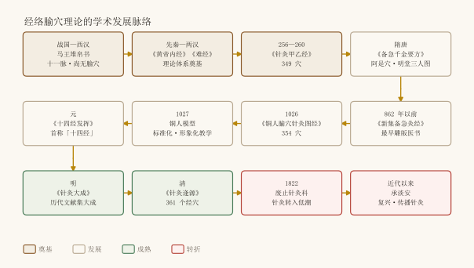

# 第 3 章 · 经络腧穴理论的形成及学术发展

> **源**：`qhzy-经络腧穴学.xlsx` · 表「03 经络腧穴理论的形成及学术发展」 · 源文 7,291 字
> **抽取**：`node scripts/import_textbooks.js --only 经络腧穴学` · sha256 `a630e66b5a4609ab…` · 2026-10-21
> **层次**：本文件是**源教材正文层** —— 节次取自源表的结构列，文字未改写、未压缩、未抽样。改写层（N.3「这个翻译丢掉了什么」/ N.5「争议与本项目立场」）尚未撰写，见 `textbooks/README.md` 章契约。

---

## 3.1 经络腧穴理论的形成

### 3.1.1 早期文献与帛书

#### 3.1.1.1 马王堆帛书《足臂十一脉灸经》《阴阳十一脉灸经》

经络腧穴理论是古代医家在长期医疗实践中，对针刺感应传导、腧穴主治功效、气功行气、体表病理反应和解剖生理知识等现象反复观察、总结归纳而逐渐形成的理论体系。这一过程经历了漫长的历史积累，其最早的文字见证，是长沙马王堆汉墓出土的帛书经脉文献。1973年，长沙马王堆三号汉墓出土了大批医学帛书，其中有两种专论经脉的古医书，即《足臂十一脉灸经》和《阴阳十一脉灸经》。【原文】'两书记载了十一条经脉的循行、病候和灸法治疗，反映了针灸学核心理论经络学说的早期面貌。'（转引自《针灸学》新世纪第4版）这是迄今发现的最早的经络学专著，为研究经络腧穴理论的形成提供了珍贵的第一手史料。 《足臂十一脉灸经》共载十一条脉，按部位分为“足”与“臂”两类，足部六脉、臂部五脉，分别以足泰阳脉、足少阳脉、足阳明脉、足少阴脉、足泰阴脉、足厥阴脉与臂泰阴脉、臂少阴脉、臂泰阳脉、臂少阳脉、臂阳明脉命名。与《黄帝内经》的十二经脉相比，帛书缺少手厥阴心包经一脉；经脉循行描述较为简略，多为自四肢末端走向躯体的简单路线，尚未形成与脏腑的属络联系；病候记载较为简单，多为该脉循行部位的病症；治疗方面只述灸法，不见针法与腧穴名称，故两书均以“灸经”命名。整体观之，帛书所反映的经脉理论尚处于朴素、初级的阶段，然其“以脉为主、以灸为治”的体例，已开经络学说之先河。 《阴阳十一脉灸经》的体例较《足臂十一脉灸经》有所发展：经脉均以阴阳命名，如“钜阳脉、少阳脉、阳明脉、太阴脉、厥阴脉”等，并按先阳后阴、先足后臂的顺序排列；每条脉分“是动则病”与“其所产病”两部分记述病候，已见后世《灵枢·经脉》“是动病”“所生病”分类之雏形；病候内容较足臂本丰富，并载有具体的灸治部位。这说明至迟在战国至西汉之际，医家已能运用阴阳学说对经脉进行系统的归类与命名，经络学说正由零散的经验记载向系统的理论形态演进。 帛书十一脉与《内经》十二经脉的差异，体现了经络学说由简到繁、由粗到精的演进轨迹：经脉由十一条增至十二条，补齐了手厥阴心包经；循行路线由简单走向复杂，并与脏腑建立了属络关系；治疗手段由单用灸法发展为针、灸并用，腧穴理论随之萌生。帛书所载十一脉虽无腧穴之名，但其循行路线为后世十二经脉与腧穴定位奠定了雏形，是经络腧穴理论形成期最重要的里程碑。本节要点：经络腧穴理论源于长期医疗实践的经验总结；马王堆帛书《足臂十一脉灸经》《阴阳十一脉灸经》为现存最早的经脉文献，载十一脉循行、病候与灸法治疗，尚无腧穴记载，是经络学说早期面貌的直接见证。 经络理论的形成经历了漫长的经验积累过程，其途径是多方面的：一是针灸等刺激后感应传导现象的总结。古代医家在临床实践中观察到针刺穴位时患者会产生酸、麻、胀、重等主观感觉，称为“针感”，这种“针感”常沿着一定路线向远部传导，《灵枢·邪气脏腑病形》指出：【原文】'中气穴，则针游于巷。'（《灵枢·邪气脏腑病形》）温灸时亦有热感由施灸部位向远处扩散，经长期观察，医家逐步认识到人体各部有复杂而又有规律的联系通路，从而总结出经络分布的轮廓。二是腧穴主治功效的总结。古代医家发现腧穴不仅能治疗局部病证，还能治疗某些远隔部位的病证，且主治范围基本相同的穴位往往有规律地排列在一条线路上，为经络的存在提供了佐证。三是气功“行气”感的反复出现。气功古代称为“导引”“行气”，《灵枢·官能》载：【原文】'缓节柔筋而心和调者，可使导引、行气。'（《灵枢·官能》）在导引、行气过程中常出现“气”在体内有规律地流行的感觉，这种感觉的反复出现有利于对经气的认识和经络的发现。四是体表病理现象的总结。当体内某一脏腑发生疾病时，体表相应部位可出现压痛、结节、皮疹、皮肤色泽改变等异常反应，《灵枢·背腧》记载：【原文】'欲得而验之，按其处，应在中而痛解，乃其也。'（《灵枢·背腧》）五是解剖生理知识的启发。《灵枢·经水》记载：【原文】'若夫八尺之士，皮肉在此，外可度量切循而得之，其死可解剖而视之。'（《灵枢·经水》）古代医家通过临床观察和对尸体的解剖，在一定程度上对内脏的位置、形态及某些生理功能有了直观认识，发现人体分布着许多与四肢相联系的管状和条索状结构。上述认识相互启发、彼此补充，最终凝结为帛书所见的十一条经脉体系，进而发展为《内经》的十二经脉理论。

### 3.1.2 《黄帝内经》与《难经》

#### 3.1.2.1 经络腧穴理论体系的奠基

《黄帝内经》的成书，标志着经络腧穴理论体系的正式奠基。《内经》约成书于战国至西汉时期，包括《素问》和《灵枢》两部分，共18卷162篇，其中以《灵枢》所载针灸理论更为丰富和系统，故《灵枢》又称《针经》。【原文】'《内经》对经络学说尤有精辟的论述，不但对十二经脉的循行走向、属络脏腑及其所主病证均有明确记载，而且对奇经八脉、十二经别、十五络脉、十二经筋、十二皮部的走向、分布、功能以及与经络系统相关的标本、根结、气街、四海等亦有记叙。'（转引自《针灸学》新世纪第4版）至此，以十二经脉为主体、包括奇经八脉及各类络属组织在内的经络系统框架基本确立，经络学说成为中医理论体系的核心内容之一。 在腧穴理论方面，《内经》载有160个左右常用穴位的名称，对特定穴理论阐述较详，特别是对五输穴理论阐述较全面，对原穴、下合穴、十五络穴、五脏背俞穴等也都有载述，并论述了腧穴与脏腑经络的联系，为后世腧穴学的形成奠定了基础。在刺灸法方面，《内经》对刺法论述较为详尽，提出了迎随补泻、徐疾补泻、呼吸补泻、开阖补泻等手法；在治疗方面，论述了治疗原则如“盛则泻之，虚则补之”，在取穴配穴方面提出了俞募配穴法、远道取穴法等具体方法。《内经》记载了100多种病证，其中绝大多数都应用针灸治疗。【原文】'《内经》的成书，标志着当时的医学家们不但已构筑起以经络学说为核心的理论框架，而且已卓有成效地运用刺法、灸法等技术防病治病，并善于理论联系实践，在实践中不断发展和更新理论，初步形成了以理、法、方、穴、术为一体的独特的针灸学理论体系。'（转引自《针灸学》新世纪第4版） 《黄帝八十一难经》（简称《难经》）相传系秦越人（扁鹊）所作，内容简要，辨析精微，进一步丰富和充实了针灸学理论体系。【原文】'其中关于奇经八脉和原穴的论述，补充了《内经》之不足。'（转引自《针灸学》新世纪第4版）《难经》系统阐发了奇经八脉的循行与病候，发展了原穴理论，提出了八会穴，并对五输穴按五行学说做了详细的解释，充实了特定穴理论的内容，对后世针灸学术的发展产生了深远影响。 两汉至魏晋时期，针灸学术继续发展。创立六经辨证的张仲景，在其著作《伤寒杂病论》中，不仅于方药方面留下许多光辉的典范，而且在针灸学术上也有许多独到的见解和贡献，其中直接与针灸有关的条文达69条，主张针药结合、辨证施治。以外科闻名于世的华佗亦精于针灸，创立了著名的“华佗夹脊穴”，著有《枕中灸刺经》（佚）。这一时期还出现了腧穴学的专门著作——《明堂孔穴针灸治要》（即《黄帝明堂经》），惜已佚失，但其内容为后世《针灸甲乙经》等书所辑存，成为腧穴理论传承的重要环节。本节要点：《内经》确立了以经络学说为核心、理法方穴术一体的针灸理论体系；《难经》补充奇经八脉与原穴理论，提出八会穴；张仲景、华佗及《黄帝明堂经》推动了针灸临床与腧穴理论的发展。 《内经》对经络作用的论述亦成为后世经络理论的核心纲领。《灵枢·经脉》记载：【原文】'经脉者，所以能决死生，处百病，调虚实，不可不通。'（《灵枢·经脉》）说明经络具有联系人体内外、运行气血、抗御病邪、反映证候、传导感应的作用；《灵枢·海论》所说：【原文】'夫十二经脉者，内属于腑脏，外络于肢节。'（《灵枢·海论》）概括了经络沟通内外的整体联系；《灵枢·本脏》则谓：【原文】'经脉者，所以行血气而营阴阳，濡筋骨，利关节者也。'（《灵枢·本脏》）这些论述从功能层面确立了经络学说在中医理论体系中的核心地位。需要指出的是，《内经》所载经络内容虽已相当系统，但尚未形成独立的经络腧穴专著，相关论述散见于各篇，其穴位数目与定位亦未尽完备，这些不足正是后世医家继续整理、补充的出发点。

## 3.2 学术发展与传承

### 3.2.1 历代发展

#### 3.2.1.1 《针灸甲乙经》/《铜人腧穴针灸图经》/《十四经发挥》/《针灸大成》

魏晋时期，皇甫谧于魏甘露年间（公元256～260年），将《素问》《灵枢》和《明堂孔穴针灸治要》三书中的针灸内容汇而为一，去其重复，择其精要，编撰成《针灸甲乙经》。全书分为12卷128篇，共收349个腧穴，按脏腑、气血、经络、腧穴、脉诊、刺灸法和临床各科病证针灸治疗为次序加以编纂，成为一部最早的体系比较完整的针灸专书，是继《内经》之后对针灸学的又一次总结，在针灸学发展史上起到了承前启后的作用。晋代葛洪撰《肘后备急方》，所录针灸医方109条，其中99条为灸方，使灸法得到进一步发展；其妻鲍姑亦擅长用灸。隋至初唐名医甄权著有《针方》《针经钞》和《明堂人形图》等（均佚）。 隋唐时期，孙思邈撰《备急千金要方》和《千金翼方》，首载阿是穴法和指寸法，广泛收入前代各家的针灸临床经验，并绘制了《明堂三人图》。【原文】'其中十二经脉五色作之，奇经八脉以绿色为之，三人孔穴共六百五十穴'（转引自《针灸学》新世纪第4版），成为历史上最早的彩色经络腧穴图。杨上善在《黄帝明堂经》基础上撰《黄帝内经明堂类成》，按十二经脉和奇经八脉的次序论列穴位；王焘编《外台秘要》，大量采录诸家灸法；崔知悌《骨蒸病灸方》专论灸治痨病；刊于公元862年以前的《新集备急灸经》是我国最早雕版印刷的医书，专论急症用灸。唐代太医署设“针博士一人，针助教一人，针师十人，针工二十人，针生二十人”，【原文】'为针灸学的学校教育开创了先河。'（转引自《针灸学》新世纪第4版） 宋金元时期，印刷术的广泛应用促进了针灸文献的积累与传播。北宋王惟一在政府支持下，重新考订厘正了354个腧穴的位置及所属经脉，增补了腧穴的主治病证，于公元1026年撰成《铜人腧穴针灸图经》，雕印刻碑，由政府颁行；次年（1027年）设计制成两具铜人模型，外刻经络腧穴，内置脏腑，作为教学和考试针灸师之用，开针灸腧穴标准化、形象化教学之先河。南宋王执中撰《针灸资生经》，重视实践经验，对后世颇有影响。元代滑寿考订经络循行及其与腧穴的联系，在忽泰必烈《金兰循经取穴图解》基础上编撰《十四经发挥》，首次把任、督脉和十二经脉并称为“十四经”，进一步发展了经络腧穴理论。金代何若愚与阎明广提倡按时取穴，著《子午流注针经》；金元名医窦汉卿所撰《标幽赋》是针灸歌赋中的名篇。 明清时期针灸学术发展到高潮。明代杨继洲在家传著作《卫生针灸玄机秘要》基础上增辑而成的《针灸大成》，是汇集历代针灸文献的集大成之作；徐凤《针灸大全·金针赋》、高武《针灸聚英发挥》、张介宾《类经图翼》等亦是汇总历代针灸文献的重要著作。针刺手法的研究更加深入，在单式手法的基础上形成了二十多种复式手法；灸法由烧灼灸法向艾卷温和灸法发展，14世纪开始出现的艾卷灸法后来发展为加进药物的“雷火神针”“太乙神针”；明代医家还对历代不属于经穴的针灸部位进行了整理，在腧穴里列出“奇穴”这个类别，使腧穴体系趋于完备。清代李学川撰《针灸逢源》，强调辨证取穴，针药并重，增加中枢、急脉两穴，列出361个经穴。公元1822年，清王朝以“针刺火灸，究非奉君之所宜”为理由，下令太医院停止使用针灸，废止针灸科，针灸发展一度转入低潮。近代以来，承淡安先生为振兴针灸学术做出很大贡献，【原文】'被誉为中国针灸事业的复兴者与传播者。'（转引自《针灸学》新世纪第4版）本节要点：从《针灸甲乙经》到《针灸大成》，历代医家不断总结、整理与发展经络腧穴理论；铜人模型的创制与“十四经”体系的提出是其中重要的里程碑。 晋代葛洪撰《肘后备急方》，【原文】'所录针灸医方109条，其中99条为灸方'（转引自《针灸学》新世纪第4版），【原文】'使灸法得到了进一步的发展。'（转引自《针灸学》新世纪第4版）【原文】'其妻鲍姑，亦擅长用灸。'（转引自《针灸学》新世纪第4版）明代汇集文献的著作尚有朱橚《普济方·针灸门》、徐凤《针灸大全》、高武《针灸聚英发挥》、吴昆《针方六集》、张介宾《类经图翼》等；专论针刺手法的则有《针灸大全·金针赋》《针灸大成·三衢杨氏补泻》、李梴《医学入门·针灸》、汪机《针灸问对》等，反映了明代对针刺手法研究的深入。清初至鸦片战争时期，医者重药而轻针，针灸逐渐转入低潮，然18世纪吴谦等人奉敕撰《医宗金鉴·刺灸心法要诀》，【原文】'以歌诀和插图为主，很切合实用。'（转引自《针灸学》新世纪第4版）此期著述虽多，但影响不大，经穴数目则经李学川《针灸逢源》增补而趋于固定。

### 3.2.2 近现代标准化

#### 3.2.2.1 GB/T 12346/ISO 针灸标准/教材体系沿革

新中国成立后，针灸事业进入新的发展阶段。20世纪50年代，卫生部发布《中医师暂行条例》，在全国各地建立中医医院（内设针灸科），成立针灸研究机构，整理出版古代针灸专著，开展针灸文献、临床研究和针灸作用机理的实验研究。1956年后，全国各地陆续成立以培养中医专业本科人才为主的中医学院，【原文】'针灸学作为主干课程，为学生们所必修，开创了我国高等中医药学历教育的历史。'（转引自《针灸学》新世纪第4版）1958年，我国针灸工作者在针刺麻醉取得手术成功的基础上，首次提出了“针刺麻醉”概念；1971年，我国正式向世界宣布针刺麻醉成功，在国际上掀起针灸热潮。1979年，中华全国中医学会针灸分会成立；1985年，中国针灸学会升格为国家一级学会。20世纪90年代，国家科技基础研究重大项目计划（攀登计划）将针灸经络列为研究重点，经络腧穴研究进入以国家计划为支撑的新阶段。 针灸标准化建设是近几十年经络腧穴学术发展的突出成就。20世纪80年代起，《经穴部位》《耳穴名称与部位》作为国家标准正式颁布，开创了腧穴标准化的先河。2006年12月，新修订并予以实施的国家标准《腧穴名称与定位》（GB/T 12346—2006）颁布，【原文】'将印堂穴确定为经穴'（转引自《针灸学》新世纪第4版），归入督脉，【原文】'使经穴总数达362个。'（转引自《针灸学》新世纪第4版）2008年12月，颁布国家标准《针灸技术操作规范》，并逐年增加标准化项目，已颁布22项针灸技术操作国家标准（十四五教材记至2020年底；新世纪第4版记至2011年年底，两源统计截止时间不同，[待核实]）。与此同时，多层次针灸标准化组织相继成立，包括中国针灸学会标准化工作委员会、世界针灸学会联合会标准化工作委员会、全国针灸标准化技术委员会、国际标准化组织中医药技术委员会等；研制了《一次性无菌针灸针》《针灸针》《针灸经穴定位》等8项针灸国际标准，其中3项ISO标准，【原文】'包括首个中医药ISO标准'（转引自《针灸学》十四五规划教材），并有1项WHO西太区标准与4项WFAS标准，标志着针灸标准化由国内标准走向国际标准。 世界卫生组织（WHO）倡导针灸的标准化、规范化。1979年，WHO提倡学习和应用针灸，并提出了适用针灸治疗的43种疾病的名称；2002年，WHO列出了针灸应用的106种适应证；2006年10月，WHO针灸经穴定位标准西太区会议制定出针灸腧穴定位的国际标准；2010年，WHO启动中医学疾病分类代码编制工作，第一次将传统医学纳入世界主流医学范畴；2011年，“中医针灸”被列入联合国教科文组织“人类非物质文化遗产代表作名录”，彰显了国际社会对中国针灸传承和保护的重视。1987年11月，世界针灸学会联合会在北京成立，负责国际针灸医师水平考核，为合格者颁发针灸医师水平证书，推动了针灸的国际传播。 在教材与标准化体系方面，本教材的腧穴体表定位采用2006年12月实施的国家标准《腧穴名称与定位》（GB/T 12346—2006），定位描述采用标准解剖学体位，即身体直立，两眼平视前方，两足并拢，足尖向前，上肢下垂于躯干两侧，掌心向前；骨度折量定位法【原文】'即以《灵枢·骨度》规定的人体各部的分寸为基础'（转引自《针灸学》新世纪第4版），结合后世医家创用的折量寸作为定穴依据。从帛书十一脉到《内经》十二经脉，从《针灸甲乙经》349穴到GB/T 12346的362个经穴，经络腧穴理论在两千余年的传承中不断标准化、规范化、国际化，形成了以经络为本、腧穴为用、配伍为验的完整学术体系，持续指导着针灸临床实践（标准化与国际化内容属现代认识，不改经典原义）。本节要点：GB/T 12346—2006《腧穴名称与定位》确立362个经穴的标准化定位，ISO与WHO国际标准推动针灸国际化；现代教材体系以国家标准为腧穴定位依据。 在对外传播方面，公元6世纪针灸即已传至朝鲜、日本。公元562年，我国以《针经》赠日本钦明天皇，同年吴人知聪携《明堂图》《针灸甲乙经》等医书东渡日本；公元702年，日本颁布大宝律令，仿我国唐朝的医学教育制度，开设针灸专业。17世纪针灸传入欧洲，法国成为欧洲传播针灸学术的主要国家，1671年哈尔文的《中医秘典》在法国出版。1997年11月，美国国立卫生院举行了针刺疗法听证会并明确指出：起源于中国的针刺疗法对许多疾病具有显著疗效，作用确切而副作用极小，可以广泛应用。目前世界上已有180多个国家和地区设有中医针灸医疗机构。在临床应用与安全性方面，针灸应用范围有所扩大，对慢性疲劳综合征、戒断综合征等疗效较好，并常用于减肥、延缓衰老、美容等；电针、激光针等被广泛应用于针灸临床，严格的针具消毒技术和一次性针灸针的使用大大降低了针灸感染率，使针灸应用更为安全。临床实践表明，针灸对内、外、妇、儿、五官、骨伤等科400多种病证有一定治疗效果，对其中100种左右病证有较好的疗效（上述内容属现代认识，不改经典原义）。

---

> **免责声明**：本教材内容仅用于教育与科研，不构成任何诊疗建议。
> 本文件由 `scripts/import_textbooks.js` 从源工作簿生成，请勿手改 —— 需要修改请改源工作簿后重跑。
