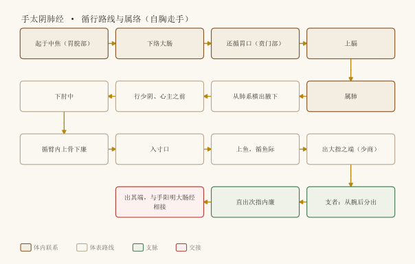

# 第 4 章 · 手太阴肺经（经脉循行·主治概要）

> **源**：`qhzy-经络腧穴学.xlsx` · 表「04 手太阴肺经及其腧穴」 · 源文 5,382 字
> **抽取**：`node scripts/import_textbooks.js --only 经络腧穴学` · sha256 `a630e66b5a4609ab…` · 2026-10-21
> **层次**：本文件是**源教材正文层** —— 节次取自源表的结构列，文字未改写、未压缩、未抽样。改写层（N.3「这个翻译丢掉了什么」/ N.5「争议与本项目立场」）尚未撰写，见 `textbooks/README.md` 章契约。

---

## 4.1 经脉循行

### 4.1.1 循行路线与属络

#### 4.1.1.1 体表路线/体内联系(起于中焦属肺络大肠)

手太阴肺经是十二经脉气血流注的起始之经。经脉起于中焦，属肺络大肠，自胸走手，与手阳明大肠经相为表里。其循行包括体内联系与体表路线两部分，均以《灵枢·经脉》的记载为宗。 体表路线：手太阴肺经起于中焦（胃脘部），向下联络大肠，再返回沿胃上口（贲门部）上行，穿过横膈，入属于肺。从肺系（气管、喉咙部）向外横行至腋窝下，沿上臂内侧下行，循行于手少阴心经与手厥阴心包经之前（即上肢内侧前缘），下至肘中，沿着前臂内侧桡骨尺侧缘下行，经寸口（桡动脉搏动处），行至大鱼际，再沿大鱼际桡侧缘循行，直达拇指末端。其支脉，从手腕后分出，沿食指桡侧直达食指末端，与手阳明大肠经相接。就体表标志而言，本经起于胸部中府穴处（横平第1肋间隙，前正中线旁开6寸），沿上肢内侧前缘下行，止于拇指桡侧端少商穴处。 体内联系：本经起于中焦，向下联络大肠，还循胃口（胃之上口），上膈属肺，并由肺系（气管、喉咙）外行至腋下。其属络关系为属肺而络大肠，体现了肺与大肠相表里的脏腑联系；经脉起于中焦，又表明肺经气血资生于脾胃运化之水谷精微，与“肺朝百脉”的生理特点相呼应。 《灵枢·经脉》所载本经循行原文为：【原文】'肺手太阴之脉，起于中焦，下络大肠，还循胃口'（《灵枢·经脉》），上膈属肺，从肺系横出腋下；【原文】'行少阴、心主之前，下肘中，循臂内上骨下廉，入寸口，上鱼，循鱼际，出大指之端'（《灵枢·经脉》）；其支脉【原文】'其支者：从腕后，直出次指内廉，出其端'（《灵枢·经脉》）。原文中的“胃口”指胃之上口，即贲门部；“肺系”指肺及其相联系的组织器官，包括气管、喉咙等；“上骨”指桡骨。明此三词，则体内循行层次了然于胸。 循行要点可概括为四：其一，走向，本经起于中焦，自胸走手，属阴经，行于上肢内侧前缘，符合“手之三阴，从脏走手”的走向规律；其二，属络，属肺络大肠，与手阳明大肠经相为表里；其三，交接，在食指桡侧端与手阳明大肠经相接，气血流注由肺经始，循环往复，周而复始；其四，分部，上肢内侧前缘为太阴经分布之处，凡上肢内侧前缘疼痛、麻木、活动不利者，多从肺经论治。临床辨治胸肺疾患，亦当首察肺经经脉之虚实。 【现代认识，不改经典原义】子午流注学说认为气血于寅时（3—5时）流注肺经，哮喘、咳嗽等肺系疾病多于此时发作或加重，现代临床观察与之一致，可资辨证参考。 肺经循行的生理意义，可与其功能相联系来理解。肺主气而司呼吸，主宣发肃降，通调水道，外合皮毛，开窍于鼻，咽喉为肺之门户，肺与大肠相为表里。经脉起于中焦，正提示肺之气血资生于脾胃运化的水谷精微；经脉上膈属肺、联络大肠，又为肺主宣降、大肠传化糟粕的功能联系提供了结构基础；经脉经肺系外行于上肢内侧前缘，则咽喉肿痛、缺盆及上肢内侧前缘疼痛诸症，均可据经脉循行加以定位。临床上，水液代谢失常之水肿、小便不利，因肺失宣降、不能通调水道所致者，常取肺经腧穴宣肺利水，即所谓提壶揭盖之法，此亦肺经循行连系水道的运用。 从经络系统的整体看，手太阴肺经为十二经脉气血流注之始。气血自中焦化生，上输于肺，经肺朝百脉而布散周身，故《灵枢》以肺经为十二经之首，气血流注自肺经起始，依次传于手阳明大肠经、足阳明胃经、足太阴脾经……环周不休。掌握肺经在流注次序中的起始地位，对理解全身气血运行与经络辨证的整体观念均有意义。 【现代认识，不改经典原义】从解剖学观察，肺经体表路线大致沿肱二头肌内侧沟、前臂桡侧缘走行，深层有桡动脉、头静脉及前臂外侧皮神经、桡神经浅支等结构，肺经循行线上分布的腧穴如尺泽、孔最、列缺、太渊等，其针刺层次均与上述解剖结构相关，可供临床针刺时参考。 本经腧穴沿循行线自上而下分布：胸部有中府、云门，上臂有天府、侠白，肘部有尺泽，前臂有孔最、列缺、经渠，腕部有太渊，掌部有鱼际，指端有少商。胸部穴近肺脏，主治胸肺病证而兼顾局部；肘以下诸穴为五输穴、原穴、络穴、郄穴之所在，主治范围广，既治本脏病证，又治经脉循行部位病证，为临床最常用者。掌握本经腧穴的分部与特定穴属性，是临床选穴配穴的基础。临床选穴配穴的基础。肺主一身之气，宗气积于胸中，上出喉咙以司呼吸，贯注心脉以行气血。肺经起于中焦而上属肺，正是宗气生成与运行的经气基础；肺经循行于上肢内侧前缘，又为营卫之气运行于体表的路径之一。故肺经功能正常，则呼吸调匀，气血流畅，卫外固密；肺经失常，则呼吸不利，气血运行失和，卫外不固。此与肺经病候相互印证。

### 4.1.2 主要病候

#### 4.1.2.1 咳喘/胸满/缺盆痛等

主要病候是经脉及其所属脏腑发生病变时所反映出的病症，也是经络辨证的依据。手太阴肺经的病候首载于《灵枢·经脉》，历代医家将其归纳为：【原文】'咳嗽，气喘，少气不足以息，咯血，伤风，胸部胀满，咽喉肿痛，缺盆部和手臂内侧前缘痛，肩背部寒冷、疼痛等'（转引自《针灸学》新世纪第4版）。这些病候可分为肺脏病候与经脉病候两类加以认识。 肺脏病候：咳嗽，气喘，少气不足以息，咯血，伤风，胸部胀满，咽喉肿痛。肺主气而司呼吸，主宣发肃降，外合皮毛，开窍于鼻，咽喉为肺之门户。外邪袭表或内伤劳损，肺失宣降，肺气上逆则咳嗽、气喘；肺气亏虚，气不归根则少气不足以息；热伤肺络，血溢脉外则咯血；肺卫不固，腠理疏松，外感风邪则伤风；肺气壅滞，宣降失常则胸部胀满；肺热循经上蒸，搏结咽喉则咽喉肿痛。肺经病候以肺系症状为核心，临床凡见咳、喘、痰、咯血、咽喉肿痛诸症，皆当从肺论治。 经脉病候：缺盆部和手臂内侧前缘痛，肩背部寒冷、疼痛等。缺盆、上肢内侧前缘、肩背均为手太阴肺经循行所过之处，经气运行不利则疼痛；阳气不能温煦则寒冷。所谓经脉所过，病候所及，经脉循行部位的病变，是经络辨证定位的重要依据。 经络辨证应用：临证见咳喘、咯血、咽喉肿痛等症，当结合兼症与舌脉辨其虚实寒热，再定取穴。又《灵枢·经脉》将十二经病候分为是动病与所生病两类，肺经是动病多由外邪引动经气失常所致，以肺胀满、喘咳、缺盆中痛等为特征；所生病多由本脏病变累及经脉所致，除咳喘外，尚见烦心、胸满、掌中热及上肢内侧前缘疼痛厥冷等经脉所过部位的症状。两类病候虽有侧重，其治则总不离调理肺经。 【现代认识，不改经典原义】现代医学的上呼吸道感染、急慢性支气管炎、支气管哮喘、肺炎、咽喉炎、鼻出血等疾病所见的咳、喘、咯血、咽喉肿痛等症状，多与肺经病候相应，临证可参考运用。 肺主皮毛，开窍于鼻，外合卫气。皮毛为一身之藩篱，卫气循行于肌表以抵御外邪；肺气充盛则卫外固密，邪不易侵；肺气亏虚则腠理疏松，卫外不固，外邪乘虚而入，首先犯肺，故肺经病候每以恶风、伤风、咳嗽为先。季节气候亦与肺经病候相关，秋季燥气当令，燥邪最易伤肺，故秋令咳喘、咽干口燥者多见，临证当顺时辨证。 肺经病候还常涉及相关脏腑的兼病。肺病及脾者，脾肺气虚，可见咳喘日久、气短乏力、纳少便溏，治当培土生金，取肺经穴配足太阴脾经穴同用；肺病及肾者，肾不纳气，可见呼多吸少、动则喘甚，治当补肾纳气，肺肾同治；肺失肃降，腑气不通，则可见咳嗽气喘兼大便秘结，而大肠腑热上蒸，亦可致咳喘咽痛，此即肺与大肠相表里的病理体现，临证可表里两经同取。 就咳嗽一证而言，辨其虚实寒热，取穴各异：风寒束肺者，咳声重浊，痰白清稀，鼻塞流清涕，恶寒无汗，苔薄白，治宜疏风散寒、宣肺止咳，配风门、合谷；风热犯肺者，咳痰黄稠，咽痛口渴，身热，舌尖红苔薄黄，治宜疏风清热、肃肺化痰，配大椎、曲池；痰湿蕴肺者，咳嗽痰多色白易咯，胸闷脘痞，苔白腻，治宜健脾化痰，配丰隆、中脘；肺气虚者，咳喘无力，气短声低，自汗畏风，治宜补益肺气，配肺俞、膏肓、足三里；肺阴虚者，干咳少痰，咽干声嘶，潮热盗汗，治宜滋阴润肺，配太溪、照海。据此辨证明理，再定补泻刺法，方能中的。 此外，上肢内侧前缘、缺盆部的按诊亦属经络诊察的内容，凡循经出现压痛、条索或结节等阳性反应者，多提示肺经气血运行失常，可结合病候辨证，为选穴治疗提供参考。 肺开窍于鼻，喉为肺之门户，故肺经病候虽以咳喘为中心，鼻部与咽喉症状亦常并见，如鼻塞、流涕、鼻衄、声嘶、失音等，临床治疗鼻病、咽喉病，多从肺经入手，天府治鼻衄、鱼际少商治咽喉肿痛即其例证。又肺主气而朝百脉，肺气贯注心脉以行血，肺病日久，气病及血，可见唇绀、爪甲青紫等血行瘀滞之象，临证当肺心同治，兼以活血通脉。脉。肺经病候与现代医学的呼吸系统疾病多有对应：支气管哮喘发作时可见咳喘、胸闷、张口抬肩，与肺经病候之咳喘、胸部胀满相合；慢性支气管炎、慢性阻塞性肺疾病患者常见久咳、气短、动则喘甚，与少气不足以息相应；肺结核、支气管扩张之咯血，属热伤肺络之变；反复上呼吸道感染，则与肺卫不固、伤风频作同义。【现代认识，不改经典原义】现代研究表明，肺系疾病患者上肢内侧前缘可出现压痛等阳性反应，针刺肺经腧穴对气道炎症与支气管痉挛有一定缓解作用，可作辅助治疗参考。

## 4.2 主治概要

### 4.2.1 主治特点

#### 4.2.1.1 肺系/咽喉/经脉循行部位病证

本经腧穴的主治范围与其主要病候相应，可概括为肺系病证与经脉循行部位的其他病证两大类。 1.肺系病证：咳嗽，气喘，咽喉肿痛，咯血，胸痛等。【原文】'咳嗽，气喘，咽喉肿痛，咯血，胸痛等'（转引自《针灸学》新世纪第4版）肺主气而司呼吸，肺经腧穴多能宣肺、肃肺、清肺、补肺，故凡肺失宣降之咳嗽气喘，肺热伤络之咯血，肺热上攻之咽喉肿痛，肺气壅滞之胸痛，皆可取本经腧穴治疗。本经是治疗肺系疾病的主选经脉，临床上呼吸道感染、支气管炎、支气管哮喘、肺炎、咯血、急慢性咽炎等病证，均常选用肺经腧穴。 2.经脉循行部位的其他病证：肩背痛，肘臂挛痛，手腕痛等。【原文】'肩背痛，肘臂挛痛，手腕痛等'（转引自《针灸学》新世纪第4版）本经循行于缺盆、上肢内侧前缘、鱼际等处，经脉所过，主治所及，故肩背痛、肘臂挛痛、手腕痛以及本经循行部位的麻木、活动不利诸症，均可取本经腧穴治疗。 主治特点与特定穴的运用：本经腧穴主治与特定穴属性密切相关，掌握特定穴理论是运用本经穴的门径。中府为肺之募穴，肺气汇聚之处，善治胸肺病证；尺泽为合穴，善清肺热、泄肺实，又善治急症，故急性吐泻、中暑、小儿惊风等急症多用之；孔最为郄穴，郄穴善治本经所属脏腑的急性病证，尤善治血证，故孔最为止血要穴，主治咯血、鼻衄；列缺为络穴，又为八脉交会穴（通于任脉），既能治本经病证，又善治头项、咽喉等病证，《四总穴歌》所谓【原文】'肚腹三里留，腰背委中求，头项寻列缺，面口合谷收'（转引），即指列缺为治头项强痛之要穴；太渊为输穴、原穴，又为八会穴之脉会，肺虚证“虚则补其母”，太渊为肺经母穴，故善补肺气，又主无脉症；鱼际为荥穴，善清肺热、利咽喉；少商为井穴，多用于急症、热证，点刺出血可泄热开窍。 本经主治与表里经的关系：肺与大肠相表里，经脉互相络属，故肺经腧穴亦可调治大肠及阳明经病变，如尺泽治急性吐泻即为其例；反之，手阳明大肠经的合谷、商阳等穴亦常用于肺系病证，临证可表里配穴、前后呼应。 【现代认识，不改经典原义】现代临床观察表明，针刺尺泽、太渊、列缺等穴对支气管哮喘患者的肺通气功能有一定改善作用，对慢性支气管炎、咽喉炎等病的症状缓解亦有帮助，可作辅助治疗参考。 为便于临床应用，兹将本经11穴的主治特点总览如下：中府、云门均治咳嗽、气喘、胸痛等胸肺病证及肩背痛；天府治咳嗽、气喘、鼻衄、瘿气及上臂痛；侠白治咳嗽、气喘、心痛、干呕及上臂痛；尺泽治肺系实热病证及肘臂挛痛、急性吐泻、中暑、小儿惊风等急症；孔最治咯血、鼻衄、咳嗽、气喘、咽喉肿痛及肘臂挛痛；列缺治肺系病证、头面诸疾及手腕痛；经渠治咳嗽、气喘、胸痛、咽喉肿痛及手腕痛；太渊治咳嗽、气喘、无脉症及腕臂痛；鱼际治咽喉肿痛、失音、咯血、掌中热及小儿疳积；少商治咽喉肿痛、鼻衄、高热及昏迷、癫狂等急症。综观之，本经腧穴主治不离肺系与经脉循行部位两端，惟各穴因特定穴属性不同而各有侧重。 本经五输穴的五行属性，与补母泻子法的运用关系密切：少商为井穴属木，鱼际为荥穴属火，太渊为输穴属土，经渠为经穴属金，尺泽为合穴属水。肺属金，金生水而土生金，故肺经实证、热证，实则泻其子，当取子穴尺泽清泻肺热；肺经虚证，虚则补其母，当取母穴太渊补益肺气。此即五输穴五行生克规律在肺经的具体运用，临床选穴时可资参考。 原穴与络穴的配伍亦为肺经常用：太渊为肺经原穴，列缺为肺经络穴，表里经原络配穴以太渊配偏历，可调理肺与大肠两经；本经原络配穴以太渊配列缺，可调补肺气而通调水道。凡肺系疾患兼见便秘、腹泻者，可取表里经穴同调，以复肺与大肠的正常生理联系。 【现代认识，不改经典原义】据现代临床观察，肺经腧穴治疗上呼吸道感染、急慢性支气管炎、支气管哮喘、慢性咽炎、扁桃体炎、鼻出血等疾病均有一定疗效，其中尺泽、孔最、列缺、太渊、鱼际、少商为最常用穴，可作辅助治疗参考。 运用本经腧穴，尚须把握虚实补泻的原则。肺经病证属实、属热者，多取尺泽、少商、鱼际等穴，用泻法或点刺出血，以清泻肺热、泄肺降逆；属虚者，多取太渊、中府等穴，用补法并加灸，以补益肺气。哮喘发作期以宣肺平喘为要，缓解期以补肺固表为要，标本缓急，各有其治。临证又当结合患者体质、病程与新久，权衡针刺深浅、留针时间与艾灸壮数，方为善治。

---

> **免责声明**：本教材内容仅用于教育与科研，不构成任何诊疗建议。
> 本文件由 `scripts/import_textbooks.js` 从源工作簿生成，请勿手改 —— 需要修改请改源工作簿后重跑。
