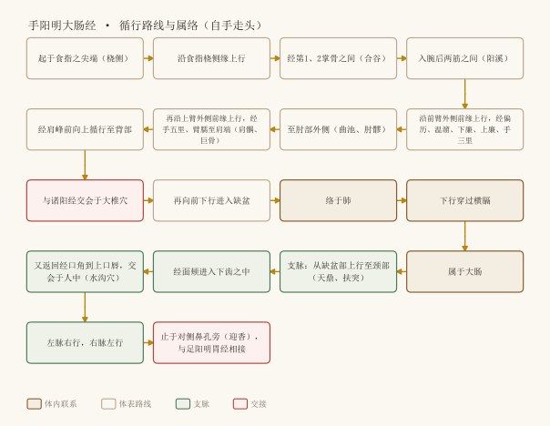

# 第 5 章 · 手阳明大肠经（经脉循行·主治概要）

> **源**：`qhzy-经络腧穴学.xlsx` · 表「05 手阳明大肠经及其腧穴」 · 源文 4,930 字
> **抽取**：`node scripts/import_textbooks.js --only 经络腧穴学` · sha256 `a630e66b5a4609ab…` · 2026-10-21
> **层次**：本文件是**源教材正文层** —— 节次取自源表的结构列，文字未改写、未压缩、未抽样。改写层（N.3「这个翻译丢掉了什么」/ N.5「争议与本项目立场」）尚未撰写，见 `textbooks/README.md` 章契约。

---

## 5.1 经脉循行

### 5.1.1 循行路线与属络

#### 5.1.1.1 起于商阳/属大肠络肺

手阳明大肠经，简称大肠经，与手太阴肺经互为表里，属大肠，络肺。本经起于食指桡侧端的商阳穴，止于对侧鼻翼旁的迎香穴，左右各20穴。十二经脉气血流注，手太阴肺经之后即传于手阳明大肠经，肺经起于中焦、下络大肠，故肺与大肠脏腑表里、经脉相接，大肠的传导功能有赖于肺气之宣降，肺气的肃降亦需大肠通降之配合。临床上肺系病证与大肠传导失常常相互影响、互为因果，故本经腧穴既治大肠腑病，亦常用于肺经病证的配合治疗，如咳嗽气喘兼见便秘者，通腑即可降肺气。 循行路线：手阳明大肠经起于食指之尖端（桡侧），沿食指桡侧缘上行，经第1、2掌骨之间（合谷），入腕后两筋之间（阳溪），沿前臂外侧前缘上行，经偏历、温溜、下廉、上廉、手三里，至肘部外侧（曲池、肘髎），再沿上臂外侧前缘上行，经手五里、臂臑至肩端（肩髃、巨骨），经肩峰前向上循行至背部，与诸阳经交会于大椎穴，再向前下行进入缺盆，络于肺，下行穿过横膈，属于大肠。其支脉，从缺盆部上行至颈部（天鼎、扶突），经面颊进入下齿之中，又返回经口角到上口唇，交会于人中（水沟穴），左脉右行，右脉左行，止于对侧鼻孔旁（迎香）。 《灵枢·经脉》对本经循行有系统记载：【原文】'大肠手阳明之脉，起于大指次指之端，循指上廉，出合谷两骨之间'（《灵枢·经脉》），注家认为“合谷两骨”指第1、2掌骨；【原文】'上出于柱骨之会上，下入缺盆，络肺'（《灵枢·经脉》），“柱骨之会上”指大椎穴处，经脉于此与诸阳经交会，然后下入缺盆，络肺，下膈，属大肠；【原文】'从缺盆上颈，贯颊，入下齿中；还出夹口，交人中'（《灵枢·经脉》），其中“两筋”指拇长伸肌腱、拇短伸肌腱，故前臂段行于两筋之间；【原文】'左之右、右之左，上夹鼻孔'（《灵枢·经脉》），说明本经左右交叉，左脉行向右、右脉行向左，分别上夹对侧鼻孔，这是十二经脉中仅见的两条经脉左右交叉现象之一，与任脉人中等穴的交通作用相呼应。 综观本经循行，其体内联系以属大肠、络肺为核心，并联络下齿与鼻；体表循行集中于食指、上肢外侧前缘、肩部及头面。经脉所过，主治所及，故本经腧穴对下齿、鼻、咽喉、肩臂等部位的病证具有特殊治疗意义：上肢部穴主治循行部位的疼痛、麻木、不遂，头面部穴主治五官病证。临床循经取穴时，当把握本经“起于商阳，止于迎香”的起止特点与“左之右、右之左”的交叉分布规律，并注意与手太阴肺经表里相配、上下相应，如大肠腑病取合谷、曲池，肺气不降之咳喘亦可配合本经腧穴通腑降逆。本节要点：手阳明大肠经起于商阳，止于迎香，属大肠、络肺，联系下齿与鼻，左右各20穴；经脉行于上肢外侧前缘，上出柱骨之会（大椎）后入缺盆、络肺、下膈属大肠，支脉贯颊入下齿，左右交叉上夹鼻孔。 手阳明大肠经之名，包含三层含义：“手”指经脉循行于上肢，“阳明”取阳气隆盛、两阳合明之义，“大肠经”则因本经属大肠而得名。本经在十二经脉流注次序中位居手太阴肺经之后、足阳明胃经之前。肺经之脉起于中焦，下络大肠，还循胃口，其脉气由中府、云门下行至拇指端少商，经别支由列缺别出，沿食指端与大肠经衔接；大肠经之脉则止于对侧鼻旁迎香，与起于鼻旁的足阳明胃经相接，形成手阳明与足阳明同名经首尾相贯之局。同名经气血相通、同气相求，故头面部病证常手足阳明经穴同取，如齿痛取下关、颊车（足阳明）配合谷（手阳明），口眼歪斜取地仓、四白（足阳明）配迎香、合谷（手阳明），此即同名经配穴法在大肠经的具体运用。 本经腧穴分布集中于上肢外侧前缘与头面部：食指桡侧有商阳、二间、三间，第2掌骨桡侧为合谷，腕背桡侧为阳溪，前臂外侧前缘依次为偏历、温溜、下廉、上廉、手三里，肘外侧为曲池、肘髎，上臂外侧前缘为手五里、臂臑，肩部为肩髃、巨骨，颈部为天鼎、扶突，面部为口禾髎、迎香。定穴时宜以骨度分寸为基准：肘横纹至腕横纹为12寸，前臂诸穴即按此折量，如偏历在腕上3寸、手三里在肘下2寸、曲池在肘横纹与肱骨外上髁连线中点；肩臂部穴位则结合体表标志取定，如肩髃在肩峰外侧缘前端与肱骨大结节之间的凹陷中。掌握“起于商阳，止于迎香”的起止规律与穴位的纵向排列顺序，对循经取穴、按序记忆均有裨益。 中医学认为，大肠为“传导之官”，主传化糟粕、吸收津液，其功能赖胃之降浊、肺之肃降与脾之运化共同维系。大肠传导正常，则腑气通降，浊阴下行；传导失司，则糟粕停聚，或为便秘，或为泄泻。手阳明大肠经属大肠、络肺，经脉之气与大肠功能息息相关，故调理本经腧穴即可恢复大肠传导之职，此为本经治疗肠腑病证的生理基础。

### 5.1.2 主要病候

#### 5.1.2.1 齿痛/颈肿/肩臂痛等

手阳明大肠经主要病候，是指本经及其所属大肠发生病变时所表现出的证候群。《灵枢·经脉》将经脉病候分为“是动病”与“所生病”两类，后世针灸教材结合临床实际，将本经主要病候归纳为：【原文】'腹痛，肠鸣，泄泻，便秘，痢疾，咽喉肿痛，齿病，鼻流清涕或出血，本经循行部位疼痛、热肿或寒冷等。'（转引自《针灸学》新世纪第4版） 分析上述病候，可归纳为三类。其一，大肠腑病候：腹痛，肠鸣，泄泻，便秘，痢疾等。大肠为传导之官，主传化糟粕，其功能失常则传导失司、清浊不分，故见泄泻、便秘、痢疾；腑气壅滞、气机不畅则腹痛、肠鸣。其二，经脉所过部位的病候：齿病，咽喉肿痛，鼻流清涕或出血等。本经入下齿中、贯颊、上夹鼻孔，故下齿、咽喉、鼻部病变常反映于本经；又因经脉左右交叉，一侧受邪亦可出现对侧症状。其三，经气运行失常的循行部位病候：本经循行部位（手指、前臂、上臂、肩部）疼痛、热肿或寒冷等，经气阻滞不通则痛，气血壅滞化热则热肿，阳气不能温煦则寒冷。 在病候辨识上，应注意本经与相关脏腑经络的鉴别联系。足阳明胃经入上齿，手阳明大肠经入下齿，故临床辨治齿痛当分清上下：下齿痛多取手阳明经穴，上齿痛多取足阳明经穴。肺与大肠相表里，大肠经气不利可影响肺气宣降，临床可见咳嗽、气喘与肠腑病证并见；肺失宣降、津液不布，亦可致大肠传导失常而见便秘，故治疗常肺肠同治、表里兼顾。鼻流清涕或出血既见于大肠经病候，亦为肺经病候常见表现，临证宜结合脏腑辨证综合分析，不可拘于一经。 现代临床观察提示，针刺大肠经腧穴对肠道运动功能具有双向调节作用，对腹泻、便秘、肠易激综合征等病证的辅助治疗已为临床实践所证实（现代认识，不改经典原义）。本节要点：大肠经主要病候分三类——肠腑传导失常之腹痛、肠鸣、泄泻、便秘、痢疾，经脉所过之齿病、咽喉肿痛、鼻流清涕或出血，以及循行部位疼痛、热肿或寒冷；辨治齿痛当分上下齿，并注意肺与大肠的表里关系。 从病候的经典源流看，《灵枢·经脉》将经脉病候分为“是动病”与“所生病”两类。所谓是动病，指经脉受邪、经气变动失常所表现的病候，多与经脉循行部位相关；所生病，指本经所属脏腑及相关组织器官发生病变所表现的病候。据此，本经是动病以齿痛、颈肿为主；所生病则以津液所生病为主，可见目黄、口干、鼻流清涕或出血、喉痹，以及肩前臑痛、大指次指痛不用等。教材所载“本经循行部位疼痛、热肿或寒冷”，正与经气有余则当脉所过之处热肿、经气虚则寒栗不复之旨相合，提示本经病候有寒热虚实之辨：热肿者多属经气有余之实热，寒冷者多属经气不足之虚寒，临床当据其寒热以别虚实，分别采用清热泻火与温经散寒之法。 在病候的临床运用上，可循经辨证取穴：下齿痛取合谷、三间；咽喉肿痛取商阳、合谷，点刺商阳出血尤宜于急性发作；鼻流清涕或出血取迎香、合谷；腹胀、腹痛、泄泻、痢疾等肠腑病证取曲池、手三里、天枢；肩臂疼痛不遂取肩髃、曲池、臂臑；上肢麻木酸痛取循行线上的局部腧穴。同时注意表里经同治：肺与大肠相表里，咳喘痰多兼便秘者，通腑降气即可助肺气肃降；大肠腑气不通而致肺气上逆者，亦当通腑以平喘。此外，本经病候的辨治还当与足阳明胃经病候相鉴别，如齿痛须分上下齿，鼻病须辨属肺属肠，咽喉病须察热毒之轻重，如此方能切中病机、取穴精当。 在病机的把握上，泄泻、痢疾虽同为肠腑病证，其病机有别：泄泻多因脾失健运、湿浊下注，或大肠传导失常、清浊不分所致；痢疾则以湿热或寒湿之邪蕴结大肠、气血凝滞为主，故见下利赤白、里急后重。肠鸣一症，多系气滞湿停、肠间气液相击漉漉有声之象。临床辨治时，泄泻宜健脾化湿、调理肠腑，痢疾宜清化湿热、调气和血，均可以本经曲池、手三里等穴为主，配合足阳明经天枢、上巨虚（大肠下合穴）等穴施治，以恢复大肠传导功能。

## 5.2 主治概要

### 5.2.1 主治特点

#### 5.2.1.1 头面五官/热病/肠腑病证

手阳明大肠经腧穴的主治特点，取决于本经的循行分布、属络关系及阳明经的生理特性，概括起来有四个方面。 其一，头面五官病证。本经循行经过下齿、面颊、鼻及咽喉，故其腧穴主治目病、齿痛、咽喉肿痛、鼻衄、口眼歪斜、耳聋等头面五官病证，其中尤以下齿痛、鼻病与咽喉病为特长。《四总穴歌》云：【原文】'肚腹三里留，腰背委中求，头项寻列缺，面口合谷收'（《四总穴歌》），“面口合谷收”概括了合谷这一手阳明经原穴对头面口齿诸疾的卓著疗效，是“经脉所过，主治所及”取穴原则的典型体现。 其二，热病、神志病证。阳明为多气多血之经，阳气隆盛，故本经腧穴善治热病，主治热病昏迷、眩晕、癫狂等病证（【原文】'热病昏迷，眩晕，癫狂等'（转引自《针灸学》新世纪第4版））。临床高热、神昏、癫狂痫等病常取商阳、合谷、曲池等穴清热泻火、醒神开窍，商阳点刺出血尤为急症常用。 其三，肠腑病证。本经属大肠，其腧穴主治腹胀、腹痛、肠鸣、泄泻等肠腑病证（【原文】'腹胀，腹痛，肠鸣，泄泻等'（转引自《针灸学》新世纪第4版））。大肠主传导糟粕，取合谷、手三里、曲池等穴可调理肠腑气机、恢复传导功能，属“合治内腑”与循经远道取穴的范畴。 其四，经脉循行部位的其他病证。本经腧穴主治手臂酸痛、半身不遂、手臂麻木等病证（【原文】'手臂酸痛，半身不遂，手臂麻木等'（转引自《针灸学》新世纪第4版））。上肢外侧前缘为经脉所过，经气不利则见酸痛、麻木、不遂，取本经循行线上腧穴以疏通经络、调和气血。 此外，阳明经多气多血，主润宗筋、束骨而利机关，故上肢痿痹之证亦常取本经腧穴，体现了【原文】'治痿独取阳明'（转引自《针灸学》新世纪第4版）的治法思想，临床治疗痿证、痹证常以手足阳明经穴为主。本经经穴歌概括其起止与主治范围：【原文】'LI二十手大肠，起于商阳止迎香，头面眼鼻口齿喉，皮肤神热与胃肠'（手阳明大肠经经穴歌）——“头面眼鼻口齿喉”指头面五官病证，“皮肤”指瘾疹、湿疹、疥癣等皮肤病证，“神热”指神志病与热病，“胃肠”指肠腑病证，二十穴的主治范围尽括其中。本节要点：大肠经腧穴主治头面五官病、热病神志病、肠腑病证及经脉循行部位病证四大类，面口合谷收为其代表规律；阳明多气多血，又为治痿要经。 本经腧穴主治体现了腧穴主治作用的一般规律。其一为近治作用，即腧穴能治疗其所在部位及邻近组织器官的病证，如迎香治鼻病、肩髃治肩臂病、阳溪治腕痛、天鼎扶突治咽喉病，皆属局部取穴。其二为远治作用，即腧穴能治疗其所属经脉循行所及远隔部位的病证，如合谷治头面五官病、商阳治咽喉病，均以经脉循行为依据，属循经远道取穴。其三为特定穴的特殊作用，如井穴商阳善治热证急症，原穴合谷善治脏腑及头面病证，郄穴温溜善治急症，合穴曲池善治六腑病证。把握这三个层次，方能灵活运用本经腧穴。 此外，本经腧穴还常用于瘾疹、湿疹、疥癣等皮肤外科病证，其中以曲池、合谷最为常用。阳明经多气多血而主肌肉，皮肤病多与风邪外袭、血热蕴结有关，取曲池、合谷可清热祛风、调和营血，配血海、三阴交则凉血养血之功更著。现代临床观察表明，针刺曲池、合谷等穴对炎症反应与体温调节具有一定影响，对瘾疹、湿疹等过敏性皮肤病的辅助治疗有一定作用（现代认识，不改经典原义）。 在具体取穴上，本经治头面五官病证常据病位选穴：鼻塞、鼻衄取迎香、合谷；下齿痛取合谷、三间；咽喉肿痛取商阳、合谷；目赤肿痛取合谷、阳溪；耳聋耳鸣取合谷、阳溪等。口眼歪斜（面瘫）为临床常见病证，常取本经迎香、合谷，配合足阳明经地仓、颊车、阳白等穴治疗，急性期针刺手法宜轻，恢复期可配合电针与功能锻炼，以提高疗效。

---

> **免责声明**：本教材内容仅用于教育与科研，不构成任何诊疗建议。
> 本文件由 `scripts/import_textbooks.js` 从源工作簿生成，请勿手改 —— 需要修改请改源工作簿后重跑。
