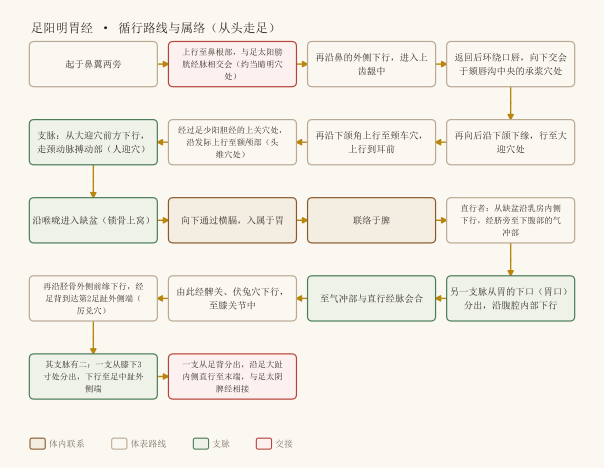

# 第 6 章 · 足阳明胃经（经脉循行·主治概要）

> **源**：`qhzy-经络腧穴学.xlsx` · 表「06 足阳明胃经及其腧穴」 · 源文 7,801 字
> **抽取**：`node scripts/import_textbooks.js --only 经络腧穴学` · sha256 `a630e66b5a4609ab…` · 2026-10-21
> **层次**：本文件是**源教材正文层** —— 节次取自源表的结构列，文字未改写、未压缩、未抽样。改写层（N.3「这个翻译丢掉了什么」/ N.5「争议与本项目立场」）尚未撰写，见 `textbooks/README.md` 章契约。

---

## 6.1 经脉循行

### 6.1.1 循行路线与属络

#### 6.1.1.1 起于承泣/属胃络脾

足阳明胃经简称胃经，属十二经脉之一，与足太阴脾经互为表里，属胃络脾，是十二经脉中循行较长、腧穴较多的经脉之一，左右各45穴。本经从头面部起始，纵贯头面、颈项、胸腹及下肢外侧前缘，为多气多血之经。胃为“水谷之海”，主受纳、腐熟水谷，脾主运化、升清，脾胃相合而为气血生化之源，故胃经气血充盛，临床既可调理胃肠、益气养血，又可清泄阳明实热，应用十分广泛。 一、体表循行路线。足阳明胃经起于鼻翼两旁，上行至鼻根部，与足太阳膀胱经脉相交会（约当睛明穴处），再沿鼻的外侧下行，进入上齿龈中；返回后环绕口唇，向下交会于颏唇沟中央的承浆穴处；再向后沿下颌下缘，行至大迎穴处，再沿下颌角上行至颊车穴，上行到耳前，经过足少阳胆经的上关穴处，沿发际上行至额颅部（头维穴处）。其支脉：从大迎穴前方下行，走颈动脉搏动部（人迎穴），沿喉咙进入缺盆（锁骨上窝），向下通过横膈，入属于胃，联络于脾。其直行的经脉：从缺盆沿乳房内侧下行，经脐旁至下腹部的气冲部；另一支脉从胃的下口（胃口）分出，沿腹腔内部下行，至气冲部与直行经脉会合。由此经髀关、伏兔穴下行，至膝关节中；再沿胫骨外侧前缘下行，经足背到达第2足趾外侧端（厉兑穴）。其支脉有二：一支从膝下3寸处分出，下行至足中趾外侧端；一支从足背分出，沿足大趾内侧直行至末端，与足太阴脾经相接。 《灵枢·经脉》载其循行云：【原文】'旁约太阳之脉，下循鼻外，入上齿中，还出夹口，环唇，下交承浆，却循颐后下廉，出大迎，循颊车，上耳前，过客主人'（《灵枢·经脉》）；又云：【原文】'其支者：从大迎前，下人迎，循喉咙，入缺盆，下膈，属胃，络脾。其直者：从缺盆下乳内廉，下夹脐，入气街中。其支者：起于胃口，下循腹里，下至气街中而合'（《灵枢·经脉》）。经文所谓“气街”，即气冲部，当腹股沟股动脉搏动处；“客主人”即上关穴。足阳明经的经别、经筋、络脉分布与经脉大体一致：足阳明络脉（丰隆之别）自外踝上8寸处别出，走向足太阴脾经，沟通表里两经；足阳明经筋分布于面、腹及膝胫部，其病候多表现为拘挛、转筋、肿痛等。 二、体内属络联系。胃经属胃，络脾。经脉自缺盆下膈属胃络脾，其直行者又下乳内廉、夹脐入气街，故本经与脾胃运化、气血生化及乳房、腹部的关系最为密切；头面部循行联络鼻、目、上齿、口唇、面颊、耳前、额颅诸部，故胃经病变既可表现为脘腹胃肠症状，又可出现头面五官诸症。胃为“水谷之海”，主受纳、腐熟水谷，【原文】'胃为水谷之海，是营气、卫气的化源之地'（转引自《针灸学》新世纪第4版），脾胃为后天之本、气血生化之源，故调理胃经腧穴亦为治疗气血亏虚诸证的重要途径。胃经循行所过，亦是阳明经气与阳明胃火循经上炎、下注的通路，齿痛、鼻衄、面瘫、乳痈、膝胫肿痛等病证的病机多与此相关。 三、循行要点。（1）起止与交接：起于鼻旁，止于足第2趾外侧端厉兑穴，首穴为承泣（ST1），末穴为厉兑（ST45）；其支脉在足大趾末端与足太阴脾经相接，构成脾胃表里经的经气流注关系。（2）属络：属胃，络脾。（3）头面联络：行经鼻根、上齿、口唇、下颌、耳前、额颅，与目、鼻、口、齿等官窍联系广泛，故本经腧穴善治头面五官病。（4）躯干线路：缺盆—乳内廉—夹脐—气街，胸腹部穴位沿前正中线旁开2寸（不容至气冲）与旁开4寸（气户至乳根）两条纵线排列。（5）下肢线路：髀关、伏兔、阴市、梁丘、犊鼻、足三里、上巨虚、条口、下巨虚、丰隆、解溪、冲阳、内庭、厉兑依次分布于大腿前外侧、膝、胫前与足背，多为止痛、调肠胃、治痿痹之要穴。 胃经循行的临床意义有三：其一，为头面五官病的远道取穴提供依据，如齿痛取内庭、颊车，鼻衄取厉兑，目疾取承泣、四白，皆因胃经循行所过；其二，为胸腹脏腑病提供局部与远道结合的取穴思路，腹部穴（如天枢、梁门）近取以治胃肠，下肢穴（如足三里、上巨虚）远道以调六腑；其三，为下肢痿痹、半身不遂等病证的循经取穴奠定基础，阳明为多气多血之经，主润宗筋、束骨而利机关，故痿证、偏瘫多取髀关、伏兔、足三里、丰隆等阳明经穴。足阳明胃经与足太阴脾经相为表里，同主中焦。胃主受纳、腐熟水谷，脾主运化、输布精微，脾胃升降相因、燥湿相济，共同完成饮食物的消化吸收与精微输布，故脾胃为后天之本、气血生化之源。胃经气血充盛与否，常反映于面部色泽与脉象，临证察色按脉、辨胃气之盛衰，亦是运用胃经腧穴的重要依据。 本节要点：足阳明胃经起于鼻旁，属胃络脾，循行于头面、胸腹及下肢外侧前缘，左右各45穴，为多气多血之经；其循行联络鼻、目、上齿、口唇、面颊、耳前、额颅诸官窍，下通脾胃与乳房腹部，理解经脉循行是掌握本经腧穴定位与主治规律的基础。 本经经别、经筋、络脉的具体分布如下。足阳明经别：从足阳明经脉髀部别出，上行入腹里，属胃，散络于脾，上通于心，再上行沿咽部出于口，上至鼻根、目系，还系目系；足阳明经筋：起于足次趾、中趾，结于足跗，上结于膝外廉，结于髀枢，上循胁肋属脊，其直者上结于缺盆，上颈、上合于颧部，下属结于鼻，上合于太阳经脉，其病候可见足中趾支胫转筋、脚跳坚、腹筋急、引缺盆及颊、卒口僻等。胃经与诸经交会亦多：承泣为阳跷脉、任脉交会穴，地仓为阳跷脉、手足阳明经交会穴，下关为足阳明、足少阳经交会穴，头维为足少阳、阳维脉交会穴，上关（客主人）为足阳明、足少阳、手少阳、足太阳之交会，人迎、气冲等穴又正当动脉搏动处，取穴与操作须予注意。掌握经别、经筋、络脉与交会穴，有助于理解本经与脾、心、目、口、齿等脏腑官窍的广泛联系及本经腧穴的多种主治。 胃经与脾胃的关系，还体现在经脉气血的流注节律上。十二经脉气血流注，起于手太阴肺经，依次传至手阳明大肠经、足阳明胃经……终于足厥阴肝经，复注于肺，如环无端；胃经纳于辰时，为阳明经气旺盛之时，故调理脾胃、治疗胃肠病证，可结合子午流注理论择时取穴，如辰时取足三里、天枢等穴，可助阳明经气旺盛、提高疗效（现代认识，不改经典原义，可作参考）。胃经的腧穴定位，头面、胸腹、下肢诸穴多以体表标志与骨度分寸为准：头面部穴以五官标志取穴，如承泣、四白以目正视、瞳孔直下定位，地仓在口角旁0.4寸，颊车在下颌角前上方咬肌隆起处，下关在颧弓下缘凹陷中，头维在额角发际直上0.5寸；胸腹部穴以胸骨角、肋间隙、脐、耻骨联合等标志结合前正中线旁开寸数定位，如天枢在脐旁2寸，梁门在脐上4寸旁开2寸；下肢穴以髌底、胫骨前嵴、外踝尖等标志结合骨度分寸定位。取穴准确是针刺取效的前提，学习本经腧穴宜反复揣穴，体会穴下凹陷、条索、动脉搏动等指下感觉，做到“宁失其穴，勿失其经”，循经取穴方能有的放矢。

### 6.1.2 主要病候

#### 6.1.2.1 胃痛/腹胀/头面五官病候等

经脉病候是经脉循行及所属脏腑功能失调所反映的证候，是循经辨证、循经取穴的直接依据。《灵枢·经脉》在每条经脉循行之后均记载其病变，后世将其概括为“是动病”与“所生病”两类，前者多指经脉本身经气变动所生之病，后者多指经脉所属脏腑的病变；足阳明胃经的病候亦循此例，可据以辨经、选穴。 一、主要病候。本经主要病候为：【原文】'肠鸣，腹胀，水肿，胃痛，呕吐或消谷善饥，口渴，咽喉肿痛'（转引自《针灸学》新世纪第4版），以及鼻衄、热病、癫狂（新世纪第4版作“发狂”，两说并存[待核实]），胸、膝等本经循行部位疼痛等症。上述病候大体可分四类：其一为胃肠运化失常所致，如肠鸣腹胀、胃痛呕吐、消谷善饥、口渴、水肿等，盖胃主受纳、腐熟水谷，胃气以降为和，胃失和降则胃痛呕吐，受纳腐熟失常则消谷善饥或食欲不振，运化不及则水湿内停而为肠鸣、腹胀、水肿；其二为经脉循行部位经气不利或阳明热盛所致，如咽喉肿痛、鼻衄、齿痛及胸、膝等本经循行部位疼痛等，盖阳明为多气多血之经，胃火循经上炎，熏灼咽喉鼻齿，则见咽喉肿痛、鼻衄、齿痛；其三为热病及神志病，如热病汗出、癫狂等，盖阳明热盛，热扰心神，或胃中痰火蒙蔽清窍，则发为癫狂；其四为水液输布失常之水肿，与脾胃运化水湿功能失调密切相关。 二、病候的辨证意义。胃经病候有虚实寒热之异：胃气虚弱者，多见食少纳呆、腹胀便溏、面色少华，可取足三里、天枢等穴健脾和胃；胃火炽盛者，多见消谷善饥、口渴引饮、齿痛龈肿、口臭便秘，可取内庭、厉兑、足三里等穴清泄胃火；胃阴不足者，多见胃脘灼痛、饥不欲食、干呕呃逆，可针补足三里、三阴交等穴养阴和胃；寒邪犯胃者，多见胃脘冷痛、呕吐清水，宜灸中脘、足三里温中散寒。凡此皆以胃及胃经病机为纲，循经选穴，体现了经络辨证与脏腑辨证相结合的原则。 三、病候的临床意义。临证凡见本经循行部位或脾胃所主病证，皆可循经辨证，取本经腧穴治疗：脘腹胃肠病证，取足三里、天枢、梁丘、上巨虚等穴；头面五官病证，取承泣、四白、地仓、颊车、下关、头维及远端内庭、厉兑等穴；癫狂等神志病证，取足三里、丰隆、内庭、厉兑等穴清泄阳明、豁痰开窍；下肢痿痹及膝胫肿痛，取梁丘、足三里、上巨虚、条口、丰隆、解溪等穴。本经腧穴除上述病候所主诸病外，对胃气上逆之呃逆、嗳气，胃络瘀阻之胃脘刺痛，以及阳明腑实之腹满、便秘等，亦有较好疗效，可据证选用足三里、天枢、内庭、丰隆等穴。如此以经统穴、以穴应症，体现了“经脉所过，主治所及”的辨证取穴规律。 本节要点：胃经主要病候为肠鸣、腹胀、水肿、胃痛、呕吐或消谷善饥、口渴、咽喉肿痛、鼻衄、热病、癫狂及胸、膝等循行部位疼痛等症，可分胃肠运化失常、阳明热盛循经上炎、热扰心神及水液输布失常四类辨治；临证循经辨证，取本经腧穴远近相配治疗。 “是动病”与“所生病”的划分，源于《灵枢·经脉》对各经病候的记述，体现了经脉病候与脏腑病候、经络辨证与脏腑辨证的密切关系。就胃经而言，其是动病多反映胃经经气变动之症，如恶人与火、闻木声则惕然而惊、心欲动、独闭户塞牖而处、甚则欲上高而歌、弃衣而走、贲响腹胀等，皆与阳明经气变动、胃气上逆及神志异常有关；其是主血所生病者，如狂、疟、温淫汗出、鼽衄、口喎唇胗、颈肿、喉痹、大腹水肿、膝膑肿痛等，则多与阳明多气多血、血分病变及经脉循行部位气血失调有关。教材所述本经主要病候，即是对上述病候的概括提炼，临床运用时二者可相互参照。 胃经病候的产生，总以胃腑及阳明经气失调为病机核心。胃主受纳腐熟，其气以降为顺，若饮食不节、情志失调、外邪犯胃，致胃失和降，则胃痛、呕吐、嗳气、呃逆；若胃火炽盛、腐熟太过，则消谷善饥、口渴引饮；若胃气虚弱、受纳腐熟不及，则食欲不振、纳少腹胀；脾胃运化水湿功能失常，水湿泛溢，则肠鸣、腹胀、水肿。阳明经脉循行于头面胸腹及下肢外侧前缘，经脉所过之处气血壅滞或亏虚，则相应部位疼痛、麻木、痿痹不用；阳明热盛，循经上炎，则咽喉肿痛、鼻衄、齿痛；热扰神明或痰火蒙窍，则癫狂。临证辨治胃经病候，当先辨虚实寒热：虚者补之、实者泻之、寒者灸之、热者清之，再结合病位选穴，如病在胃脘取足三里、中脘，病在头面取颊车、内庭，病在下肢取梁丘、丰隆，使辨证、立法、选穴环环相扣。 本经病候中，水肿一症尤能体现脾胃与水液代谢的关系。脾主运化水湿，胃主受纳水谷，水液入胃，经脾之运化输布而达周身，若脾胃虚弱，运化失职，水湿内停，泛溢肌肤，则发为水肿；故水肿之治，除利水渗湿外，常需健脾和胃以治其本，可取足三里、阴陵泉、水分、气海等穴，针补加灸。热病一候，因阳明为多气多血之经，外感热病邪入阳明，多表现为壮热、汗出、口渴、脉洪大，治宜清泄阳明，可取内庭、厉兑、足三里、曲池等穴，针用泻法或点刺出血。癫狂一候，多因阳明热盛、痰火互结、扰乱神明所致，可取丰隆、内庭、厉兑、足三里等穴清泄阳明、豁痰开窍；病情较重者，应结合现代医学诊断，在规范治疗的前提下配合针灸（现代认识，不改经典原义）。此外，胃经病候中的胸、膝等循行部位疼痛，多因经气不利、不通则痛，治宜通经活络、行气止痛，可取局部腧穴与远道腧穴相配，如膝痛取梁丘、犊鼻、阳陵泉，胸胁痛取乳根、不容、梁门等，循经远近相配，可提高疗效。

## 6.2 主治概要

### 6.2.1 主治特点

#### 6.2.1.1 胃肠病/头面五官/神志/热病/经脉循行病证

本经腧穴的主治作用，取决于经脉的循行分布与其所属脏腑的功能。足阳明胃经属胃络脾，循行于头面、胸腹及下肢外侧前缘，故其腧穴主治可概括为胃肠病、头面五官病、神志病、热病及经脉循行部位的其他病证五大类，正如本经经穴歌所概括：【原文】'ST四五是胃经，起于承泣厉兑停，胃肠血病与神志，头面热病五官病'（足阳明胃经经穴歌）。 1.胃肠病：食欲不振，胃痛，呕吐，噎膈，腹胀，泄泻，痢疾，便秘等。本类为本经主治的重点，因胃经属胃络脾，直接联系胃肠，故凡脘腹诸疾，不论虚实寒热，均可取本经腧穴治疗。如足三里为胃之下合穴，统治胃肠诸病；天枢为大肠之募穴，善治腹痛、腹胀、便秘、泄泻、痢疾；上巨虚为大肠之下合穴，主治肠鸣、腹痛、肠痈等；梁丘为郄穴，善治急性胃痛；内庭、厉兑亦能清泄胃肠之热。 2.头面五官病：目赤痛痒，目翳，眼睑瞤动，鼻衄，齿痛，耳病等。本经循行于头面，分布于头面的承泣、四白、地仓、颊车、下关、头维等穴，主治眼、口、齿、耳、鼻及面部病证；远端的内庭、厉兑等穴亦能上病下取，治疗齿痛、咽喉肿痛、鼻衄等头面五官实热性病证，体现了“经脉所过，主治所及”的取穴规律。 3.神志病：癫狂。胃为多气多血之经，阳明热盛、痰火内扰可致神志失常，故足三里、丰隆、内庭、厉兑等穴可清泄阳明、豁痰开窍，治疗癫狂等神志病。 4.热病：热病汗出。阳明主肌肉，为多气多血之经，外感热病或阳明经热，可取内庭、厉兑、足三里等穴清泄阳明之热。 5.经脉循行部位的其他病证：下肢痿痹，转筋，腰膝冷痛，半身不遂等。本经穴多位于下肢，梁丘、足三里、上巨虚、条口、丰隆、解溪、冲阳、内庭等均可治疗下肢痿痹、膝关节肿痛、足背肿痛等，其中足三里、丰隆等又为治疗中风半身不遂之常用穴。阳明经多气多血，为五脏六腑之海，主润宗筋、束骨而利机关，故痿证的治疗有“治痿独取阳明”之说【原文】'治痿独取阳明'（转引自《针灸学》新世纪第4版），本经腧穴为治痿要穴。 本经腧穴的主治规律与特定穴属性密切相关：足三里为合穴、胃之下合穴，合穴与下合穴善于治疗相应腑病，故为调理胃肠之要穴；梁丘为郄穴，郄穴为经气深聚之处，多用于治疗急性病证；丰隆为络穴，络穴联络表里两经，兼治表里两经病证，且为化痰要穴；内庭为荥穴，荥穴善治热病；厉兑为井穴，井穴为经气所出之处，多用于泄热、开窍、醒神。临床取穴常远近相配：胃痛近取中脘，循经远取足三里、梁丘；前额阳明头痛循经选取合谷、内庭；齿痛取颊车配内庭；乳痈取乳根、梁丘等。正如《四总穴歌》所云：“肚腹三里留，腰背委中求，头项寻列缺，面口合谷收”（《四总穴歌》），其中“肚腹三里留”一语，直接概括了足三里对胃肠病证的卓越疗效，也是循经远道取穴的典型例证。 本经腧穴的主治作用还体现为局部、邻近与远道取穴相结合的特点：头面、躯干部穴位主治局部及邻近脏腑组织病证，如承泣、四白治目疾，地仓、颊车治面口病，天枢治腹部病证；肘膝关节以下穴位既能治局部病证，又能治远隔部位病证，如足三里治胃肠病、丰隆治痰证、内庭治头面热病，此即“经脉所过，主治所及”规律的体现。临证既可上病下取，如齿痛、咽喉肿痛取内庭、厉兑；亦可远近相配，如胃痛近取中脘，远取足三里、梁丘；前额阳明头痛循经选取合谷、内庭等，取穴灵活而皆有经脉理论为依据。在针灸临床中，足阳明胃经腧穴应用极为广泛：消化系统疾病如急慢性胃炎、胃及十二指肠溃疡、肠炎、痢疾、便秘等，常取足三里、天枢、上巨虚、梁丘等穴；神经系统疾病如面神经麻痹、三叉神经痛，常取地仓、颊车、下关、四白等穴；五官疾病如近视、目赤肿痛、牙痛、咽喉肿痛、耳鸣耳聋，常取承泣、四白、内庭、厉兑、下关等穴；运动系统疾病如膝关节炎、下肢痿痹、肩关节周围炎，常取梁丘、犊鼻、足三里、条口、丰隆等穴。胃经腧穴亦可用于保健，常灸足三里能增强体质、扶助正气。本经腧穴主治与其主要病候相对应：病候中肠鸣、腹胀、胃痛、呕吐、消谷善饥、口渴等胃肠症状，可取足三里、天枢、上巨虚、梁丘等穴治之；咽喉肿痛、鼻衄等头面五官症状，可取内庭、厉兑、颊车、下关等穴治之；热病、癫狂等全身症状，可取内庭、厉兑、足三里、丰隆等穴清泄阳明；胸、膝等循行部位疼痛，可取相应局部穴与远道穴配合治之。掌握“病候—主治”的对应关系，有助于临床辨证选穴、提纲挈领。此外，胃经腧穴在急症中的应用亦值得重视：急性胃痛取梁丘、足三里，高热神昏可点刺厉兑、内庭出血，面瘫急性期取地仓、颊车、下关等穴，均体现了胃经腧穴急则治标、随证施治的应用价值。 本节要点：胃经腧穴主治可概括为五大类，即胃肠病、头面五官病、神志病、热病与经脉循行部位病证；其中胃肠病证为本经主治之重点，头面五官病证为本经主治之特色。临证取穴应结合特定穴属性，遵循“经脉所过，主治所及”之规律，远近相配，灵活运用。 从特定穴角度看，本经常用腧穴覆盖了五输穴、下合穴、郄穴、络穴、募穴等多种特定穴类型：天枢为大肠募穴，主治大肠腑病；梁丘为郄穴，主治急性痛证；足三里为合穴、胃之下合穴，上巨虚为大肠下合穴，主治相应腑病；丰隆为络穴，主治表里经病候与痰证；内庭为荥穴、厉兑为井穴，善治热病与神志病。掌握各类特定穴的属性与主治规律，是临床辨证选穴、提高疗效的基础。本经经穴歌对取穴部位亦有概括：头面诸穴如承泣在目下眶缘、四白在眶下孔、地仓在口角旁四分、颊车在咬肌高处、下关在颧弓下、头维在额角发际直上；胸腹诸穴如不容在巨阙旁二寸，其下依次为承满、梁门、关门、太乙、滑肉门，天枢在脐旁二寸，外陵、大巨、水道、归来、气冲依次下行；下肢诸穴如髀关在膝上尺二，伏兔在膝上六寸，阴市在膝上方三寸，梁丘在膝上二寸，犊鼻在膝外下陷中，足三里在膝下三寸，上巨虚在膝下六寸，条口在膝下八寸，其下为下巨虚，丰隆在条口外一指，解溪在足腕横纹处，冲阳在足背动脉处，陷谷在跖趾关节后，内庭在次中趾缝间，厉兑在次趾外甲角，共四十五穴，皆可按寸取穴，便于临证掌握。 本经腧穴的主治运用，还可从以下三个层面把握。其一，局部取穴以治本经循行部位病证：头面穴治头面五官病，胸腹穴治胸腹脏腑病，下肢穴治下肢病证，此为“腧穴所在，主治所在”规律的体现。其二，远道取穴以治脏腑及远隔部位病证：足三里治胃肠病、丰隆治痰证、内庭治头面热病、厉兑治神志病，此为“经脉所过，主治所及”规律的体现。其三，特定穴属性决定主治侧重：募穴治腑病、下合穴治六腑病、郄穴治急症、络穴治表里经病与痰证、荥穴治热病、井穴治神志急症，掌握特定穴规律即可举一反三。本经腧穴在现代临床中的应用相当广泛：消化内科之功能性消化不良、慢性胃炎、肠易激综合征，神经科之面神经麻痹、三叉神经痛，五官科之牙周炎、咽炎、鼻炎，骨科之膝骨关节炎、腰椎间盘突出症，妇科之痛经、月经不调等，均可按辨证选取本经腧穴治疗（现代认识，不改经典原义）。足三里、天枢、上巨虚等穴亦为针灸减肥、针灸调理胃肠功能的常用穴位，常与中脘、阴陵泉、丰隆等穴配伍应用（现代认识，不改经典原义）。学习本经腧穴，应以足三里、天枢、丰隆、梁丘、上巨虚等常用穴为重点，逐一掌握其定位、主治、刺灸法与配伍，再推及其余，由点及面，方能系统掌握足阳明胃经腧穴的临床应用。

---

> **免责声明**：本教材内容仅用于教育与科研，不构成任何诊疗建议。
> 本文件由 `scripts/import_textbooks.js` 从源工作簿生成，请勿手改 —— 需要修改请改源工作簿后重跑。
