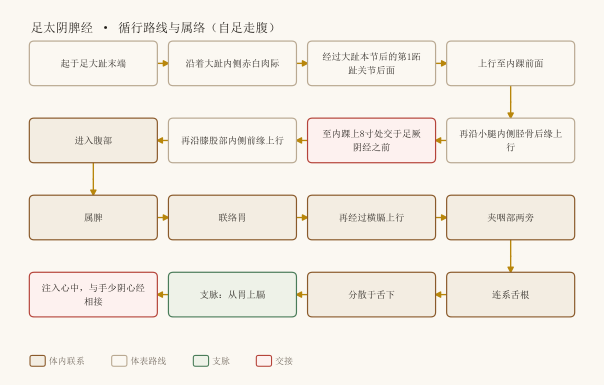

# 第 7 章 · 足太阴脾经（经脉循行·主治概要）

> **源**：`qhzy-经络腧穴学.xlsx` · 表「07 足太阴脾经及其腧穴」 · 源文 5,500 字
> **抽取**：`node scripts/import_textbooks.js --only 经络腧穴学` · sha256 `a630e66b5a4609ab…` · 2026-10-21
> **层次**：本文件是**源教材正文层** —— 节次取自源表的结构列，文字未改写、未压缩、未抽样。改写层（N.3「这个翻译丢掉了什么」/ N.5「争议与本项目立场」）尚未撰写，见 `textbooks/README.md` 章契约。

---

## 7.1 经脉循行

### 7.1.1 循行路线与属络

#### 7.1.1.1 起于隐白/属脾络胃

足太阴脾经简称脾经，属十二经脉之一，与足阳明胃经互为表里，起于足大趾末端隐白穴，沿下肢内侧上行，经腹部、胸部，止于腋下大包穴，左右各21穴。本经属脾络胃，主治以脾胃病、妇科病、前阴病及经脉循行部位病证为主，是针灸临床调理脾胃、统摄血液、运化水湿的重要经脉。 一、体表循行路线。足太阴脾经起于足大趾末端，沿着大趾内侧赤白肉际，经过大趾本节后的第1跖趾关节后面，上行至内踝前面，再沿小腿内侧胫骨后缘上行，至内踝上8寸处交于足厥阴经之前，再沿膝股部内侧前缘上行，进入腹部。体内循行：本经进入腹部后属脾，联络胃；再经过横膈上行，夹咽部两旁，连系舌根，分散于舌下。其支脉，从胃上膈，注入心中。 《灵枢·经脉》对本经的循行有明确记载：【原文】'脾足太阴之脉，起于大指之端，循指内侧'（《灵枢·经脉》），【原文】'白肉际，过核骨后，上内踝前廉'（《灵枢·经脉》），【原文】'循胫骨后，交出厥阴之前'（《灵枢·经脉》），【原文】'上膝股内前廉，入腹，属脾，络胃，上膈'（《灵枢·经脉》），【原文】'连舌本，散舌下。其支者：复从胃'（《灵枢·经脉》），【原文】'别上膈，注心中'（《灵枢·经脉》）。其中“大指”指足大趾，“核骨”指第1跖趾关节内侧的圆形突起，“内踝前廉”即内踝前缘，“胫骨”即小腿内侧之长骨，“咽”指食道。经文显示，本经不仅属脾络胃，还连系心、咽、舌本，其支脉注心中，使脾经经气与手少阴心经相衔接。 二、循行要点。（1）起止与交接：起于足大趾内侧端隐白穴，止于腋下大包穴；其支脉从胃上膈注心中，与手少阴心经相接，十二经脉气血流注承接足阳明胃经之后，构成“胃→脾→心”的传注环节。（2）属络关系：属脾，络胃，与足阳明胃经互为表里。（3）体表分布：本经在体表主要分布于足大趾内侧、内踝前下、小腿内侧、膝股部内侧前缘及腹胸部；其小腿部在内踝上8寸处交出足厥阴经之前，是足三阴经在小腿部排列关系的重要标志。（4）脏腑器官联系：本经联系的脏腑器官有脾、胃、心、咽、舌等，故其腧穴既可治疗脾胃肠腑病证，又可治疗妇科、前阴及心、舌、咽喉病证，临证取穴须结合经脉所过与脏腑所属综合分析。 三、临床意义。脾为后天之本，气血生化之源，主运化、主统血、主肌肉四肢，开窍于口，其华在唇。本经经脉循行所过之处，正是脾之功能在体表的投影区：足大趾内侧端为经气始发之处，隐白穴为井穴，善治崩漏、便血等脾不统血之证；内踝上3寸三阴交为足三阴经交会之处，一穴而调肝脾肾；膝股部内侧为脾经与胃经经气交相输布之地，阴陵泉、血海分主水湿与血分诸病。临证凡见脘腹痞满、纳呆便溏、肢体困重、月经不调等脾虚湿盛之候，皆可从本经入手，或单取一经，或表里配穴，灵活施治。本经与足阳明胃经同为中焦之经脉，一阴一阳，一表一里，共同主持受纳、腐熟、运化、输布之职。脾经属阴，主升清，胃经属阳，主降浊，升降相因，燥湿相济，则水谷精微得以化生输布。故临床调治脾胃，常脾经、胃经同取：脾气不升者，取三阴交、太白、阴陵泉以升清运化；胃气不降者，配足三里、中脘、内庭以降逆和胃。本经支脉从胃上膈注心中，又与心之功能密切相关，脾不生血、心血不足者，可酌情选用本经腧穴以助生化之源。此皆经脉循行理论在临床辨证取穴中的具体运用。 本经除经脉本干外，尚有经别、络脉、经筋等附属结构：足太阴经别从足部别出，上至髀部，合于足阳明经别上行，入腹属脾络胃，联系舌本，加强了本经与脾胃、舌咽的联系；足太阴络脉（公孙之别）自公孙穴处分出，走向足阳明胃经，其病候“实则肠中切痛，虚则鼓胀”，取公孙穴治之，为表里两经经气沟通的重要通道；足太阴经筋起于足大趾内侧端，结于内踝，上结于膝内辅骨，沿股内侧结于髀部，聚于阴器，上腹结于脐，其病候可见足大趾内踝痛、膝内辅骨痛、阴器扭转疼痛及脐腹牵引疼痛等，取本经腧穴及经筋结点治疗。掌握经脉、经别、络脉、经筋的分布与联系，方能全面理解本经的主治范围与临床运用。 四、体表标志与取穴。从体表投影看，本经在足部的隐白、大都、太白、公孙诸穴，正对第1跖趾关节与第1跖骨周围，足弓内侧缘之赤白肉际为取穴之基准标志；小腿部三阴交、漏谷、地机、阴陵泉诸穴，均以胫骨内侧缘为定位依据，沿胫骨内侧缘后际触摸取穴，既准确又简便；膝股部血海、箕门及腹胸部诸穴，则分别以髌底、腹股沟、肋间隙为标志。掌握这些体表标志与骨度分寸，是准确取穴、提高疗效的前提，也是本章学习的基本功。 本节要点：足太阴脾经起于足大趾内侧端隐白穴，止于腋下大包穴，属脾络胃，支脉注心，左右各21穴；循行于足大趾内侧、内踝前下、小腿内侧、膝股内侧前缘及腹胸部，小腿部于内踝上8寸处交出足厥阴之前；经气与手少阴心经相接，联系的脏腑器官有脾、胃、心、咽、舌，其腧穴主治以脾胃病、妇科病、前阴病及经脉循行部位病证为主。

### 7.1.2 主要病候

#### 7.1.2.1 胃脘痛/食则呕/腹胀等

经脉病候是经脉循行及其所属脏腑功能失调所反映的证候，是循经辨证、循经取穴的直接依据。《灵枢·经脉》在每条经脉循行之后均记载其病变，后世将其概括为“是动病”与“所生病”两类，前者多指经脉本身经气变动所生之病，后者多指经脉所属脏腑的病变；足太阴脾经的病候亦循此例，可据以辨经、选穴。 一、主要病候。本经主要病候为：胃脘痛，食则呕，嗳气，腹胀，便溏，黄疸，身重无力，舌根强痛，下肢内侧肿胀、厥冷等症。其中【原文】'胃脘痛，食则呕'（转引自《针灸学》新世纪第4版）即脾失健运、胃气上逆之典型表现。上述病候大体可分四类：其一为脾胃运化失常所致，如胃脘痛、食则呕、腹胀、便溏等，盖脾主运化水谷精微，脾失健运则水谷不化、气机壅滞而为脘腹胀痛，胃气上逆则食入即吐；其二为升清降浊失常所致，如嗳气、便溏等，盖脾主升清，清气不升、浊阴不降则嗳气频作、大便溏泄；其三为水湿输布失常所致，如身重无力、下肢内侧肿胀、黄疸等，盖脾不运湿、湿困肌肉四肢则身重无力，湿浊下注或泛溢肌肤则下肢内侧肿胀，湿浊内蕴、胆汁外溢则发为黄疸；其四为经气不利、气血不能温养所致，如舌根强痛、下肢厥冷等，盖脾经连舌本、散舌下，经气不利则舌根强痛，脾阳不振、气血不能温养四末则下肢厥冷。 二、病候的辨证意义。脾经病候有虚实寒热之异：脾气虚者，多见食少纳呆、腹胀便溏、神疲乏力，可取太白、足三里、脾俞等穴健脾益气；脾阳虚者，多见脘腹冷痛、喜温喜按、四肢不温、大便清稀，宜灸隐白、神阙、中脘温运脾阳；脾不统血者，多见月经过多、崩漏、便血、尿血，可取隐白、太白、三阴交、血海等穴益气摄血；湿困脾阳者，多见脘腹痞闷、身重困倦、舌苔白腻、脉象濡缓，可取阴陵泉、三阴交、丰隆健脾利湿。凡此皆以脾及脾经病机为纲，循经选穴，体现了经络辨证与脏腑辨证相结合的原则。 三、病候的临床意义。临证凡见本经循行部位或脾所主病证，皆可循经辨证、取本经腧穴治疗：脾胃肠腑病证，取太白、公孙、三阴交、阴陵泉等穴；妇科血分病证，取隐白、地机、三阴交、血海等穴；水湿病证，取阴陵泉、三阴交、水分等穴；下肢内侧及胸胁部病证，取三阴交、阴陵泉、血海及胸部诸穴。本经病候中舌根强痛一症，提示脾经与舌本的联系，临证见舌强、舌痛、言语不利等，可酌取本经腧穴；下肢内侧肿胀、厥冷，则提示本经循行部位气血运行失常，可循经取穴以通经活络。如此以经统穴、以穴应症，体现了“经脉所过，主治所及”的辨证取穴规律。 值得一提的是，脾经病候与脾胃病机密切相关，脾为后天之本，气血生化之源，脾病则气血乏源、百病由生，故后世有“调脾胃以安五脏”之说。临证中，凡慢性虚损性疾病见纳呆、腹胀、便溏、乏力者，皆可从调理脾经入手，以资化源；脾虚日久，又可累及他脏，如脾虚及肺则咳喘痰多，脾虚及肾则腰膝酸软、五更泄泻，心脾两虚则心悸失眠、健忘，临证须审证求因，在治本经的同时兼顾相关脏腑，方能周全。本经病候中的黄疸一症，与湿邪困脾、胆汁外溢相关，临床治黄疸常取阴陵泉、三阴交、足三里等穴健脾利湿退黄，亦体现了本经病候对临床的指导意义。 本节要点：脾经主要病候为胃脘痛、食则呕、嗳气、腹胀、便溏、黄疸、身重无力、舌根强痛及下肢内侧肿胀、厥冷等，可分脾胃运化失常、升清降浊失常、水湿输布失常与经气不利四类辨治；临证循经辨证，取本经腧穴健脾和胃、升清降浊、运化水湿、温养经脉。

## 7.2 主治概要

### 7.2.1 主治特点

#### 7.2.1.1 脾胃病/妇科/前阴/经脉循行病证

足太阴脾经腧穴的主治作用，取决于经脉循行分布与脾脏的生理功能。脾主运化水谷精微，为后天之本、气血生化之源；脾主统血；脾主肌肉四肢；脾开窍于口，其华在唇。故本经腧穴的主治范围可归纳为以下四类。 1.脾胃病：胃痛，呕吐，腹痛，泄泻，便秘等。脾与胃相表里，共主受纳腐熟与运化输布，脾失健运则水谷不化、清浊不分，故凡胃痛、呕吐、腹痛、泄泻、便秘等脾胃肠腑病证，均可取本经腧穴治疗，太白、公孙、三阴交、阴陵泉等皆为常用穴。 2.妇科病：月经过多，崩漏等。脾主统血，脾虚则统摄无权、血不归经，发为月经过多、崩漏等出血病证；隐白、地机、三阴交、血海等穴均为治疗妇科血分病证的要穴。 3.前阴病：阴挺，不孕，遗精，阳痿等。脾主升清，脾气下陷则阴挺、遗精；本经腧穴又能调补肝、脾、肾三脏精气，故可治疗不孕、阳痿等生殖系统病证，三阴交、阴陵泉等穴常用。 4.经脉循行部位的其他病证：下肢痿痹，胸胁痛等。本经循行于下肢内侧及胸胁部，经脉所过，主治所及，故下肢痿痹、膝股内侧痛、胸胁痛等病证可取本经腧穴。 本经经穴歌概括其主治规律：【原文】'起于隐白大包终，脾胃肠腹泌尿好，五脏生殖血舌病'（转引自《针灸学》新世纪第4版），提示本经腧穴主治脾胃肠腹、泌尿、生殖、血证及舌本诸病。现代研究表明，针刺脾经腧穴可调节胃肠运动、胃酸分泌及消化吸收功能，对机体水液代谢亦有良性调整作用（现代认识，不改经典原义）。临床运用时，脾胃病常取太白、公孙、三阴交，妇科病常取隐白、三阴交、血海、地机，水湿病证常取阴陵泉、三阴交，并可配合足阳明胃经腧穴同用以和胃健脾，共奏运化输布之功。 本经腧穴的主治规律与其特定穴属性密切相关：隐白为井穴，经气所出，善治崩漏、便血等出血病证，又能开窍醒神、泄热苏厥；太白为输穴兼原穴，原穴为脏腑原气输注留止之处，故善补脾益气，为治脾胃虚弱诸证之要穴；公孙为络穴，络脉别走足阳明胃经，沟通表里两经，又通冲脉，故既能治脾胃肠腑病证，又能平冲降逆治奔豚气；三阴交为足三阴经交会穴，一穴通调肝脾肾三脏；阴陵泉为合穴，经气深入，善于健脾利湿、通利水道；血海为血之归聚之处，善调血分诸病。临证取穴当结合特定穴属性，方能提纲挈领、取效更捷。 本经腧穴取穴配伍，当以脾之生理病理为纲。脾气虚者，补太白、足三里、脾俞以助运化；脾不统血者，灸隐白、针血海、三阴交以益气摄血；湿困中焦者，取阴陵泉、水分、丰隆以健脾利湿；冲气上逆之奔豚，取公孙配内关以平冲降逆；肝脾不调之月经不调、痛经，取三阴交、血海、地机以调经止痛。本经腧穴长于治疗慢性虚损性疾病，灸法尤为适宜，常与足阳明胃经、任脉腧穴相配，培补后天之本，以治本为主，兼治其标。 本经主治的四类病证，实以脾之三大生理功能为纲：其一，脾主运化，故本经腧穴主治脘腹诸疾，凡饮食不节、思虑过度、劳倦内伤所致脾失健运之胃痛、呕吐、腹痛、泄泻、便秘，均可取本经腧穴健脾助运；其二，脾主统血，故本经腧穴主治月经过多、崩漏、便血、尿血等出血病证，取隐白、太白、三阴交、血海等益气摄血；其三，脾主肌肉四肢，又为气血生化之源，故本经腧穴主治下肢痿痹、身重无力及妇科、前阴之血海空虚或气虚下陷诸证。此外，本经腧穴亦常用于调理心悸、失眠、高血压等病症，如三阴交滋阴潜阳、宁心安神，为临床所常用。临证时当审证求因，辨明脾气虚、脾阳虚、脾不统血、湿困脾阳等不同证候，分别施以补法、灸法或平补平泻之法。 本经腧穴虽以治脾为本，但脾为生痰之源、气血生化之源，故其主治范围常超出消化系统而波及全身。痰湿为患之咳嗽、眩晕，可取阴陵泉健脾化痰；气虚不摄之紫癜、鼻衄，可灸隐白、太白摄血归经；脾虚湿困之带下，可取三阴交、阴陵泉健脾渗湿。凡此皆体现“治病求本”“虚则补其母”之思想。临床取穴时，还应注意本经与冲脉的特殊联系——公孙通冲脉，故治疗月经病、奔豚气等冲脉病证常获良效；与任脉、足阳明经腧穴配合，则可广泛用于妇科与脾胃病证的调治，充分体现经络学说指导临床的实用价值。 本经腧穴在现代临床中应用广泛：消化系统疾病如慢性胃炎、消化性溃疡、肠易激综合征、慢性结肠炎等，常取太白、公孙、三阴交、阴陵泉等穴健脾和胃、调理肠腑；妇科疾病如功能性子宫出血、痛经、月经不调、更年期综合征，常取隐白、三阴交、血海、地机等穴调理冲任、统血调经；泌尿生殖系统疾病如遗精、阳痿、遗尿、慢性前列腺炎，常取三阴交、阴陵泉等穴补肾固涩、通利水道；代谢及内分泌疾病如单纯性肥胖、高脂血症，常取阴陵泉、三阴交等穴健脾利湿、化痰降浊。现代研究还观察到，针刺本经腧穴对胃肠运动具有双向调节作用，对下丘脑—垂体—性腺轴及免疫功能亦有一定影响（现代认识，不改经典原义）。临证运用本经腧穴，须把握脾主运化、主统血、主肌肉四肢的生理特性，辨清虚实寒热，或补或泻，或针或灸，方能得心应手。 本节要点：脾经腧穴主治可概括为四大类，即脾胃病、妇科病、前阴病与经脉循行部位病证；其中脾胃病证为本经主治之基础，妇科血分病证为本经主治之特色。临证取穴应结合特定穴属性（井、荥、输、原、络、合等），遵循“经脉所过，主治所及”之规律，远近相配、表里同治，灵活运用。

---

> **免责声明**：本教材内容仅用于教育与科研，不构成任何诊疗建议。
> 本文件由 `scripts/import_textbooks.js` 从源工作簿生成，请勿手改 —— 需要修改请改源工作簿后重跑。
