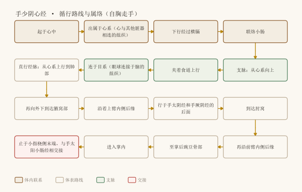

# 第 8 章 · 手少阴心经（经脉循行·主治概要）

> **源**：`qhzy-经络腧穴学.xlsx` · 表「08 手少阴心经及其腧穴」 · 源文 5,995 字
> **抽取**：`node scripts/import_textbooks.js --only 经络腧穴学` · sha256 `a630e66b5a4609ab…` · 2026-10-21
> **层次**：本文件是**源教材正文层** —— 节次取自源表的结构列，文字未改写、未压缩、未抽样。改写层（N.3「这个翻译丢掉了什么」/ N.5「争议与本项目立场」）尚未撰写，见 `textbooks/README.md` 章契约。

---

## 8.1 经脉循行

### 8.1.1 循行路线与属络

#### 8.1.1.1 起于心中/属心络小肠

手少阴心经，简称心经，为十二经脉之一，属心而络小肠，与手太阳小肠经相为表里。心主血脉，藏神，为君主之官，故本经的循行、病候与主治均围绕“心”这一核心展开。本经循行最具特色之处在于“起于心中”，即经脉直接发自内脏，再由内达外、分布体表，体现了心为五脏六腑之大主、其气由内而外输布周身的特点。 体内循行：心经起于心中，出属于心系（心与其他脏器相连的组织）；下行经过横膈，联络小肠。其支脉，从心系向上，夹着食道上行，连于目系（眼球连接于脑的组织）。其直行经脉，从心系上行到肺部，再向外下到达腋窝部，沿着上臂内侧后缘，行于手太阴经和手厥阴经的后面，到达肘窝；再沿前臂内侧后缘，至掌后豌豆骨部，进入掌内，止于小指桡侧末端。据此，心经的体内属络联系可概括为：属心，络小肠，上连目系，并通过“心系”“肺”与胸中诸脏相通。 《灵枢·经脉》对本经循行作了经典记载：【原文】'心手少阴之脉，起于心中，出属心系，下膈，络小肠。其支者：从心系，上夹咽，系目系。其直者：复从心系，却上肺，下出腋下，下循内后廉，行太阴、心主之后，下肘内，循臂内后廉，抵掌后锐骨'（《灵枢·经脉》），其后文云“之端，入掌内后廉，循小指之内，出其端”，即抵掌后锐骨（豌豆骨）之端，入掌内后廉，循小指之内而出其端。文中【原文】'掌后锐骨：指豌豆骨'（转引自《针灸学》新世纪第4版），“下膈，络小肠”点明心与小肠的表里络属关系；“却上肺”说明心经之气经肺而外出，故心经病变常波及肺系而见胸闷、咳喘；“上夹咽，系目系”则解释了心经何以能主治咽喉与目系病证。 从气血流注看，本经承接足太阴脾经“注心中”之气，经气自心中发出，循体内与体表两路布散，并于小指桡侧端与手太阳小肠经相交接，从而构成“脾—心—小肠”的经气衔接，周而复始，如环无端。体表循行路线可概括为：腋窝中央→上臂内侧后缘→肘窝→前臂内侧后缘→掌后豌豆骨部→掌内→小指桡侧端。值得强调的是，心经行于上肢内侧后缘，与手太阴肺经（内侧前缘）、手厥阴心包经（内侧中间）并列，三经自上而下依“太阴在前、厥阴居中、少阴在后”排列，故《灵枢》称其“行太阴、心主之后”。掌握这一排列规律，对临床定位心经诸穴及判别上肢内侧疼痛的归经具有重要意义：凡疼痛、麻木沿上肢内侧后缘放散者，多属心经病候。此外，心经的体表循行还经过腋窝、肘窝等重要部位，极泉、少海等穴即分布于腋、肘部，既可治疗局部及经脉循行部位的病证，又可治疗心、胸、神志病。 循行要点小结：其一，心经起于心中，属心，络小肠，与手太阳小肠经相表里；其二，本经与目系、咽、肺均有直接联系，故可主治目黄、咽干及肺系兼证；其三，体表循行沿上肢内侧后缘下行，止于小指桡侧端，与肺经、心包经在上肢内侧依次排列；其四，心为君主之官，经脉所过之处即病候所及之处，掌握循行是理解本经主治的基础。 从定位方法看，心经诸穴的体表标志十分明确：腋窝中央动脉搏动处定极泉，肘横纹定少海，腕掌侧远端横纹及其上1.5寸、1寸、0.5寸处分别定灵道、通里、阴郄，横纹尺侧端定神门，第4、5掌骨间定少府，小指桡侧指甲根角侧上方0.1寸定少冲。临证取穴时，以腕掌侧远端横纹为基准线向上度量，结合尺侧腕屈肌腱桡侧缘这一标志，即可准确定位前臂部诸穴，此为本经取穴的关键。 【现代认识，不改经典原义】现代解剖学提示，“心系”与出入心脏的大血管及纵隔结缔组织等结构相应，心经经气以此为枢纽与五脏六腑相通，故心病不仅表现为局部的心痛、心悸，还可波及咽、目、肺、小肠等脏腑器官而见咽干、目黄、咳喘、腹痛诸症；临床常见的心绞痛放射痛，其疼痛常沿左上肢内侧后缘放散，恰为心经体表循行所过之处，据此取极泉、少海、神门等穴调理心经经气，可缓解心痛及放射痛，此为循经取穴的典型例证。 【现代认识，不改经典原义】心经经气以“心系”为枢纽与脏腑相通的理论，还可在临床中得到印证：心经腧穴不仅能治疗心脏本身的病变，对与心相关的情志病、血脉病亦有调治作用，如神门宁心安神以治失眠，阴郄养阴清热以治盗汗，均以心经内连心系、外布体表的循行特点为基础。学习本经，宜将体内循行（起于心中，属心络小肠，上系目系）与体表循行（沿上肢内侧后缘下行，止于小指桡侧端）合观，方能把握其主治全貌。 体表循行与体内联系相互印证，构成了对本经的完整认识：体内“起于心中”决定了本经主治以心系病证为核心，体表“循臂内后廉”则决定了本经腧穴多分布于上肢内侧后缘。极泉位于腋窝，为心经体表循行之始，亦是经脉气血由内达外的枢纽；少海位于肘部，为心经合穴，经气汇聚于此；神门位于腕部，为心经原穴，心之原气输注于此；少冲位于小指桡侧端，为心经经气之末。由上至下，经气由深出浅、由盛渐微，掌握这一气血分布态势，对理解各穴主治侧重大有裨益。心经与心包经同属心系，两经在上肢内侧的分布相邻（心包经行于中间，心经行于后缘），主治亦多相通，临床常相须为用。此外，心经“其支者：从心系，上夹咽，系目系”，故本经与咽、目关系密切，咽干、目黄、目赤等症可从心经论治，此亦为“经脉所过，主治所及”的具体体现。

### 8.1.2 主要病候

#### 8.1.2.1 心痛/咽干/目黄等

主要病候是经脉及其所属脏腑发生病变时所反映出的病症，也是经络辨证的依据。手少阴心经的主要病候首载于《灵枢·经脉》，教材归纳为：【原文】'心痛，咽干，口渴，目黄，胁痛，上臂内侧痛，手心发热等症'（转引自《针灸学》新世纪第4版）。这些病候可分为心系病候与经脉病候两类加以认识。 心系病候：心痛，咽干，口渴。心主血脉，心气推动血液在脉中运行，若心脉痹阻、心失所养，或心阳暴脱、心气亏虚，则发为心痛，此为本经第一主症；心经别支上夹咽喉，心火上炎，灼伤津液，则咽干、口渴。心痛之虚实，须结合兼症与舌脉辨别：刺痛固定、入夜尤甚者多属心血瘀阻；隐痛绵绵、遇劳则甚者多属心气不足；灼痛烦热者多属心火亢盛；冷痛肢厥者多属心阳不振。咽干口渴而兼心烦舌赤者，为心火伤津之象，常取本经荥穴、郄穴清心泄热、养阴生津。 经脉病候：目黄，胁痛，上臂内侧痛，手心发热。心与小肠相表里，心火下移，湿热熏蒸，则目黄；经脉循行过胁下，经气不利则胁痛；邪客本经，经气运行不畅则上臂内侧痛；心经有热，循经外达则手心发热。此类病候均位于心经循行所过之处，所谓经脉所过，病候所及，是经络辨证定位的重要依据。凡疼痛、麻木、灼热沿上肢内侧后缘出现者，多可从心经辨治；手心发热兼心烦失眠者，多为心经虚热或心肾不交之候。 经络辨证应用：临证见心痛、心悸、咽干、口渴、目黄、胁痛诸症，当结合兼症与舌脉辨其虚实寒热，再定取穴。心与小肠相表里，心火下移小肠，可见小便短赤、涩痛，常取心经腧穴配伍小肠经腧穴清心泻火、导热下行；心开窍于舌，心火上炎则口舌生疮，常取心经荥穴少府、井穴少冲清泄心火；汗为心之液，心阴不足、虚热内扰则盗汗，常取心经郄穴阴郄养阴敛汗。又因心经“上夹咽，系目系”，故咽喉干燥、目黄目赤等咽目病证，亦可从心经论治。 【现代认识，不改经典原义】现代医学的冠心病心绞痛、心律失常、心肌炎、神经官能症等疾病所见的胸痛、心悸、怔忡等症状，多与心经病候相应；心绞痛发作时的放射痛，其部位常沿心经体表循行放散至左臂内侧，与“上臂内侧痛”的病候记载相合，临证可参考运用，亦为心经腧穴治疗心系病证的现代佐证。 本节要点：心经主要病候以心痛为核心，兼见咽干、口渴、目黄、胁痛、上臂内侧痛、手心发热等症；病候分心系与经脉两类，心痛之虚实寒热当结合兼症与舌脉辨析；心与小肠相表里、心开窍于舌、汗为心之液等理论，是指导心经病候辨证取穴的依据。 此外，心经病候还可从“是动”与“所生”两个层面理解：凡因心之本体受病而反映于经脉者，如心痛、心悸、心烦等，多属本脏病候；凡因经脉循行部位经气不利而见者，如胁痛、上臂内侧痛、手心发热等，多属经脉病候。前者治以调补心之气血阴阳，后者治以疏通本经经气。临证又当注意，心与小肠相表里，心火下移小肠可见小便短赤涩痛，心火上炎可见口舌生疮，心肾不交可见失眠健忘，皆可从心经及表里经、相关经脉配合取穴，此即经络辨证整体观的体现。 从现代医学角度看，心经病候与循环系统及自主神经功能紊乱关系密切：心痛、心悸多见于冠心病、心律失常、心脏神经官能症等；咽干、口渴、手心发热等症，可见于神经衰弱、更年期综合征等功能性疾病；目黄则需结合肝功能等检查排除肝胆疾患，临证当中西医互参，明确诊断，不可仅凭经络辨证延误病情。针刺心经腧穴治疗心系病证时，应重视辨证与辨病结合：器质性心脏病（如急性心肌梗死）须及时转诊急救，针灸可作为辅助治疗手段，此属现代认识，不改经典原义。 心经病候的辨证要点还可从病位与病性两方面把握。就病位而言，心痛、心悸、心烦等症病位在心，为本脏病变；咽干、口渴、目黄等症病位在经脉所过之咽、目，多因心火循经上炎；胁痛、上臂内侧痛、手心发热等症病位在经脉循行部位，多因经气不利。就病性而言，暴病多实，久病多虚：突发心胸刺痛、痛引肩臂者，多属心血瘀阻或痰浊痹阻心脉；病程缠绵、心悸气短、动则加重者，多属心气、心血亏虚；五心烦热、盗汗颧红者，多属心阴不足、虚热内扰；形寒肢冷、心痛遇寒加重者，多属心阳不振。辨明病位病性，方能确定补泻手法与腧穴配伍：虚证多用补法，可加灸以温补心阳；实证多用泻法，或点刺井穴、荥穴以泄热开窍；气滞血瘀者，针用泻法并配合活血化瘀之穴。此为心经病候辨证论治之纲领，亦为学习本经主治概要与腧穴运用的基础。此外，心经病候每与情志因素相关，喜怒忧思过度、五志过极皆可化火伤阴、扰乱心神而诱发心痛、心悸、失眠诸症，临证除针灸调治外，还当辅以情志疏导，使患者心境平和，方能获效。

## 8.2 主治概要

### 8.2.1 主治特点

#### 8.2.1.1 心/胸/神志/经脉循行病证

本经腧穴的主治范围与其主要病候相应，可概括为“心、胸、神志病”与“经脉循行部位的其他病证”两大类。教材所载本经主治概要为：【原文】'心、胸、神志病心痛，心悸，癫狂痫等'（转引自《针灸学》新世纪第4版），【原文】'经脉循行部位的其他病证肩臂疼痛，胁肋疼痛，腕臂痛等'（转引自《针灸学》新世纪第4版）。 1.心、胸、神志病：心痛，心悸，癫狂痫等。此类主治基于心主血脉、心主神明的生理功能。心主血脉，心血充盈、心气推动有力则脉道通利；若心脉痹阻、心失所养，则见心痛、心悸，故本经腧穴为治疗心痛、心悸等心系病证的要穴，临床冠心病心绞痛、心律失常等病常取本经腧穴调治。心藏神，主神明，若心神被扰或神失所主，则见失眠、健忘、癫狂痫等神志病证，故本经腧穴又为调神要穴，神门、少冲、少府等穴均善治神志病。凡心气虚、心血虚、心阴虚、心火亢盛及痰蒙心窍诸证所致的神志异常，皆可从本经选穴施治。 2.经脉循行部位的其他病证：肩臂疼痛，胁肋疼痛，腕臂痛等。此类主治基于经脉所过、主治所及的原则。本经循行于腋下、上臂与前臂内侧后缘、掌内及小指桡侧端，经脉所过之处即为主治所及之处，故肩臂疼痛、胁肋疼痛、腕臂痛、小指挛痛等经脉循行部位的病证，均可取本经腧穴治疗。临床辨治上肢内侧疼痛时，凡疼痛沿上肢内侧后缘放散者，多从心经论治，取本经腧穴疏通经气、活血止痛。 从脏腑经络联系看，心开窍于舌，其华在面，故舌强不语、暴喑等舌窍病证可取通里、阴郄等穴；汗为心之液，阴虚内热、迫津外泄之骨蒸盗汗，可取心经郄穴阴郄清退虚热；心与小肠相表里，心经支脉上夹咽、系目系，故咽干、口渴、目黄等亦属本经主治范畴；心火炽盛、热扰心神之昏迷、热病，则取井穴少冲点刺出血以泄热开窍醒神。本经腧穴在临床常与手厥阴心包经腧穴配合应用，如神门配内关治疗心悸、失眠，两经同属心系，协同调畅心之气血阴阳，是治疗心与神志病证的基本配伍。 为便于记诵本经九个腧穴的定位，教材载有经穴歌：【原文】'HT九穴是心经，起于极泉止少冲，心病神志与血病，烦热悸汗皆可用。极泉腋窝动脉牵，青灵肘上三寸见，少海骨纹头间，灵道掌后一寸半，通里掌后一寸间，阴五分在掌后，神门横纹肌腱内，少府握拳小指尖，少冲小指桡侧边'（手少阴心经经穴歌，转引自《针灸学》新世纪第4版）。歌诀首句概括了本经的循行起止（起于极泉，止于少冲）与主治范围（心病、神志病与血病，以及烦热、心悸、汗出诸症），以下各句则按穴名、部位依次点出定位要点，如“灵道掌后一寸半，通里掌后一寸间，阴五分在掌后”标明三穴均在腕掌侧远端横纹上方、尺侧腕屈肌腱桡侧缘，依次相距0.5寸，记忆时可结合体表标志互相对照。 本节要点：手少阴心经主治以心、胸、神志病为主，兼治经脉循行部位病证；神门为心经原穴，为调神、宁心之要穴；通里为络穴，善治舌强不语；阴郄为郄穴，善治骨蒸盗汗；少冲为井穴，用于昏迷、热病等急症，可点刺出血。 在配穴应用上，心经腧穴常与相关经脉腧穴配伍以增强疗效。如神门为心经原穴，通里为心经络穴，两穴相配属原络配穴法，一原一络，表里相应，主治心悸、怔忡、失眠等心与神志病证；神门配心俞、巨阙，属俞募配穴，前后呼应，调补心气，善治心痛、胸痹；少冲、中冲、少商等井穴同用，点刺出血，泄热开窍，主治高热昏迷、中风闭证等急症；阴郄配复溜，滋阴清热，主治骨蒸盗汗。临床辨证时，凡心气虚、心血虚、心阴虚、心火亢盛及痰蒙心窍诸证，均可从本经选取相应腧穴，或补或泻，或针或灸，总以调畅心之气血阴阳为要。此外，心经腧穴多位于上肢内侧及手掌部，肌肉较薄、血管神经较为表浅，针刺时进针宜稳，深度宜浅，得气即止，不可盲目深刺强刺激，以免伤及血管神经，针刺安全，临床红线。【现代认识，不改经典原义】现代临床与实验研究亦从神经、体液调节角度对本经腧穴的主治作用作了观察，如针刺心经腧穴可影响心率、血压及心功能，对自主神经功能具有调节作用，为心经腧穴治疗心系病证提供了现代依据。 心经腧穴在神志病的治疗中占有重要地位。心藏神，神志活动的正常有赖于心血的濡养与心气的推动，凡思虑过度、暗耗心血，或情志不遂、气郁化火，或痰浊蒙蔽心窍，均可导致心神不宁而见失眠、健忘、心悸、癫狂痫等症。本经腧穴通过调心而安神，故为治疗神志病的基本经脉之一。其中神门为心经原穴，宁心安神之力最著，为治疗失眠、健忘、心悸的第一要穴；少冲为井穴，开窍泄热，用于热病神昏、癫狂等急症；阴郄为郄穴，滋阴清热，用于阴虚火旺之骨蒸盗汗；通里为络穴，通络利舌，用于舌强不语、暴喑。四穴各有所长，合之则调心、安神、开窍、通络兼备，体现了特定穴理论在临床配伍中的指导作用。临证选用时，当结合患者体质、兼症及舌脉，灵活化裁。还需注意，本经与手厥阴心包经同主心与神志病证，两经主治相近而各有侧重：心包经偏于清心泻热、宽胸理气，本经则长于养心安神、通络利窍，临床辨治心悸、失眠、癫狂等病时，可两经合参、交替选用，俾使经气畅通、心神得安，疗效更彰。

---

> **免责声明**：本教材内容仅用于教育与科研，不构成任何诊疗建议。
> 本文件由 `scripts/import_textbooks.js` 从源工作簿生成，请勿手改 —— 需要修改请改源工作簿后重跑。
