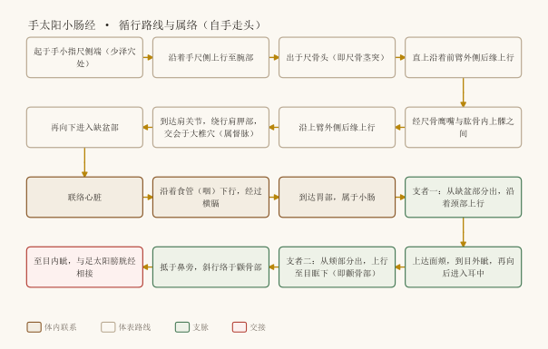

# 第 9 章 · 手太阳小肠经（经脉循行·主治概要）

> **源**：`qhzy-经络腧穴学.xlsx` · 表「09 手太阳小肠经及其腧穴」 · 源文 4,506 字
> **抽取**：`node scripts/import_textbooks.js --only 经络腧穴学` · sha256 `a630e66b5a4609ab…` · 2026-10-21
> **层次**：本文件是**源教材正文层** —— 节次取自源表的结构列，文字未改写、未压缩、未抽样。改写层（N.3「这个翻译丢掉了什么」/ N.5「争议与本项目立场」）尚未撰写，见 `textbooks/README.md` 章契约。

---

## 9.1 经脉循行

### 9.1.1 循行路线与属络

#### 9.1.1.1 起于少泽/属小肠络心

手太阳小肠经，简称小肠经，为十二经脉之一，属小肠而络心，与手少阴心经互为表里。小肠主受盛化物、泌别清浊，为“受盛之官”，赖心阳之温煦以行其职；心主血脉、藏神，为君主之官，其气由内而外输布周身。两经一属心、一属小肠，脏腑相连，经脉相通，故本经的循行、病候与主治，均与小肠受盛化物、泌别清浊的功能及心主血脉、藏神的功能密切相关。本经起于手小指尺侧端，自手走头，是“手之三阳，从手走头”循行规律的典型代表；其体表分布范围较广，涉及手指、腕、前臂、上臂、肩胛、颈项、面颊以及耳、目、颧部等部位。 体表循行路线：本经起于手小指尺侧端（少泽穴处），沿着手尺侧上行至腕部，出于尺骨头（即尺骨茎突，古称“踝”），直上沿着前臂外侧后缘上行，经尺骨鹰嘴与肱骨内上髁之间，沿上臂外侧后缘上行，到达肩关节，绕行肩胛部，交会于大椎穴（属督脉），再向下进入缺盆部。这一段循行经过手、腕、肘、肩等关节，故本经腧穴对手指挛痛、腕痛、肘臂疼痛、肩臂疼痛等经脉循行部位病证均有治疗作用。其中“出于尺骨头”一句，点明本经在前臂后区沿尺骨尺侧与尺侧腕屈肌之间走行，与尺神经在前臂的分布区域大体相当，临床上该区域疼痛、麻木诸症，多可循经取本经腧穴施治。 体内属络联系：经脉进入缺盆部后，联络心脏，沿着食管（咽）下行，经过横膈，到达胃部，属于小肠。据此，本经的属络关系可概括为：属小肠，络心，与心相表里，并通过缺盆、咽、膈与胸中诸脏相通。心与小肠相表里：心火下移，则小肠泌别清浊失职，可见小便短赤涩痛；小肠受盛化物功能失常，清浊不分，亦可上扰心神。这一表里关系，是临床从心治小肠病、从小肠治心病及表里经配穴的经络学基础，也是“心移热于小肠”诸证从本经论治的理论依据。 支脉分布：本经共有两条支脉。其一，从缺盆部分出，沿着颈部上行，上达面颊，到目外眦，再向后进入耳中，故本经腧穴能主治耳鸣、耳聋等耳部病证及目疾；其二，从颊部分出，上行至目眶下（即颧骨部，古称“䪼”），抵于鼻旁，至目内眦，斜行络于颧骨部，故本经又主面颊、颧部及鼻旁病证。两条支脉均在头面部与手足太阳、少阳等经脉交会，使本经与耳、目、面颊诸窍的联系更为密切。 《灵枢·经脉》对本经循行的经典记载为：【原文】'小肠手太阳之脉，起于小指之端，循手外侧上腕，出踝中'（《灵枢·经脉》），继则上行而【原文】'绕肩胛，交肩上'（《灵枢·经脉》），再【原文】'入缺盆，络心，循咽下膈，抵胃，属小肠'（《灵枢·经脉》），其支者【原文】'从缺盆循颈，上颊'（《灵枢·经脉》）而达头面。原文所述名词需加注意：“踝”，指手腕后方的尺骨头隆起处，即尺骨茎突；“臂骨”，指尺骨；“两骨”，指尺骨鹰嘴和肱骨内上髁；“肩解”，指肩端之骨节解处，即肩关节；“目锐眦”，指目外眦；“䪼”（音拙），指眼眶下缘的骨。理解这些名词术语，是掌握本经循行路线的基础。 与手少阴心经的衔接：手少阴心经起于心中，出属心系，下络小肠，沿上肢内侧后缘下行，止于小指桡侧端少冲穴；手太阳小肠经起于小指尺侧端少泽穴，两经在小指端首尾相接，构成“心与小肠相表里”的经络基础。临床上心经病变可取小肠经腧穴，小肠经病变亦可取心经腧穴，表里经配穴是治疗心系及小肠相关病证的重要方法。 循行要点小结：其一，本经起于少泽，止于听宫，左右各19穴，属小肠，络心，与手少阴心经相表里；其二，体表循行经手尺侧、腕、前臂外侧后缘、肘、上臂外侧后缘、肩胛、颈项、面颊，止于耳前，分布广泛；其三，与督脉交会于大椎，并与足太阳膀胱经、足少阳胆经、足阳明胃经等在头面、肩背部相互交会；其四，经脉所过之处即病候所及之处，掌握循行路线，是理解本经主治范围及临床取穴的基础。现代研究借助体表循经感传、肌电及影像学等手段观察本经循行路线的客观性，现代认识，不改经典原义。 本经与足太阳膀胱经的衔接：手太阳小肠经之支脉，从颊部上行至目眶下，抵于鼻旁，至目内眦，斜行络于颧骨部；足太阳膀胱经起于目内眦（睛明穴），两经在目内眦处首尾相接，气血由手太阳小肠经依次流注于足太阳膀胱经，构成十二经脉气血流注的又一衔接环节。循此流注关系，头项、肩背、腰脊等部位之病证，两太阳经腧穴常可配合应用，如后溪通督脉治头项腰背痛，与膀胱经之申脉相配即属此例；临床取穴亦常循“太阳主表”之性，两经同用以疏风散寒、解表通络。 需要说明的是，本经循行所过之肩胛部，为手太阳经筋、经脉之气汇聚之处，肩胛痛、肩背拘急等病证多取天宗、秉风、曲垣等穴；又因经脉“从缺盆循颈，上颊，至目锐眦，却入耳中”，其支脉又“抵鼻，至目内眦”，故本经与耳、目、鼻、颊诸窍相通，耳鸣耳聋、目疾、鼻病、面颊肿痛等皆可从本经论治。掌握经脉在头面部的支脉分布，是理解听宫、颧髎、天容等穴主治范围的关键。

### 9.1.2 主要病候

#### 9.1.2.1 耳聋/颊肿/肩臂痛等

本经主要病候为：【原文】'少腹痛，腰脊痛引睾丸，耳聋，目黄，颊肿，咽喉肿痛，肩臂外侧后缘痛等症'（转引自《针灸学》新世纪第4版）。 分析其病机：小肠受盛化物、泌别清浊功能失常，或小肠经气不利，则见少腹痛；小肠经循行过腰脊，病及下焦，则腰脊痛引睾丸；小肠与心相表里，心移热于小肠，或邪热循经上扰，则见耳聋、目黄、颊肿、咽喉肿痛；邪客经脉，经气阻滞，则肩臂外侧后缘疼痛。诸症或见于脏腑功能失常，或见于经脉循行所过之处，其病机总不外乎小肠泌别清浊失职、经脉经气不利两端。 从脏腑病机看：小肠主受盛化物、泌别清浊，其病则清浊不分、水谷并趋而下，故少腹疼痛之候，多与小肠受盛化物功能失常有关；腰脊痛引睾丸，系病邪循经下注，累及少腹、前阴、腰脊等部位，足太阳膀胱经亦行于腰脊，两太阳经同气相求，故小肠病亦可牵及腰脊。心与小肠相表里，心火亢盛、移热于小肠，则热邪循经上炎，发为耳聋、目黄、颊肿、咽喉肿痛等头面五官病候；火热下注小肠，亦可致小便短赤涩痛。临床上凡见小便赤涩、心烦口疮而兼小肠经病候者，常从心与小肠的表里关系论治，取本经腧穴清心泻火、通利小肠。 从经脉病机看：本经起于小指之端，循臂外侧后缘上行，过肩胛，上颈项，故邪客经脉、经气阻滞，则见肩臂外侧后缘疼痛；经脉上达头面，涉及耳目咽喉，故热邪循经上扰，则见耳聋、目黄、颊肿、咽喉肿痛。此即“经脉所过，病候所及”之理，凡经脉循行所过部位之病证，皆可从本经论治。临证见上述病候，即可取本经腧穴或表里经腧穴调理，如肩臂外侧后缘痛可取后溪、小海等穴，耳聋、颊肿可取听宫、天容等穴，并注意结合病性之寒热虚实随证加减。 现代临床观察，小肠经病候与消化系统（如肠炎、肠痉挛之少腹痛）、泌尿生殖系统（如膀胱炎之小便赤涩）及神经系统（如臂丛及尺神经病变之肩臂疼痛）疾病关系密切，临证可参合现代医学检查明确病位，再按经脉辨证取穴，现代认识，不改经典原义。 此外，本经病候亦可从经筋角度参悟：手太阳之筋循行于小指、肘内锐骨、腋下、肩胛及耳中、目外眦等处，其筋病可见肘臂疼痛、腋下痛、肩胛引颈而痛、耳中鸣痛等，与本经病候中肩臂外侧后缘痛、耳聋等相呼应，临证可参合经筋辨证，于局部痛处配合阿是穴及经筋排刺之法。又小肠经与督脉交会于大椎，督脉总督诸阳，故本经病候之发热、疟疾等，亦常取后溪、少泽等穴清泄阳热，与督脉病证之治法相通。 本节要点：小肠经主要病候为少腹痛、腰脊痛引睾丸、耳聋、目黄、颊肿、咽喉肿痛、肩臂外侧后缘痛等，其病机与小肠泌别清浊失常及经脉经气不利有关，并与心经表里相关，临证当结合脏腑、经脉两端辨析论治。

## 9.2 主治概要

### 9.2.1 主治特点

#### 9.2.1.1 头项/肩胛/耳目/热病/神志病证

本经腧穴的主治特点，可归纳为头面五官病、热病神志病及经脉循行部位病证三类。其一，头面五官病：头痛，目疾（目赤、目翳、目视不明等），咽喉肿痛，耳鸣、耳聋，齿痛等；其二，热病、神志病：昏迷，发热，疟疾，癫狂痫等；其三，经脉循行部位的其他病证：项背强痛，腰背痛，手指及肘臂挛痛，肩胛疼痛等。本经腧穴主治范围之所以如此广泛，与其循行分布密切相关：经脉起于小指，行于上肢外侧后缘，绕肩胛，上颈项，抵头面，入耳中，至目内外眦，故凡经脉所过之处的病证，皆为本经腧穴主治所及。 本经经穴歌概括其主治范围为：【原文】'头项耳目咽喉病，热病神志液病良'（转引自《针灸学》新世纪第4版）。其中“头项耳目咽喉病”，正是本经循行所过部位——头项、耳目、咽喉的病证，体现了“经脉所过，主治所及”的取穴原则；“热病神志”，与小肠经属小肠络心、又通于督脉有关，督脉总督诸阳、入属于脑，故本经腧穴可治发热、疟疾等热病及癫狂痫等神志病；“液病”，则提示小肠主液、泌别清浊的功能特点，故本经腧穴还可治疗乳少、乳痈等与津液输布失常相关的病证，如井穴少泽即为治疗乳少、乳痈的要穴。 从选穴规律看：头面五官病证，多取本经头面部的腧穴，如听宫治耳鸣、耳聋，颧髎治口眼歪斜、齿痛，天容、天窗治咽喉肿痛；经脉循行部位的病证，多取局部及邻近腧穴，如肩贞、天宗、秉风等治肩胛疼痛，小海治肘臂疼痛，阳谷治腕痛；热病、神志病及头项腰背痛，则多取远端腧穴，如后溪为八脉交会穴、通于督脉，善治头项强痛、腰背痛及癫狂痫，少泽为井穴，善治昏迷、热病等急症。临证当根据病位、病性，结合特定穴的功用灵活选用，并注意与手少阴心经腧穴的配合应用。 从本经五输穴的分布看其主治层次，亦颇有规律：井穴少泽位于小指端，经气初出，故善治昏迷、热病等急症、热证；荥穴前谷善治热病；输穴后溪位于掌后，主治体重节痛，又通督脉而治头项腰背及神志病证；经穴阳谷位于腕后，经气正盛，善治热病及经脉循行部位病证；合穴小海位于肘部，经气深入，合治内腑，故善治肘臂疼痛、麻木及癫痫。临证取穴，可循井主心下满、荥主身热、输主体重节痛、经主喘咳寒热、合主逆气而泄的五输穴主治纲领，参合本经具体穴性而用之。 现代临床研究提示，小肠经腧穴对周围神经病变、颈肩综合征、耳鸣耳聋及乳腺疾病等有较好疗效，其作用机制与神经节段支配、经脉—脏腑相关等理论有关，现代认识，不改经典原义。 在特定穴应用方面，本经八脉交会穴后溪通于督脉，临床常与足太阳膀胱经之申脉相配，上下相应，共奏疏通督脉、调和阴阳之功，主治目内眦、颈项、耳、肩胛及腰背等部位病证；郄穴养老善治急痛，络穴支正通于心经而兼理神志，原穴腕骨调和本经气血，各特定穴依其属性各有所主。临证又当注意本经与手足阳明、少阳经在头面肩背部的交会关系，如听宫与耳门、听会相伍，天容、天窗与翳风相配，皆属邻近经脉腧穴的协同应用，可增强疏通局部经气之效。 从本经与脏腑的关系看，小肠受盛胃中腐熟之水谷，泌别清浊，清者上输于脾，浊者下注膀胱，故小肠功能失调，除见少腹诸症外，尚可影响水液代谢而见小便异常，临床治疗小便短赤、淋涩等症，除取膀胱经、肾经腧穴外，亦可酌情选用本经前臂、手部腧穴以通调气机。凡此种种，皆体现“经络所通，主治所及”的辨证取穴思想。 本节要点：小肠经主治以头面五官病、热病神志病及经脉循行部位病证为主；少泽、后溪为本经治疗热病、神志病及头项腰背病证的要穴；小肠主液，本经腧穴尚可治疗乳少、乳痈等病证。

---

> **免责声明**：本教材内容仅用于教育与科研，不构成任何诊疗建议。
> 本文件由 `scripts/import_textbooks.js` 从源工作簿生成，请勿手改 —— 需要修改请改源工作簿后重跑。
