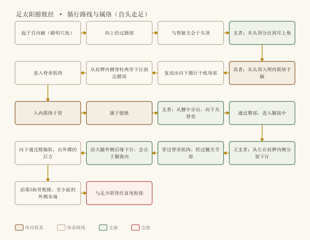

# 第 10 章 · 足太阳膀胱经（经脉循行·主治概要·背俞穴）

> **源**：`qhzy-经络腧穴学.xlsx` · 表「10 足太阳膀胱经及其腧穴」 · 源文 13,754 字
> **抽取**：`node scripts/import_textbooks.js --only 经络腧穴学` · sha256 `a630e66b5a4609ab…` · 2026-10-21
> **层次**：本文件是**源教材正文层** —— 节次取自源表的结构列，文字未改写、未压缩、未抽样。改写层（N.3「这个翻译丢掉了什么」/ N.5「争议与本项目立场」）尚未撰写，见 `textbooks/README.md` 章契约。

---

## 10.1 经脉循行

### 10.1.1 循行路线与属络

#### 10.1.1.1 起于睛明/属膀胱络肾(最长经脉)

足太阳膀胱经，简称膀胱经，为十二经脉之一，属膀胱而络肾，与足少阴肾经互为表里。膀胱为“州都之官”，主贮尿排尿，赖肾之气化以行其职；肾主水，藏精，为先天之本。两经一属膀胱、一属肾，脏腑相连，经脉相通，故本经的循行、病候与主治，均与膀胱贮尿排尿、肾主水液及腰脊、头项、下肢后侧的功能活动密切相关。本经起于目内眦，自头走足，是“足之三阳，从头走足”循行规律的典型代表；其体表分布范围居十二经脉之首，起于内眼角，上额交巅，下循项背，分为两条侧线夹脊下行，经臀、股后、腘窝、小腿后侧，止于足小趾外侧端，左右各67穴，为十二经脉中腧穴最多的一经。 体表循行路线：本经起于目内眦（睛明穴处），向上经过额部，与督脉交会于头顶。其支脉，从头顶分出到耳上角。其直行经脉，从头顶入颅内联络于脑，复浅出向下循行于枕项部，从肩胛内侧脊柱两旁下行到达腰部，进入脊旁肌肉，入内联络于肾，属于膀胱。一支脉从腰中分出，向下夹脊旁，通过臀部，进入腘窝中；另一支脉从左右肩胛内侧分别下行，穿过脊旁肌肉，经过髋关节部，沿大腿外侧后缘下行，会合于腘窝内，向下通过腓肠肌，出外踝的后方，沿第5跖骨粗隆，至小趾的外侧末端。 《灵枢·经脉》对本经循行的经典记载为：【原文】'膀胱足太阳之脉'（《灵枢·经脉》），起于目内眦，【原文】'上额，交巅。其支者：从巅至耳上角。其直者：从巅入络脑，还出别下项'（《灵枢·经脉》），循肩髆内（肩胛区），【原文】'夹脊抵腰中'（《灵枢·经脉》），入循膂（脊旁肌肉），【原文】'络肾，属膀胱'（《灵枢·经脉》）。其支者：【原文】'从腰中，下夹脊，贯臀'（《灵枢·经脉》），入腘中；又其支者：【原文】'左右别下贯胛，夹脊内'（《灵枢·经脉》），过髀枢（髋关节），循髀外后廉，下合腘中，以下贯踹内，【原文】'出外踝之后，循京骨'（《灵枢·经脉》）至小趾外侧端。原文所述名词需加注意：“巅”，指头顶最高处；“肩髆”，指肩胛区；“膂”，指夹脊两旁的肌肉；“髀枢”，指髋关节；“京骨”，指第5跖骨粗隆，其下为京骨穴。理解这些名词术语，是掌握本经循行路线的基础。 体内属络联系：本经属膀胱，络肾，与足少阴肾经相表里。膀胱与肾同居下焦，共主水液代谢：肾主气化，膀胱主贮尿排尿，肾气充足、气化正常，则膀胱开阖有度；肾气亏虚、气化失司，则膀胱失约或气化不利，可见遗尿、小便不利、癃闭等证。故本经腧穴既能调节膀胱气化，又能补肾益精，肾俞、膀胱俞、委中、至阴等穴均为治疗泌尿生殖系病证的要穴。本经还与督脉交会于巅顶（百会）、大椎等穴，与足少阳胆经、足阳明胃经等亦有交会。 循行要点小结：其一，本经起于睛明，止于至阴，左右各67穴，属膀胱，络肾，与足少阴肾经相表里；其二，体表循行经目内眦、额、巅顶、项、背（第一、第二侧线）、腰、臀、股后、腘窝、小腿后侧、外踝后，止于足小趾外侧端，分布范围居十二经脉之首；其三，与督脉交会于巅顶、大椎等穴，背部两条侧线纵贯脊柱两旁，为背俞穴所在；其四，经脉所过之处即病候所及之处，掌握循行路线，是理解本经主治范围及临床取穴的基础。 从经络辨证角度看，本经病候多与膀胱气化失司及经脉所过部位气血阻滞有关。膀胱气化不利，则见小便不通、遗尿；膀胱经气上逆或邪热循经上扰，则见目痛、鼻塞多涕；经脉郁闭，气机逆乱，则见癫狂；经气阻滞，经脉所过之头项、背腰、臀部及下肢后侧则见疼痛。临证见上述病候，即可从本经论治。此外，本经循行“从巅入络脑”，与脑府相连，故神志病证亦是本经主治的重要方面。 本经与足少阴肾经在循行上首尾衔接：足少阴肾经起于足小趾下，斜走足心，行舟骨粗隆下，经内踝后方进入足跟中，沿小腿内侧上行，贯脊柱，属肾，络膀胱，两经一属膀胱、一属肾，于足部及下焦脏腑相互沟通，构成“肾与膀胱相表里”的经络学基础。肾主水液，司气化；膀胱司贮尿排尿，赖肾气之蒸化而开阖有度。肾气充足，则膀胱气化正常，小便通利；肾气亏虚，气化失司，则膀胱开阖失常，可见小便不利、遗尿、癃闭等证。故本经腧穴既调膀胱之气化，又补肾之精气，肾俞、膀胱俞、委中、至阴、京骨等皆为治疗水液代谢病证之要穴。 本经与督脉关系至为密切：督脉行于脊柱正中，总督诸阳；本经两条侧线夹脊而行，纵贯腰背，与督脉交会于巅顶百会、大椎等处。督脉入属于脑，膀胱经“从巅入络脑”，两经同主腰背、头项及神志病证，临床治腰背痛常督脉与膀胱经穴位同用，如后溪（通督脉）配委中、申脉，大椎配风门、肺俞，皆取两经协同之意。 足太阳主一身之表，为诸经之藩篱。风寒外袭，太阳首当其冲，故外感表证常取本经风门、大杼、肺俞等穴祛风散寒、宣肺解表；项背强痛、身痛等太阳经证，则循经取委中、昆仑、申脉等远道穴。本经尚有络脉、经筋与皮部分布：足太阳络脉自飞扬处分出，十五络脉节载其【原文】'在外踝上7寸处分出，走向足少阴肾经'（转引自《针灸学》新世纪第4版），其病变【原文】'实证为鼻塞流涕、头背部疼痛，虚证为鼻流清涕'（转引自《针灸学》新世纪第4版），故络穴飞扬为治鼻塞、鼻流清涕及头背部疼痛之常用穴；足太阳之筋起于足小趾，循外踝、腘、臀、项背而上行，其筋病可见足跟肿痛、腘挛急、脊反折、项筋急等，经筋病证可于痛处取阿是穴及邻近腧穴施治（经筋循行原文两源参考书均未录，此处据教材通例概述，不引原文）；本经皮部与经络相应，分布于项背、腰骶及下肢后侧，为皮肤针叩刺、拔罐、刮痧等外治法提供了经络学依据。 从现代研究看，本经循行路线与脊神经后支、交感干及其节段性分布的关系较为密切，背部第一、第二侧线恰与脊神经后支皮支的分布区域大体对应，循经感传及穴位电学特性研究亦提示本经存在相对特异的体表反应带，现代认识，不改经典原义。本经经穴歌称【原文】'六十七穴分三段'（足太阳膀胱经经穴歌），头、背、下肢三段各有取穴规律，掌握之则全经腧穴可依次推求。 本经67穴的分布与命名有一定的规律可循：头项部10穴（睛明至天柱）多按部位与形态命名，如睛明位于目内眦，攒竹位于眉头，通天位于巅顶之上；背腰部44穴（大杼至秩边）中，第一侧线背俞穴以脏腑命名，如肺俞、心俞、肝俞、脾俞、肾俞等，第二侧线诸穴多以脏腑功能及神志活动命名，如魄户、神堂、魂门、意舍、志室等；下肢部13穴（合阳至至阴）多按解剖标志命名，如委中位于腘窝中央，承山位于腓肠肌两肌腹交角处，昆仑位于外踝与跟腱之间，至阴位于足小趾端。理解穴名的含义，有助于记忆定位与主治。 从起止穴看，睛明为十二经脉中唯一起于目内眦的穴位，至阴止于足小趾外侧端，一上一下，纵贯人体后正中线两侧，故本经主治范围广及头面、神志、腰背、下肢及泌尿生殖诸系统。临床取穴，头面病取睛明、攒竹、通天等，腰背病取背俞穴、委中等，下肢病取承山、昆仑、申脉等，远端取穴与局部取穴相结合，即“经脉所过，主治所及”之运用。此外，本经腧穴在体表的分布与脊神经节段支配及皮节分布大体对应，背部诸穴的治疗作用多与相应节段的神经调节有关，现代认识，不改经典原义。

### 10.1.2 主要病候

#### 10.1.2.1 头项强痛/腰背痛/目疾等

本经主要病候为：【原文】'小便不通，遗尿，癫狂，目痛，鼻塞多涕等，头痛以及项、背、腰、臀部及下肢后侧本经循行部位疼痛'（转引自《针灸学》新世纪第4版）。 分析其病机：膀胱为“州都之官”，主贮尿排尿，赖肾之气化以行其职。肾与膀胱相表里，肾气亏虚、气化失司，则膀胱开阖失常——气化不利则小便不通，膀胱失约则遗尿，故小便异常诸证多从肾与膀胱论治，本经肾俞、膀胱俞、委中、至阴等穴皆为常用。足太阳之脉起于目内眦，上额交巅，其直者从巅入络脑，邪热循经上扰清窍，则见目痛、鼻塞多涕；经脉郁闭，气机逆乱，蒙蔽清窍，则发癫狂。足太阳主一身之表，风寒湿邪外袭，经气阻滞，经脉所过之头项、背腰、臀部及下肢后侧即见疼痛，故太阳经证以头项强痛、身痛为特征。 从表里经关系看，肾与膀胱共主水液代谢，本经病候中小便不通、遗尿，既责之于膀胱气化失司，亦与肾之气化功能密切相关；癫狂等神志病证，既因膀胱经“从巅入络脑”、经气逆乱，又与足少阴肾经“络心，注胸中”、肾精不足、脑海失养有关。故临证辨治本经病候，当脏腑与经脉并重、表里两经互参。 从经络辨证看，本经病候可概括为三个方面：其一，水液代谢失常之候——小便不通、遗尿，多属膀胱气化不利或失约，治宜通调膀胱、补肾固脬，取膀胱俞、中极、肾俞、三阴交等；其二，头面五官及神志之候——目痛、鼻塞多涕、癫狂，多属邪热上扰或气机逆乱，治宜清热通窍、醒神开窍，取睛明、攒竹、通天、心俞、申脉等；其三，经脉循行部位之候——头项强痛、腰背痛、臀腿痛，多属经气阻滞，治宜疏通经络、活血止痛，取委中、承山、昆仑、秩边、大肠俞等，此即“经脉所过，主治所及”之理。 临证运用中，本经病候与现代临床常见病多有对应：小便不通、遗尿等，多见于尿潴留、神经源性膀胱、小儿遗尿症等，可取膀胱俞、中极、肾俞、三阴交等穴调理膀胱气化；腰背及下肢后侧疼痛，多见于腰肌劳损、腰椎间盘突出症、坐骨神经痛等，可取委中、承山、昆仑、秩边等穴疏通经气；癫狂等神志病证，多见于癫痫、精神分裂症等，可取心俞、肝俞、申脉、至阴等穴安神定志。急性腰扭伤者，腰脊强痛不能转侧，循经远取委中、后溪，针后配合腰部活动，多可即时缓解，现代认识，不改经典原义。 此外，本经病候中的头项强痛为太阳经证之常见症状：风寒外束，太阳经气不利，则头项强痛，可兼恶寒发热、身痛无汗，临床取风池、风门、大椎、昆仑等穴疏风散寒、解表通络，即从太阳论治之义。临证当结合八纲辨证，辨别病之表里寒热虚实，随证选穴，不可拘于一端。 本经病候与相关经脉病证的鉴别要点：其一，与督脉病证之别——督脉行于脊里，其病多为脊强反折、角弓反张等；膀胱经行于脊旁，其病多为腰脊疼痛、俯仰不利，两者部位一里一外，常相互兼见，临床可同治。其二，与足少阴肾经病证之别——肾经属肾络膀胱，其病以腰痛、遗精、耳鸣、水肿等肾虚证为主，膀胱经病候虽亦涉遗尿、小便不利，但多兼见腰背及下肢后侧循行部位疼痛，辨之不难。其三，与带脉病证之别——带脉环腰一周，其病为腰腹纵、溶溶如坐水中，与膀胱经之腰脊痛当分虚实。临证当四诊合参，辨经选穴。 本经病候的辨证取穴，可概括为病在腑者调其俞募、病在经者通其经气、病在神者安其神志：小便异常取膀胱俞、中极、肾俞、三阴交调膀胱气化；腰背及下肢疼痛取委中、昆仑、秩边、承山通经活络；癫狂、失眠取心俞、申脉、至阴宁心安神。随证加减，不离本经循行与脏腑表里之大法。 本经病候所反映的脏腑病机，又当联系膀胱腑本身之虚实：膀胱虚寒，气化无力，则小便频数清长、遗尿，治宜温补，取肾俞、膀胱俞、关元，针灸并用；膀胱湿热，气化不利，则小便短赤涩痛、淋沥不畅，治宜清利，取膀胱俞、中极、阴陵泉、行间；膀胱蓄血或瘀血阻滞，可见小便不利而小腹硬满，治宜活血通利，取次髎、委中（点刺放血）。凡此皆不离膀胱腑病之辨治，而本经腧穴为其主取。 本节要点：膀胱经主要病候为小便不通、遗尿、癫狂、目痛、鼻塞多涕及头项、背、腰、臀部及下肢后侧本经循行部位疼痛，其病机与膀胱气化失司、肾之气化失常及经脉经气阻滞有关；足太阳主一身之表，外感表证及太阳经证亦为本经病候所涵盖。

## 10.2 主治概要

### 10.2.1 主治特点

#### 10.2.1.1 脏腑病/头项腰背/神志/经脉循行病证

本经主治概要，可分四类。其一，脏腑病证：十二脏腑及其相关组织器官病证。本经背部第一侧线上分布着五脏六腑之背俞穴，如肺俞治肺系病证、心俞治心与神志病证、肝俞治肝胆病证、脾俞胃俞治脾胃病证、肾俞治肾虚病证等，故凡脏腑虚实诸证，均可取相应背俞穴治疗。其二，神志病：癫、狂、痫等。心主神明，脑为元神之府，膀胱经直行者“从巅入络脑”，与脑直接相连，故神志病证可取心俞、肝俞、申脉、至阴等穴治疗。其三，头面五官病：头痛、鼻塞、鼻衄等。本经起于目内眦，上额交巅，经气通达头面，故睛明、攒竹治目疾，通天、玉枕治鼻病，天柱治后头痛等。其四，经脉循行部位的其他病证：项、背、腰、下肢病证等。本经循行于项背、腰骶及下肢后侧，故颈项强痛、腰背疼痛、腰腿痛、下肢痿痹等均为本经主治范围，其中委中为治疗腰背痛之要穴，故四总穴歌有“腰背委中求”之说：【原文】'腰背委中求'（转引自《针灸学》新世纪第4版）。 本经经穴歌概括其主治范围为：【原文】'脏腑头面筋痔腰，热病神志身后凭'（转引自《针灸学》新世纪第4版）。其中“脏腑”指脏腑病证，“头面”指头面五官病证，“筋痔腰”指筋脉拘急、痔疾、腰背疼痛等经脉循行部位病证，“热病神志”指发热及癫狂痫等神志病证，“身后凭”提示本经腧穴主治以人体后侧（头后、项背、腰骶、下肢后侧）病证为特长。 从选穴规律看：脏腑病证，多取相应脏腑之背俞穴，如咳嗽、气喘取肺俞，心悸、失眠取心俞，胃脘痛取胃俞、脾俞，腰痛、遗精取肾俞，并与相应募穴配伍，构成俞募配穴法；神志病证，取心俞、肝俞、申脉、至阴等；头面五官病证，取局部穴睛明、攒竹、通天等；项背腰及下肢病证，取委中、承山、昆仑、秩边、大肠俞等，远端与局部配合。本经腧穴众多，主治广泛，临证当根据病位、病性及特定穴属性灵活选用。 需要强调的是，本经背部第一侧线的背俞穴与第二侧线的相应穴位主治各有侧重：背俞穴重在调治相应脏腑本身的功能失调，如肺俞治咳喘、心俞治心悸失眠、肾俞治遗精腰痛；第二侧线诸穴则多在背俞穴主治的基础上兼治局部经筋病证，如膏肓补虚治羸瘦、志室补肾治遗精、秩边治腰腿痛。临证可两线配合应用，以增强疗效。 本经特定穴众多，临床应用各有专长：井穴至阴、荥穴足通谷、输穴束骨、经穴昆仑、合穴委中构成五输穴系统；委阳为三焦之下合穴，申脉为八脉交会穴通于阳跷脉，飞扬为络穴，跗阳、金门为郄穴，京骨为原穴，大杼为骨会，膈俞为血会，十二脏腑背俞穴更全部集中于本经第一侧线。把握这些特定穴的属性与功用，是掌握本经主治规律、进行临床配穴的关键。 从分部取穴看，本经腧穴的主治呈现明显的节段规律：头项部诸穴主治头面五官病证，如睛明、攒竹治目疾，通天、玉枕、曲差治鼻病，天柱治后头痛、项强；背腰部第一侧线背俞穴主治相应脏腑病证，第二侧线诸穴主治相应脏腑病证兼治局部经筋病证；腰骶部大肠俞、膀胱俞、次髎、秩边等主治腰腿痛及泌尿生殖、妇科病证；下肢后侧委中、承山、昆仑等主治腰背及下肢病证；足部申脉、至阴等则主治神志病、头面五官病及胎产病证。这种局部取穴与循经远取相结合的分部取穴规律，是本经腧穴主治特点的重要方面。 从特定穴看，本经特定穴数量居十二经之首，其主治各有专长：五输穴自足小趾端向膝部依次为井（至阴）、荥（足通谷）、输（束骨）、经（昆仑）、合（委中），经气由浅入深，主治由头面急症渐及脏腑内腑；原穴京骨调理本经本腑虚实，络穴飞扬联络表里两经，郄穴跗阳（阳跷脉之郄）、金门善治急痛，八脉交会穴申脉通阳跷脉而调神志、司眼睑开阖，下合穴委阳（三焦之下合）、委中（膀胱之下合）合治内腑，八会穴大杼（骨会）、膈俞（血会）各主骨病、血证，十二脏腑背俞穴更全部集中于第一侧线。把握特定穴属性，是临床配穴的枢纽。 本经与督脉经气相通，两经腧穴常配合治疗神志病与腰背病：督脉总督诸阳、入属于脑，膀胱经“从巅入络脑”、背部夹脊而行，故癫狂痫、失眠、健忘等神志病证，可取心俞、肝俞、申脉、至阴等，配督脉之百会、大椎、人中；腰背强痛，可取委中、昆仑、秩边等，配督脉之腰阳关、命门。足太阳主一身之表，外感表证、项背强痛亦为本经主治所长。四总穴歌概括循经远取之要：【原文】'肚腹三里留，腰背委中求，头项寻列缺，面口合谷收'（《四总穴歌》），其中“腰背委中求”即指腰背部病证当循经远取膀胱经合穴委中，为临床治腰背痛之常法。 现代研究表明，本经腧穴对内脏功能的调整作用与其所在节段及脏器的神经支配节段密切相关，如肺俞、心俞可影响心肺功能，肝俞、胆俞、脾俞、胃俞对消化系统功能有调整作用，肾俞、膀胱俞对泌尿系统功能有调整作用，穴位效应具有相对特异性，现代认识，不改经典原义。 从选穴层次看，本经腧穴主治还可按“本经—表里经—同名经”三个层次理解：本经腧穴主治本经循行部位及膀胱腑病证；与足少阴肾经表里相配，肾俞配太溪、膀胱俞配阴谷，可同治水液代谢病证；手足太阳同名经同气相求，手太阳之后溪、腕骨与足太阳之申脉、京骨常相配伍，同治头项腰背及神志病证。此外，本经腧穴还常与任督二脉腧穴配合，如腰背痛取委中配腰阳关，遗尿取膀胱俞配中极，癫狂痫取申脉配人中，皆取阴阳经气相互贯通之意。临证取穴，当先辨病位所属，再按经脉循行与特定穴属性选穴组方，方能执简驭繁。 从病种看，本经腧穴在目疾、鼻病、腰背痛、神志病、痔疾及皮肤病等方面的应用尤为突出。目疾：睛明、攒竹为局部要穴，配风池、光明、肝俞、太阳，可治目赤肿痛、迎风流泪、视物昏花；肝开窍于目，肝俞、胆俞为远道配穴。鼻病：通天、玉枕、曲差、攒竹治鼻塞、鼻渊、鼻衄，配迎香、印堂，并循经远取足通谷、至阴，为“上病下取”之例。腰背痛：委中、昆仑、承山、秩边、大肠俞及相应背俞穴均可选用，急性者多泻委中，慢性虚损者多灸肾俞、命门。神志病：心俞、肝俞、申脉、至阴等，配百会、四神聪、人中。痔疾：承山、秩边、会阳、白环俞配长强、二白。皮肤病：膈俞、肺俞、委中，瘾疹可点刺委中出血，配曲池、血海。凡此配伍，皆以本经循行、特定穴属性及脏腑表里关系为依据，与腧穴配伍研究方向一致。 本节要点：膀胱经主治以脏腑病证、神志病、头面五官病及经脉循行部位病证为主；背俞穴是治疗脏腑病证的核心穴组；委中为“腰背委中求”之要穴；神志病可取心俞、申脉、至阴等。

## 10.3 背俞穴

### 10.3.1 第一侧线背俞穴

#### 10.3.1.1 风门/肺俞/心俞/膈俞/肝俞/脾俞/胃俞/肾俞等

背俞穴，是脏腑之气输注于背腰部的腧穴，位于足太阳膀胱经第一侧线上，即后正中线旁开1.5寸处，与相应脏腑位置的高低基本一致，是治疗相应脏腑病证的重要特定穴。本经第一侧线诸穴自上而下依次为：大杼（第1胸椎棘突下）、风门（第2胸椎棘突下）、肺俞（第3胸椎棘突下）、厥阴俞（第4胸椎棘突下）、心俞（第5胸椎棘突下）、督俞（第6胸椎棘突下）、膈俞（第7胸椎棘突下）、肝俞（第9胸椎棘突下）、胆俞（第10胸椎棘突下）、脾俞（第11胸椎棘突下）、胃俞（第12胸椎棘突下）、三焦俞（第1腰椎棘突下）、肾俞（第2腰椎棘突下）、气海俞（第3腰椎棘突下）、大肠俞（第4腰椎棘突下）、关元俞（第5腰椎棘突下）、小肠俞（骶区，横平第1骶后孔）、膀胱俞（骶区，横平第2骶后孔）、中膂俞（骶区，横平第3骶后孔）、白环俞（骶区，横平第4骶后孔），均后正中线旁开1.5寸。 大杼（Dazhu，BL11）为八会穴之骨会：在脊柱区，第1胸椎棘突下，后正中线旁开1.5寸。主治：①咳嗽，发热；②项强，肩背痛。操作：斜刺0.5～0.8寸。大杼为骨会，骨主髓，故骨病、髓病可选用本穴；又居项背，为治项强、肩背痛之常用穴。本经背部诸穴，不宜深刺，以免伤及内部重要脏器：【原文】'本经背部诸穴，不宜深刺，以免伤及内部重要脏器'（转引自《针灸学》新世纪第4版），针刺安全，临床红线。 风门（Fengmen，BL12）：在脊柱区，第2胸椎棘突下，后正中线旁开1.5寸。主治：①感冒、咳嗽、发热、头痛等外感病证；②项强，胸背痛。操作：斜刺0.5～0.8寸。热证宜点刺放血。风门为风邪出入之门户，善祛风解表，外感风寒、风热表证均可取用，常与肺俞、大椎配伍。 肺俞（Feishu，BL13）为肺之背俞穴：在脊柱区，第3胸椎棘突下，后正中线旁开1.5寸。主治：①咳嗽、气喘、咯血等肺系病证；②骨蒸潮热、盗汗等阴虚病证；③瘙痒、瘾疹等皮肤病。操作：斜刺0.5～0.8寸。热证宜点刺放血。肺俞为治疗肺系病证之要穴，咳嗽、气喘、咯血、肺痨等均可用之，常与中府（肺之募穴）配伍，为俞募配穴之代表；肺主皮毛，故瘾疹、皮肤瘙痒等皮肤病亦常用本穴。现代临床常用于支气管炎、支气管哮喘、肺炎、肺结核及荨麻疹等，现代认识，不改经典原义。 厥阴俞（Jueyinshu，BL14）为心包之背俞穴：在脊柱区，第4胸椎棘突下，后正中线旁开1.5寸。主治：①心痛，心悸；②咳嗽，胸闷；③呕吐。操作：斜刺0.5～0.8寸。 心俞（Xinshu，BL15）为心之背俞穴：在脊柱区，第5胸椎棘突下，后正中线旁开1.5寸。主治：①心痛、惊悸、失眠、健忘、癫痫等心与神志病证；②咳嗽、咯血等肺系病证；③盗汗，遗精。操作：斜刺0.5～0.8寸。心俞为治疗心系及神志病证之要穴，常与巨阙（心之募穴）配伍，心悸、失眠、健忘、癫狂痫等均可用之。 督俞（Dushu，BL16）：在脊柱区，第6胸椎棘突下，后正中线旁开1.5寸。主治：①心痛，胸闷；②寒热，气喘；③腹胀、腹痛、肠鸣、呃逆等胃肠病证。操作：斜刺0.5～0.8寸。 膈俞（Geshu，BL17）为八会穴之血会：在脊柱区，第7胸椎棘突下，后正中线旁开1.5寸。主治：①血瘀诸证；②呕吐、呃逆、气喘、吐血等上逆之证；③瘾疹，皮肤瘙痒；④贫血；潮热，盗汗。操作：斜刺0.5～0.8寸。膈俞为八会穴之血会，凡血虚、血瘀、血热、出血诸证皆可选用，为治疗血证之要穴，亦善治气机上逆之呕吐、呃逆。 肝俞（Ganshu，BL18）为肝之背俞穴：在脊柱区，第9胸椎棘突下，后正中线旁开1.5寸。主治：①胁痛、黄疸等肝胆病证；②目赤、目视不明、目眩、夜盲、迎风流泪等目疾；③癫狂痫；④脊背痛。操作：斜刺0.5～0.8寸。肝开窍于目，肝俞又为治疗目疾之要穴，肝主疏泄，胁痛、黄疸及情志病证亦常用之。 胆俞（Danshu，BL19）为胆之背俞穴：在脊柱区，第10胸椎棘突下，后正中线旁开1.5寸。主治：①黄疸、口苦、胁痛等肝胆病证；②肺痨，潮热。操作：斜刺0.5～0.8寸。 脾俞（Pishu，BL20）为脾之背俞穴：在脊柱区，第11胸椎棘突下，后正中线旁开1.5寸。主治：①腹胀、纳呆、呕吐、腹泻、痢疾、便血、水肿等脾胃肠腑病证；②多食善饥，身体消瘦；③背痛。操作：斜刺0.5～0.8寸。 胃俞（Weishu，BL21）为胃之背俞穴：在脊柱区，第12胸椎棘突下，后正中线旁开1.5寸。主治：①胃脘痛、呕吐、腹胀、肠鸣等胃肠病证；②多食善饥，身体消瘦。操作：斜刺0.5～0.8寸。脾俞、胃俞常相配，为治疗脾胃病证之主穴，常与中脘、足三里配伍，脾虚腹胀、纳呆、腹泻、胃脘痛等均可用之。 三焦俞（Sanjiaoshu，BL22）为三焦之背俞穴：在脊柱区，第1腰椎棘突下，后正中线旁开1.5寸。主治：①肠鸣、腹胀、呕吐、腹泻、痢疾等脾胃肠腑病证；②小便不利、水肿等三焦气化不利病证；③腰背强痛。操作：直刺0.5～1寸。 肾俞（Shenshu，BL23）为肾之背俞穴：在脊柱区，第2腰椎棘突下，后正中线旁开1.5寸。主治：①头晕、耳鸣、耳聋、腰酸痛等肾虚病证；②遗尿、遗精、阳痿、早泄、不育等泌尿生殖系统疾患；③月经不调、带下、不孕等妇科病证；④消渴。操作：直刺0.5～1寸。肾俞为补肾益精之要穴，凡肾虚之腰膝酸软、头晕耳鸣、遗精阳痿、遗尿、月经不调等均可用之，常与命门、太溪、关元等配伍，亦为治疗腰痛的常用穴。现代临床常用于慢性肾炎、腰肌劳损、腰椎间盘突出症、性功能障碍及不孕不育等，现代认识，不改经典原义。 气海俞（Qihaishu，BL24）：在脊柱区，第3腰椎棘突下，后正中线旁开1.5寸。主治：①肠鸣，腹胀；②痛经；③腰痛。操作：直刺0.5～1寸。关元俞（Guanyuanshu，BL26）：在脊柱区，第5腰椎棘突下，后正中线旁开1.5寸。主治：①腹胀，泄泻；②腰骶痛；③小便频数或不利，遗尿。操作：直刺0.8～1.2寸。小肠俞（Xiaochangshu，BL27）为小肠之背俞穴：在骶区，横平第1骶后孔，骶正中旁开1.5寸。主治：①遗精、遗尿、尿血、尿痛、带下等泌尿生殖系统疾患；②腹泻，痢疾；③疝气；④腰骶痛。操作：直刺或斜刺0.8～1.2寸。中膂俞（Zhonglushu，BL29）：在骶区，横平第3骶后孔，骶正中旁开1.5寸。主治：①腹泻；②疝气；③腰骶痛。操作：直刺1～1.5寸。白环俞（Baihuanshu，BL30）：在骶区，横平第4骶后孔，骶正中旁开1.5寸。主治：①遗尿，遗精；②月经不调，带下；③疝气；④腰骶痛。操作：直刺1～1.5寸。 背俞穴针刺要点：胸段背俞穴深部为肺脏等重要脏器，一律斜刺0.5～0.8寸，不宜深刺，以免伤及内脏；腰段可直刺0.5～1寸，骶段可直刺1～1.5寸。【原文】'本经背部诸穴，不宜深刺，以免伤及内部重要脏器'（转引自《针灸学》新世纪第4版），针刺安全，临床红线。临证取俯卧位，进针宜缓慢，得气后行补泻手法，或配合灸法、拔罐等。 背俞穴的理论依据，可上溯《灵枢》所载脏腑之气输注于背的论述。五脏六腑有病，常于相应背俞穴处出现压痛、敏感或条索状反应物，临床上既可作为诊察脏腑疾病的依据，又可作为施治的部位，是“以痛为输”与“阴病行阳”思想的体现。取穴时先定棘突：两肩胛骨内缘连线横平第3胸椎棘突（肺俞），两肩胛下角连线横平第7胸椎棘突（膈俞），髂嵴最高点连线横平第4腰椎棘突（大肠俞），据此上下推求，可准确取穴。 背俞穴与募穴相配，构成俞募配穴法，为前后配穴法的典型实例。背俞穴位于背腰部膀胱经第一侧线，属阳；募穴位于胸腹部，属阴。五脏六腑之气输注于背者为俞，汇聚于胸腹者为募，俞募均与脏腑之气直接相通。根据《难经·六十七难》【原文】'阴病行阳，阳病行阴'（《难经·六十七难》）及《素问·阴阳应象大论》【原文】'从阴引阳，从阳引阴'（《素问·阴阳应象大论》）的论述，脏病（阴病）多取背俞穴，腑病（阳病）多取募穴；又《灵枢·卫气》谓【原文】'气在胸者，止之膺与背俞'（《灵枢·卫气》），说明脏腑之气可通过气街与俞募穴相联系。故临床凡脏腑病证，常俞募同用、前后呼应，如肺病取肺俞配中府，心病取心俞配巨阙，肝病取肝俞配期门，脾病取脾俞配章门，胃病取胃俞配中脘，肾病取肾俞配京门，大肠病取大肠俞配天枢，膀胱病取膀胱俞配中极。《素问·奇病论》所载【原文】'治之以胆募、俞'（《素问·奇病论》），即是最早的俞募配穴应用实例。 背俞穴又是诊察脏腑疾病的重要部位。脏腑有病，常于相应背俞穴出现压痛、敏感、结节或条索状反应物，或见皮肤色泽、温度异常，触诊按压可协助判断病位所在，此即“有诸内必形诸外”之理；现代临床亦观察到，慢性胆囊炎者胆俞穴区可有压痛，消化性溃疡者脾俞、胃俞穴区常有阳性反应，肺系疾病者肺俞穴区皮肤电阻及温度可有异常，可作为辅助诊察参考，现代认识，不改经典原义。 现代研究还提示，背俞穴的穴区分布与相应脏腑的神经节段支配密切相关，针刺背俞穴可通过脊神经节段及交感通路对相应脏腑的功能活动产生调整作用，如针刺肺俞可改善支气管痉挛，针刺心俞可调整心率，针刺肾俞可影响肾血流量等，其效应具有相对特异性，现代认识，不改经典原义。 本节要点：背俞穴为脏腑之气输注于背腰部的腧穴，分布于膀胱经第一侧线（后正中线旁开1.5寸），与相应脏腑位置高低相应；背俞穴主治相应脏腑病证，常与募穴相配构成俞募配穴法，又是诊察脏腑疾病的重要部位；大杼为骨会、膈俞为血会，各有所主；针刺胸段背俞穴须斜刺浅刺，不宜深刺，以免伤及肺脏。

### 10.3.2 第二侧线穴

#### 10.3.2.1 膏肓等

足太阳膀胱经第二侧线，位于后正中线旁开3寸处，与第一侧线背俞穴相平行，自上而下依次为：附分（第2胸椎棘突下）、魄户（第3胸椎棘突下）、膏肓（第4胸椎棘突下）、神堂（第5胸椎棘突下）、譩譆（第6胸椎棘突下）、膈关（第7胸椎棘突下）、魂门（第9胸椎棘突下）、阳纲（第10胸椎棘突下）、意舍（第11胸椎棘突下）、胃仓（第12胸椎棘突下）、肓门（第1腰椎棘突下）、志室（第2腰椎棘突下）、胞肓（骶区，横平第2骶后孔）、秩边（骶区，横平第4骶后孔）。 附分（Fufen，BL41）：在脊柱区，第2胸椎棘突下，后正中线旁开3寸。主治：颈项强痛、肩背拘急、肘臂麻木等痹证。操作：斜刺0.5～0.8寸。 魄户（Pohu，BL42）：在脊柱区，第3胸椎棘突下，后正中线旁开3寸。主治：①咳嗽、气喘、肺痨等肺疾；②项强，肩背痛。操作：斜刺0.5～0.8寸。 膏肓（Gaohuang，BL43）：在脊柱区，第4胸椎棘突下，后正中线旁开3寸。主治：①咳嗽、气喘、肺痨等肺系虚损病证；②健忘、遗精、盗汗、羸瘦等虚劳诸证；③肩胛痛。操作：斜刺0.5～0.8寸。【原文】'此穴多用灸法，每次7~15壮，或温灸15~30分钟'（转引自《针灸学》新世纪第4版）。膏肓为治虚劳之要穴，肺痨、咳喘、骨蒸盗汗、羸瘦体弱者多用灸法调补，为扶正补虚之常用穴；本穴位于肩胛骨脊柱缘，针刺不可深刺，以免伤及肺脏，针刺安全，临床红线。 神堂（Shentang，BL44）：在脊柱区，第5胸椎棘突下，后正中线旁开3寸。主治：①咳嗽、气喘、胸闷等肺胸病证；②脊背强痛。操作：斜刺0.5～0.8寸。 譩譆（Yixi，BL45）：在脊柱区，第6胸椎棘突下，后正中线旁开3寸。主治：①咳嗽，气喘；②肩背痛；③疟疾，热病。操作：斜刺0.5～0.8寸。 膈关（Geguan，BL46）：在脊柱区，第7胸椎棘突下，后正中线旁开3寸。主治：①胸闷、嗳气、呕吐等气上逆之病证；②脊背强痛。操作：斜刺0.5～0.8寸。 魂门（Hunmen，BL47）：在脊柱区，第9胸椎棘突下，后正中线旁开3寸。主治：①胸胁痛，背痛；②呕吐，腹泻。操作：斜刺0.5～0.8寸。 阳纲（Yanggang，BL48）：在脊柱区，第10胸椎棘突下，后正中线旁开3寸。主治：①肠鸣、腹痛、腹泻等胃肠病证；②黄疸；③消渴。操作：斜刺0.5～0.8寸。 意舍（Yishe，BL49）：在脊柱区，第11胸椎棘突下，后正中线旁开3寸。主治：腹胀、肠鸣、呕吐、腹泻等胃肠病证。操作：斜刺0.5～0.8寸。 胃仓（Weicang，BL50）：在脊柱区，第12胸椎棘突下，后正中线旁开3寸。主治：①胃脘痛、腹胀、小儿食积等脾胃病证；②水肿；③背脊痛。操作：斜刺0.5～0.8寸。 肓门（Huangmen，BL51）：在腰区，第1腰椎棘突下，后正中线旁开3寸。主治：①腹痛、胃痛、便秘、痞块等胃肠病证；②乳疾。操作：斜刺0.5～0.8寸。 志室（Zhishi，BL52）：在腰区，第2腰椎棘突下，后正中线旁开3寸。主治：①遗精、阳痿等肾虚病证；②小便不利，水肿；③腰脊强痛。操作：斜刺0.5～0.8寸。志室与肾俞相平，为治肾虚诸证之常用穴，遗精、阳痿、腰脊强痛多用之。 胞肓（Baohuang，BL53）：在骶区，横平第2骶后孔，骶正中旁开3寸。主治：①肠鸣、腹胀、便秘等胃肠病证；②癃闭；③腰脊强痛。操作：直刺1～1.5寸。 秩边（Zhibian，BL54）：在骶区，横平第4骶后孔，骶正中旁开3寸。主治：①腰骶痛、下肢痿痹等腰及下肢病证；②小便不利，癃闭；③便秘，痔疾；④阴痛。操作：直刺1.5～2寸。秩边深部正当梨状肌下缘，外侧为坐骨神经，为治疗腰腿痛、坐骨神经痛之要穴，针刺时若出现触电样放射感，应退针调整方向，不宜强行提插，针刺安全，临床红线。 第二侧线诸穴胸段均斜刺0.5～0.8寸，腰骶段可直刺1～2寸；背部诸穴均不宜深刺，以免伤及内脏，针刺安全，临床红线。 膏肓为治虚劳之要穴，历来为医家所重。肺痨、咳喘日久，或大病之后气血亏耗、形体羸瘦者，多灸膏肓以补虚培元。施灸时宜令患者正坐，两手抱肘或抱膝，使肩胛骨充分外展、穴区充分暴露，灸量宜足，可连灸数日乃至数十日，为保健灸法之重要穴位。膏肓深部为肺脏，针刺须斜刺0.5～0.8寸，不可深刺直刺，针刺安全，临床红线；体虚者亦可用艾炷隔姜灸或艾条温和灸，灸后注意避风保暖。 志室与肾俞相平，位于第2腰椎棘突下旁开3寸，为补肾固精之要穴，遗精、阳痿、腰脊强痛多用之，常与肾俞、命门、太溪、关元等配伍；其治小便不利、水肿，与肾主水液的功能有关。秩边位于骶区，横平第4骶后孔旁开3寸，深部正当梨状肌下缘，外侧邻近坐骨神经，为治疗腰骶痛、下肢痿痹及坐骨神经痛之要穴，常与环跳、承扶、委中、阳陵泉配伍；其治小便不利、癃闭、便秘、痔疾及阴痛，为近部取穴与远部取穴相结合。胞肓与膀胱俞相平，善治癃闭、肠鸣腹胀，可直刺1～1.5寸。譩譆、膈关主治气机上逆之证，魂门、阳纲、意舍、胃仓、肓门主治脾胃肝胆及胃肠病证，与相应脏腑背俞穴的主治相呼应，临证可两线同用。 第二侧线与第一侧线诸穴相平行，主治常互为补充：第一侧线重在调治脏腑功能，第二侧线则在调脏腑之余兼治局部经筋、气血病证，如膏肓补虚、志室固精、秩边通络止痛，临证前后配穴，可增强疗效。第二侧线胸段诸穴深部为肺脏，一律斜刺0.5～0.8寸，腰骶段可直刺1～2寸，均不宜深刺，针刺安全，临床红线。现代临床中，秩边深刺治疗坐骨神经痛、慢性前列腺炎等有较好疗效，膏肓灸用于慢性支气管炎、支气管哮喘缓解期之调补亦多报道，现代认识，不改经典原义。 附分、魄户与风门、肺俞相平，主治颈项强痛、肩背拘急及肺系病证，外感风寒之肩背疼痛常两线同取；神堂主治咳嗽、气喘、胸闷，与心俞相配可调心肺；膈关主治胸闷、嗳气、呕吐等气机上逆之证，与膈俞相配，一在侧线之内、一在侧线之外，前后相应；魂门、阳纲、意舍、胃仓分别与肝俞、胆俞、脾俞、胃俞相平，主治相应脏腑病证，临证可肝俞与魂门相配，以增强调肝之力，余可类推。第二侧线诸穴均位于肩胛骨脊柱缘及其下方，进针时须避开肩胛骨，沿肋间隙方向斜刺，胸段切忌直刺深刺，以防气胸，针刺安全，临床红线。现代临床中，膏肓灸、神堂针法用于慢性心肺疾病的调治，秩边深刺用于坐骨神经痛、下肢瘫痪的康复治疗，均有应用报道，现代认识，不改经典原义。 本节要点：第二侧线诸穴与第一侧线背俞穴相平行，主治多与相应脏腑相关；膏肓为灸治虚劳之要穴；秩边为治疗腰腿痛、坐骨神经痛的要穴。

---

> **免责声明**：本教材内容仅用于教育与科研，不构成任何诊疗建议。
> 本文件由 `scripts/import_textbooks.js` 从源工作簿生成，请勿手改 —— 需要修改请改源工作簿后重跑。
