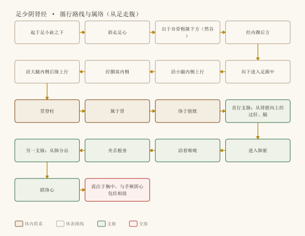

# 第 11 章 · 足少阴肾经（经脉循行·主治概要）

> **源**：`qhzy-经络腧穴学.xlsx` · 表「11 足少阴肾经及其腧穴」 · 源文 7,582 字
> **抽取**：`node scripts/import_textbooks.js --only 经络腧穴学` · sha256 `a630e66b5a4609ab…` · 2026-10-21
> **层次**：本文件是**源教材正文层** —— 节次取自源表的结构列，文字未改写、未压缩、未抽样。改写层（N.3「这个翻译丢掉了什么」/ N.5「争议与本项目立场」）尚未撰写，见 `textbooks/README.md` 章契约。

---

## 11.1 经脉循行

### 11.1.1 循行路线与属络

#### 11.1.1.1 起于涌泉/属肾络膀胱

足少阴肾经，简称肾经，属十二经脉之一，与足太阳膀胱经相表里。肾为先天之本，主藏精，主水，主纳气，为人体生命活动之根本；本经起于足小趾之下，斜走足心，出于舟骨粗隆下方（然谷），经内踝后方，向下进入足跟中，沿小腿内侧上行，经腘窝内侧，沿大腿内侧后缘上行，贯脊柱，属于肾，络于膀胱。其直行支脉，从肾脏向上经过肝、膈，进入肺脏，沿着喉咙，夹舌根旁；另一支脉，从肺分出，联络心，流注于胸中。经脉循行所过之处，联系肾、膀胱、肝、肺、心等脏腑及咽喉、舌本等器官，为肾经腧穴主治肾系、肺系、咽喉、妇科及前阴病证奠定了循行基础。 《灵枢·经脉》对本经循行的记载为：【原文】'肾足少阴之脉，起于小指之下，邪走足心，出于然谷之下，循内踝之后，别入跟中'（《灵枢·经脉》）。经文所述“邪走足心”，邪通斜，指经脉从足小趾下方斜向足心而行；然谷即内踝前下方隆起之大骨，即舟骨粗隆。经脉下行进入足跟中，沿小腿内侧上行，经腘窝内侧，沿大腿内侧后缘上行，贯脊柱，属于肾，络于膀胱，【原文】'上股内后廉，贯脊属肾，络膀胱'（《灵枢·经脉》）。由此可知，肾经与足太阳膀胱经通过脏腑络属构成表里关系，肾与膀胱一脏一腑，同居下焦，共司水液代谢与排泄。肾经循行“贯脊”，脊柱为督脉所行、肾所主骨之处，故肾经经气与脊、骨关系密切，肾虚腰痛、脊股内后侧痛等病证，每从肾经论治。 其直行支脉的循行为：【原文】'其直者：从肾上贯肝、膈，入肺中，循喉咙，夹舌本'（《灵枢·经脉》）。直行者从肾脏向上，贯穿肝脏和横膈，进入肺脏，沿喉咙上行，夹于舌根两旁，将肾与肝、肺、咽喉、舌本紧密联系起来。肾藏精而肝藏血，精血互生；肾主纳气而肺主呼吸，金水相生；足少阴之脉“循喉咙，夹舌本”，故肾阴不足、虚火上炎之咽喉肿痛，可用肾经腧穴治疗。其支脉的循行为：【原文】'其支者：从肺出，络心，注胸中'（《灵枢·经脉》）。支脉从肺脏分出，联络心脏，注于胸中，与手厥阴心包经衔接，使肾水与心火上下交济，为心肾相交的经脉基础，故肾经腧穴亦可治疗心悸、失眠等心神病证。 循行要点：肾经起于足心，循下肢内侧后缘上行，贯脊属肾络膀胱；体内联络肝、肺、心，上行循喉咙夹舌本，注于胸中。其循行体现了肾为“先天之本”、主水、主纳气的生理特点，亦决定了本经腧穴主治以肾系病证为中心，兼及肺、咽喉、心及经脉循行部位病证。 【表里与流注】肾经与膀胱经相表里，肾为脏属阴，膀胱为腑属阳，二者通过经脉相互络属，共同完成水液代谢的调节；肾经又通过支脉“从肺出，络心，注胸中”，与手厥阴心包经相接，使十二经脉气血流注由足太阳膀胱经传入手少阴肾经，再传至手厥阴心包经，周而复始，如环无端。肾藏精，为先天之本，肾精化生肾气，肾气分阴阳，为一身阴阳之根本，故肾经腧穴既能补肾益精，又能调理阴阳，临床应用极为广泛。 【歌诀与取穴要点】足少阴肾经经穴歌曰：“KI二十七肾经属，起于涌泉止俞府，肝心脾肺膀胱肾，肠腹泌尿生殖喉。”肾经共二十七穴，起于足底涌泉，止于胸部俞府，主治涉及肝、心、脾、肺、膀胱、肾诸脏腑及肠腹、泌尿、生殖、咽喉病证，歌诀简明概括了本经腧穴的分布与主治规律，便于临床取穴记忆。本经腧穴分布特点：足部及小腿穴（涌泉、然谷、太溪、大钟、水泉、照海、复溜、交信、筑宾、阴谷）主治肾系、妇科、前阴及神志病证；腹部穴（横骨至幽门）主治泌尿生殖、胃肠病证；胸部穴（步廊至俞府）主治胸肺疾患。取穴时须注意：足底涌泉在足心凹陷处，须屈足卷趾取之；内踝附近诸穴以跟腱、舟骨粗隆、跟骨结节为标志；腹胸部穴均以前正中线旁开0.5寸或2寸定位，逐穴相隔1寸或1肋间隙。 【本经穴位概览】足少阴肾经共二十七穴，首穴涌泉，末穴俞府，双侧共五十四穴。穴名多与“水”相关，如涌泉、水泉、照海、复溜、交信等，体现了肾主水的生理特性；胸腹部穴名如幽门、商曲、石关、阴都、腹通谷、步廊、神封、灵墟、神藏、彧中、俞府等，或示部位，或寓功用。全经腧穴以足踝部穴最为常用，太溪、照海、复溜、涌泉等皆为临床要穴，胸腹部穴多用于泌尿生殖、胃肠及胸肺病证。学习本经，宜循经线掌握穴位分布，再结合各穴主治特点记忆运用。 【循行分段详解】足少阴肾经的循行，自下而上可分为足部段、小腿段、大腿段与体内段四段。足部段：经脉起于足小趾之下，斜走足心，出于舟骨粗隆下方。足小趾为足太阳膀胱经所起之处，肾经起于其下，正合“阴阳表里经脉起止相接”之意；足心为涌泉穴所在，是肾经经气所出之根。小腿段：经脉从内踝后方下行进入足跟中，再沿小腿内侧上行，经腘窝内侧。足跟为肾经“别入跟中”之处，足跟痛每从肾经论治；小腿内侧属阴，经脉行于胫骨内侧缘后方，与足太阴脾经、足厥阴肝经同为下肢内侧之经，三阴经在足踝部形成三阴交，为足三阴经交会之处，故足踝部穴位（太溪、照海、复溜等）亦为足三阴经病证常用之穴。大腿段：经脉沿大腿内侧后缘上行，贯脊柱。大腿内侧后缘为足少阴与足太阳经在体表的表里对应部位，经脉上行贯脊，与督脉并行于脊柱两侧，故肾经腧穴能治疗腰脊病证。体内段：经脉属于肾，络于膀胱；直行者从肾上贯肝、膈，入肺中，循喉咙，夹舌本；支者从肺出，络心，注胸中。体内段将肾与膀胱、肝、肺、心及咽喉、舌本联系起来，形成了“肾—膀胱—肝—肺—心”的脏腑经络联系网络，肾经腧穴之所以能治疗肺系、心系、咽喉及妇科病证，正是基于这一循行基础。 【经脉与脏腑关系】肾经与肾、膀胱两脏腑有直接属络关系，与肝、肺、心三脏通过直行支脉相联络，形成了肾经与五脏六腑的广泛联系。其一，肾与膀胱相表里：肾为脏属阴，膀胱为腑属阳，经脉相互络属，功能上共司水液代谢，肾阳气化则膀胱开阖有度，故肾经腧穴可治疗癃闭、遗尿、小便不利等膀胱病证。其二，肾与肝精血互生：肝肾同源，肾藏精、肝藏血，精血互化，肾经直行者上贯肝，故肾经腧穴能滋养肝肾、调理冲任，治疗月经不调、不孕等病证。其三，肾与肺金水相生：肺属金、肾属水，金生水，肾经入肺中，故肺肾同病之咳喘、咯血，可取肾经腧穴纳气平喘。其四，肾与心水火既济：心属火、肾属水，肾经支脉络心，心肾相交则神安，故失眠、心悸等心肾不交之证，可取肾经腧穴滋阴降火、交通心肾。可见肾经虽以属肾络膀胱为主，其循行却联系五脏，故肾经腧穴主治范围甚广，为“肾为先天之本”的经络学依据。 【循行要点记忆】记忆肾经循行，可抓住“一源、二络、三联系”之纲要：一源，指肾经起于足小趾之下、斜走足心，经气源于足底涌泉；二络，指经脉属肾络膀胱，构成表里关系；三联系，指经脉上贯肝膈、入肺中、循喉咙夹舌本、络心注胸中，联系肝、肺、心三脏及咽喉、舌本。循行顺序依次为足心、内踝、跟中、小腿内侧、腘窝、大腿内侧后缘、贯脊、属肾络膀胱、上贯肝膈、入肺、循喉咙夹舌本、络心注胸中。取穴定位时，足部穴以足心、舟骨粗隆、跟腱、跟骨结节为标志，小腿穴以内踝尖为基准上下定位，腹胸部穴均以任脉（前正中线）为基准旁开定位，循经取穴宜先辨体表标志，再定穴位分寸。

### 11.1.2 主要病候

#### 11.1.2.1 腰痛/水肿/咽干等

本经主要病候为：【原文】'咯血，气喘，舌干，咽喉肿痛，水肿，大便秘结，泄泻，腰痛，脊股内后侧痛，痿弱无力，足心热等症'（转引自《针灸学》新世纪第4版）。分析其病机：肾主纳气，肾不纳气、气失摄纳则气喘，气不归元、血随气逆则咯血；肾阴不足、虚火循经上炎则舌干、咽喉肿痛；肾主水液，气化失司、水液泛溢则水肿；肾司二便，肾气不固则大便秘结或泄泻；腰为肾之府，肾虚则腰痛；经脉行于脊股内后侧，经气不利则脊股内后侧痛、痿弱无力；肾阴亏虚、虚热内生则足心热。病候所及，均与肾的生理功能及经脉循行部位密切相关。 【病候阐释】肾经病候涉及肾之精气阴阳及经脉循行部位多方面，可从脏腑与经络两个层面理解。就脏腑功能而言：其一，肾主纳气，肾不纳气则呼吸表浅、气短喘促，咳甚则络伤血溢而为咯血，此类病候多见于久病肾虚、肺肾气虚之咳喘患者；其二，肾主水液，赖肾阳之气化，肾阳虚衰则气化无权，水湿泛溢肌肤，发为水肿，水气内停则二便异常；其三，肾司二便，肾气不固则膀胱失约、大便失禁，或肾阴不足、肠道失润而大便秘结；其四，肾藏精生髓，肾精亏虚则髓海不足、筋骨失养，发为痿弱无力。就经络循行而言：经脉“贯脊属肾”，行于脊股内后侧，肾虚或寒湿之邪循经阻滞，则腰痛、脊股内后侧痛；经脉“循喉咙，夹舌本”，肾阴不足、虚火上炎则舌干、咽喉肿痛；足心为肾经所起之处，肾阴亏虚、虚热内生则足心热。可见本经病候以肾之功能失常为中心，兼及肺、咽喉及下肢内侧循行部位，为临床辨证取穴提供了依据。 【病候与循行对应】《灵枢·经脉》所载足少阴肾经病候，与经脉循行路线高度对应：经气起于足心，故足心热、足跟痛见于本经；经脉循内踝、小腿内侧、腘窝、大腿内侧后缘上行，故小腿内侧痛、下肢痿痹、脊股内后侧痛为本经所过之处病证；经脉贯脊属肾络膀胱，故腰痛、水肿、二便异常与肾及膀胱病变相关；经脉上贯肝膈、入肺中、循喉咙、夹舌本、络心注胸中，故咯血、气喘、咽喉肿痛、舌干及心悸失眠等病证均可从肾经论治。这种“经脉所过、病候所及”的对应关系，正是经络辨证取穴的基础。 【临床辨治举隅】肾经病候在临床辨证中，须辨虚实寒热：肾阳虚者，症见畏寒肢冷、腰膝酸软、水肿、小便清长，治宜温补肾阳，取肾俞、命门、关元及本经太溪、复溜等穴，针灸并用；肾阴虚者，症见潮热盗汗、咽干舌燥、足心热、腰膝酸软，治宜滋阴降火，取太溪、照海、然谷等穴，针刺为主；肾气不固者，症见遗精滑泄、小便频数、遗尿，治宜补肾固摄，取太溪、关元、肾俞等穴，重用灸法；肾不纳气者，症见呼多吸少、动则喘甚，治宜补肾纳气，取太溪、气海、膻中等穴。上述辨治思路体现了“虚则补之”的针灸治疗原则，临证尚须结合具体病证随证加减。 【现代认识】现代研究表明，针刺肾经腧穴可调节肾血流量及肾小球滤过功能，影响水钠代谢与血压调节，并对下丘脑—垂体—肾上腺轴及性腺轴功能有一定影响；针刺太溪、复溜等穴对泌尿系统疾病、慢性肾病及水肿的辅助治疗作用已有实验与临床观察支持。上述研究属“现代认识，不改经典原义”，针灸治疗肾系病证仍以辨证论治为纲，现代研究结果可作为临床参考。 【是动病与所生病辨析】《灵枢·经脉》在叙述十二经脉病候时，历来有“是动病”与“所生病”之分。是动病多为经气变动、病在气分经脉之候，所生病则多为脏腑阴阳气血失调、病在脏腑之候。肾经病候中，咯血、气喘、舌干、咽喉肿痛等，既可见于肾不纳气、虚火上炎之脏病，亦可见于经气逆乱之经病；水肿、大便秘结、泄泻、腰痛、脊股内后侧痛、痿弱无力、足心热等，则多属脏腑功能失调及经脉循行部位病变。临床上不必拘泥于是动、所生之截然划分，而应结合病候出现的脏腑经络背景综合辨治，此即“审证求因、辨证论治”之义。 【肾经病候与针灸治疗】肾经病候的针灸治疗，总以“调补肾之阴阳精气”为要：喘咳咯血者，取太溪、复溜、肺俞、肾俞，补肾纳气、金水相生；水肿者，取复溜、阴陵泉、水分、肾俞，温阳利水；便秘者，取太溪、照海、支沟、天枢，滋阴润肠；泄泻者，取太溪、足三里、天枢，补肾健脾；腰痛、脊股内后侧痛者，取委中、肾俞、太溪，通经活络；足心热者，取涌泉、然谷、太溪，滋阴降火；咽喉肿痛、舌干者，取照海、列缺、太溪，滋阴清热。临证又当据虚实寒热随证加减，虚者补之、实者泻之、寒者灸之、热者疾之，体现了针灸辨证施治的整体观念。 【肾经病候的现代认识】现代临床与实验研究提示，肾经腧穴对泌尿系统、呼吸系统及内分泌系统疾病均有治疗作用：针刺太溪、复溜等穴可改善肾血流量与肾功能指标，对慢性肾炎、肾功能不全之水肿、蛋白尿有一定辅助作用；针刺肾俞、太溪可调节下丘脑—垂体—肾上腺轴功能，改善更年期综合征、骨质疏松等内分泌相关病证；针刺照海、涌泉对失眠、焦虑等精神神经症状有缓解作用。上述研究为肾经病候的针灸治疗提供了现代实验依据，属“现代认识，不改经典原义”，临床仍当以辨证论治为准绳。

## 11.2 主治概要

### 11.2.1 主治特点

#### 11.2.1.1 肾/肺/咽喉/妇科/前阴病证

足少阴肾经腧穴主治以肾及泌尿生殖系统病证为主，兼治肺系、咽喉、妇科、前阴及神志病证，即本节标题所概括的“肾/肺/咽喉/妇科/前阴病证”。肾藏精，主生长发育与生殖，为先天之本；肾主水，司膀胱开阖，与膀胱相表里；肾主纳气，助肺呼吸；肾开窍于耳及二阴，其华在发；肾阴肾阳为五脏阴阳之本。故肾经腧穴主治范围广泛，凡肾之精气阴阳亏虚所导致的病证，皆可选用本经腧穴调治。 1.头和五官病证：头痛，目眩，咽喉肿痛，齿痛，耳聋，耳鸣等。肾藏精生髓，脑为髓海，肾精不足则髓海空虚，发为头痛、目眩；肾开窍于耳，肾精亏虚、耳窍失养则耳鸣、耳聋；足少阴之脉循喉咙夹舌本，肾阴不足、虚火上炎则咽喉肿痛、齿痛。临床常用太溪、照海等穴滋阴降火，治疗虚性咽喉、耳目病证。 2.妇科病，前阴病：月经不调，遗精，阳痿，小便频数等。肾为先天之本，主藏精，司二阴；女子以血为本，经水出于肾，肾精充盛则天癸至、月事以时下，肾气亏虚则月经不调、带下、不孕；男子肾精不固则遗精，命门火衰则阳痿；肾气不固、膀胱失约则小便频数、遗尿。故涌泉、然谷、太溪、照海、复溜等穴为治疗妇科及泌尿生殖病证的常用穴。 3.经脉循行部位的其他病证：下肢厥冷，内踝肿痛等。经脉起于足心，行经内踝、小腿内侧及大腿内侧后缘，凡经脉所过之处因寒凝、气血运行不畅所致之下肢厥冷、内踝肿痛、腰脊痛、脊股内后侧痛等，均可取本经腧穴治疗，体现了“经脉所过，主治所及”的取穴原则。 【常用穴举隅】肾经腧穴中，涌泉为井穴，开窍醒神，多用于急症；太溪为原穴，补肾益精，为肾虚诸证之要穴；照海通阴跷脉，滋阴安神利咽；复溜为经穴，利水调汗；然谷为荥穴，清泄肾经虚热；阴谷为合穴，益肾调经通淋。临证之际，须辨肾之阴阳虚实：肾阳虚者，取太溪、阴谷等穴针灸并用，或配合灸法温补肾阳；肾阴虚者，取太溪、照海、然谷等穴，滋阴降火；肾气不固者，取太溪、复溜等穴，补肾固摄；水湿泛溢者，取复溜、阴谷等穴，利水消肿。体现了“虚则补之，实则泻之，寒则灸之”的针灸治疗原则。 【神志病证】肾藏志，肾精充足则志定神安；肾水亏虚，不能上济心火，心肾不交，则发为失眠、健忘、癫狂等神志病证。肾经腧穴中涌泉、照海、筑宾、阴谷等均可治疗神志病证：涌泉开窍苏厥，主治昏厥、癫狂痫；照海滋阴安神，主治失眠；筑宾为阴维脉之郄穴，主治癫狂；阴谷亦治癫狂。此类腧穴治疗神志病证的机理，在于调补肾之阴阳精气，使水火既济、心肾相交，属中医整体调节的体现。现代研究提示，针刺肾经腧穴对神经内分泌及自主神经功能有一定调节作用，可辅助改善睡眠障碍及部分精神症状，属“现代认识，不改经典原义”。 【肾经与冲任】足少阴肾经与冲脉、任脉关系密切：冲脉起于胞中，为“十二经之海”“血海”，任脉为“阴脉之海”，肾经与冲脉并行于腹部（腹部腧穴均在任脉旁开0.5寸），肾经又与任脉在胸腹部多次交会，故肾经腧穴能调补冲任、固摄胞宫，为治疗月经不调、带下、不孕、阴挺等妇科病证的重要经脉。肾为先天之本，主藏精而系胞，肾气充盛则冲任通盛、经血有源，故妇科病证调治，常以肾经腧穴与任脉腧穴相配，如太溪配关元、三阴交，照海配中极、归来等，体现了“治妇人病，当以调肾为要”的学术思想。 【现代认识】现代研究表明，肾经腧穴对泌尿系统、生殖系统、内分泌及神经系统的功能具有调节作用：针刺太溪、复溜等穴可影响肾血流量及肾小球滤过功能；针刺照海、涌泉可调节自主神经功能，改善睡眠；针刺肾经穴对血压、血糖亦有一定调节作用。上述研究为肾经腧穴的临床应用提供了现代实验依据，但针灸治病仍以辨证论治为纲，现代认识仅供参考，不改经典原义。 【主治规律】肾经腧穴主治的规律，可概括为“一源三向”：一源，即主治皆源于肾之生理功能（藏精、主水、主纳气、主骨生髓、开窍于耳及二阴）；三向，即主治向三个方向延伸——向上治头面五官病证（肾精生髓充脑、肾开窍于耳、经脉循喉咙夹舌本），向下治妇科前阴及泌尿生殖病证（肾司二阴、主藏精系胞），向外治经脉循行部位病证（下肢内侧后缘、腰脊、足心）。此外，肾经腧穴尚可治疗神志病证，因肾藏志，肾精充足则志定神安。掌握这一主治规律，有助于临床举一反三：凡肾虚所致诸证，无论病位在头面、腰腹还是下肢，均可循经取穴，配合辨证选穴应用。 【各穴主治特色】肾经腧穴主治各有侧重，临床应用当据穴性选用：涌泉为井穴，长于开窍醒神、引火归元，多用于急症、神志病及虚火上炎之证；然谷为荥穴，长于清泄肾经虚热，多用于消渴、咽喉肿痛及妇科湿热病证；太溪为原穴，长于补肾益精、调理阴阳，为肾虚诸证之要穴；大钟为络穴，长于沟通表里、益肾开窍，多用于膀胱气化失常及痴呆；水泉为郄穴，长于治血证急症，多用于月经不调、痛经、淋证；照海通阴跷脉，长于滋阴安神、利咽止痛，为失眠、咽喉病要穴；复溜为经穴，长于利水调汗，为水肿、汗证要穴；筑宾、阴谷则分别长于安神定志、益肾调经通淋。掌握各穴特性，方能“穴随证选、证穴相符”。 【肾经与奇经八脉】肾经与奇经八脉关系极为密切：其一，肾经与冲脉并行于腹部，冲脉起于胞中，为“十二经之海”“血海”，肾经腹部腧穴均在任脉旁开0.5寸，与冲脉循行路线相合，故肾经腧穴能调理冲任、固摄胞宫；其二，肾经与任脉在胸腹部多次交会，任脉为“阴脉之海”，总任一身之阴，肾为先天之本、一身阴阳之根，故肾经腧穴与任脉腧穴相配，可滋阴温阳、调理阴阳；其三，照海通阴跷脉、筑宾为阴维脉之郄穴，交信亦为阴跷脉之郄穴，肾经腧穴通过八脉交会及郄穴联系阴跷、阴维二脉，参与调节一身之阴及下肢运动、眼睑开阖等功能。故肾经腧穴既能治本经病证，又能通过奇经八脉治疗相关病证，临床应用范围甚广。 【临床应用注意】肾经腧穴临床应用，尚须注意以下几点：其一，肾为先天之本，肾虚多属慢性、虚损性病证，针灸治疗贵在坚持，常需多次治疗、缓慢图功，并可配合艾灸、药物贴敷等法；其二，肾经腧穴中涌泉、太溪、照海等穴刺激量宜适中，体虚者尤须轻刺激，以防晕针；其三，妇科病证调治，宜结合月经周期分期治疗，经前期、经期、经后期选穴各有侧重；其四，胸部腧穴深部为心肺，操作必须严格遵循斜刺或平刺、浅刺的原则，确保针刺安全。针灸治病，辨证为先，安全为要，临证当慎之又慎。 本节要点：肾经腧穴主治以肾系病证为核心，突出肾藏精、主水、主纳气、开窍于耳及二阴的生理功能；主治范围涵盖头面五官（头痛、目眩、咽喉肿痛、齿痛、耳聋、耳鸣）、妇科前阴（月经不调、遗精、阳痿、小便频数）及经脉循行部位病证（下肢厥冷、内踝肿痛）；临床应用须辨肾之阴阳虚实，虚证多用太溪、照海、复溜等补益之穴，急证、热证可选用涌泉、然谷等穴。

---

> **免责声明**：本教材内容仅用于教育与科研，不构成任何诊疗建议。
> 本文件由 `scripts/import_textbooks.js` 从源工作簿生成，请勿手改 —— 需要修改请改源工作簿后重跑。
