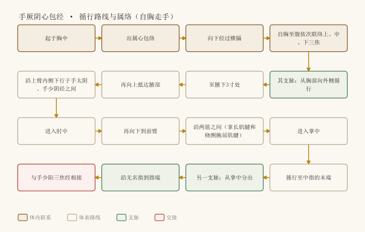

# 第 12 章 · 手厥阴心包经（经脉循行·主治概要）

> **源**：`qhzy-经络腧穴学.xlsx` · 表「12 手厥阴心包经及其腧穴」 · 源文 4,794 字
> **抽取**：`node scripts/import_textbooks.js --only 经络腧穴学` · sha256 `a630e66b5a4609ab…` · 2026-10-21
> **层次**：本文件是**源教材正文层** —— 节次取自源表的结构列，文字未改写、未压缩、未抽样。改写层（N.3「这个翻译丢掉了什么」/ N.5「争议与本项目立场」）尚未撰写，见 `textbooks/README.md` 章契约。

---

## 12.1 经脉循行

### 12.1.1 循行路线与属络

#### 12.1.1.1 起于天池/属心包络三焦

手厥阴心包经，简称心包经，属十二经脉之一，与手少阳三焦经相为表里。心包位于胸中，为心之宫城，具有保护心脏、代心受邪的作用，故本经病候多与心胸、神志相关。本经起于胸中，出属心包络，向下经过横膈，自胸至腹依次联络上、中、下三焦；其支脉，从胸部向外侧循行，至腋下3寸处，再向上抵达腋部，沿上臂内侧下行于手太阴、手少阴经之间，进入肘中，再向下到前臂，沿两筋之间，进入掌中，循行至中指的末端；另一支脉从掌中分出，沿无名指到指端（图3-56）。 《灵枢·经脉》对本经循行作了经典描述：【原文】'心主手厥阴心包络之脉，起于胸中，出属心包络，下膈，历络三焦'（《灵枢·经脉》）。"心主"，即心包络，言心包代心行令、代心受邪之意；"历络三焦"，据教材注释，【原文】'历络三焦：指自胸至腹依次联络上、中、下三焦'（转引自《针灸学》新世纪第4版）。其支者：【原文】'其支者，循胸出胁，下腋三寸，上抵腋下'（《灵枢·经脉》），继则沿上臂内侧（原文作"循臑内"）下行，【原文】'行太阴、少阴之间，入肘中，下臂，行两筋'（《灵枢·经脉》）之间，【原文】'入掌中，循中指，出其端'（《灵枢·经脉》）；又【原文】'其支者，别掌中，循小指次指出其端'（《灵枢·经脉》）。文中"两筋"，指掌长肌腱和桡侧腕屈肌腱；"小指次指"，即无名指。 本经体内联系：属心包络，络三焦，并与心、肺等脏关系密切；体表循行：起于胸中，经腋下、上臂内侧、肘窝、前臂掌侧两筋之间、掌中，止于中指端，其支脉至无名指端，与手少阳三焦经相接。本经虽以"起于天池"称其体表起始穴，实则经脉之根起于胸中、出属心包络，胸胁部天池为体表第一穴。心包为心之外卫，代心受邪，故邪犯心包多见心胸病证；本经气血流注承接足少阴肾经，下接手少阳三焦经，构成十二经脉气血循环的重要环节。手厥阴与手少阳两经一阴一阳、一里一表，在四肢部于无名指端衔接，在体内则心包络与三焦脏腑互为表里，三焦总司一身气化，故临床心胸病证与三焦气化失常常常相互影响，针刺本经腧穴既可调理心包经气，亦可通过表里经关系作用于三焦。 循行要点：本经起于胸中，属心包络而络三焦；体表循行于胸胁、上臂内侧、肘窝、前臂掌侧正中及掌中，止于中指端，支脉至无名指端。临证取穴，沿"腋前纹头—肘横纹—掌长肌腱与桡侧腕屈肌腱之间—掌中"一线寻按，可循经取穴治疗心胸、神志及胃腑病证。 心包经与心经的关系尤须明确：心经属心而络小肠，主治以心病为主；心包经属心包络而络三焦，主治亦以心胸、神志病证为主。两经同属手之阴经，循行于上臂内侧（心经行于内侧后缘，心包经行于两经之间），临床治疗心痛、心悸、心烦、失眠等病证时常相须为用。如心痛急症，既可取心包经内关、郄门，亦可配心经神门、阴郄；癫狂痫等神志病，则心包经与心经腧穴常同取，以宁心安神、开窍定志。此外，本经在胸部的天池穴与足厥阴肝经、足少阳胆经等亦有邻近关系，胸胁病证辨证选穴时当一并参酌（现代认识，不改经典原义）。 再从经络学说整体看，心包经与三焦经的表里配属关系，是十二经脉"脏腑表里"理论的重要一环。三焦为孤腑，总司人体气化，通行元气、运行水液，其经脉循行于上肢外侧中线，与心包经在上肢内侧中线相对；两经一阴一阳，阴阳相济，共同维系心胸与三焦的气机升降出入。临床上凡见心悸怔忡而兼胸闷气短、脘腹痞满、水湿内停者，多属心包与三焦同病，可取内关、外关表里相配，内关通阴维以宁心宽胸，外关通阳维以调畅气机，二穴相须，使心气得舒、三焦气化复常，此即"表里经配穴法"在心包经的具体运用。 《灵枢·邪客》指出，邪气侵犯心脏，皆由心包络代为承受，进一步阐明心包代心受邪的生理病理基础。心为君主之官，神明出焉，不宜直接受邪，故邪气犯心，皆由心包络代为承受。正因如此，心包经的循行与病候虽然"属于心包络而络于三焦"，其主治却广涉心、胸、胃、神志诸病，成为十二经脉中治疗心胸病证最重要的一条阴经。临证时凡心痛、心悸、胸痹、失眠、癫狂痫等病证，皆可从本经入手；又因本经与三焦相表里，三焦气化失司所生之痰饮、水湿，亦可通过调理本经而化。现代认识认为，心包经在上肢内侧的循行路线与正中神经、前臂掌侧血管神经束的走行大体一致，其胸部天池穴深层邻近心、肺，针刺时须严格掌握深度与方向（现代认识，不改经典原义）。

### 12.1.2 主要病候

#### 12.1.2.1 心痛/心烦/掌热等

本经主要病候为：【原文】'心痛，胸闷，心悸，心烦，癫狂，腋肿，肘臂挛急，掌心发热等症'（转引自《针灸学》新世纪第4版）。 心包代心受邪，故病候以心胸、神志病为主：邪犯心包，心脉痹阻，则见心痛、胸闷、心悸、心烦；心主神明，心包热盛或痰浊蒙蔽心包，则见癫狂等神志异常；经脉所过之处为病，则见腋肿、肘臂挛急、掌心发热等症。其中心痛、胸闷、心悸、心烦多属实证、热证，与心包经气郁滞、邪热内扰有关；癫狂则责之于心神被扰、神明失守；腋肿、肘臂挛急、掌心发热属经脉循行部位的经气不利。此外，本经病候还常伴有胃脘不适、呕恶等症，因本经下膈历络三焦、经气与中焦相通之故；若热邪循经上炎，亦可出现口舌生疮、舌下肿痛等表现，临床辨证时当结合经脉循行与脏腑络属综合分析。 从脏腑病机看，心包为心之外围，代心受邪，故外感六淫、内伤七情之邪，多先犯心包而后及心。邪犯心包，心阳痹阻，气血运行不畅，则心痛、胸闷、心悸、心烦；热毒炽盛，内陷心包，蒙蔽神明，则见癫狂、神昏谵语等重症；痰浊、瘀血等病理产物阻于心包络脉，亦可致心脉挛急、疼痛彻背。临床凡见心胸刺痛、闷痛，伴心悸心烦者，多从心包论治，取内关、郄门、膻中、心俞等穴宣痹通阳、理气止痛；若见神昏谵语、狂躁不宁，则当取中冲、水沟等穴开窍醒神。 从经脉病机看，本经循行于胸胁、腋下、上臂内侧、肘窝、前臂掌侧及掌中，经脉所过，病候所及，故经气阻滞则见腋肿、肘臂挛急、掌心发热等症。掌心发热一症，尤为心包经病候之特征性表现，因本经入掌中、循中指出其端，掌中为心包经气所聚之处，热邪循经下注则掌心灼热；临证见掌心灼热、掌中汗出者，可取劳宫、大陵清泄心包之热。腋肿则因本经循胸出胁、下腋三寸，经气壅滞于腋下所致；肘臂挛急因本经入肘中、下臂行于两筋之间，邪客经脉、筋脉失养则挛急不舒。凡此诸症，皆不离"经脉所过，病候所及"之理，临证可取本经循行线上腧穴疏通经气，随证施治。 此外，本经病候与手少阴心经病候颇多相通之处。心经病候以心痛、咽干、渴而欲饮、目黄、胁痛、臑臂内后廉痛厥、掌中热痛等为主；心包经病候则以心痛、胸闷、心悸、心烦、癫狂、腋肿、肘臂挛急、掌心发热等为主。两经皆循行于上肢内侧，皆入掌中，故掌中热、心痛、心悸为两经共有之候；所不同者，心经病候多兼舌、咽、目之症，心包经病候则多兼神志异常与腋肘之症。临证鉴别，当以经脉循行部位与兼见症状为据：痛在臂内侧后缘而兼咽干目黄者，责之心经；挛急在肘臂中央而兼心烦癫狂者，责之心包经。两经病候常同见并存，如心悸怔忡者，往往心经、心包经腧穴同取，神门配内关、阴郄配郄门，以增强宁心安神之力。 本经病候的传变规律，多由实转虚、由气及血：初期邪实，经气壅滞，则心痛胸闷、心烦掌热，治当泻其实；日久耗伤气阴，心包络脉失养，则心悸怔忡、神疲少寐，治当补其虚。又心包与胃以膈为界而经络相通，本经下膈历络三焦，故胃气上逆之呕恶、呃逆，亦常伴见于心包经病候之中，取内关、大陵和胃降逆，每收良效。凡此种种，皆示本经病候虽以心胸为要，实与神志、胃腑、经脉所过之处密切相关，临证当圆机活法，不可执一。

## 12.2 主治概要

### 12.2.1 主治特点

#### 12.2.1.1 心胸/神志/胃腑病证

本经腧穴主治概要，可概括为心胸、神志病证，胃腑病证及经脉循行部位的其他病证三大类。 1.心胸、神志病证：【原文】'心痛，心悸，心烦，胸闷，癫狂痫等'（转引自《针灸学》新世纪第4版）。心包为心之宫城，代心受邪，凡心系病证如心痛、心悸、胸闷、心烦等，均可取本经腧穴治疗；心主神明，心包络病则神明失守，故癫狂痫、失眠、郁证等神志病证亦属本经主治范围。本经腧穴中，内关为治疗心胸病证的要穴，常与公孙、膻中等穴相配以宽胸理气、宁心安神；郄门为郄穴，善治急性心痛；间使、大陵、曲泽等穴亦为治疗心胸及神志病的常用穴。凡心绞痛、心悸怔忡、失眠多梦、烦躁不宁等，皆可从心包经论治，此即"心包代心受邪"理论的临床应用。 2.胃腑病证：【原文】'胃痛，呕吐等'（转引自《针灸学》新世纪第4版）。本经"下膈，历络三焦"，经气与胃腑相通；又心包与三焦相为表里，三焦总司一身气化，故本经腧穴对胃腑病证亦有较好的治疗作用。临床常见的胃痛、呕吐、呃逆等，常取内关、间使、大陵等穴和胃降逆止呕，如内关配中脘、足三里治疗胃脘痛，内关配膻中、天突治疗呃逆。胃热上逆之呕血、呕吐，尤宜取曲泽、郄门等穴清泻胃热、凉血止血。凡情志不遂、肝气犯胃所致之胃脘胀痛、嗳气频作，取内关、间使疏肝和胃，亦为临床常用之法。 3.经脉循行部位的其他病证：【原文】'上臂内侧痛，肘、臂、腕挛痛，掌中热等'（转引自《针灸学》新世纪第4版）。本经循行经过胸胁、上臂内侧、肘窝、前臂掌侧及掌中，经脉所过，主治所及，故上臂内侧痛、肘臂挛痛、掌中热等局部病证，可取本经腧穴治之，如曲泽治肘臂挛痛，大陵治腕臂挛痛，劳宫治掌中热等。此类病证多因经脉气血运行不畅、经气阻滞所致，针刺本经腧穴可疏通经络、调和气血，其取穴原则为"以痛为输、循经取穴"，局部远部相配合，常获良效。 此外，本经腧穴还常用于热病、血证及急症：曲泽点刺出血可清泄血热，用于暑热病；郄门为郄穴，善治咯血、呕血、衄血等热性出血证；中冲为井穴，善于开窍醒神，急救中风昏迷、中暑、昏厥、小儿惊风等急症；劳宫清心泻火，治口疮、口臭。这些应用体现了本经腧穴"清心泻热、开窍醒神、凉血止血"的功用特点。本经经穴歌概括其主治规律为：【原文】'起于天池中冲尽，心胸肺胃效皆好，神志血病亦可寻'（经穴歌，转引自《针灸学》新世纪第4版），提示本经腧穴主治心胸、肺胃病证，兼及神志病与血分病。值得注意的是，本经腧穴的运用并不局限于心包本身，凡心、胸、胃、神志、血分诸疾，皆可从本经论治，此即心包"代心受邪、代心行事"理论在针灸临床上的具体体现。 从特定穴应用的角度看，本经腧穴主治的发挥，与特定穴属性密切相关。井穴中冲善于开窍泄热、醒神苏厥，为急救要穴；荥穴劳宫清心泻火，善治口疮口臭、掌中热；经穴间使兼治疟疾、癫狂痫；合穴曲泽清泻血热，善治暑热病及热性出血；郄穴郄门为治疗急性心痛、出血证之要穴；络穴内关通于阴维脉，与公孙相配主治胃、心、胸病证；原穴大陵宁心安神、清泻心胃之火。五输穴自指端向肘部依次排列，由浅入深、由末及本，体现了病在脏者取之井、病变于色者取之荥、病时间时甚者取之输、病变于音者取之经、经满而血者及以饮食不节得病者取之于合的取穴层次，临床可按病位之浅深、病势之缓急灵活选用。 现代临床观察表明，心包经腧穴对心脑血管系统、消化系统及精神神经系统功能均有广泛的调整作用：针刺内关可显著改善冠心病心绞痛患者的心肌缺血，对心率、血压具有双向调节作用；针刺郄门、间使可调整心律，用于心律失常的治疗；针刺内关、大陵、中冲等穴对晕车呕吐、术后恶心呕吐及妊娠恶阻亦有较好疗效；针刺中冲、劳宫等穴用于中风昏迷、中暑等急症的救治，具有开窍醒神之效。凡此皆为本经腧穴主治的现代印证（现代认识，不改经典原义）。临床选穴时，应本"经络所过，主治所及"之旨，结合特定穴特性，灵活配伍，方能尽本经腧穴之用。 本节要点：手厥阴心包经主治以心胸病证为核心，兼治胃腑病证、神志病及经脉循行部位病证；临床取穴以心包代心受邪、下膈历络三焦等经络理论为依据，内关、郄门、间使、大陵、中冲等穴各有所主，须结合特定穴属性灵活运用。

---

> **免责声明**：本教材内容仅用于教育与科研，不构成任何诊疗建议。
> 本文件由 `scripts/import_textbooks.js` 从源工作簿生成，请勿手改 —— 需要修改请改源工作簿后重跑。
