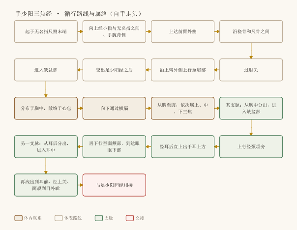

# 第 13 章 · 手少阳三焦经（经脉循行·主治概要）

> **源**：`qhzy-经络腧穴学.xlsx` · 表「13 手少阳三焦经及其腧穴」 · 源文 4,433 字
> **抽取**：`node scripts/import_textbooks.js --only 经络腧穴学` · sha256 `a630e66b5a4609ab…` · 2026-10-21
> **层次**：本文件是**源教材正文层** —— 节次取自源表的结构列，文字未改写、未压缩、未抽样。改写层（N.3「这个翻译丢掉了什么」/ N.5「争议与本项目立场」）尚未撰写，见 `textbooks/README.md` 章契约。

---

## 13.1 经脉循行

### 13.1.1 循行路线与属络

#### 13.1.1.1 起于关冲/属三焦络心包

手少阳三焦经，简称三焦经，属十二经脉之一，与手厥阴心包经相为表里。三焦为六腑之一，有主持诸气、总司全身气机与气化的功能，又为水液运行之通路，其气化正常与否直接关系水液的输布与排泄。故本经病候除头面五官病证外，多与水液代谢失常及三焦气化不利有关。本经起于无名指尺侧末端，属三焦而络心包，气血流注承接手厥阴心包经，下接足少阳胆经。 三焦者，为六腑之一，有上焦、中焦、下焦之分。上焦如雾，主宣发卫气、输布水谷精微；中焦如沤，主腐熟水谷、化生营血；下焦如渎，主泌别清浊、排泄水液。三焦气化正常，则水道通调，津液输布有序；三焦气化失常，则水液停聚，变生腹胀、水肿、小便不利等症。心包与三焦互为表里，心包主血脉、主神明，三焦主气化、行水液，两者一里一表，病理上相互影响，故本经腧穴既能调理水液代谢，亦能通过表里经关系作用于心包所主的心胸、神志病证。 体表循行路线：起于无名指尺侧末端，向上经小指与无名指之间、手腕背侧，上达前臂外侧，沿桡骨和尺骨之间，过肘尖，沿上臂外侧上行至肩部，交出足少阳经之后，进入缺盆部，分布于胸中，散络于心包，向下通过横膈，从胸至腹，依次属上、中、下三焦。其支脉，从胸中分出，进入缺盆部，上行经颈项旁，经耳后直上出于耳上方，再下行至面颊部，到达眼眶下部。另一支脉，从耳后分出，进入耳中，再浅出到耳前，经上关、面颊到目外眦，与足少阳胆经相接。由此可见，本经循行自上而下遍及三焦，又与耳、目、咽喉等官窍相连，这是其主治头面五官病证与水液代谢病证的循行基础。 《灵枢·经脉》对本经循行作了经典描述：【原文】'三焦手少阳之脉，起于小指次指之端，上出两指之间，循手表腕，出臂外两骨之间，上贯肘'（《灵枢·经脉》），继则沿上臂外侧上行，【原文】'而交出足少阳之后，入缺盆'（《灵枢·经脉》），入缺盆后布于胸中，【原文】'散络心包，下膈，遍属三焦'（《灵枢·经脉》）。其支者：【原文】'上出缺盆，上项，系耳后，直上出耳上角'（《灵枢·经脉》），再下行至面颊部；又【原文】'其支者，从耳后入耳中，出走耳前'（《灵枢·经脉》），【原文】'过客主人前，交颊，至目锐'（《灵枢·经脉》）。文中“小指次指”即无名指，“手表腕”指手背腕关节，“臂外两骨之间”指前臂背侧尺骨与桡骨之间，“膻中”此指胸中、不指穴名；句末“遍”字，《脉经》作“偏”，据教材注释【原文】'指自上而下依次联属三焦'（转引自《针灸学》新世纪第4版）。 体内属络联系：本经属三焦，络心包，并与心、肺等脏气相通。三焦主气化而通调水道，三焦气化失常，水液代谢障碍，则见腹胀、水肿、遗尿、小便不利等症；本经循行绕耳、过目外眦、行咽喉，邪热循经上扰，则见耳聋、耳鸣、咽喉肿痛、目赤肿痛、颊肿等症；经脉所过之处经气不利，则见耳后、肩、臂、肘外侧疼痛等症。就病候性质而言，本经病证多属热证、实证，如耳聋、耳鸣、咽喉肿痛、目赤肿痛皆以火邪上炎为要；而三焦气化不利所致的水液代谢失常则虚实并见，水肿、腹胀多属本虚标实，遗尿、小便不利又常与肾气不固、膀胱失约相关，临床当结合脏腑辨证审因论治。 本经循行环耳周而绕行头侧，与耳的听觉、目的视觉、咽喉的通利关系至为密切，故耳聋、耳鸣、目赤肿痛、咽喉肿痛为本经最为常见的病证；邪热循经上炎，又可见颊肿、齿痛等。三焦为水液运行之通路，三焦气化失常所致的水肿、小便不利等水液代谢病证，亦可取本经腧穴调治。临床凡见耳、目、咽喉及头侧病证，或水液代谢失常病证，均当考虑从手少阳三焦经论治（现代认识，不改经典原义）。 循行要点：本经起于无名指尺侧末端（关冲），止于眉梢（丝竹空），属三焦而络心包；体表循行于上肢外侧正中，经肩、颈项旁，绕耳后，上头侧，止于眉梢，其支脉入耳中、至目外眦。本经起止穴关冲、丝竹空，一为井穴、一为头面部要穴，分别用于急救开窍与头目病证。临证取穴，沿无名指尺侧、手背第4、5掌骨间、腕背横纹、前臂外侧两骨之间、肘尖、上臂外侧、肩、颈至耳周一线寻按，可循经取穴治疗耳、目、咽喉及头侧病证，以及三焦气化失常所致的腹胀、水肿、遗尿、小便不利等病证。本经与手厥阴心包经在无名指端相接，两经互为表里，临床心胸病证可配本经外关等穴以疏调三焦气机，三焦气化失常之病亦可配心包经内关等穴调理，体现了表里经配穴的临床意义（现代认识，不改经典原义）。

### 13.1.2 主要病候

#### 13.1.2.1 耳聋/咽喉肿/目锐眦痛等

本经主要病候为：【原文】'腹胀，水肿，遗尿，小便不利，耳聋，耳鸣，咽喉肿痛，目赤肿痛，颊肿，耳后、肩、臂、肘外侧疼痛等症'（转引自《针灸学》新世纪第4版）。分析其病机，可将本经病候归纳为水液代谢失常、头面五官火热及经脉循行部位病证三类，分别与三焦的生理功能及经脉的循行分布相应。 【水液代谢病候】腹胀，水肿，遗尿，小便不利。三焦为六腑之一，主持诸气、总司全身气机与气化，又为水液运行之通路；三焦气化正常，则水道通调，津液输布有序。若三焦气化失司，水道不利，水液停聚泛溢，则见腹胀、水肿；若下焦气化失常，膀胱开阖失约，则见遗尿、小便不利。故水液代谢失常类病候为本经病候的重要组成部分，凡腹胀、水肿、遗尿、小便不利等症，均可从调理三焦气化入手，取本经腧穴治之，此即三焦为决渎之官、主通调水道之义在临床的体现。 【头面五官病候】耳聋，耳鸣，咽喉肿痛，目赤肿痛，颊肿。本经循行绕耳周、过目外眦、行面颊与咽喉，支脉从耳后入耳中、出走耳前，与耳、目、咽喉、面颊关系至为密切。邪热循经上扰，经气壅滞，则见耳聋、耳鸣、咽喉肿痛、目赤肿痛、颊肿等症。其中耳聋、耳鸣为本经最具特征性的病候，因本经支脉入耳中、出走耳前，耳部经气壅滞或失养，皆可致听力异常；咽喉为经脉所过，邪热循经上炎则咽喉肿痛。临床凡见耳、目、咽喉及颊部火热病证，均当考虑从手少阳三焦经论治。 【经脉循行部位病候】耳后、肩、臂、肘外侧疼痛。经脉所过之处经气不利，气血运行不畅，则见耳后、肩、臂、肘外侧疼痛等症。此类病候多因外感风寒湿邪或劳损内伤，致经脉痹阻，其辨证取穴当以"经脉所过，主治所及"为原则，沿本经循行路线寻按痛点，选取外关、支沟、肩髎等穴疏通经气。 【病候性质与传变】就病候性质而言，本经病候多属热证、实证，如耳聋、耳鸣、咽喉肿痛、目赤肿痛皆以火邪上炎为要；而三焦气化不利所致的水液代谢失常则虚实并见，水肿、腹胀多属本虚标实，遗尿、小便不利又常与肾气不固、膀胱失约相关，临床当结合脏腑辨证审因论治。三焦与心包相为表里，三焦气化失常，气机郁滞，亦可影响心包所主的心胸、神志病证；反之，心包之邪亦可循表里经关系影响三焦，故本经病候虽以水液与头面五官病证为主，临证尚须顾及表里两经的病理联系（现代认识，不改经典原义）。 【临床辨治思路】本经病候中，水液代谢类与头面五官类病证往往兼见，如三焦气化失司者，既见腹胀、水肿，又因水湿上泛、清窍被蒙而见耳鸣、头重；火热循经上炎者，既见咽喉肿痛，又常兼见耳聋、目赤。临证当以经脉循行为纲、脏腑气化为目，结合具体见症灵活选穴：水肿、腹胀取阳池、外关等调理气化、通调水道；耳聋、耳鸣取翳风、耳门、中渚等近部与远部相配；咽喉肿痛、目赤肿痛取关冲、液门等清泻三焦邪热。如此循经取穴与辨证选穴相结合，方能切中病机，获效于临床。

## 13.2 主治概要

### 13.2.1 主治特点

#### 13.2.1.1 头面耳目/热病/经脉循行病证

本经腧穴的主治范围，依据经脉循行与脏腑属络，可归纳为头面五官病、热病、经脉循行部位的其他病证三组。 1.头面五官病证：头、目、耳、颊、咽喉病等。本经循行过耳周、目外眦、面颊及咽喉，故本经诸穴均可治疗耳聋、耳鸣、目赤肿痛、咽喉肿痛、头痛等病证。其中翳风、耳门、角孙等穴近耳，为治耳疾之要穴；丝竹空位于眉梢，善治目疾；关冲、液门、中渚、外关等穴循经远取，可清泻三焦之火而治咽喉肿痛、目赤肿痛。2.热病：热病汗出。本经腧穴多有清热之功，其中关冲为井穴，点刺出血可清泻三焦之热，用于高热、中暑；液门为荥穴，善治热性病证；外关为八脉交会穴，通于阳维脉，阳维主阳主表，故善治外感表证之发热、热病汗出。热病汗出，多因外感风热、邪犯少阳所致，取外关疏风解表、和解少阳，常配大椎、曲池等穴，使邪从表解；若高热神昏、烦躁不安，则取关冲、中渚等穴点刺放血或施泻法，清泻三焦之热（现代认识，不改经典原义）。3.经脉循行部位的其他病证：胸胁痛，肩臂外侧痛，上肢挛急、麻木、不遂等。上肢痿痹不遂，可取外关、支沟等；肩臂疼痛、肩重不能举，取肩髎、臑会等；肘劳，取天井；胁肋痛，取支沟、外关等，常配合足少阳胆经腧穴同用。 本经腧穴的特定穴属性较为齐全，五输穴中井、荥、输、经、合俱备，尚有原穴、络穴与八脉交会穴，临床应用可依其属性把握主治特点：井穴关冲善开窍泄热，多用于热病神昏、中暑等急症；荥穴液门善清泻邪热，多用于热性五官病证；输穴中渚善治体重节痛，多用于肩背肘臂酸痛；经穴支沟善调气机，多用于胁肋痛、便秘；合穴天井善疏风通络，多用于癫痫、瘿气及肘臂病证；原穴阳池可调理三焦气化，多用于消渴、口干及腕臂痛；络穴外关沟通表里，又通阳维脉，为治热病与头侧五官病证之要穴。临证取穴，当远近相配、表里互参，方能切中病机。 外关为八脉交会穴之一，通于阳维脉。《八脉交会八穴歌》云：【原文】'阳维目锐外关逢'（转引自《针灸学》新世纪第4版），言外关通阳维脉，可治目锐眦、耳后、面颊、颈项部病证及寒热往来等阳维脉失调之症（现代认识，不改经典原义）。临床取本经腧穴，尚须根据“经脉所过，主治所及”的原则，结合腧穴的特定穴属性灵活配伍，如高热神昏取关冲点刺出血，耳鸣耳聋取翳风、耳门，肩臂不举取肩髎，便秘取支沟等。此外，本经腧穴循经分布于上肢外侧正中与头侧耳周，取穴时既可按部就近选用耳周诸穴，亦可循经远取手部、前臂部腧穴，如耳病可取翳风、耳门局部施针，亦常配外关、中渚等远道取穴，远近结合，疗效相得益彰（现代认识，不改经典原义）。 总而言之，本经腧穴以疏调三焦气机、清泻三焦邪热为基本功用。三焦主持诸气、通行水道，故本经腧穴既能调气，又能利水，凡气机郁滞、水液停聚之证皆可选用；又因循行过耳、目、咽喉，其清热之功多用于头面五官之火热病证。凡属少阳枢机不利之证，取本经腧穴和解枢机、疏调气机，亦为临床常用之法（现代认识，不改经典原义）。临证之时，当辨清病位之表里、病性之寒热虚实，灵活运用井穴放血、荥输穴清热、络穴解表、经穴调气、合穴通络等法，配合局部取穴与循经远取，方能获效。 本节要点：本经腧穴主治以头面五官病、热病及经脉循行部位病证为主。头面五官病重在耳、目、咽喉；热病以井、荥穴及八脉交会穴外关为常用；经脉循行部位病证则以支沟、肩髎等局部与循经取穴相配。本经腧穴尚有通调水道之功，水肿、小便不利等症可配合选用。临床运用时，须把握“经脉所过，主治所及”的原则，结合特定穴属性灵活选穴。

---

> **免责声明**：本教材内容仅用于教育与科研，不构成任何诊疗建议。
> 本文件由 `scripts/import_textbooks.js` 从源工作簿生成，请勿手改 —— 需要修改请改源工作簿后重跑。
