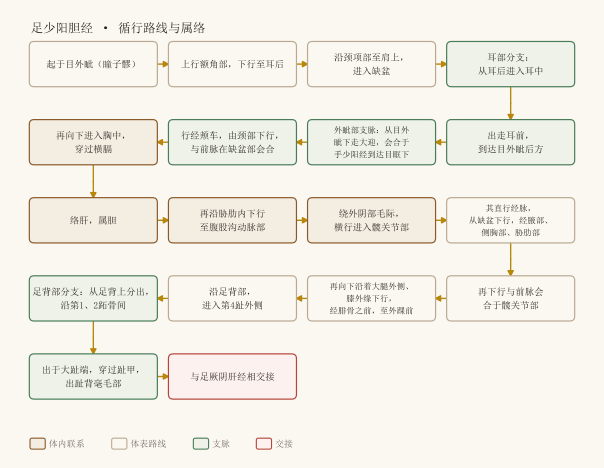

# 第 14 章 · 足少阳胆经（经脉循行·主治概要）

> **源**：`qhzy-经络腧穴学.xlsx` · 表「14 足少阳胆经及其腧穴」 · 源文 5,671 字
> **抽取**：`node scripts/import_textbooks.js --only 经络腧穴学` · sha256 `a630e66b5a4609ab…` · 2026-10-21
> **层次**：本文件是**源教材正文层** —— 节次取自源表的结构列，文字未改写、未压缩、未抽样。改写层（N.3「这个翻译丢掉了什么」/ N.5「争议与本项目立场」）尚未撰写，见 `textbooks/README.md` 章契约。

---

## 14.1 经脉循行

### 14.1.1 循行路线与属络

#### 14.1.1.1 起于瞳子髎/属胆络肝

足少阳胆经，简称胆经，属十二经脉之一，与足厥阴肝经相表里。本经起于目外眦（瞳子髎），上行额角部，下行至耳后，沿颈项部至肩上，进入缺盆。耳部分支，从耳后进入耳中，出走耳前，到达目外眦后方。外眦部支脉，从目外眦下走大迎，会合于手少阳经到达目眶下，行经颊车，由颈部下行，与前脉在缺盆部会合，再向下进入胸中，穿过横膈，络肝，属胆，再沿胁肋内下行至腹股沟动脉部，绕外阴部毛际，横行进入髋关节部。其直行经脉，从缺盆下行，经腋部、侧胸部、胁肋部，再下行与前脉会合于髋关节部，再向下沿着大腿外侧、膝外缘下行，经腓骨之前，至外踝前，沿足背部，进入第4趾外侧。足背部分支，从足背上分出，沿第1、2跖骨间，出于大趾端，穿过趾甲，出趾背毫毛部，与足厥阴肝经相交接。经脉循行所过之处，联系胆、肝等脏腑及目、耳、咽喉、胁肋、髋关节等器官，为胆经腧穴主治头面五官病、肝胆病及经脉循行部位病证奠定了循行基础。 《灵枢·经脉》对本经循行的记载为：【原文】'上抵头角，下耳后，循颈，行手少阳之前，至肩上，却交出手少阳之后，入缺盆'（《灵枢·经脉》）。经文所言头角，指头顶两旁隆起之处，即顶骨结节部位；经脉起于目锐眦（目外眦），上至额角后下行耳后，沿颈项行于手少阳三焦经之前，至肩上又交出三焦经之后，入缺盆，体现了少阳经脉行于人身侧面的循行特点。其支脉：【原文】'其支者，从耳后入耳中，出走耳前'（《灵枢·经脉》），自耳后进入耳中，出走耳前，与目外眦相连，故耳部疾患为本经主治的重要内容。另一支脉从目外眦分出，【原文】'下大迎，合于手少阳'（《灵枢·经脉》），下行至大迎，会合手少阳经到达目眶下，行经颊车，由颈部下行，与前脉在缺盆部会合；入胸后【原文】'以下胸中，贯膈，络肝，属胆，循胁里，出气街，绕毛际'（《灵枢·经脉》），穿过横膈，络属于肝、胆，沿胁肋内下行，经气冲穴部（气街）绕阴毛部，横行进入髀厌（髋关节）。其直行经脉【原文】'其直者，从缺盆下腋，循胸，过季胁，下合厌中'（《灵枢·经脉》），自缺盆下行，经腋部、侧胸部、胁肋部，与支脉会合于髋关节部；下肢部【原文】'出膝外廉，下外辅骨之前，直下抵绝骨之端，下出外踝之前'（《灵枢·经脉》），沿大腿外侧（髀阳）、膝外缘，经腓骨（外辅骨）之前，直下至腓骨下端（绝骨）之端，出外踝之前，沿足背【原文】'入小指次指之间'（《灵枢·经脉》），进入第4趾外侧。其支脉从足背分出，【原文】'循大指歧骨内，出其端，还贯爪甲，出三毛'（《灵枢·经脉》），沿第1、2跖骨（大指歧骨）间行至大趾端，回绕趾甲，出于趾背毫毛部（三毛），与足厥阴肝经相交接，实现了气血由胆经向肝经的流注。 综观本经循行，大体可分为三段。头颈段：起于目外眦，绕行头之两侧，上抵额角，下行耳后，沿颈项行于手少阳经之前，至肩上交手少阳之后而入缺盆，经脉行于头侧、耳周、颈项，故偏头痛、耳鸣、耳聋、目疾及颈项强痛为本经主治所长；耳后支脉入耳中、出走耳前，沟通耳窍内外，是胆经腧穴治疗耳病的循行基础，听会、完骨、头窍阴等穴均赖此以开窍聪耳。胸胁段：经脉入缺盆后下行胸中，贯膈络肝属胆，循胁里出气街、绕毛际，其直行者又循胸过季胁，故胸胁满痛、肝胆病证多取本经日月、京门、带脉及阳陵泉等穴，肝、胆、胁肋为其主治核心；带脉穴正当季胁之下，五枢、维道居少腹侧，均与经脉“出气街、绕毛际”的循行相呼应，故带下、疝气、少腹痛等病证亦属本经主治范围。下肢段：经脉出髀厌（髋关节），沿大腿外侧（髀阳）、膝外缘下行，经腓骨之前，直下抵绝骨之端，出外踝之前，循足背入第4趾外侧端，故腰胯疼痛、下肢外侧痿痹、足跗痛等皆为本经主治范围，环跳、风市、阳陵泉、悬钟、丘墟等穴均为循经取穴之要。 循行要点：胆经起于目外眦，绕行头侧，下耳后，行身之侧，络肝属胆，沿胁肋、髋部、大腿及小腿外侧下行，止于第4趾外侧端，与足厥阴肝经相交。其循行路线纵贯头、颈、胸、胁、腹、髋、下肢外侧，联系胆、肝两脏，沟通目、耳、咽喉等官窍，故本经腧穴主治范围以头面五官病、肝胆病及经脉循行部位病证为中心。胆附于肝，内藏精汁，主决断，与肝同司疏泄；胆经与肝经相表里，脏腑络属关系使两经腧穴在主治上亦多相通，临床治疗肝胆病证常胆、肝二经穴位配合使用。十二经脉气血流注，由手少阳三焦经传至足少阳胆经，再传至足厥阴肝经，周而复始，如环无端。 从属络关系看，胆经属胆络肝，与足厥阴肝经相为表里。胆附于肝，内藏精汁，主决断，与肝同司疏泄、共主谋虑决断；胆经气血充盈，则胆腑疏泄正常，决断有度；若胆气不足，则胆怯易惊、多虑不决。经脉属络关系使胆、肝二经腧穴在主治上多相通用：肝经行于下肢内侧，胆经行于下肢外侧，内外相应，临床治疗肝胆病证常胆、肝经穴位配合使用，如阳陵泉配太冲、日月配期门、光明配蠡沟，皆取其表里相济之意。十二经脉气血流注，由手少阳三焦经传至足少阳胆经，再传至足厥阴肝经，周而复始，如环无端；胆经位居三焦经与肝经之间，承上启下，为少阳枢机之枢纽，外连太阳、阳明，内通厥阴，故本经腧穴既能和解表里、清泄少阳之热，又能疏调肝胆气机，临床应用极为广泛。 【歌诀与取穴要点】足少阳胆经经穴歌曰：“GB四四足少阳，头侧耳目鼻喉恙，起瞳子止窍阴，身侧神志热妇良。”胆经共四十四穴，起于目外眦瞳子髎，止于第4趾外侧端足窍阴，主治涉及头侧耳目鼻喉、身侧、神志、热病及妇科病证。本经腧穴分布特点：头面部穴（瞳子髎至风池）主治头面五官病；胸胁部穴（肩井至京门）主治肝胆、胸胁及乳房疾患；带脉、五枢、维道、居髎等腹部穴主治妇科、疝气及少腹病证；下肢穴（环跳至足窍阴）主治腰腿、下肢疾患及肝胆病证。取穴时须注意：头侧诸穴多在发际及鬓发弧形线上，以耳、瞳孔、眉为标志；胸胁部穴多沿肋间隙定位，针刺宜斜刺或平刺，不可深刺；下肢穴以腓骨、外踝、髂前上棘、股骨大转子为骨性标志，环跳、风市、阳陵泉等穴须按特定体位取穴。

### 14.1.2 主要病候

#### 14.1.2.1 口苦/胁痛/偏头痛等

本经主要病候有【原文】'口苦，目眩'（转引自《针灸学》新世纪第4版），以及疟疾，头痛，颔痛，目外眦痛，缺盆部肿痛，腋下肿，【原文】'缺盆部肿痛，腋下肿，胸、胁、股及下肢外侧痛，足外侧痛，足外侧发热'（转引自《针灸学》新世纪第4版）等症。归纳而言，本经病候可分为胆腑病候与经脉病候两大类：前者以口苦、目眩、疟疾等为代表，责之于胆腑疏泄失常、少阳枢机不利；后者以头痛、颔痛、目外眦痛、缺盆肿痛、腋下肿及胸胁股下肢外侧痛等为主体，责之于经脉循行部位经气阻滞、气血不和。 口苦、目眩为胆热上蒸、少阳枢机不利的典型表现。胆为“中正之官”，内藏精汁，其味苦；胆火上炎，胆汁上溢则口苦，少阳风火上扰清窍则目眩。《伤寒论》有“少阳之病，口苦，咽干，目眩”之论，将口苦、目眩列为少阳病提纲之症，故凡见口苦、目眩，多从少阳胆经论治，临床常取阳陵泉、侠溪、足临泣等穴清泄少阳胆热。疟疾属少阳病范畴，疟邪伏于半表半里之间，正邪交争则寒热往来，休作有时；少阳为枢，主表里出入，故历代治疟多从少阳论治，有“疟不离少阳”之说，本经侠溪、足临泣、风池等穴皆为治疟常用穴。 头痛、颔痛、目外眦痛及缺盆部肿痛，为经脉循行所过之处经气不利所致。胆经起于目外眦，上行额角，下耳后，循颈入缺盆，其支者下大迎、加颊车、下颈合缺盆，故头侧、颔部、目外眦、缺盆均为经脉所过之地，经气阻滞则发为相应部位疼痛，偏头痛尤为本经病候之突出表现；腋下肿，则因经脉“从缺盆下腋，循胸，过季胁”之故。胸、胁、股及下肢外侧痛、足外侧痛或发热，与经脉行于身侧、胁肋、大腿及小腿外侧、足外侧的分布完全对应，凡寒湿痹阻、气血运行不畅，皆可沿经出现肿痛、麻木或发热之症，体现了“经脉所过，主治所及”的辨证思想。 据《灵枢·经脉》所载，胆足少阳之脉是动则病口苦，善太息，心胁痛不能转侧，甚则面微有尘，体无膏泽，足外反热，是为阳厥；是主骨所生病者，可见头痛、颔痛、目锐眦痛、缺盆中肿痛、腋下肿、马刀侠瘿、汗出振寒、疟、胸胁肋髀膝外至胫绝骨外踝前及诸节皆痛、小指次指不用等症。“善太息”“心胁痛不能转侧”，为胆气郁结、枢机不利之象，患者常以叹息为舒；“面微有尘，体无膏泽”，形容肝胆疏泄失常、气血不荣于面与肌肤之候；“足外反热”即足外侧发热，与经脉循行足外侧相应；“马刀侠瘿”指瘰疬生于腋下、颈旁者，亦属本经循行部位之病变。上述病候群与本节所列主要病候相互印证，为胆经腧穴主治头面五官病、肝胆病及下肢外侧病证提供了直接的病候依据。 综观本经主要病候，其病机不离少阳枢机不利、肝胆疏泄失常与经脉循行部位经气阻滞两端。枢机不利则口苦目眩、寒热往来、善太息，疏泄失常则胁痛、黄疸、情志不舒，经气阻滞则头痛颔痛、缺盆肿痛、腋下肿及下肢外侧疼痛。临证审证求经：口苦目眩取阳陵泉、侠溪清泄胆热；疟疾取侠溪、足临泣和解少阳；偏头痛取风池、率谷循经止痛；胸胁痛取日月、阳陵泉疏肝利胆；下肢痿痹取环跳、风市、阳陵泉、悬钟通经活络，均体现了“经脉所过，主治所及”与“审证求经、循经取穴”的选穴规律。 本节要点：胆经主要病候以口苦、目眩、疟疾及头身侧面、下肢外侧疼痛为主，其病机归结为少阳枢机不利、肝胆疏泄失常与经脉循行部位经气阻滞；病候分布与经脉起于目外眦、行于身侧、属胆络肝的循行路线高度一致，为“经脉所过，主治所及”提供了直接依据。临证凡见口苦目眩、寒热往来、偏头痛、胁痛及下肢外侧痛等症，均可循经选取胆经腧穴调治。

## 14.2 主治概要

### 14.2.1 主治特点

#### 14.2.1.1 肝胆病/头身侧部/目耳病证

足少阳胆经腧穴主治以肝胆病、头身侧部及目耳病证为主，即本节标题所概括的“肝胆病/头身侧部/目耳病证”。胆为“中正之官”，主决断，内藏精汁，与肝相表里，共司疏泄；足少阳之脉起于目外眦，行于头之侧、身之侧及下肢外侧，经脉所过之处即为主治所及。故凡肝胆疏泄失常、少阳枢机不利以及经脉循行部位之病证，皆可取本经腧穴调治，本经腧穴主治范围可归纳为以下四类。 1.头面五官病：侧头、目、耳、咽喉病等。足少阳之脉起于目外眦，环绕耳之前后，行于头之侧，故偏头痛、目赤肿痛、目眩、羞明流泪、耳鸣、耳聋、齿痛、咽喉肿痛等头面五官病证，为本经腧穴主治之重点，临床常用瞳子髎、率谷、听会、风池、阳白、头临泣、侠溪等穴。其中偏头痛为胆经腧穴的突出主治，头侧为少阳经脉循行之所，“经脉所过，主治所及”，凡少阳头痛多取风池、率谷、悬颅、悬厘等穴，循经取穴，疗效确切。 2.肝胆病：黄疸、口苦、胁痛等。胆附于肝，主疏泄而藏精汁；经脉属胆络肝，“循胁里”，故黄疸、口苦、胁痛、呕吐、吞酸等肝胆病证，可取阳陵泉、日月、丘墟、足临泣、侠溪等穴治疗。阳陵泉为胆之下合穴，“合治内腑”，尤善疏泄肝胆、清利湿热，为治疗肝胆病证之要穴；日月为胆之募穴，募穴为脏腑之气汇聚之处，主治胆腑病证；丘墟为胆经原穴，原穴为本经原气所过留止之处，长于调整本经虚实。临床治疗急慢性胆囊炎、胆石症、胁痛等病证，常以阳陵泉、日月、丘墟等穴相配，体现了“腑病取合”“募穴治腑”的选穴规律。 3.热病、神志病：发热、癫狂等。少阳为枢，主表里出入之枢机，外邪侵袭，邪入少阳，可见寒热往来、口苦、咽干等症；胆经腧穴又能清泄少阳之热、镇惊安神，主治发热、癫狂、癫痫、小儿惊风等病证，常用风池、足临泣、侠溪、足窍阴、完骨等穴。风池为祛风之要穴，既能疏散外风以解表退热，又能平熄内风以镇惊定痫；井穴足窍阴开窍泻热，荥穴侠溪清热泻火，皆可用于热病及神志病证。 4.经脉循行部位的其他病证：下肢痹痛、麻木、不遂等。经脉行于髋部、大腿及小腿外侧、足背，凡经脉所过之处因寒湿痹阻、气血运行不畅所致的腰胯疼痛、下肢痿痹、麻木、半身不遂、足内翻、足下垂等病证，均可取环跳、风市、阳陵泉、悬钟、丘墟等穴治疗，体现了“经脉所过，主治所及”的取穴原则。环跳深部正当坐骨神经，为治疗坐骨神经痛、下肢痿痹之要穴；阳陵泉为八会穴之筋会，筋会治筋病，凡筋脉拘挛、屈伸不利者皆可用之；悬钟为髓会，髓充则骨健，主治下肢痿弱及颈项强痛。 现代临床观察表明，胆经腧穴在治疗偏头痛、三叉神经痛、带状疱疹、急慢性胆囊炎、胆石症、坐骨神经痛、腰椎间盘突出症、膝骨关节炎及妇科月经病等病证方面应用广泛，风池、阳陵泉、环跳、光明、足临泣等穴为各病证之常用穴（现代认识，不改经典原义）。取穴时须依据经脉循行分部与腧穴特定穴属性：偏头痛取头侧风池、率谷、悬颅，胆腑病取阳陵泉、日月、丘墟，下肢痹痛取环跳、阳陵泉、悬钟，目疾取光明、瞳子髎，妇科病取带脉、足临泣、三阴交，随证配伍，方能切中病机。 八脉交会穴中，足临泣通于带脉，与手少阳三焦经外关穴（通阳维脉）上下相配，主治目外眦、耳后、颊、颈、肩部病证，歌曰：【原文】'公孙冲脉胃心胸，内关阴维下总同。临泣胆经连带脉，阳维目锐外关逢'（《八脉交会穴歌》，转引自《针灸学》新世纪第4版）。足临泣与带脉相通，又能调理带脉以治妇科经带病证，是胆经腧穴主治妇科病的重要依据。临床运用胆经腧穴，当把握少阳枢机、肝胆疏泄两条主线：枢机不利者，和解少阳，取风池、侠溪、足临泣；疏泄失常者，疏肝利胆，取阳陵泉、日月、丘墟；经脉痹阻者，循经通络，取环跳、风市、阳陵泉、悬钟；结合特定穴属性（合穴、募穴、原穴、络穴、郄穴、八会穴、八脉交会穴等）随证配伍，方能执简驭繁、切中病机。 本节要点：胆经腧穴主治以肝胆病（黄疸、口苦、胁痛）、头身侧部病证（偏头痛、胁肋痛、下肢外侧痛）及目耳病证（目赤肿痛、耳鸣、耳聋）为核心，兼治热病、神志病及妇科病证；其主治范围与经脉起于目外眦、行于身侧、属胆络肝的循行分布高度一致。临床应用须抓住少阳枢机、肝胆疏泄两大主线，腑病取阳陵泉（下合穴）、日月（募穴），筋病取阳陵泉（筋会），髓病取悬钟（髓会），目疾取光明（络穴）、瞳子髎，偏头痛循经取头侧诸穴，下肢痿痹取环跳、风市、阳陵泉等穴，随证配伍，方能切中病机。

---

> **免责声明**：本教材内容仅用于教育与科研，不构成任何诊疗建议。
> 本文件由 `scripts/import_textbooks.js` 从源工作簿生成，请勿手改 —— 需要修改请改源工作簿后重跑。
