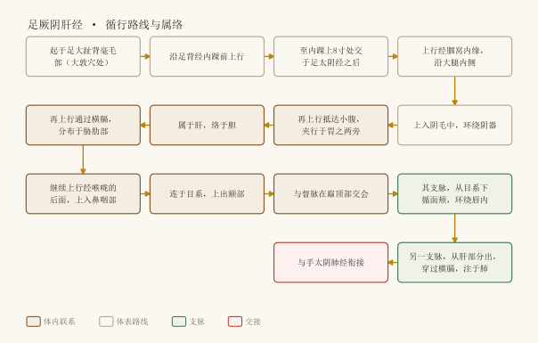

# 第 15 章 · 足厥阴肝经（经脉循行·主治概要）

> **源**：`qhzy-经络腧穴学.xlsx` · 表「15 足厥阴肝经及其腧穴」 · 源文 5,690 字
> **抽取**：`node scripts/import_textbooks.js --only 经络腧穴学` · sha256 `a630e66b5a4609ab…` · 2026-10-21
> **层次**：本文件是**源教材正文层** —— 节次取自源表的结构列，文字未改写、未压缩、未抽样。改写层（N.3「这个翻译丢掉了什么」/ N.5「争议与本项目立场」）尚未撰写，见 `textbooks/README.md` 章契约。

---

## 15.1 经脉循行

### 15.1.1 循行路线与属络

#### 15.1.1.1 起于大敦/属肝络胆

足厥阴肝经，简称肝经，属十二经脉之一，与足少阳胆经互为表里，五行属木。肝主疏泄、藏血，在体合筋，其华在爪，开窍于目，在志为怒，与胆相表里。肝为将军之官，体阴而用阳，性喜条达而恶抑郁，其生理功能以疏泄气机、贮藏血液、调节血量为核心，凡情志活动、消化吸收、气血运行、水液代谢、月经胎产等，无不赖肝之疏泄与藏血功能的正常发挥。肝经腧穴的主治范围广及肝胆、脾胃、妇科、前阴及神志病证，与其经脉循行分布和肝的生理功能密切相关。十二经脉气血流注始于手太阴肺经，依次相传，终于足厥阴肝经，复注于手太阴肺经，故肝经居十二经气血循环之末，又为下一循环之始，具有承前启后、调理一身气血的重要作用，临床上有“百病从肝治”“肝为五脏之贼”之说（现代认识，不改经典原义），足见肝及其经脉在生理病理中的重要地位。肝主疏泄，能调畅全身气机，促进脾胃运化、胆汁分泌排泄及气血津液的运行输布；肝藏血，能贮藏血液、调节血量，与冲任二脉及血海密切相关，故有“肝为血海”之说。肝又藏魂，主谋虑，胆主决断，肝胆相济，则情志调和、决断有度。凡情志不遂、气机郁滞、血行不畅、脾胃运化失常、冲任失调等病变，皆与肝之疏泄藏血功能失常相关，此亦为肝经腧穴主治范围广泛的内在依据。 本经循行分体表与体内两条路线。体表循行：起于足大趾背毫毛部（大敦穴处），沿足背经内踝前上行，至内踝上8寸处交于足太阴经之后，上行经腘窝内缘，沿大腿内侧，上入阴毛中，环绕阴器。值得注意的是，足三阴经在小腿内侧的排列次序并非固定不变：内踝上8寸以下，足厥阴肝经行于前缘，足太阴脾经行于中线，足少阴肾经行于后缘；至内踝上8寸处，肝经交出太阴之后，此后在小腿上部及大腿内侧，肝经行于足太阴脾经与足少阴肾经之间。这一“交出太阴之后”的交叉关系，正是原文强调肝经与脾经在小腿内侧位置变换的关键，取穴与循经推按时不可不辨。肝经体表循行所过之处，下肢内侧、阴器、少腹、胁肋等部位依次相连，构成肝经腧穴“经脉所过，主治所及”的分布基础。 体内属络联系：肝经再上行抵达小腹，夹行于胃之两旁，属于肝，络于胆；再上行通过横膈，分布于胁肋部；继续上行经喉咙的后面，上入鼻咽部，连于目系，上出额部，与督脉在巅顶部交会。其支脉，从目系下循面颊，环绕唇内。另一支脉，从肝部分出，穿过横膈，注于肺，与手太阴肺经衔接，使十二经脉气血流注如环无端。可见肝经内行线联系肝、胆、胃、肺等脏腑及目系、喉咙、鼻咽、巅顶等器官，外行线联络下肢内侧、阴器、少腹、胁肋等部位，分布广泛，故其病候与主治亦相应广泛。此外，肝经环阴器、抵小腹，与冲脉、任脉、督脉皆起于胞中而密切联系，肝藏血、司血海，冲为血海、任主胞胎，故肝经与妇科经带胎产诸病关系尤为密切，历代医家素有“女子以肝为先天”之说，此说虽为后世发挥，然实本于肝经之循行分布与肝藏血主疏泄的功能特点，临证治疗妇科病证多从肝经论治，其理即在于此。 《灵枢·经脉》对本经循行有详尽记载：【原文】'肝足厥阴之脉，起于大指丛毛之际'（《灵枢·经脉》），【原文】'上循足上廉，去内踝一寸，上踝八寸，交出太阴之后'（《灵枢·经脉》），即从足大趾爪甲后丛毛处起始，沿足背内侧上行，在内踝上8寸处交出于足太阴脾经之后；继而上行经腘窝内侧，沿大腿内侧进入阴毛中，环绕阴器，【原文】'环阴器，抵小腹，夹胃，属肝，络胆'（《灵枢·经脉》），【原文】'上贯膈，布胁肋'（《灵枢·经脉》），再沿喉咙之后上行，进入鼻咽部，【原文】'连目系，上出于额部，与督脉会于巅'（《灵枢·经脉》）。其支者，【原文】'从目系下颊里，环唇内'（《灵枢·经脉》）；另一支者，【原文】'其支者，复从肝别贯膈，上注肺'（《灵枢·经脉》）。原文“丛毛”指足大趾爪甲后方有毫毛处，即大敦穴所在；“股阴”指大腿内侧；“颃颡”同嗓，指上与鼻相通的部位，相当于鼻咽部。 从循行分布可见，肝经体内属肝络胆，与胆腑直接相通；其支脉上连目系、交会巅顶，下绕阴器、抵小腹、布胁肋，故肝经与目、巅顶、前阴、少腹、胁肋等部位在经脉上联系密切，这是肝经腧穴能够治疗目疾、巅顶头痛、疝气、妇科病及胸胁胀满等病证的基础。肝经与督脉会于巅顶，故巅顶头痛多从肝经论治；肝经连目系，肝开窍于目，故目疾为肝经主治之长；肝经绕阴器、抵少腹，故疝气、前阴病与妇科病为肝经所主；肝经布胁肋、贯膈，肝气郁结则胸胁胀满、善太息，取肝经腧穴疏肝解郁每获良效。肝在体合筋，其华在爪，肝经循行于筋之所聚的关节部位，肝血充盈则筋脉得养、爪甲荣润，肝血不足则筋脉拘急、爪甲不荣，故肝经腧穴亦常用于筋脉挛急、肢体麻木等筋病。 循行要点：①起于足大趾背毫毛部（大敦），沿下肢内侧上行，绕阴器，抵小腹；②属肝络胆，上贯膈，布胁肋，连目系，会于巅顶；③一分支从目系下颊环唇，一分支从肝别出上注于肺。掌握“起于大敦、属肝络胆、连目系、会巅顶、绕阴器”这一循行框架，是理解肝经腧穴主治规律的关键。 本节要点：肝经起于大敦，循下肢内侧上行，绕阴器、抵小腹、布胁肋、连目系而会于巅顶，属肝络胆，一分支环唇，一分支注肺；其循行分布决定了肝经腧穴主治肝胆、妇科、前阴、头目及下肢内侧诸病证的规律。足三阴经在小腿内踝上8寸处的排列交叉，为取穴与循经辨证之关键，须熟练掌握。

### 15.1.2 主要病候

#### 15.1.2.1 胁痛/疝气/小便不利等

足厥阴肝经的主要病候为：腰痛，胸满，呃逆，遗尿，小便不利，疝气，少腹肿等症。这些病候与肝经绕阴器、抵小腹、布胁肋、上贯膈的循行部位相应，亦反映肝失疏泄、气机郁滞、经气不利的病机特点。肝气郁结，横逆犯胃，胃气上逆，则见胸满、呃逆；肝经抵少腹、绕阴器，肝失疏泄，下焦气化不利，则见遗尿、小便不利、疝气、少腹肿；肝主筋，腰为肾之府，肝血不足、筋脉失养，或肝经经气不利，则见腰痛。临证时可根据病候所在部位选取肝经相应腧穴调治。 肝经病候的传变，多循五行生克之序。肝木乘土，则肝脾不和、肝胃不和，见腹胀、泄泻、呕逆、纳呆；肝病及肾，则肝肾阴虚，见腰膝酸软、眩晕耳鸣、目涩；肝火犯肺，则木火刑金，见咳逆上气、胸胁灼痛；肝病及心，则心肝火旺，见心烦失眠、口舌生疮。反之，他脏之病亦可及肝，如肾水不足不能涵养肝木，则水不涵木、肝阳上亢；脾虚生痰，痰气互结，则成梅核气、瘿瘤等。故临证治疗肝经病证，须明脏腑生克乘侮之理，或疏肝以安他脏，或补他脏以平肝，方为周全。 细析病候，可分经脉所过与脏腑功能两端。就经脉所过而言，肝经起于足大趾，沿下肢内侧上行，环绕阴器，抵小腹，布胁肋，上贯膈、连目系、会巅顶，凡经脉所过之处经气不利，皆可出现相应病候：下肢内侧循行部位气血痹阻，则见下肢痹痛、麻木、不遂；阴器、少腹为肝经所绕所抵，肝经气滞或寒凝经脉，则发疝气、少腹肿、阴中痛，故《灵枢·经脉》所载肝经是动病，即以腰痛不可以俯仰、丈夫㿉疝、妇人少腹肿等为提纲；肝经布胁肋、贯膈，气机郁滞则胸胁胀满、善太息，气机上逆则呃逆、呕吐；肝经连目系、会巅顶，肝火上炎或肝血不足，则目赤肿痛、巅顶头痛、眩晕。就脏腑功能而言，肝主疏泄、藏血，肝病则疏泄失职、藏血失常，气机郁滞，血行不畅，诸证蜂起：疏泄失常、气郁化火，则心烦易怒、头痛目赤；木旺乘土、横逆犯胃，则胸胁胀痛、呕逆、腹胀、泄泻；疏泄不及、胆汁外溢，则发黄疸；肝藏血失职、冲任失调，则月经不调、崩漏、带下；肝血不足、筋脉失养，则筋脉拘急、肢体麻木、爪甲不荣。肝病又多兼情志因素，肝主怒，情志抑郁、暴怒伤肝，则气机逆乱，变生诸证，此亦肝经病候的一大特点。 肝与胆相表里，肝经属肝络胆，故肝病常累及于胆，胆病亦可及于肝，临床所见肝胆同病者甚多：肝失疏泄，胆汁疏泄不利，则见口苦、黄疸、胁痛；胆气上溢，则口苦、呕涎。因此，治疗肝经病证时，常须兼顾胆腑，取肝经穴的同时亦可配合胆经腧穴（如阳陵泉、丘墟等）以利胆疏肝，此亦表里经配穴法在肝经病证中的具体运用。 从病候的辨证要点而言，肝经病证之辨，首重气、血、寒、热、虚、实之异。疝气一证，寒凝肝脉者，少腹冷痛、痛引睾丸，得温则减，治宜温经散寒，可灸大敦、关元；气滞者，胀痛走窜、随情志增减，治宜疏肝理气，取太冲、期门；湿热下注者，阴囊红肿灼痛，治宜清利湿热，取行间、蠡沟。少腹肿痛，气滞血瘀者居多，可配三阴交、气海行气活血。小便不利、遗尿，属肝失疏泄、下焦气化失司者，取太冲、中封、曲泉调畅气机；属肝血不足、膀胱失约者，配关元、肾俞补益固摄。胸满、呃逆，为肝气横逆犯胃，胃气上逆所致，常配内关、足三里和胃降逆。腰痛属肝血不足、筋脉失养者，配肾俞、命门、阳陵泉养血荣筋。凡此种种，皆当审证求因，随证配穴，方能体现肝经腧穴疏、清、平、养四法的运用之妙。 肝为刚脏，体阴用阳，其病易郁、易火、易风、易虚：情志抑郁则肝气郁结，郁久则化火，火盛则生风，木旺则乘脾犯胃，肝血肝阴不足则虚风内动。临床上肝病常见肝气郁结、肝火上炎、肝阳上亢、肝风内动、肝血不足、肝阴亏虚等证型，均可结合辨证选取肝经腧穴施治，体现了肝经“疏、清、平、养”四法并用的治疗特色。 现代研究表明，肝经病候中情志因素占有重要地位，针刺肝经腧穴对抑郁、焦虑等情志障碍及功能性胃肠病具有一定调节作用，其机制可能与调节自主神经功能、影响神经递质代谢等有关（现代认识，不改经典原义）。 本节要点：肝经主要病候为腰痛、胸满、呃逆、遗尿、小便不利、疝气、少腹肿等，病机总属肝失疏泄、气机郁滞；其病易郁、易火、易风、易虚，辨证须分气血寒热虚实，并明脏腑生克传变，治疗体现疏、清、平、养四法并用的特色。

## 15.2 主治概要

### 15.2.1 主治特点

#### 15.2.1.1 肝胆病/妇科/前阴/神志病证

足厥阴肝经腧穴主治范围，依据“经脉所过，主治所及”的原则，主要概括为三大类。 一是肝胆病证：黄疸，胸胁胀痛，呕逆，及肝风内动所致的中风、头痛、眩晕、惊风等。肝主疏泄，性喜条达而恶抑郁，若情志不遂、疏泄失常，气机郁滞，则见胸胁胀痛、善太息、呕逆；肝失疏泄，胆汁疏泄不利，外溢肌肤，则发为黄疸；肝阴不足、肝阳上亢，阳化风动，则见头痛、眩晕，甚则中风、惊风。肝经腧穴能疏肝理气、清肝泻火、平肝息风，故善治上述病证。临证时，黄疸须辨阳黄、阴黄，胁痛须辨气滞、血瘀、肝火，中风眩晕须辨肝阳上亢与肝风内动之虚实，均可取太冲、行间、期门、章门等穴随证施治。肝经原穴太冲为疏肝理气之要穴，荥穴行间长于清泄肝火，募穴期门为肝气结聚之处，脏会章门能调五脏之气，四穴相伍，疏、清、平、调各有所宜，为肝胆病证之常用穴组。 二是妇科病、前阴病证：月经不调、痛经、崩漏、带下、遗尿、小便不利等。肝藏血，主疏泄，司血海，冲脉起于胞中而隶于肝，故有“女子以肝为先天”之说；肝经“环阴器，抵小腹”，与前阴、少腹、胞宫直接相连，肝之疏泄与藏血功能正常，则冲任调和、经带如期。若肝气郁滞、血海失调，则见月经不调、痛经、崩漏、带下；肝经经气不利，下焦气化失常，则见遗尿、小便不利、疝气等。故妇科病、前阴病证均为肝经主治之长，临证常取大敦、蠡沟、曲泉、太冲等穴调理肝之疏泄与藏血功能。更年期前后，冲任渐衰，肝血不足，阴阳失调，常见烘热汗出、心烦易怒、失眠等症，亦多从肝经调理。 三是经脉循行部位的其他病证：下肢痹痛、麻木、不遂等。本经循行于下肢内侧、少腹、胁肋等部位，经脉所过之处气血痹阻、经筋失养，则见下肢痹痛、麻木、痿废不用等症，可取本经腧穴通经活络、濡养筋脉，如膝关、曲泉治膝肿痛，阴包、足五里治下肢痿痹，中封、太冲治足踝肿痛等。此类病证多属痹证、痿证范畴，临证须辨虚实：气血瘀阻者当活血通络，筋脉失养者当养血荣筋，可酌配血海、阳陵泉、足三里等穴以增强疗效。 此外，肝开窍于目，肝经连目系、会巅顶，故目赤肿痛、青盲、目眩、巅顶头痛等头目病证亦为本经所主。目为肝之窍，肝血上注于目则目能视物，肝血不足则两目干涩、视物昏花，肝火上炎则目赤肿痛，均取肝经腧穴调理。肝与情志活动密切相关，肝主疏泄以调畅情志，若疏泄失常，气机郁结，则见郁证、不寐、癫狂痫等神志病证，临床常取太冲配膻中、内关等穴疏肝解郁、宁心安神（现代认识，不改经典原义）。此外，肝主筋，肝经循行所过之筋脉关节病变，如筋脉拘挛、手足震颤等，亦属本经主治范围。肝经腧穴主治虽以肝胆、妇科、前阴病证为要，然其分布广泛、联系脏腑众多，临证当结合经脉循行与脏腑辨证灵活运用，不可拘于一隅。 肝经腧穴主治的现代临床应用，已由传统的肝胆、妇科、前阴病证，逐步拓展至心身疾病、代谢性疾病等领域：如以疏肝解郁法治疗抑郁症、围绝经期综合征，以平肝息风法治疗原发性高血压、偏头痛，以清肝泻火法治疗甲状腺功能亢进、突发性耳聋等，均取得较好疗效（现代认识，不改经典原义）。但无论应用范围如何拓展，其取穴依据仍不离肝经循行分布与肝主疏泄、藏血的功能特点，临床当以辨证论治为纲，遵循“经脉所过，主治所及”的原则灵活变通。 本经腧穴的主治分布，与穴位的所在部位密切相关，大体可按分部归纳：足部穴（大敦、行间、太冲、中封）主治头目病证、疝气、妇科及前阴病证，兼治足部局部病证；小腿穴（蠡沟、中都）主治妇科病、前阴病及疝气、睾丸肿痛；膝股部穴（曲泉、膝关、阴包、足五里、阴廉）主治膝肿痛、下肢痿痹及妇科、前阴病证；胁腹部穴（章门、期门）主治肝胆、脾胃病证及乳痈。临床取穴，既可循经远取（如巅顶痛取太冲），亦可局部近取（如膝痛取曲泉、胁痛取期门），远取近取相合，是肝经腧穴运用的基本法则。 此外，肝经腧穴在养生保健与情志调摄中亦应用广泛：肝主疏泄，调畅情志，肝气条达则气血和调、脏腑安和，故平素情志不舒、压力较大者，可常按揉太冲、行间、期门等穴以疏肝解郁；肝血不足、视物昏花者，可按揉肝俞、太冲、光明等穴养血明目；春季为肝气当令，顺应天时调养肝气，亦是中医养生的重要内容（现代认识，不改经典原义）。 本节要点：肝经腧穴主治以肝胆病、妇科病、前阴病证为主，兼治经脉循行部位的下肢痹痛及头目、神志病证；记忆要点可概括为“肝胆脾胃前阴病，疝气妇科病亦灵”。

---

> **免责声明**：本教材内容仅用于教育与科研，不构成任何诊疗建议。
> 本文件由 `scripts/import_textbooks.js` 从源工作簿生成，请勿手改 —— 需要修改请改源工作簿后重跑。
