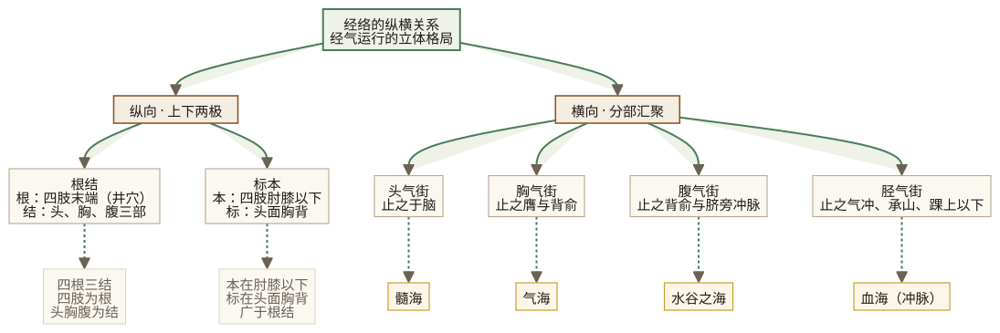

# 第 18 章 · 经络的纵横关系

> **源**：`qhzy-经络腧穴学.xlsx` · 表「18 经络的纵横关系」 · 源文 14,047 字
> **抽取**：`node scripts/import_textbooks.js --only 经络腧穴学` · sha256 `a630e66b5a4609ab…` · 2026-10-21
> **层次**：本文件是**源教材正文层** —— 节次取自源表的结构列，文字未改写、未压缩、未抽样。改写层（N.3「这个翻译丢掉了什么」/ N.5「争议与本项目立场」）尚未撰写，见 `textbooks/README.md` 章契约。

---

## 18.1 根结与标本

### 18.1.1 根结理论

#### 18.1.1.1 四肢末端为根/头胸腹为结

经络学说不仅论述了十二经脉上下相接、循环贯注的纵向循行，还揭示了经气在分布与运行上的若干特殊规律，其中以标本、根结、气街、四海四者最为重要，它们从纵横两个方向补充说明了经气的流注运行状况，是经络理论的重要内容之一。掌握这些理论，可以加深对经络分布及经气运行特殊规律的认识，从而有效地指导临床实践。标本根结主要说明经气上下两极间的纵向联系，气街主要说明经气在头、胸、腹、胫各部的横向汇聚，四海则从气血精髓汇聚的角度总括全身经气的组成和来源。四者相互补充、纵横交织，共同构成了经络学说中关于经气运行分布的完整理论体系，也是本章论述的重点。 一、根结的概念。根，指根本、开始；结，指结聚、归结。根结理论认为，四肢末端是经气所起的根本之处，头、胸、腹部是经气所归的结聚之处。就具体部位而言，"根"即四肢末端的井穴，"结"即头、胸、腹三部。《灵枢·根结》系统地记载了足三阴三阳经脉的根与结：足太阳之根在至阴，结于命门（目）；足阳明之根在厉兑，结于颃颡（钳耳）［待核实·参考书OCR此处作"大（钳耳）"，据《灵枢·根结》原文及教材通例补"颃颡"二字］；足少阳之根在窍阴，结于窗笼（耳中）；足太阴之根在隐白，结于太仓（胃）；足少阴之根在涌泉，结于廉泉（舌下）；足厥阴之根在大敦，结于玉英（玉堂），并络于膻中［待核实·参考书OCR此处作"络擅中/络腹中"，据《灵枢·根结》原文作"络于膻中"］。上述六条经脉的"根"均位于四肢末端，且皆为井穴：至阴位于足小趾外侧端，厉兑位于足第2趾外侧端，窍阴位于足第4趾外侧端，隐白位于足大趾内侧端，涌泉位于足底前1/3凹陷处，大敦位于足大趾外侧端，充分体现了"根"在四肢末端的含义；六经之"结"则分别位于目、咽颡、耳、胃、舌下、胸腹等头面躯干部位，体现了"结"聚于头、胸、腹三部的规律。需要说明的是，《灵枢·根结》所载根结以足六经为主，后世医家在此基础上加以发挥，认为十二经脉皆以四肢末端为根、以头胸腹为结，手六经之根亦在其四肢末端井穴，其结亦归于头、胸、腹三部，从而形成了"四根三结"的完整表述。 二、根结理论的出处与含义。《灵枢·根结》在论述足六经根结的同时，还以"根、溜、注、入"的次序说明了六阳经经气在四肢部的出入输注过程，即经气自井穴之"根"发出，依次溜行、灌注、深入于肘膝关节以下的特定腧穴，再上行入于头身之"结"，反映了经气由四肢末端向头身部运行输布的基本趋向。具体而言，如足太阳经气根于至阴，溜于京骨，注于昆仑，入于天柱、飞扬；足阳明经气根于厉兑，溜于冲阳，注于下陵（足三里），入于人迎、丰隆；足少阳经气根于窍阴，溜于丘墟，注于阳辅，入于天容、光明；手三阳经亦各有根、溜、注、入之部。这一论述与五输穴理论相为呼应：井穴为经气所出之处，正与"根"的含义相应；荥、输、经、合诸穴则依次体现了经气由浅入深、由小而大的输注过程。根结理论由此把四肢末端与头、胸、腹三部联结为一个上下呼应、首尾相贯的整体，说明经络不仅有十二经脉循行线所体现的纵向流注，还存在着以"根—结"为两极的经气汇聚与弥散。从临床角度看，这种两极联系提示我们在诊治头面、躯干疾病时，应当重视四肢末端腧穴的远治作用；在诊治四肢末端疾病时，也应当考虑其与头身脏腑的内在联系，从而扩大辨证论治的视野。 三、根结理论的意义。《标幽赋》指出：【原文】'更穷四根三结，依标本而刺无不痊'（《标幽赋》）。所谓"四根三结"，是指十二经脉以四肢为"根"，以头、胸、腹三部为"结"。十二经脉之根均在四肢末端井穴之处，其结分别归于头、胸、腹三部，故称"四根三结"。根结理论主要反映经气的所起与所归，以及经气上下两极间的联系。根为经气始生始发之地，是经气所出之处；结为经气所结、所聚之处，是经气所归之所。经气自四肢末端之"根"发出，沿经脉上行，汇聚于头胸腹之"结"，从而把人体四肢与头身紧密联系起来，强调经气上下两极相互呼应、相互贯通，这是对十二经脉纵向循行流注之外，经气运行方式的又一重要补充。根结理论在针灸临床中的意义还在于，它提示四肢末端井穴不仅主治局部病证，更可通过根结两极的联系治疗头面、五官、神志及脏腑病证，为"上病下取"提供了理论依据。后世医家据此创立的取穴方法甚多，如八脉交会穴中公孙通冲脉、内关通阴维脉等，皆以四肢末端之穴治疗心胸、胃腹之疾，即是根结理论在特定穴运用中的具体体现。 四、根结与标本的关系。十二经脉的"根"与"本"、"结"与"标"位置相近或相同，意义也相似："根"有"本"意，"结"有"标"意。根与本部位在下，皆为经气始生始发之地，为经气所出；结与标部位在上，皆为经气所结、所聚之处，为经气之所归。但两者在具体内容上又有所区别，即"根之上有本"，"结之外有标"，"标本"的范围较"根结"为广。从部位上看，本位于四肢肘膝以下，范围较根（井穴）为大；标位于头面胸背，范围较结（头、胸、腹三部）更为宽泛。从理论侧重上看，标本理论强调经脉分布上下部位的相应关系，根结理论则强调经气两极间的联系。二者相互补充，共同说明了人体四肢与头身的密切联系，故临床上常将"标本根结"并称，作为远道取穴、上下配穴的共同理论依据。 五、根结理论的临床应用。根结理论为四肢肘膝以下的腧穴治疗远隔部位的脏腑及头面五官疾病提供了又一理论依据。临床上"上病下取"的远端取穴法即是根结理论的直接运用：如目疾属足太阳经病者，可取足太阳之根穴至阴或远端腧穴，配合结部之睛明等穴治疗；咽喉肿痛可取手太阴之井穴少商点刺出血，以清泄肺热、利咽开音；高热神昏、中风闭证、中暑晕厥等急症，常取十二井穴点刺出血以开窍醒神、泄热启闭，即"井穴多用于急救"之意。头面五官、神志及脏腑病证取四肢末端腧穴治疗，正是根结理论在临床选穴中的体现。根结配穴法即取根穴与结穴相配，如足太阳经目疾取至阴配睛明，足阳明经齿痛、咽喉病取厉兑配人迎、地仓等，本标相应、上下同治，临床常获良效。此外，根结理论还提示，四肢末端又是经脉病候反映的敏感部位，许多脏腑经络病变可在根穴（井穴）处出现压痛、色泽改变等异常反应，如《灵枢·九针十二原》所谓【原文】'五脏有疾也，应出十二原'（《灵枢·九针十二原》）虽就原穴而言，但与根结理论所强调的四肢末端与脏腑的密切联系相通，临床切诊四肢末端反应点，亦有助于脏腑辨证。现代研究观察到井穴区神经末梢与感受器分布密集、大脑皮层功能代表区投射集中，针刺井穴可产生较强的感觉传入与中枢反应，提示根结理论关于四肢末端与头身密切联系的论述具有一定的生物学基础，属"现代认识，不改经典原义"，可作辅助参考。 标本根结理论在针灸临床中的另一重要运用，是指导八脉交会穴与特定穴的配伍使用。八脉交会穴均位于四肢腕踝关节上下，恰在"根""本"所主的范围之内，其主治却多在心、胸、胃、头、目等"结""标"所在部位，如内关通阴维脉主治心胸胃之疾，外关通阳维脉主治头目、耳后之疾，列缺通任脉主治胸肺、咽喉之疾，公孙通冲脉主治脾胃、心胸之疾，此即根结理论所揭示的"四肢为根、头胸腹为结"上下相应的临床体现。临证之际，凡头面五官、神志、脏腑之病，皆可考虑从四肢末端选穴施治，此即"上病下取"之法；反之，四肢末端之病，亦可上取标结之穴以调其本，上下互参，灵活运用。 根结理论还与经络的病理反映密切相关。经气以四肢末端为根，故当脏腑经络发生病变时，其病气亦常首先或明显地反映于根穴部位。临床常见某些内脏疾病在相应井穴或四肢末端出现压痛、酸胀、皮肤色泽或温度异常等反应，如脾胃病在足太阴之隐白、足阳明之厉兑附近出现压痛，心肺病在手太阴之少商、手厥阴之中冲附近出现异常等。针灸临床通过切按四肢末端以探查阳性反应点，既可辅助诊断脏腑病变之所在，又可直接选取反应明显之根穴施治，往往可获"以痛为输、随反应取穴"之效。这一认识与现代医学中"体表-内脏相关"的研究方向相吻合：内脏病变可在体表特定区域出现牵涉性反应，刺激相应体表区域又可调节内脏功能，根结理论正是对这一规律的最早概括之一，属"现代认识，不改经典原义"，可作辅助参考。 根结理论的学习，还应注意与标本理论、五输穴理论相互参照。根结言经气之根与结两极，标本言经气之标与本上下，五输穴言经气在四肢部由小到大、由浅入深的输注次序，三者皆以四肢末端为经气生发之所，从不同侧面说明了四肢末端腧穴的重要地位。其中根结与标本侧重说明上下两极的联系，五输穴侧重说明经气在四肢部依次流注的过程；根结之"根"皆在井穴，五输穴之"井"为经气所出，二者所指部位一致而角度不同。临床上取四肢末端腧穴治疗头身病证，既符合根结标本上下相应之理，又与五输穴主治规律相合，诸理论相互印证、相得益彰。掌握这些理论的异同与联系，有助于融会贯通地理解经络学说的整体内涵，并在临床中灵活运用。 总之，根结理论以四肢末端为根、头胸腹为结，揭示了经气所起与所归的两极联系，与标本理论共同构成经络学说纵向联系的纲领，为远道取穴、上下配穴、井穴急救等临床方法提供了经典理论依据。 本节要点：根结理论以四肢末端井穴为"根"、头胸腹三部为"结"，反映经气的所起与所归及上下两极间的联系；足六经根结各有定位，"四根三结"为其概括；根结与标本意义相近而范围有别；该理论为远端取穴、井穴急救、上下配穴提供了理论依据。

### 18.1.2 标本理论

#### 18.1.2.1 四肢为本/头身标

标本理论是以经脉腧穴分布部位的上下对应关系来说明经气运行规律的理论。"标"原义指树梢，引申为上部，与人体头面胸背的位置相应；"本"原义指树根，引申为下部，与人体四肢下端相应。标本理论主要指经脉腧穴分布部位的上下对应关系。十二经脉都有"标"部与"本"部，本在四肢肘膝以下的一定部位，标在头、胸、背部，上下相互对应，经气由此上下呼应、内外沟通。 一、十二经脉的标本部位。根据《灵枢·卫气》所载，十二经脉标本的位置及相应的腧穴如下：足太阳之本在足跟以上5寸中，穴为跗阳，标在两络命门（目），穴为睛明；足少阳之本在窍阴之间，穴为足窍阴，标在窗笼（耳）之前，穴为听会；足阳明之本在厉兑，穴为厉兑，标在人迎、颊，挟颃颡，穴为人迎、地仓；足太阴之本在中封前上4寸中，穴为三阴交，标在背俞与舌本，穴为脾俞、廉泉；足少阴之本在内踝下上3寸中，穴为交信、复溜，标在背俞与舌下两脉，穴为肾俞、廉泉；足厥阴之本在行间上5寸，穴为中封，标在背俞，穴为肝俞。手太阳之本在手外踝之后，穴为养老，标在命门（目）上1寸，穴为攒竹；手少阳之本在小指次指之间上2寸，穴为中渚，标在耳后上角、下外眦，穴为丝竹空；手阳明之本在肘骨中、上至别阳，穴为曲池、臂臑［待核实·参考书OCR此处作"臂"，据教材通例补"臑"字］，标在颜下合钳上，穴为扶突；手太阴之本在寸口之中，穴为太渊，标在腋内动脉，穴为中府；手少阴之本在锐骨之端，穴为神门，标在背俞，穴为心俞；手厥阴之本在掌后两筋之间2寸中，穴为内关，标在腋下3寸，穴为天池。由此可见，十二经之"本"均在四肢肘膝关节以下的腕踝附近，十二经之"标"均在头面、胸背等上部。值得注意的是，十二经之"本"多为该经的特定穴，如太渊为肺经原穴，神门为心经原穴，养老为小肠经郄穴，中渚为三焦经输穴，内关为心包经络穴，三阴交为足三阴经交会穴等，提示本部腧穴在经气输注中具有重要地位。十二经标本的部位分布，集中体现了"四肢为诸阳之本""四肢末端为经气所起"的规律，本标上下对应、内外相应，是经络学说中极富临床指导意义的内容之一。 二、标本理论的意义。标本理论强调经脉分布上下部位的相应关系。本在下，为经气所出之处；标在上，为经气所归之处。经气自下部之"本"发出，向上运行输布于头面胸背之"标"，故标本部位之间存在着上下相应的密切联系。这种上下对应关系是经络学说关于经气运行分布规律的重要补充，它说明经气不仅沿十二经脉的特定路线纵向流注，还存在着以标本部位为上下两极的呼应关系，为临床"上病下取、下病上取"等取穴方法奠定了理论基础。《标幽赋》指出：【原文】'明标与本，论刺深刺浅之经'（《标幽赋》），说明辨识标本所在，对于确定针刺的深浅、远近具有指导意义。从诊断角度看，标本部位又是脏腑经络病变反映的敏感区域，本部的脉动、压痛与标部的色泽、形态变化相参互证，有助于辨别病位所在与经气盛衰。如手太阴之本在寸口，寸口脉为诊脉之要地，正可反映肺与全身气血之盛衰；足太阳之标在两目，目之精明可反映太阳经气与神气之状况，此皆标本理论在诊法中的具体运用。足阳明之本在厉兑、标在人迎，而人迎脉又与寸口脉合参以候胃气之盛衰，亦与标本相应之义相合。 三、标本与根结的区别联系。标本与根结意义相近："根"有"本"意，"结"有"标"意；根与本部位在下，皆为经气始生始发之地；结与标部位在上，皆为经气所结、所聚之处。但标本的范围较根结为广：从部位上看，本位于肘膝以下，范围较根（井穴）为大，即"根之上有本"；标位于头胸背，范围较结（头胸腹三部）更为具体，即"结之外有标"。从理论侧重上看，标本理论强调经脉分布上下部位的相应关系，根结理论则强调经气两极间的联系。标本根结理论共同补充说明了经气的流注运行状况，即经气循行的多样性和弥散作用，强调了人体四肢与头身的密切联系。二者在临床上常合并运用，标本根结配穴即是依据上下相应的关系，取四肢本部腧穴与头身标（结）部腧穴相配，以协调上下经气。 四、标本理论的临床应用。标本理论为循经远道取穴提供了理论依据。在明确诊断的基础上，除选用局部腧穴外，通常以循经取穴为主，即某一经络或脏腑有病，便选用该经或相应经脉的远部腧穴来治疗，如【原文】'上病下取、下病上取、中病旁取、左右交叉取以及前后对取等'（《针灸学》）。如胃痛近取中脘，循经远取足三里、梁丘；胁痛循经选取阳陵泉、太冲；前额阳明头痛，循经选取上肢的合谷穴和下肢的内庭穴等。《四总穴歌》【原文】'肚腹三里留，腰背委中求，头项寻列缺，面口合谷收'（《四总穴歌》）就是标本理论指导循经取穴的很好例证。标本配穴法在临床上应用亦广：如肺系病证可取手太阴之本部太渊配标部中府；目疾属足太阳经者可取本之跗阳配标之睛明；心系病证可取手少阴之本部神门配标部心俞等，体现了本标相应、上下同治的配穴思想。此外，标部腧穴多位于头面胸背，与脏腑官窍直接邻近，如标部背俞穴为脏腑之气输注于背腰部的腧穴，本部腧穴则多位于腕踝附近，临床上本部取穴以调经气之源，标部取穴以调经气之归，远近配合，相得益彰。还应注意，标本部位上下相应、内外相通的特点，也提示我们在针刺深浅上有所权衡：本部位于四肢末端，肌肉浅薄，宜浅刺；标部位于头面胸背，有的部位肌肉丰厚，有的邻近重要脏器，须根据具体腧穴的解剖特点确定针刺深度与方向，防止损伤。如背俞穴邻近肺脏，不可深刺，以防气胸，即属标部取穴的针刺安全要点。现代研究通过体表电位测定、红外热像等手段观察到腕踝部与头面躯干部腧穴之间存在着相对稳定的功能联系，为标本理论提供了部分佐证，属"现代认识，不改经典原义"，可作辅助参考。 标本理论在临床上还常与根结理论结合，用以解释"穴有远近，治有内外"的取穴规律。凡本部（四肢肘膝以下）腧穴，如五输穴、原穴、络穴、郄穴等，多为远道取穴之要穴，主治头面、躯干、脏腑的远隔病证；凡标部（头面胸背）腧穴，如头面诸穴、背俞穴、募穴等，多为近部取穴或前后配穴之用。二者一源一归、一表一里，构成了针灸处方中远近配穴、上下配穴的理论基础。如咳嗽气喘之证，既取标部之中府、肺俞以宣降肺气，又取本部之太渊、列缺以调畅经气；眩晕耳鸣之证，既取标部之百会、风池以息风潜阳，又取本部之太冲、侠溪以平肝泻火，皆本标本相应之义。现代研究亦表明，四肢腕踝部腧穴与头面躯干相应部位之间存在明确的神经节段或功能联系，针刺本部腧穴可对远隔部位的脏腑功能产生调节作用，为标本理论提供了现代生理学层面的印证，属"现代认识，不改经典原义"，可作辅助参考。 标本理论所确立的"上病下取、下病上取"原则，在针灸处方中应用极广，后世诸多配穴方法皆由此衍化而来。如头面五官病证，多取四肢末端之穴治疗：目疾取光明、太冲，耳疾取中渚、侠溪，鼻疾取合谷、迎香（合谷属手阳明本经远道取穴），齿痛取合谷、内庭，咽喉肿痛取少商、商阳等，皆属上病下取；而遗尿、脱肛等下焦虚寒之证，又可上取百会以升提阳气，属下病上取；中焦脾胃之病，可取四肢之足三里、内关、公孙等穴，属中病旁取或上下同治。凡此种种，皆体现标本理论所揭示的上下相应的取穴规律。需要指出的是，标本理论虽然强调上下相应，但临床应用仍须以辨证为纲，结合病位、病性、病势灵活选穴，不可拘泥于标本部位而忽视整体辨证。现代研究提示，四肢远端腧穴对头面躯干脏腑的调节作用，可能通过脊髓节段性联系、脑干网状结构及大脑皮层等不同层次的神经通路实现，为"上病下取"提供了多水平的机制解释，属"现代认识，不改经典原义"，可作辅助参考。 标本理论的形成，源于古人对经脉上下部位联系的长期观察。古人发现，人体四肢末端（尤其腕踝关节以下）的经气活动最为活跃，经脉在此处浅表易于诊察，针刺此处易于得气，且能治疗远隔部位的头身脏腑病证；而头面、胸背等上部又是脏腑官窍汇聚之处，经脉之气在此结聚输布。由此概括出"本在下、标在上"的上下对应规律，并以"标""本"命名，取义于树之根本与树梢，形象地说明了经气由下而上、由源及流的关系。这一认识与临床"四肢为诸阳之本""头为诸阳之会"等经验相合，也解释了为什么针灸临床上大量远道取穴的效穴都集中在腕踝关节以下。深入学习标本理论，当以十二经标本部位为基础，结合各经主病与腧穴主治，逐步体会标本相应在辨证选穴中的实际意义。 总之，标本理论以四肢为本、头身胸背为标，阐明了经脉腧穴上下对应的分布规律，与根结理论同源于《灵枢》，互为表里，是经络学说的重要组成部分，对针灸辨证选穴与针刺操作均具有实际的指导意义。 本节要点：标本理论以四肢肘膝以下为本、头面胸背为标，强调经脉腧穴分布上下部位的相应关系；十二经各有标本部位与相应腧穴，本部多为特定穴；标本范围较根结为广，二者共同说明经气运行的多样性与弥散作用；标本理论为远道取穴、上病下取、标本配穴提供了理论依据。

## 18.2 气街

### 18.2.1 气街理论

#### 18.2.1.1 四气街部位与作用

气街是经气聚集运行的共同通路。《灵枢·卫气》记载：【原文】'请言气街：胸气有街，腹气有街，头气有街，胫气有街'（《灵枢·卫气》）。《灵枢·动输》又指出：【原文】'四街者，气之径路也'（《灵枢·动输》），说明了头、胸、腹、胫部有经脉之气聚集循行的通路。气街理论与标本根结理论不同：标本根结主要反映经气上下两极间的纵向联系，气街则反映经气在头、胸、腹、胫各部的横向汇聚，二者纵横交织，共同说明经气运行分布的立体格局。 一、四气街的部位。《灵枢·卫气》对气街的部位有较详细记载：【原文】'故气在头者，止之于脑。气在胸者，止之膺与背俞。气在腹者，止之背俞，与冲脉于脐左右之动脉者。气在胫者，止之于气街，与承山踝上以下。'（《灵枢·卫气》）据此，四气街的部位可归纳如下：头气街位于头部，经气汇聚于脑；胸气街位于胸部，经气汇聚于前胸之膺（胸膺部）与背部俞穴；腹气街位于腹部，经气汇聚于背部俞穴及冲脉在脐左右循行的动脉处；胫气街位于下肢胫部，经气汇聚于气街（气冲部）与承山及踝上以下部位。其中"气街"作为部位名称，又特指气冲部，《针灸学·古代人体部位释义》指出：【原文】'气街指气冲部，当腹股沟股动脉搏动处'（《针灸学》）。足阳明胃经之气冲穴即位于此，别名气街，为冲脉与足阳明经的交会穴，可见气街理论既有经气汇聚通路之义，又与具体腧穴部位相对应。四气街中，头气街以脑为汇聚之所，胸气街以胸膺与背俞为汇聚之所，腹气街以背俞与脐旁冲脉为汇聚之所，胫气街以气冲与承山、踝上为汇聚之所，各部经气在此横向贯通、相互联络，从而把同部之经脉、脏腑、组织器官联结为一个整体。 二、气街的特点。气街具有横向为主、上下分部、紧邻脏腑、前后相连的特点：横向为主，是指经气在头、胸、腹、胫各部横向汇聚贯通，而非仅沿经脉纵向运行；上下分部，是指气街纵分头、胸、腹、胫四个部位，各部相对独立又相互联系；紧邻脏腑，是指胸气街、腹气街均邻近心肺、脾胃等脏腑，经气与脏腑之气直接相通；前后相连，是指胸、腹气街之气止于前胸腹部之膺与脐旁，又止于背部俞穴，前后呼应、贯通相连。横贯脏腑经络，纵分头、胸、腹、胫，是气街理论的核心内容。气街与标本、根结相互补充：标本、根结主要反映经气上下两极间的纵向联系，气街则反映经气在头、胸、腹、胫各部的横向汇聚，二者纵横交织，与十二经脉的循行路线共同构成人体经络气血运行分布的立体网络。气街又与四海相互为用：头气街与髓海相应，胸气街与气海相应，腹气街与水谷之海相应，胫气街与血海（冲脉）相应，气街主经气的通行汇聚，四海主气血精髓的化生蓄积，通行与蓄积相辅相成。 三、气街理论的临床应用。气街理论从另一个角度阐述了经气运行的规律，为临床配穴处方提供了理论依据。腧穴的分部主治规律与气街、四海的功能相关：位于头面、颈项部的腧穴以治疗头面五官及颈项部病证为主，后头区及项区腧穴又可治疗神志病，躯干部腧穴均可治疗相应、邻近脏腑疾病，这与各部气街汇聚经气、联络脏腑的功能特点相一致。在配穴方法上，胸气街"止之膺与背俞"，前胸之募穴与背部之俞穴前后呼应，为俞募配穴、前后配穴提供了理论依据，如肺病可取胸部的膻中（心包募）、中府（肺募）配背部肺俞、厥阴俞，胃病可取中脘（胃募）配胃俞，大肠病可取天枢（大肠募）配大肠俞等，此即《难经·六十七难》所谓【原文】'阴病行阳，阳病行阴。故令募在阴，俞在阳'（《难经·六十七难》）、《素问·阴阳应象大论》所谓【原文】'从阴引阳，从阳引阴'（《素问·阴阳应象大论》）之旨；头气街"止之于脑"，脑为元神之府，神志病、脑病可取头部腧穴调神醒脑，如失眠、眩晕可取百会、四神聪，风池、风府治头项病证亦与头气街经气汇聚于脑的功能相关；腹气街经气止于背俞与脐旁，腹部病证可前后配穴取治，如脐腹痛可取天枢、气海配相应背俞穴；胫气街经气止于气冲、承山及踝上以下，下肢病证可取该部腧穴施治，如坐骨神经痛循经取环跳、承山，踝关节病取昆仑、丘墟等。此外，气街理论对针灸处方的整体设计亦有指导意义：头、胸、腹、胫四部各有其气街，处方时可根据病位所属之气街，在相应部位选取腧穴，或上下相配、或前后相对、或内外呼应，使经气各归其街、各畅其道。如胸痹心痛之证，病位在胸，属胸气街所主，可取膻中、内关、郄门等胸部及心包经腧穴，配背部心俞、厥阴俞，前后相应以通调胸气街之经气；又如胃脘痛之证，病位在腹，属腹气街所主，可取中脘、天枢、足三里等穴，配背部胃俞、脾俞，前后相应以调和腹气街之经气。气街理论指导下的分部取穴、前后配穴，至今仍是针灸临床的常用方法。现代研究观察到胸腹背部的穴位主治与相应脊髓节段的神经支配存在对应关系，俞募配穴的疗效机制亦得到部分实验证实，可为理解气街理论提供参考，属"现代认识，不改经典原义"，可作辅助参考。 气街理论对理解腧穴的远治作用与特异性亦有启发意义。腧穴虽分属各经，但其主治作用往往超越本经范围，而与所在部位之气街密切相关。如胸部之膻中、中府、天突等穴，虽分属任脉、肺经，然同处胸气街，故均可治疗心肺、胸膈病证；腹部之中脘、天枢、气海等穴，同处腹气街，故均可治疗脾胃、肠腑病证；头部之百会、风府、四神聪等穴，同处头气街，故均可治疗神志、头面病证。这种"同街穴性相近"的现象，正是气街理论对腧穴分部主治规律的概括。临床配穴时，把握病位所属之气街，于该街内选穴组方，可使经气直达病所；再配合本街内前后、左右相应之穴，则气机调畅、疗效更彰。气街理论由此成为沟通经络辨证与分部主治的重要桥梁，是针灸临床选穴组方中不可忽视的理论依据。 气街理论还提示，头、胸、腹、胫四部各有其经气汇聚的"枢纽"部位，这些枢纽部位正是临床取穴的要点所在。头气街之枢纽在脑，故头部腧穴如百会、四神聪、风府、风池、太阳、印堂等，皆为调神醒脑、通利头窍之要穴；胸气街之枢纽在膺与背俞，故膻中、中府、天突、心俞、肺俞、厥阴俞等穴，为治心肺胸膈病证之要穴；腹气街之枢纽在背俞与脐旁（冲脉），故中脘、天枢、气海、关元及脾俞、胃俞、肾俞、大肠俞等穴，为治脾胃肠腑及下焦病证之要穴；胫气街之枢纽在气街（气冲）与承山、踝上，故气冲、髀关、伏兔、足三里、承山、三阴交、太溪等穴，为治下肢及足部病证之要穴。临证之际，据病位所属之气街，把握各街之枢纽腧穴，选穴组方便有条理、有重点，此即气街理论"各归其街、各畅其道"的临床运用。现代研究观察到穴位的主治范围与其所在节段的神经支配及内脏传入纤维的节段性分布密切相关，同一气街内腧穴主治相近的现象与此相符，属"现代认识，不改经典原义"，可作辅助参考。 气街与四海的关系，可作如下归纳以便掌握：头气街与髓海相应，主脑与神志，其枢纽在头部诸穴；胸气街与气海相应，主心肺与宗气，其枢纽在膺与背俞；腹气街与水谷之海相应，主脾胃肠腑与气血生化，其枢纽在背俞与脐旁冲脉；胫气街与血海相应，主下肢与经血原气，其枢纽在气冲、承山及踝上以下。四街四海的对应关系，把经络的横向汇聚（气街）与纵向流注（标本根结）、气血精髓的汇聚化生（四海）联结为一个整体，使经络学说既能说明经气循行的路线，又能说明经气分布与汇聚的规律。临证之际，辨病位之所属，察气血之盛衰，明四海之虚实，再结合气街分部选穴，则针灸处方有理有据、层次分明。这一由纵到横、由线到面、由局部到整体的认识方法，正是学习经络学说应当掌握的重要思维方法。 总之，气街理论以头、胸、腹、胫四街概括了经气横向汇聚运行的规律，与标本根结的纵向理论纵横交织，共同构成经络学说关于经气运行分布的立体图景，为分部主治、俞募配穴、前后配穴等临床方法提供了理论依据。 气街理论在针灸临床中的运用，还体现在对"同部异经、异经同部"现象的解释上。头、胸、腹、胫四部之内，有多条经脉及其腧穴分布，如胸部既有任脉之膻中、天突，又有肺经之中府、心包经之天池等；背部既有足太阳膀胱经之背俞穴，又有督脉诸穴。这些分属不同经脉的腧穴，因其同处一气街之内，故在主治上常有相通之处，临床上可前后互参、同部联用。把握这一规律，有助于突破单经取穴的局限，从气街分部的高度整体审视腧穴的主治与配伍。 本节要点：气街是经气聚集运行的共同通路，分头、胸、腹、胫四街；头气街止之于脑，胸气街止之膺与背俞，腹气街止之背俞与冲脉脐旁动脉，胫气街止之气街与承山踝上以下；气街以横向为主、上下分部、紧邻脏腑、前后相连为特点；气街理论为分部主治、俞募配穴、前后配穴提供了理论依据。

## 18.3 四海

### 18.3.1 四海理论

#### 18.3.1.1 髓海/血海/气海/水谷之海

四海即髓海、血海、气海、水谷之海的总称。"海"是江河之水归聚之处，四海为人体气血精髓等精微物质汇聚之所。经络学说认为，十二经脉内流行的气血像大地上的水流一样，如百川归海，故《灵枢·海论》指出：【原文】'人有髓海，有血海，有气海，有水谷之海，凡此四者，以应四海也'（《灵枢·海论》）。 一、四海的部位与内容。四海的部位与气街的部位类似：髓海位于头部，气海位于胸部，水谷之海位于上腹部，血海位于下腹部，各部之间相互联系。四海主持全身的气血、津液，其具体内容为：脑部髓海为元神之府，是神气的本源、脏腑经络活动的主宰；胸部为气海，是宗气所聚之处，宗气贯心脉而行呼吸；胃为水谷之海，是营气、卫气的化源之地，即气血生化之源；冲脉为血海，又称"十二经之海"，起于胞宫，与原气关系密切，为原气之所出，是人体生命活动的原动力。可见四海与脑、胸、胃、冲脉（胞宫）等密切相关，主持全身气血津液的化生、汇聚与输布，正如《灵枢·海论》所言：【原文】'夫十二经脉者，内属于腑脏，外络于肢节'（《灵枢·海论》），十二经脉内属脏腑、外络肢节，四海即为脏腑经络之气汇聚转输的重要枢纽。四海又各有其输注之处：胃者水谷之海，其输上在气冲，下至足三里；冲脉者为十二经之海，其输上在大杼，下出于巨虚之上下廉；膻中者为气之海，其输上在柱骨之上下，前在人迎；脑为髓之海，其输上在盖（百会），下在风府。四海之输多位于头身重要部位或四肢大穴，临床调理四海，常取这些输穴施治。如调理髓海，可取百会、风府；调理气海，可取膻中、人迎；调理水谷之海，可取气冲、足三里；调理血海，可取大杼、上巨虚、下巨虚等，皆本于四海输注之义。 二、四海与气街、标本根结的关系。四海与气街部位相近、功能相通：髓海与头气街同位于头部，气海与胸气街同位于胸部，水谷之海与腹气街同位于上腹部，血海与胫气街（气冲部）同属下腹部及下肢根部，二者相互为用——气街主经气的聚集通行，四海主气血精髓的汇聚化生。四海与标本、根结亦相呼应：标本、根结反映经气上下两极的纵向联系，气街反映经气在头、胸、腹、胫各部的横向汇聚，四海则从气血精髓汇聚的角度总括全身经气的组成和来源，纵横相贯、层层递进，共同构成经络学说关于经气运行分布的完整理论。从层次上看，标本根结言经气之流注趋向，气街言经气之通行路径，四海言气血精髓之汇聚化生，三者由具体到概括、由局部到整体，层层深入地说明了经气活动的全貌。四海理论由此成为经络学说中统摄全身气血的纲领性内容，与十二经脉、奇经八脉诸理论互为表里，如冲脉为血海（十二经之海）之说，即与奇经八脉中冲脉的功能论述相互印证。 三、四海病变与临床应用。四海理论进一步明确了经气的组成和来源。四海病变，主要分为有余、不足两大类，对临床辨证施治具有指导意义。其治疗原则，有余者泻之，不足者补之：如髓海不足，可见头晕耳鸣、健忘失眠、懈怠安卧等脑神失养之症，可取百会、风府、四神聪等头部腧穴补髓益脑、安神定志；髓海有余，可见轻劲多力、自过其度等亢奋之象，治宜清泻潜镇。气海不足，可见气短乏力、少气不足以言等宗气虚弱之症，可取膻中、气海等穴补益宗气；气海有余，则见气满胸中、胸闷息粗等症，治宜宽胸理气。水谷之海（胃）功能失调，可见纳呆腹胀、胃脘不适、气血生化乏源等症，可取中脘、足三里等穴健运脾胃、化生气血。血海（冲脉）失调，可见月经不调、经闭、血虚、冲任不固等症，可取血海、膈俞、三阴交等穴养血调经；血海有余则常感身大、怫然不适，治宜疏泄。临床上，依据四海盛衰辨证选穴，对于调理脏腑气血、指导针灸治疗具有实际意义。如年老髓海空虚之健忘，针灸常取百会、风府、四神聪以益髓健脑；大病久病之后气海不足之虚劳，常取膻中、气海、足三里以补气培元；脾胃虚弱、气血两虚之证，常取中脘、足三里、脾俞以健运化源；冲任虚寒之月经病，常取关元、气海、三阴交以温养血海。四海理论还启示我们，调理四海即是调理脏腑经络之根本，脑、胸、胃、冲脉为气血精髓汇聚化生之重地，针灸治病当重视四海输穴与头部、胸腹及冲任诸穴的选用。现代研究提示脑、胸、胃肠与全身气血调节之间存在广泛的神经-内分泌联系，四海理论关于脑为元神之府、胃为气血生化之源、冲脉为血海等认识与部分现代研究结论相吻合，属"现代认识，不改经典原义"，可作辅助参考。 四海理论对针灸临床的指导意义，还可从调神、调气、调脾胃、调冲任四个方面来理解。调神以治髓海：神志病、脑病以及由神失所主引起的脏腑功能紊乱，皆可从髓海论治，取百会、四神聪、神庭、本神等头部腧穴，或取印堂、水沟等督脉要穴，以醒神开窍、安神定志；调气以治气海：心肺病证、宗气不足或气机郁滞之证，可取膻中、气海、人迎及心俞、肺俞等穴，以补益宗气、宽胸理气，使宗气贯心脉而行呼吸之职恢复正常；调脾胃以治水谷之海：凡气血生化不足、脾胃虚弱之证，皆可取中脘、足三里、脾俞、胃俞等穴，健运中焦，使水谷精微源源化生，以充养全身；调冲任以治血海：妇女经、带、胎、产诸疾及血虚、血瘀之证，常取关元、气海、血海、三阴交、膈俞及冲脉相关之穴，以调补冲任、养血活血。四海分治，各有专穴，而又相互为用，如髓海不足之证，亦常配合水谷之海之足三里以补后天而充脑髓，即"补后天以养先天"之意。临床上将四海辨证与脏腑辨证、经络辨证相参，可使选穴更加精当，疗效更加可靠。 四海理论作为经络学说的纲领性内容之一，与气街、标本根结共同构成了经络系统"纵横关系"的完整图景，对理解经络的整体性和临床辨证施治均有重要价值。四海之中，髓海、气海、水谷之海、血海分别主司神志、呼吸气血、水谷运化、经血原气，涵盖了人体生命活动的主要物质与功能方面；四海的虚实盛衰，直接关系到全身脏腑经络功能的正常与否。针灸临床运用四海理论，宜将四海辨证与脏腑辨证、经络辨证、气血津液辨证相结合，全面分析病机，确定治则，再据四海输穴及相应经脉腧穴组方施治，方能收到调理四海、燮理阴阳之效。四海理论还提示医者重视整体调理：治一脏一腑之病，当顾其四海之根本；调一街一经之气，当察其气血之来源，如此方能执简驭繁、纲举目张。现代研究提示，脑（髓海）、胸腺心肺（气海）、胃肠（水谷之海）、造血与生殖系统（血海）之间存在着神经-内分泌-免疫网络的整体调节关系，四海理论所概括的生理病理规律与之一致，属"现代认识，不改经典原义"，可作辅助参考。 四海理论源于《灵枢·海论》，是古人以"海"为喻、取象比类而概括出的理论模型。大地之水百川归海，人体之气血精髓亦汇聚于四"海"；海有盈虚，人体四海亦有有余、不足。这一取象比类的思维方式，使抽象的气血理论变得具体可感，便于医家把握。学习四海理论，一要掌握四海的概念、部位与内容，明确髓海、气海、水谷之海、血海各主何事；二要理解四海与气街、标本根结纵横交织的整体关系，把握经络学说的全貌；三要联系临床，将四海辨证应用于神志病、心肺病、脾胃病、妇科病的诊治之中。四海理论还提示，调理气血当注重"源头"：水谷之海为气血生化之源，血海为原气之所出，气海为宗气所聚，髓海为神气之本，治病求本，即当求于四海。将四海理论与脏腑经络理论结合运用，是针灸临床辨证施治的重要内容，也是本教材设置本章以总括经络纵横关系的用意所在。 总之，四海理论以髓海、气海、水谷之海、血海概括了人体气血精髓汇聚化生的纲领，与气街、标本根结纵横相贯，是经络学说中统摄全身气血的重要内容，对临床辨证施治具有重要的指导意义。 本节要点：四海指髓海、血海、气海、水谷之海，为人体气血精髓汇聚之所；髓海位于头部主神志，气海位于胸部主宗气，水谷之海位于上腹部主化源，血海位于下腹部主原气；四海各有输注之处，与气街、标本根结纵横相贯，共同说明经气的组成与来源；四海病变分有余、不足两大类，有余者泻之、不足者补之，对临床辨证施治具有指导意义。

---

> **免责声明**：本教材内容仅用于教育与科研，不构成任何诊疗建议。
> 本文件由 `scripts/import_textbooks.js` 从源工作簿生成，请勿手改 —— 需要修改请改源工作簿后重跑。

