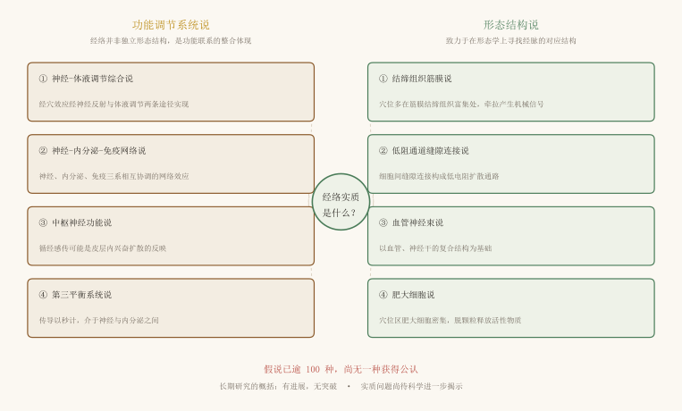
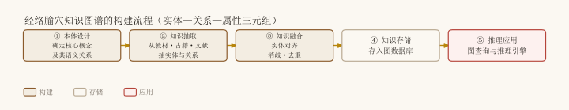

# 第 19 章 · 经络腧穴现代研究（经络实质研究·艾灸红外与灸法效应·数字化与AI应用）

> **源**：`qhzy-经络腧穴学.xlsx` · 表「19 经络腧穴现代研究」 · 源文 9,828 字
> **抽取**：`node scripts/import_textbooks.js --only 经络腧穴学` · sha256 `a630e66b5a4609ab…` · 2026-10-21
> **层次**：本文件是**源教材正文层** —— 节次取自源表的结构列，文字未改写、未压缩、未抽样。改写层（N.3「这个翻译丢掉了什么」/ N.5「争议与本项目立场」）尚未撰写，见 `textbooks/README.md` 章契约。

---

## 19.1 经络实质研究

### 19.1.1 经络现象与循经感传

#### 19.1.1.1 循经感传现象/低阻线等客观化研究

经络现象是指机体在受到针刺、艾灸等刺激时或脏腑病变状态下，沿经脉循行路线出现的感觉、形态与功能等方面的特殊反应，是经络学说形成与发展的经验基础，也是现代经络研究的出发点。其中，循经感传是最典型、研究最深入的经络现象。所谓循经感传，是指在针刺、艾灸或电针等刺激穴位时，受试者在局部产生酸、麻、胀、重等感觉（即得气）的基础上，出现一种向远隔部位传导的特殊感觉，其传导路线与古典经脉循行路线大体一致。 一、循经感传现象的发现与出现率。20世纪50年代以来，我国学者对循经感传开展了大规模调查。20世纪70年代，全国二十余个省、自治区、直辖市进行了协作普查，结果表明循经感传并非个别人的特殊体验，而是一种相当普遍的现象，多数调查显示其出现率约为12%～25%，因刺激方式、判定标准与调查对象的不同而有差异；其中感传贯通经脉全程、循行路线清晰稳定者极为少见，被称为经络敏感人，其出现率不足1%。经络敏感人的存在提示，人体确有可能存在循经传导的功能联系，这一发现在当时引起国内外学术界的高度关注，也直接推动了经络实质研究的开展。 二、循经感传的基本特征。综合大量研究，循经感传可归纳出以下特征：①循经性，感传路线大体沿古典经脉循行路线走行，手足三阴三阳经各有相应的感传路线，少数可出现偏离、串经或跨越现象；②速度缓慢，感传速度远慢于神经传导速度，一般为每秒数厘米至十余厘米，且不同受试者、不同经脉、不同节段之间差异较大；③可阻滞性，在感传路线上施加局部机械压迫、冷冻降温或注射生理盐水，可使感传在相应部位被阻断，去除阻滞因素后感传又可恢复；④双向性，针刺四肢肘膝关节以下穴位时，感传既可由刺激点向肢体远端方向传导，也可向近心端及躯干头面方向传导；⑤可激发性，通过入静诱导、循经加热、循经轻叩或电针激发等方法，可使部分感传不明显者的感传出现率显著提高，感传路线亦有所加长；⑥趋病性，感传常趋向病变部位，即所谓气至病所【原文】'气至病所'（转引自《针灸学》），临床观察提示感传趋达病所者疗效往往较好，这与古人【原文】'刺之要，气至而有效'（《灵枢·九针十二原》）的认识相吻合。此外，感传具有较好的可重复性，同一受试者多次接受同一刺激，其感传路线与感觉性质相对稳定。 三、隐性循经感传与感传的普遍性。在感传调查中，多数受试者针刺时并无明显的主观感传，但若沿经脉路线以低频叩击或小幅度指压等方法逐段探测，常可在其体表发现一条对刺激敏感的特殊线，称为隐性循经感传线，其出现率可达80%以上。隐性感传线的存在表明，循经感传可能是绝大多数机体普遍存在的一种潜在功能，只是多数人处于隐性状态而不被感知。这一发现大大扩展了对循经感传现象普遍性的认识，也为经络的客观化研究提供了新的途径，说明经络现象并非少数敏感人所独有。 四、低阻线等客观化研究。除循经感传这一以主观感觉为主的现象外，现代研究还运用多种客观检测手段观察经络现象。①皮肤电学特性方面，利用经络穴位测定仪检测经络腧穴部位的电参量，发现经穴部位皮肤电阻较周围组织低、电位较高，可借以判断各经气血盛衰与病变，此即穴位电测定；沿经皮肤低电阻点的连线构成所谓皮肤低阻线，曾被视为经脉客观存在的证据之一，但低阻点分布受汗腺分泌、电极压力、皮肤湿度及情绪状态等多种因素影响，各研究结果并不一致，其可靠性尚有较大争议。②循经红外辐射轨迹方面，应用红外热像仪观察，在针刺或艾灸激发后，部分受试者体表可沿经脉循行路线出现高温带，其走行与古典经脉线相近且具有较好的可重复性。③声信息传导方面，在经脉线上叩击或施以振动刺激，可记录到沿经传导的声信号，其传导方向与速度有别于神经、血管的传导。④其他指标如穴位注射放射性示踪剂后沿经的迁移现象、循经发光、循经微循环与组织氧分压变化等均有报道，但因方法学限制与可重复性不佳，多未成为公认结论。 五、经络现象研究的认识。循经感传与低阻线等客观化研究的意义，在于从现象学层面证实了古典经脉循行路线并非凭空虚构，人体确实存在着可被感知、可被检测的循经性功能联系，从而为经络实质研究提供了线索与起点。同时也应清醒地看到，经络现象的出现率、可重复性与判定标准仍受诸多因素影响，各种客观检测方法尚存争议，均不能据此直接认定经络的物质基础。经络现象研究属于现代认识，不改经典原义，经络学说关于经脉循行、腧穴主治与气血运行的理论仍以经典著作与规划教材为准绳，现代研究仅作为理解经络学说、指导临床应用的辅助参考。 六、循经感传的临床意义。循经感传研究不仅具有理论意义，也与针灸临床密切相关。得气是针刺取效的关键，感传的强弱与疗效存在一定关系：临床观察到感传明显、气至病所者，疗效往往较好，故历代医家重视通过手法激发经气、促使气至病所，如捻转、提插以催气，循经按压以行气，以及飞经走气等手法，皆可视为对感传现象的经验运用。现代研究还观察到，通过入静诱导、针刺手法或电针激发，可使感传出现率提高、路线加长，提示感传具有一定的可激发性与可训练性。临证之际，可在得气基础上适当运用催气、行气手法，促进针感沿经传导，以提高疗效；但感传出现与否及其强弱存在明显的个体差异，不应将感传作为疗效判定的唯一依据，更不可强求感传而徒增患者痛苦。循经感传现象的临床研究，为气至病所等经典经验提供了现代观察证据，属现代认识，不改经典原义。 本节要点：循经感传是针刺等刺激穴位时沿经脉路线出现的感觉传导现象，一般人群出现率约12%～25%，具有循经性、速度缓慢、可阻滞性、双向性、可激发性、趋病性等特征；隐性循经感传出现率高，提示感传具有普遍性；穴位电测定、皮肤低阻线、循经红外辐射轨迹等客观化研究为经络现象提供了检测证据，但均有争议，属现代认识，不改经典原义。

### 19.1.2 经络实质假说

#### 19.1.2.1 神经-体液/结缔组织/缝隙连接等假说(两说并存)

经络实质研究是运用现代科学方法探索经络的物质基础与功能本质的研究领域，其目标在于回答经络是什么这一根本问题。经络现象的大量存在提示经脉循行路线可能具有相应的生物学基础，但数十年来对其物质基础的认识仍处于假说并存的阶段。 一、经络实质研究的历程。20世纪50年代针刺麻醉的成功应用，引起国际学术界对针灸作用机理与经络实质的高度关注，此后经络研究成为针灸实验研究的重要方向。我国从七五计划时期开始即将经络研究列入国家攀登计划，【原文】'以冀找到经络的实质'（转引自《针灸学》十四五规划教材），但长期研究的结果被概括为【原文】'有进展，无突破'（转引自《针灸学》十四五规划教材）：一方面，循经感传、经穴效应等经络现象得到大量证实，形态学、生理学、生物化学等方面的实验积累日益丰富；另一方面，尚未找到公认的、与古典经脉循行线完全对应的特异性形态结构。目前，由不同研究者从不同角度提出的经络实质假说已逾100种，但尚未达成一致。研究思路亦随之调整：从寻找经络的物质结构，转向经络功能的研究；从单一经脉的研究，深入到两条或两条以上相关经脉（如表里经）乃至古典经络系统理论的整体现代科学阐释。 二、功能调节系统说。此类假说认为经络并非独立的形态结构，而是人体神经、体液等调节系统功能联系的整合体现。①神经-体液调节综合说认为，经脉循行部位与周围神经、血管、淋巴的分布密切相关，经穴效应通过神经反射与体液调节两条途径实现，针刺的针感与穴位区感受器及其传入神经纤维有关，经穴与脏腑之间的联系主要借助神经节段支配与体液因子的远距离运输来完成。②神经-内分泌-免疫网络说进一步把经络的调节作用理解为神经、内分泌、免疫三大系统相互协调的网络效应，与针灸作用整体性、双向性的特点相符。③中枢神经功能说认为，循经感传的路线与大脑皮层体表机能定位的排列有关，感传现象可能是皮层内兴奋扩散的反映，故经络可理解为大脑皮层功能定位在体表的投影系统。④第三平衡系统说认为，人体存在三个平衡系统：神经调节以毫秒计，内分泌调节以分钟、小时计，而经络调节以秒计，恰与循经感传的传导速度相合，故经络可能是介于神经与内分泌之间的第三平衡系统。以上假说各有实验支持，但均难以圆满解释循经感传的循经性、可阻滞性等全部特征。 三、形态结构说。此类假说致力于在形态学上寻找经脉的对应结构。①结缔组织筋膜说认为，穴位多位于筋膜结缔组织富集之处，针刺捻转可通过牵拉胶原纤维网络产生机械信号传导；近年人体组织间隙内液体流动网络（间质通道）的发现，被认为可能为经脉提供了新的形态学候选结构。②低阻通道缝隙连接说认为，经脉线上细胞间缝隙连接较丰富，离子与小分子信号物质可沿细胞间低电阻通路扩散传导，与经穴部位低电阻现象相符。③血管神经束说认为，经脉循行与血管、神经干及其分支的分布存在较多对应关系，经脉可能以血管神经复合结构为基础。④肥大细胞说观察到穴位区肥大细胞密集，针刺等刺激可引起肥大细胞脱颗粒，释放组胺、5-羟色胺等生物活性物质，参与构成经络-肥大细胞-神经通路。此外尚有液晶态说、半导体说、二重反射假说等多种假说。形态结构说提供了大量组织学证据，但迄今未能确定与经脉线完全一致的特异性管道或纤维结构，且经脉功能并不能由单一结构完全解释。 四、经络实质研究的现状与认识。目前经络实质研究仍处于假说林立、两说并存的阶段：功能调节系统说与形态结构说各有实验依据，又各有难以解释之处，尚无一种假说能获得公认。近年来，针灸作用机制研究在腺苷受体参与、结缔组织、肥大细胞、瞬时受体通路响应等方面取得重要进展，研究显示【原文】'穴位所在的部位与神经、血管、淋巴等组织密切相关'（转引自《针灸学》十四五规划教材），这些进展虽未直接解答经络实质问题，却不断丰富着对经穴效应生物学基础的认识。应当明确，经络实质研究的结论并不影响经络学说作为中医理论体系组成部分的临床价值——经络学说的意义在于其指导辨证、选穴与配穴的实用价值，实质问题尚待科学进一步揭示。经络实质假说相关内容属现代认识，不改经典原义。 五、经络实质研究展望。经络实质研究虽未取得突破性结论，但其科学价值不容低估：其一，经络现象的研究为经络学说提供了现代科学观察的佐证，使古典经脉循行路线获得了可检验的经验基础；其二，经络实质研究的各种假说促进了针灸学与神经科学、组织学、生物物理学等学科的交叉融合，推动了针灸实验方法学的发展；其三，围绕经络实质开展的循经感传、经穴效应、穴位敏化等研究，为针灸临床选穴与疗效评价提供了客观指标。展望未来，随着影像学、分子生物学、单细胞测序与人工智能等技术在针灸研究中的应用，经络的物质基础与功能机制有望获得更加清晰的阐释。应当强调，无论经络实质最终如何认定，经络学说作为中医理论的重要组成部分，其指导临床的价值已经过数千年实践检验，现代研究的目的在于阐释与发展经典理论，而非否定其临床意义。以上内容属现代认识，不改经典原义。 本节要点：经络实质研究历经数十年，结果有进展而无突破，假说逾100种；主流假说分为功能调节系统说（神经-体液调节、神经-内分泌-免疫网络、中枢神经功能、第三平衡系统）与形态结构说（结缔组织筋膜、低阻通道缝隙连接、血管神经束、肥大细胞等），两说并存；尚无定论，经络学说的临床价值不依赖其实质是否被证实。

## 19.3 艾灸红外与灸法效应

### 19.3.1 艾灸红外物理特性

#### 19.3.1.1 艾灸光谱特性/共振红外辐射吸收假说(沈雪勇研究方向)

一、艾灸的物理特性。艾灸疗法以艾绒为灸材，其作用机制涉及温热刺激、光辐射与艾烟化学刺激三个方面。现代研究测定表明，艾在燃烧过程中产生的光和热具有一定的光谱特性【原文】'艾在燃烧过程发出的光和热有一定的光谱特性'（转引自《针灸学》十四五规划教材）：艾绒燃烧时表面温度可达数百度，其辐射光谱以红外为主，涵盖近红外与远红外波段。灸法主要是靠灸火直接或间接地在体表施以适当的温热刺激来达到治病保健作用，灸感以局部皮肤及皮下温热或有灼痛为主，【原文】'温热刺激可直达深部，经久不消，或可出现循经感传现象'（转引自《针灸学》）。 二、艾灸红外辐射研究（沈雪勇研究方向）。艾灸红外物理特性是灸法现代研究的重要方向，上海中医药大学沈雪勇教授团队长期从事该领域研究，主要认识可归纳为：①人体体表本身持续向外辐射红外线，穴位的红外辐射光谱具有一定特征，并与机体的功能状态相关；②艾灸燃烧时产生的红外辐射与人体穴位红外辐射光谱之间存在明显的重叠与匹配关系；③据此提出共振红外辐射吸收假说，即艾灸的红外辐射可被穴位组织共振吸收，其温热效应与光辐射效应协同作用于穴位深部组织，从而产生温通经络、激发经气的效应；④不同灸材、不同施灸方式的燃烧温度与辐射光谱存在差异，隔物灸（如隔姜灸、隔附子饼灸）的温热刺激较直接灸更为缓和，其辐射特征亦不相同。这一方向的研究把灸法的温热刺激从单纯的物理加热，提升为红外辐射与机体生物物理特性相互作用的科学命题，为灸法温通作用提供了现代解释，也为灸材选择与灸具改进提供了依据。在灸材比较方面，研究表明【原文】'热水、烟条、激光虽均有一定的效应，但在效应量及效应的全面性方面，以艾绒为最佳'（转引自《针灸学》十四五规划教材），提示艾灸的疗效并非单纯温热所能替代，艾绒燃烧的综合物理化学特性具有独特价值。 三、艾烟与灸量研究。艾烟是艾灸过程中的重要产物，【原文】'艾烟具有广谱抗菌、抗病毒以及平喘等作用'（转引自《针灸学》十四五规划教材）；安全性研究显示【原文】'短期艾烟暴露对人体自主神经系统具有良性调整作用'（转引自《针灸学》十四五规划教材），但诊室长期艾烟浓度仍应通过排烟通风设施加以控制。灸量研究证实【原文】'灸量是影响艾灸效应的重要因素'（转引自《针灸学》十四五规划教材），【原文】'一定程度的灸量才能产生机体保护作用'（转引自《针灸学》十四五规划教材），且【原文】'治疗效果和较佳灸量相关，而非最强灸量'（转引自《针灸学》十四五规划教材），即灸量并非越大越好，不同灸量的调节效应存在差异，临床应因人因证确定适宜灸量。 四、艾灸的生物学效应与热敏灸。实验研究证实，艾灸具有【原文】'艾灸具有抗炎、抗自由基、降脂、促循环、免疫调节、增强器官功能、抗衰老、抗抑郁、抗癌前病变等作用'（转引自《针灸学》十四五规划教材），涉及机体多个系统。在灸法理论与技术创新方面，热敏灸又称穴热敏化艾灸疗法【原文】'热敏灸又称穴热敏化艾灸疗法'（转引自《针灸学》十四五规划教材），是以穴位敏化理论为指导，选择热敏穴，施以饱和灸量，【原文】'激发经气，气至病所'（转引自《针灸学》十四五规划教材），从而显著提高临床灸疗疗效。艾灸红外物理特性与灸法效应的研究均属现代认识，不改经典原义，灸法的取穴、灸量与操作仍当遵循教材规范，注意防止烫伤并控制艾烟刺激。 五、现代灸具与灸法安全。在灸法器具方面，现代研制了灸架、灸盒、无烟灸条、含药灸条等灸材灸具，以及利用红外线、远红外线或激光产生热量照射经络腧穴的光灸仪等，为临床施灸提供了更多选择；无烟灸条可减少艾烟对操作环境的污染，灸盒、灸架便于控制灸量与施灸部位。艾灸安全性方面，应注意防止烫伤与灸疮感染，皮肤感觉迟钝者、糖尿病患者及小儿尤须谨慎控制灸量与施灸距离；诊室应保持通风或配备排烟设施，以减少艾烟长期暴露的影响；施灸后局部出现水疱者，小者可待其自行吸收，大者应按无菌操作处理。灸具改进与安全性研究丰富了灸法临床应用的形式，但灸法的取穴、灸量与操作规范仍以教材为准，属现代认识，不改经典原义。 艾灸红外研究还提示，灸法与针刺在穴位刺激的物理形式上各具特点，灸以温热见长，针以机械刺激见长，二者常相须为用，共奏温通之效。 本节要点：艾灸作用包括温热刺激、光辐射与艾烟化学刺激；艾灸红外辐射以红外为主，与人体穴位红外辐射光谱存在重叠，沈雪勇方向据此提出共振红外辐射吸收假说；艾绒在灸材中效应量及全面性最佳；灸量适度为要，热敏灸以敏化穴与饱和灸量为特色。

## 19.4 数字化与AI应用

### 19.4.1 经络腧穴知识图谱与三维经络

#### 19.4.1.1 图谱构建/三维可视化(标可辅助参考)

一、针灸文献的数字化。数字化技术正在深刻改变针灸知识的组织、存储与利用方式。古代文献研究方面，借助计算机将古代医籍转换为多媒体、数据库、软件等新形式，为针灸古籍的储存、传播与数据挖掘提供了新工具；2012年成都天回镇汉墓出土的经穴髹漆人像（木胎漆，高约14cm，五官位置造型准确），【原文】'是迄今我国发现最早的、最完整的经络人体模型'（转引自《针灸学》十四五规划教材），【原文】'出土的920余支竹简中的《经脉书》论及经脉的名称及走向'（转引自《针灸学》十四五规划教材），具有重要学术价值，其三维扫描与数字化重建为经络形态研究提供了珍贵的数字化资料。现代文献研究方面，运用文献计量学方法分析疾病的用穴规律、刺灸法、穴位应用及配伍规律、名医医案等，并绘制可视化图谱；运用数据挖掘技术研究古代文献的疾病用穴规律、配穴规律、刺灸特点与针灸名家经验，为针灸教学、科研与临床提供信息资源与系统分析。 二、经络腧穴知识图谱的构建。经络腧穴知识图谱是以图结构组织针灸领域知识的知识表示形式，其基本单元为实体—关系—属性三元组：实体包括腧穴、经络、病证、刺灸法、特定穴类别等，关系包括腧穴与经络的隶属关系、腧穴与主治病证的对应关系、腧穴之间的配伍关系、经络与脏腑的属络关系等，属性包括定位、归经、刺灸法、注意事项等细节。构建流程一般包括：①本体设计，确定核心概念及其语义关系，形成领域本体；②知识抽取，从规划教材、经典古籍与权威临床文献中抽取实体与关系；③知识融合，进行实体对齐、消歧与去重；④知识存储，存入图数据库；⑤推理应用，通过图查询与推理引擎实现智能检索与知识发现。将《经络腧穴学》教材与经典文献中的知识抽取为结构化数据，即可构建覆盖腧穴—经络—主治—配伍全链条的知识图谱，支持语义检索、知识问答与关联推理，例如由病证反查穴位、由穴位检索经络归属与刺灸法、查询特定穴的配伍应用等。 三、知识图谱与三维可视化的应用。在检索系统层面，已开发出中国现代针灸信息数据库、针灸临床循证诊疗决策支持系统、针灸病例处方计算机系统、子午流注针灸开穴系统等多种数字化工具，通过数据挖掘研究疾病用穴规律、配穴规律、刺灸特点，为针灸工作者提供古籍查询与系统分析。三维可视化方面，用于针灸教学的虚拟三维针灸模型、虚拟人体经络腧穴模型可在三维空间中立体呈现经脉循行与腧穴定位，学习者可通过旋转、剖切、放大等操作多角度观察，弥补平面图谱与标本教学的不足；基于人体断层影像数据的个体化三维经络腧穴模型，还可为临床教学与操作训练提供参考。需要强调的是，知识图谱与三维模型的构建质量取决于数据来源的权威性，其检索与推理结论只能作为辅助参考，不能替代教材经典与临床辨证——标可辅助参考，穴位定位最终以GB/T 12346《腧穴名称与定位》及教材规范为准。数字化图谱与三维可视化内容属现代认识，不改经典原义。 四、知识图谱与智能化的限度。知识图谱等数字化工具为针灸知识的组织与利用提供了新的可能，但其限度亦应清醒认识：其一，图谱中主治、禁忌等知识的表达应严格遵循教材与权威文献口径，避免因数据来源混杂、版本不一导致知识失真；其二，图谱更新须建立审核机制，确保新增知识经专业人员校验；其三，图谱的推理结论仅反映已有知识的逻辑组合，不能产生超越数据的临床判断。因此，知识图谱与三维模型在教学中可作为直观辅助工具，在科研中可作为数据组织与分析平台，在临床中仅能提供参考信息，标可辅助参考——真实临床决策必须由执业医师结合患者具体病情作出。数字化建设与教材经典、临床实践相互支撑，方能发挥其应有价值，以上内容属现代认识，不改经典原义。 随着教材与教学资源的数字化进程，经络腧穴三维模型、电子图谱等已成为课堂教学与自主学习的重要辅助资源。 本节要点：古籍数字化与经穴髹漆人像的三维重建为经络研究提供数字化资料；知识图谱以实体—关系—属性三元组组织腧穴、经络、主治与配伍知识，支持语义检索与关联推理；三维经络模型可立体呈现循行与定位；图谱与模型标可辅助参考，不能替代教材与临床辨证。

### 19.4.2 仿真针刺与AI取穴辅助

#### 19.4.2.1 针刺仿真训练/VR经络/AI辅助(标可辅助参考,不替代真人实训)

一、针刺手法仿真系统。针刺手法是针灸操作的核心技能，传统教学依靠师承口授与自身反复练习，难以量化评估。针刺手法仿真研究结合生物力学原理、传感技术、红外热像技术、超声波技术、磁共振成像技术、计算机断层成像技术、激光多普勒血流图成像、激光散斑成像、针刺手法仪、手法参数检测系统等现代技术【原文】'对针刺手法的规范化、定量化、仿真化等进行探讨'（转引自《针灸学》十四五规划教材），对提插补泻、捻转补泻、烧山火、透天凉、飞经走气、龙虎交战等经典手法【原文】'提插补泻、捻转补泻、烧山火、透天凉'（转引自《针灸学》十四五规划教材）进行模拟与量化：手法参数检测系统可记录进针角度、深度、频率、力度等参数，使手法训练可重复、可量化、可评估；仿真系统还可记录保存名老针灸专家的手法参数，为手法传承提供数字化样本。用于针灸教学的有【原文】'针刺手法虚拟仿真系统、虚拟针灸教学系统、虚拟三维针灸模型'（转引自《针灸学》十四五规划教材）等，虚拟人体经络腧穴模型可在三维空间中立体呈现经脉循行与腧穴定位，显著提高经络腧穴学习的直观性与效率。 二、VR经络教学。虚拟现实（VR）技术为经络腧穴教学提供了沉浸式学习环境：将经络循行路线、腧穴体表标志、针刺层次与得气感应等抽象内容可视化，学生可在无风险环境中反复练习进针、行针与出针操作；结合力反馈设备可模拟针刺穿越皮肤、肌肉等组织的层次感，结合虚拟患者的生理参数变化可演示不同手法的效应差异；系统实时反馈操作参数，可实现标准化考核。仿真训练的价值在于：把难以言传的手法要领转化为可测参数，使教学反馈具体化；提供标准化考核工具，减少主观评分差异；弥补真实病人资源与实训机会的不足。 三、AI取穴辅助与数字化针灸方向。人工智能在针灸领域的应用日益广泛：图像识别技术可辅助识别体表解剖标志、提示腧穴定位；自然语言处理与知识图谱技术可解析病证描述，基于辨证规则推荐选穴方案；循证针灸智能诊疗系统、子午流注针灸开穴系统等亦为临床决策提供参考。以孙汉旭等为代表的数字化针灸研究方向主张，虚拟仿真、大数据与人工智能应明确定位为教学与临床的辅助工具：AI取穴辅助通常以GB/T 12346国家标准和教材的解剖标志描述为训练数据，输出候选定位供学习者比对；其选穴推荐则基于辨证规则与知识图谱给出主穴、配穴建议，所有输出均须经教师或执业医师审核确认后方可使用。必须强调，数字化与AI内容标可辅助参考，不替代真人实训，真实临床仅辅助不决策——穴位定位最终以GB/T 12346《腧穴名称与定位》及教材规范为准，AI不能替代临床辨证思维与专业判断。仿真训练与AI工具提高了教学效率与操作规范性，但针刺手感、得气体验与医患沟通等临床能力的培养仍离不开真实临床实践，数字化手段与传统师承训练应相辅相成。本节内容属现代认识，不改经典原义。 四、数字化与AI在针灸研究中的应用。除教学与临床辅助外，数字化与人工智能技术亦广泛用于针灸科学研究：文献计量学与数据挖掘技术可对海量针灸文献进行系统分析，揭示疾病用穴规律、配穴规律与刺灸特点；自然语言处理可用于中医古籍的自动断句、术语标准化与病证处方的语义解析；机器学习与图像识别可用于穴位定位的自动校验、针刺手法参数的自动分类；基于知识图谱的智能检索系统可辅助研究者快速获取循证证据。这些应用提高了研究效率与数据利用水平，但其分析结论仍需研究者结合专业判断加以甄别，标可辅助参考。数字化技术是传承与发展针灸学术的工具，工具为器、数据为基、辅助为界，针灸学的发展归根结底依赖于经典理论的传承、临床实践的积累与科学研究的深化。 本节要点：针刺手法仿真系统实现手法的规范化、定量化、仿真化训练与传承；VR经络教学提供沉浸式、可反复练习的学习环境；AI取穴辅助与数字化针灸方向标可辅助参考，不替代真人实训，真实临床仅辅助不决策。

---

> **免责声明**：本教材内容仅用于教育与科研，不构成任何诊疗建议。
> 本文件由 `scripts/import_textbooks.js` 从源工作簿生成，请勿手改 —— 需要修改请改源工作簿后重跑。
