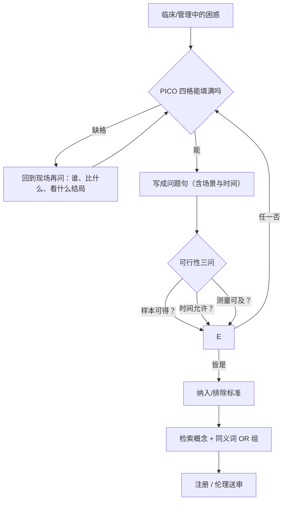

# 第 1 章 · 护理研究的选题与问题化

> **层次**：本文件是**本库撰写层**（无底本表，不是源正文层）。依据是 PRISMA 2020 expanded checklist、WHO 指南制订手册、JBI 批判性评价清单与 Cochrane Handbook Ch4，条文登记于 `standards/huli-yanjiu-zhengxun/外源条文.json`（76 条，逐字可核）。
> **依据**：`standards/huli-yanjiu-zhengxun/补源登记.json`（`python scripts/build_huli_yanjiu_sources.py --check` 现算 sha256 与逐字校勘，76/76 通过）；引用格式见 [`补源约定.md`](../../../补源约定.md)。
> **免责**：本章为选题与问题化的教学整理，不构成诊断或治疗建议；研究方案须经机构伦理审查与导师/团队评审。

---

## 本章要回答的问题

「我想研究护理人员的工作压力」——这是选题，还是问题？多数人认为是问题。但按报告规范的要求，它还不够：**谁的压力、和什么比、看什么结局、在什么场景下**，四项缺一项，这句话就无法被检索、无法被评价、也无法被复现。

问题化（problem formulation）就是把一句「想研究什么」变成**别人能照着做**的表述。这一章讲的就是这个转换。

## N.1 概念与出处

> 「Provide an explicit statement of all objective(s) or question(s) the review addresses, expressed in terms of a relevant question formulation framework.」（外源·PRISMA 2020 expanded checklist 第3条）

注意这句里的两个词：**all**（全部问题，不是主要问题）与 **framework**（用框架表述，不是自由叙述）。前者防「只写主结局」，后者防「问题写成散文」。

| 概念 | 依据 | 要点 |
|---|---|---|
| 问题要显式写出 | 外源·PRISMA 2020 expanded checklist 第3条 | 全部目标/问题 + 用提问框架表述 |
| 框架首选 PICO 或其变体 | 外源·PRISMA 2020 expanded checklist 第4条 | Population / Intervention / Comparator / Outcome |
| PICO 的四要素 | 外源·Strengthening countries' capacities to adopt and adapt evidence 第3条 | 人群／患者、干预、对照、结局 |
| 纳入标准要写全 | 外源·PRISMA 2020 expanded checklist 第5条 | 决定一项研究能否纳入的**全部**研究特征 |
| 纳入标准能否执行 | 外源·JBI 横断面研究核查表 第1条 | 「纳入样本的标准是否被清晰定义」是质量评价的第一问 |
| 问题决定检索式 | 外源·Cochrane Handbook Ch4 检索 第2条 | 概念不宜过多；每个概念内同义词用 OR 展开 |
| 注册与问题同步 | 外源·PRISMA 2020 expanded checklist 第17条 | 注册名称与号，或声明未注册 |

**读法**：第3条要求「全部问题」，第5条要求「全部研究特征」—— 两条合起来是一句话：**选题阶段含糊的部分，会在纳入标准里变成争议，在检索式里变成漏检。**

## N.2 为什么可以这样翻译：四格 + 三问 + 一条接口

| 要素 | 填不出时的含义 | 依据 |
|---|---|---|
| P（人群） | 目标人群没界定 → 样本量、外推性都无从谈起 | 外源·Strengthening countries' capacities to adopt and adapt evidence 第3条 |
| I（干预） | 「护理干预」太宽 → 需具体到频次、时长、执行者 | 同上 |
| C（对照） | 常规护理还是空白？决定效应量方向 | 同上 |
| O（结局） | 主结局与次结局要分，否则多结局比较会虚增假阳性 | 外源·PRISMA 2020 expanded checklist 第3条 |

**「全套」比「主问题」重要**。第3条要求写出全部问题，实务含义是：如果方案里存在第二个问题（如「同时看依从性」），它必须现在写出来。等到分析阶段才加，就变成事后假设。

**问题与检索式的接口**（本项目的翻译）：第2条说检索概念不宜过多、每个概念内用 OR 展开 —— 这正好对应 PICO。**通常 P + I 两个概念就够**，把 O 塞进检索式会让结果集塌缩。选题阶段的四格，落成检索式就是两三个概念块。

## N.3 这个翻译丢掉了什么

1. **不给「值得做」的判据**。PRISMA 管报告，不管选题价值：新颖性、重复研究的必要、利益相关者需求，都不在条文里。
2. **不给样本量的算法**。可行性靠经验判断，条文只要求把研究特征写全（第5条），不告诉你 n 要多少。
3. **PICO 不适配所有设计**。质性研究常用 PICo（人群—兴趣现象—情境）；条文允许「PICO 或其变体」（第4条），但**变体要自己说明**，规范不给清单。
4. **不涉及利益相关者参与**。患者/护士参与选题，是现代研究设计的常规做法，但这份清单不覆盖。
5. **注册与选题的关系只到「写出来」为止**。第17条要求注册信息，不要求「注册前必须完成问题化」——实操上顺序是反的：先有完整问题才注册得下去。
6. **伦理审查完全在条文范围之外**。第 8 章单独处理。

## N.4 与相邻学科的接口

| 去向 | 接口 |
|---|---|
| 第 2 章 量性研究与设计类型 | PICO 里的 C（对照）决定是 RCT、队列还是横断面：无对照就是描述性研究 |
| 第 3 章 质性研究与访谈分析 | 问题改写成 PICo；「兴趣现象」替代「干预—结局」 |
| 第 4 章 量表的选择与信效度 | O（结局）落到具体量表，本章只定性描述，量表章定工具 |
| 第 6 章 文献检索与系统评价 | 本章的 PICO → 检索概念块；纳入标准 → 筛选判据 |
| 第 7 章 证据到实践的转化 | 选题若来自证据缺口，转化章要回答「为什么这条证据没被用」 |
| 第 8 章 伦理审查 | 人群若涉及弱势群体（老年、儿童、认知障碍），问题化阶段就要预判伦理风险 |

## N.5 争议与本项目立场

**争议一：先有问题还是先有文献？** 一派主张先读文献找缺口，一派主张先从现场问题出发。本项目立场：**两条路都要落到同一个 PICO 上**，没有 PICO 的「文献缺口」只是印象，没有文献支撑的「现场问题」可能早已有答案。

**争议二：问题要不要在开题时冻结。** 冻结的好处是可审计（注册、伦理、方案一致）；坏处是探索性研究会被锁死。本项目立场：**注册时冻结主问题，允许次问题在研究过程中细化并记录变更**。这与第17条的精神一致——条文要求「声明」，不要求「永不改变」。

**争议三：PICO 是不是唯一入口。** 不是。PICo（质性）、PEO（暴露—环境—结局，观察性）、SPIDER（质性证据综合）都在用。本项目立场：**框架可以换，四要素的完备性不能省**——换框架是为了适配设计，不是为了省事。

**本项目立场**：选题章的产出不是一句题目，而是**三件套**：一句含场景的问题句、一张填满的 PICO 表（或声明的变体）、一份纳入/排除标准草案。三者齐，才算完成问题化。

> **免责**：本章所列条文与判据不构成诊断或治疗建议；研究问题与方案须经机构伦理审查与团队评审后实施。

## 小结

1. 选题是「想研究什么」，问题化是「别人能照着做」。
2. PRISMA 第3条要求**全部**问题 + 框架表述；第4条框架首选 PICO。
3. 纳入标准要写全全部研究特征（第5条），否则筛选阶段必起争议。
4. 问题落成检索式只需两三个概念块（P + I），每个概念内同义词用 OR（Ch4 第2条）。
5. 质性研究换 PICo，但变体必须声明。
6. 三件套：问题句 + PICO 表 + 纳入排除草案。

## 思考题

1. 把「护士的职业倦怠」改写成含 PICO 四要素的问题句，并指出哪一格最难填、为什么。
2. 第5条要求写全「全部研究特征」，若只写了人群与干预，会在筛选阶段产生什么具体争议？
3. 你的问题若用 PICo 表述，与 PICO 相比丢掉了哪一格？这一格的丢失是否影响可行性判断？
4. 注册前发现 PICO 的 C 填不出，你会先补哪一步：改问题、改设计、还是先做预调查？

## 延伸阅读

- 外源·PRISMA 2020 expanded checklist 第3–5、17 条
- 外源·Strengthening countries' capacities to adopt and adapt evidence 第3条
- 外源·Cochrane Handbook Ch4 检索 第2条
- 外源·JBI 横断面研究核查表 第1条
- 本库专题：[`standards/huli-yanjiu-zhengxun/专题-循证报告核查.md`](../../../standards/huli-yanjiu-zhengxun/专题-循证报告核查.md) 第九节（各章取条入口）
