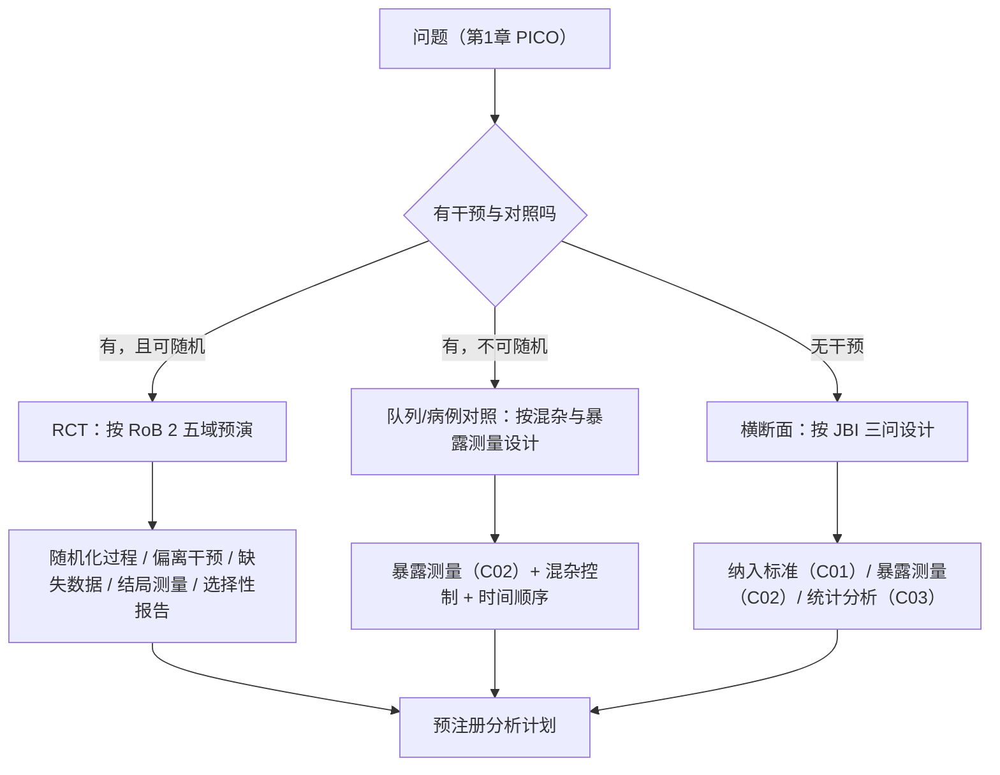

# 第 2 章 · 量性研究与设计类型

> **层次**：本文件是**本库撰写层**（无底本表，不是源正文层）。依据是 Cochrane Handbook Ch8（RoB 2）与 JBI 横断面研究核查表，条文登记于 `standards/huli-yanjiu-zhengxun/外源条文.json`（76 条，逐字可核）。
> **依据**：`standards/huli-yanjiu-zhengxun/补源登记.json`（`python scripts/build_huli_yanjiu_sources.py --check` 现算）；引用格式见 [`补源约定.md`](../../../补源约定.md)。
> **免责**：本章为研究设计的教学整理，不构成诊断或治疗建议；设计选择与统计方案须经方法学评审与伦理审查。

---

## 本章要回答的问题

「我做一个量性研究」——这句话什么也没说。量性研究至少有横断面、病例对照、队列、RCT 几大类，它们**能回答的问题不同**，能被挑出的毛病也不同。

这一章换一个入口：不从设计分类学讲，而从**偏倚评价工具反推设计**。RoB 2 用五个固定域去查一个 RCT；倒过来看，这五个域就是设计阶段该预先想清楚的五件事。同样的逻辑，JBI 横断面核查表的三问（纳入标准、暴露测量、统计分析）就是横断面设计的三个命门。

## N.1 概念与出处

> 「RoB 2 is structured into a fixed set of domains of bias, focusing on different aspects of trial design, conduct and reporting.」（外源·Cochrane Handbook Ch8 偏倚风险 第1条）

「fixed set of domains」这两个词是关键：域是**固定的**，不能按病例挑着用。这既限制了评价者的自由度，也暗示了设计者：这五个方面是绕不过去的。

| 概念 | 依据 | 要点 |
|---|---|---|
| 偏倚按固定域评价 | 外源·Cochrane Handbook Ch8 偏倚风险 第1条 | 域固定，覆盖设计、实施与报告三个方面 |
| 每域下设信号问题 | 外源·Cochrane Handbook Ch8 偏倚风险 第2条 | 信号问题的用途是「取得与该域相关的试验特征信息」 |
| 判定必须留书面理由 | 外源·Cochrane Handbook Ch8 偏倚风险 第3条 | 没有 justification 的判定不可复核 |
| 纳入标准要清晰 | 外源·JBI 横断面研究核查表 第1条 | 「纳入样本的标准是否清楚定义」 |
| 暴露测量要有效且可靠 | 外源·JBI 横断面研究核查表 第2条 | valid **and** reliable：两者都要 |
| 统计分析要恰当 | 外源·JBI 横断面研究核查表 第3条 | 与设计、数据结构匹配的分析 |

## N.2 为什么可以这样翻译：用「查」的清单当「做」的清单

| 设计 | 该预演的域 | 依据 |
|---|---|---|
| RCT | 五域全套：随机化、偏离既定干预、缺失结局数据、结局测量、选择性报告 | 外源·Cochrane Handbook Ch8 偏倚风险 第1条 |
| 队列 / 病例对照 | 暴露测量是否 valid & reliable；混杂是否被设计层面处理；时间顺序是否成立 | 外源·JBI 横断面研究核查表 第2条 |
| 横断面 | 纳入标准、暴露测量、统计分析三问 | 外源·JBI 横断面研究核查表 第1条、第2条、第3条 |

**为什么「域固定」对设计者有利**：如果域可以按病例挑，设计者就能把不利的那一域绕过去。域固定意味着**五个坑都在**，你只能在设计阶段填，不能在分析阶段躲。

**第3条的实际用法**：判定要写理由，反过来就是要求设计阶段留下「为什么这样做」的记录。等论文被审稿人问「你怎么保证随机分配隐藏」，再回想当时怎么做的，通常已经晚了。

## N.3 这个翻译丢掉了什么

1. **不给设计分类学**。RoB 2 只针对 RCT；队列、病例对照、横断面的系统分类（及各自的偏倚类型）不在这一章。
2. **不给样本量算法**。设计阶段最硬的约束之一（效应量、把握度、脱落率）完全不在评价工具里。
3. **不给混杂控制的细则**。多变量调整、倾向评分、工具变量，各自适用条件需要另找方法学底本。
4. **不给横断面的因果推断边界**。「统计分析恰当」（C03）不等于「可以谈因果」——横断面本质上是同期测量，时间顺序无法确立。
5. **不给随访时长与失访处理**。RCT 的「缺失结局数据」域只要求评价，不告诉你随访多久算够。
6. **不给真实世界数据（RWD）的位置**。登记数据、电子病历研究介于 RCT 与观察性之间，两套工具都没专门覆盖。

## N.4 与相邻学科的接口

| 去向 | 接口 |
|---|---|
| 第 1 章 选题与问题化 | PICO 的 C（对照）决定能否随机 → 决定走 RCT 还是观察性设计 |
| 第 3 章 质性研究与访谈分析 | 若问题问「为什么/怎么经历」，量性设计就不适配，转质性 |
| 第 4 章 量表的选择与信效度 | C02 的「valid and reliable」落到具体量表时要靠量表学 |
| 第 5 章 循证护理的证据分级 | 设计决定证据起始等级（RCT 高、观察性低），偏倚评价决定降几级 |
| 第 6 章 文献检索与系统评价 | 纳入标准（C01）与检索式直接对应；评价纳入研究的工具就是本章这套 |
| 第 7 章 证据到实践的转化 | 设计的外部真实性（人群、场景）决定证据能否本地化 |

## N.5 争议与本项目立场

**争议一：设计等级论（RCT 至上）站不站得住。** 支持者按证据金字塔排座次；反对者指出 RCT 的外部真实性常差，且很多护理问题（依从性、组织文化）无法随机。本项目立场：**等级是起点不是结论**——起始等级高不等于结论强，偏倚与间接性会把它拉下来（第 5 章讲）。

**争议二：横断面是不是「弱设计」。** 在因果问题上它确实弱（同期测量），但在**患病率、服务利用、相关性**问题上是首选。本项目立场：**按问题选设计，不按等级选**；用横断面回答因果问题才是错，用 RCT 回答患病率问题是浪费。

**争议三：单臂前后对照能不能算「干预研究」。** 可以算，但**不能算出效应量**：没有同期对照，时间趋势与回归到均值都混在里面。本项目立场：单臂研究只报「前后变化」，不报「干预效果」。

**本项目立场**：设计章的产出不是设计名称，而是**一份「按域自检」的设计说明**：选了哪种设计、为什么它能回答第 1 章的问题、五个（或三个）域各自怎么处理。名称是标签，说明才是方案。

> **免责**：本章所列条文与判据不构成诊断或治疗建议；具体设计与统计方案须经方法学评审、伦理审查与机构规程确认。

## 小结

1. 量性研究的设计类型由「能否随机、有无对照」决定，不由偏好决定。
2. RoB 2 的五个域是固定的，因此它同时是一份设计自检清单。
3. 每个域下设信号问题；判定必须留书面理由（第3条），所以设计阶段就要留痕。
4. 横断面三问：纳入标准清楚、暴露测量 valid & reliable、统计分析恰当。
5. 「valid and reliable」是两条要求，不是一条。
6. 设计章节的产出是设计说明，不是设计名称。

## 思考题

1. 一个「护士排班模式与患者跌倒率」的问题，你会选哪种设计？请用「能否随机」「有无对照」两问说明理由。
2. 若只能用横断面，你能回答什么、不能回答什么？请各写一句。
3. RoB 2 的五个域里，哪一个最容易被「设计阶段没想清楚」拖累？为什么？
4. 「单臂前后对照只报变化、不报效果」这条立场，若有人不同意，你会用哪条理由回应？

## 延伸阅读

- 外源·Cochrane Handbook Ch8 偏倚风险 第1–3 条
- 外源·JBI 横断面研究核查表 第1–3 条
- 本库专题：[`standards/huli-yanjiu-zhengxun/专题-循证报告核查.md`](../../../standards/huli-yanjiu-zhengxun/专题-循证报告核查.md) 第九节
