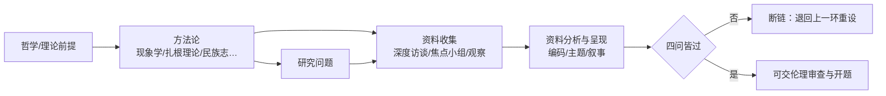

# 第 3 章 · 质性研究与访谈分析

> **层次**：本文件是**本库撰写层**（无底本表，不是源正文层）。依据是 JBI《质性研究批判性评价清单》（四条 congruity），条文登记于 `standards/huli-yanjiu-zhengxun/外源条文.json`（76 条，逐字可核）。
> **依据**：`standards/huli-yanjiu-zhengxun/补源登记.json`（`python scripts/build_huli_yanjiu_sources.py --check` 现算）。
> **免责**：本章为质性研究的教学整理，不构成诊断或治疗建议；访谈涉及人的研究须经伦理审查与知情同意。

---

## 本章要回答的问题

质性研究怎么算「做得对」？量化研究者常问「样本多少、信度多少」，而质性研究的质量判据是另一套：**一致性（congruity）**——你声称的认识论、你用的方法、你问的问题、你收集与分析资料的方式，是否一条链上互相支撑。

JBI 清单把这条链拆成四问。四问全部指向同一个东西：**不能断链**。

## N.1 概念与出处

> 「Congruity between the stated philosophical perspective and the research methodology Does the report clearly state the philosophical or theoretical premises on which the study is based?」（外源·JBI 质性研究核查表 第1条）

第一条就问「哲学前提是否写明」。这不是形式主义：现象学（phenomenology）、扎根理论（grounded theory）、民族志（ethnography）各自对「什么是资料」有不同假设 —— 假设不同，访谈该怎么问、该问几次、该几个人，全都不同。

| 概念 | 依据 | 要点 |
|---|---|---|
| 哲学前提 → 方法论 | 外源·JBI 质性研究核查表 第1条 | 报告须清楚交代研究基于何种哲学/理论前提 |
| 方法论 → 研究问题 | 外源·JBI 质性研究核查表 第2条 | 该方法论是否适合回答这个问题 |
| 方法论 → 资料收集方法 | 外源·JBI 质性研究核查表 第3条 | 收集方法是否与方法论相配 |
| 方法论 → 资料呈现与分析 | 外源·JBI 质性研究核查表 第4条 | 分析与呈现方式是否与方法论立场一致 |
| 质量评价的必要性 | 外源·JBI 系统评价核查表 第2条 | 对纳入文献做批判性评价（或类似评估）是「essential」 |

## N.2 为什么可以这样翻译：一致性链

| 断链位置 | 常见表现 | 依据 |
|---|---|---|
| A→B | 声称现象学，却用问卷式封闭问题 | 第1条 |
| B→C | 问题问「发生率」，却选了质性方法论 | 第2条 |
| B→D | 声称扎根理论，却只做一次访谈、无理论抽样 | 第3条 |
| B→E | 声称叙事研究，却只给主题频次表 | 第4条 |

**为什么「断链」比「方法不高级」更严重**：质性研究的力量来自**内部一致性** —— 你不需要用最好的方法，你需要用的是与你的问题、你的假设一致的方法。四问里任何一问为否，读者就无法判断你的结论是「资料说的」还是「你想的」。

## N.3 这个翻译丢掉了什么

1. **不给访谈提纲的写法**。开放式问题、追问技巧、访谈轮次，清单不涉及。
2. **不给饱和判据**。多少个访谈算「够了」，JBI 清单不回答（这是质性方法学的经典争议）。
3. **不给编码与信度的规范**。是否双人编码、是否算 Kappa，清单不要求；这与量性研究的信度概念不可互换。
4. **不给反思性（reflexivity）条目**。研究者的位置如何影响资料解释，是当代质性研究的重要要求，但这四条 congruity 没覆盖。
5. **不给三角验证（triangulation）的具体做法**。多来源、多方法、多分析者，各自适用条件不在清单内。
6. **只评「报告写清没有」，不评「做得对不对」**。清单是批判性评价工具，不是方法指南——一份写得清楚但设计差的研究，仍可能在这四问上过关。

## N.4 与相邻学科的接口

| 去向 | 接口 |
|---|---|
| 第 1 章 选题与问题化 | 问题若问「怎么经历/为什么」，PICO 换成 PICo；「兴趣现象」替代「干预—结局」 |
| 第 2 章 量性研究与设计类型 | 两套设计不能互相替代：横断面给分布，质性给机制与意义 |
| 第 4 章 量表的选择与信效度 | 质性研究一般不用量表；若用了，量表只作**访谈引导**，不作测量 |
| 第 5 章 循证护理的证据分级 | 质性证据的确定性评价（如 CERQual）本库尚无底本，见缺口登记 |
| 第 6 章 文献检索与系统评价 | 质性证据综合（meta-aggregation）需要专门方法，检索策略与量性不同 |
| 第 8 章 护理研究中的伦理审查 | 访谈涉及隐私与二次伤害，伦理送审要求比问卷研究更高 |

## N.5 争议与本项目立场

**争议一：质性研究该不该被「评价」。** 一派认为用清单评价质性研究是拿量性尺子量质性；另一派认为没有评价就没有证据综合。本项目立场：**评价「一致性」而不评价「精确性」** —— 四问评的是链条是否自洽，不是结果是否可重复。

**争议二：饱和度能不能当判据。** 支持者用它决定停止取样；反对者指出饱和是事后判断、难以预先设定。本项目立场：**把饱和写成过程记录**（每次访谈后新增主题数、停止理由），而不是写成一个数字。

**争议三：单人编码能不能接受。** 有双人编码更稳，但成本高。本项目立场：单人编码可接受，**但必须留编码日志与反例记录** —— 理由是让读者能追溯「这条主题怎么来的」。

**本项目立场**：质性章的产出不是「做了访谈」，而是**一张一致性自检表**：哲学前提、方法论、问题、收集、分析五格各自填一句，再加一句「若某格改动，其余哪几格要跟着改」。这张表就是伦理审查与开题答辩时最容易被追问的地方。

> **免责**：本章所列条文与判据不构成诊断或治疗建议；涉及人的研究须经伦理审查、取得知情同意，并妥善保护受访者隐私。

## 小结

1. 质性研究的质量判据是一致性，不是样本量与信度数字。
2. 四条 congruity：哲学→方法论、方法论→问题、方法论→收集、方法论→分析。
3. 断链比「方法不高级」更严重：读者无法判断结论是资料说的还是研究者想的。
4. 清单评的是「报告写清没有」，不评「做得对不对」——写清与做好是两件事。
5. 饱和、反思性、三角验证，四问都不覆盖，需要另找方法学底本。
6. 产出是一张一致性自检表 + 一句「改一格要连带改哪几格」。

## 思考题

1. 你想研究「ICU 护士经历患者死亡后的情绪处理」，会选现象学还是扎根理论？请说明这个选择如何影响第 3 条（收集方法）。
2. 一份研究声称民族志，但只有 6 次半结构访谈、没有田野观察。四条 congruity 里哪一条最先被质疑？
3. 「清单评报告、不评做法」这条边界，会不会让差研究蒙混过关？你会补哪一条自检？
4. 若把饱和度写成「过程记录」而不是数字，你会记录哪三项？

## 延伸阅读

- 外源·JBI 质性研究核查表 第1–4 条
- 外源·JBI 系统评价核查表 第2条（批判性评价的必要性）
- 本库专题：[`standards/huli-yanjiu-zhengxun/专题-循证报告核查.md`](../../../standards/huli-yanjiu-zhengxun/专题-循证报告核查.md) 第九节
- 本库缺口：[`standards/huli-yanjiu-zhengxun/缺口登记.md`](../../../standards/huli-yanjiu-zhengxun/缺口登记.md)（COREQ 未入库的原因与替代方案）
