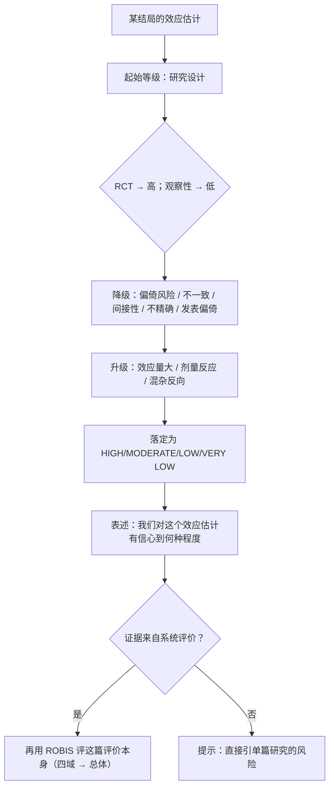

# 第 5 章 · 循证护理的证据分级

> **层次**：本文件是**本库撰写层**（无底本表，不是源正文层）。依据是 GRADE（Cochrane 版指引）、ROBIS 指南与 JBI 系统评价核查表，条文登记于 `standards/huli-yanjiu-zhengxun/外源条文.json`（91 条，逐字可核）。
> **依据**：`standards/huli-yanjiu-zhengxun/补源登记.json`（`python scripts/build_huli_yanjiu_sources.py --check` 现算）；引用格式见 [`补源约定.md`](../../../补源约定.md)。
> **免责**：本章为证据分级方法的教学整理，不构成诊断或治疗建议；分级结果不替代临床判断，也不构成对个体的诊疗推荐。

---

## 本章要回答的问题

同一篇 RCT，为什么在这份指南里是「高质量证据」，在那份里是「中质量」？答案是：**分级评的不是研究设计本身，而是「我们对这个效应估计有多大的信心」**。

> 「These assessments reflect the degree of confidence we can have in our effect estimate.」（外源·How to GRADE the quality of the evidence 第5条）

这句话是整章的钥匙。它把「证据等级」从「研究做得好不好」的排行榜，改成了**对某个结局的效应估计的信心声明**。同一篇 RCT 在不同结局上可以拿到不同等级——因为信心是按结局给的，不是按研究给的。

## N.1 概念与出处

| 概念 | 依据 | 要点 |
|---|---|---|
| 评的是每个**结局**的证据质量 | 外源·How to GRADE the quality of the evidence 第1条 | 按八项准则评（含偏倚风险、间接性、不一致性、不精确性、发表偏倚） |
| 四个等级 | 外源·How to GRADE the quality of the evidence 第2条 | HIGH / MODERATE / LOW / VERY LOW |
| HIGH 的含义 | 外源·How to GRADE the quality of the evidence 第3条 | 评估完所有潜在问题后，对效应估计有信心 |
| 下限只有一个 | 外源·How to GRADE the quality of the evidence 第4条 | 无论降级理由多少，VERY LOW 就是最低 |
| 等级＝对估计的信心 | 外源·How to GRADE the quality of the evidence 第5条 | 不是「研究质量分」，是对效应估计的信心程度 |
| 系统评价本身的偏倚 | 外源·ROBIS Guidance on how to use ROBIS 第2条 | 四域：纳入标准、检索与筛选、数据提取与评价、综合与结果 |
| 域级「低关注」的判据 | 外源·ROBIS Guidance on how to use ROBIS 第7条 | 该域所有信号问题为 Yes/Probably Yes |
| 总体偏倚判断 | 外源·ROBIS Guidance on how to use ROBIS 第11条 | Phase 3 判「整篇系统评价是否处于偏倚风险」 |
| 评价的必要性 | 外源·JBI 系统评价核查表 第2条 | 对纳入文献做批判性评价（或类似评估）是「essential」 |

## N.2 为什么可以这样翻译：三件套，而不是一个数字

| 步骤 | 判据 | 依据 |
|---|---|---|
| 起始 | 设计类型决定起点（RCT 高、观察性低） | 第1条、第2条 |
| 降级 | 五类问题各自「严重/非常严重」→ 降 1 或 2 级 | 第1条 |
| 升级 | 效应量大、剂量反应、混杂会低估效应 | 第1条 |
| 落定 | 四级之一；VERY LOW 是下限 | 第2条、第4条 |
| 表述 | 说清「信心程度」，不要说「证据等级=结论强度」 | 第3条、第5条 |
| 评价来源 | 若引用系统评价，先看它本身偏倚（四域→总体） | ROBIS 第2条、第11条 |

**两条最常被搞错的边界**：

1. **等级低 ≠ 结论错**。VERY LOW 的含义是「我们对效应估计没把握」，不是「效应不存在」。
2. **等级高 ≠ 可以照搬**。间接性（人群、干预强度、场景不同）会把「高等级证据」变成「不适用于我的患者」。

## N.3 这个翻译丢掉了什么

1. **不给降级阈值**。什么算「严重不精确」、什么算「严重不一致」，GRADE 手册有讨论（本库 Handbook 原件在库但文本层交错，条文 0 条），本章不给数值。
2. **不给质性证据的分级体系**。CERQual 与 GRADE 并列，本库无底本；质性证据的确定性无法在本章体面处理。
3. **不给推荐强度与证据等级的映射表**。强推荐可以由低质量证据产生（当获益远大于害、且价值取向明确时），规则要靠指南方法学。
4. **不给本地适用性判断**。同一份证据在不同资源条件下适用性不同，属第 7 章。
5. **不整合患者偏好与成本**。GRADE 的推荐环节需要这些输入，本章只到「证据确定性」为止。
6. **不给实施与去实施（de-implementation）**。低价值实践如何撤除，不在分级体系内。

## N.4 与相邻学科的接口

| 去向 | 接口 |
|---|---|
| 第 2 章 量性研究与设计类型 | 设计决定起始等级；RoB 2 的域结论输入「偏倚风险」这一降级维度 |
| 第 3 章 质性研究与访谈分析 | 质性证据需要另一套确定性评价，本章只能点明缺口 |
| 第 4 章 量表的选择与信效度 | 结局测量不可靠会同时降低确定性（偏倚风险 + 不精确） |
| 第 6 章 文献检索与系统评价 | 分级的上游是系统评价；ROBIS 在这里与检索章共用 |
| 第 7 章 证据到实践的转化 | 分级的终点是「本地要不要用、怎么用」 |
| 第 8 章 伦理审查 | 「证据不足」时做干预性研究，伦理审查会更严（风险受益比） |

## N.5 争议与本项目立场

**争议一：证据等级能不能当「结论强度」用。** 常被这么用，但违反第5条的定义。本项目立场：**等级描述信心，结论强度还要叠加风险受益比与价值取向**；把四级直接写成「强/弱」，是把两件事压成一件。

**争议二：观察性研究能否升级到 HIGH。** 规则上可以（效应量大、剂量反应、混杂反向），但门槛很高。本项目立场：**允许升级，但必须在报告里写出升级理由**，否则读者无法判断这是规则允许还是作者偏好。

**争议三：低质量证据要不要做推荐。** 现实里必须做（很多护理问题的 RCT 极少）。本项目立场：**做，但把不确定性写明**，并给出「若证据改变，推荐会怎么变」的条件性表述。

**本项目立场**：分级章的产出不是一串等级符号，而是**三件套**：每个结局的起始等级与升降级理由、该结局的确定性表述、以及所引系统评价自身的偏倚判断（ROBIS 四域→总体）。三件套齐，「高质量」才不是一句形容词。

> **免责**：本章所列条文与判据不构成诊断或治疗建议；证据分级不替代临床判断，也不构成对具体患者的诊疗推荐。

## 小结

1. 分级评的是「对效应估计的信心」，不是「研究质量分」。
2. 按结局评，不按研究评；同一研究不同结局可以不同等级。
3. 四级：HIGH/MODERATE/LOW/VERY LOW；VERY LOW 是下限。
4. 降级五类：偏倚风险、不一致、间接性、不精确、发表偏倚；升级三类：效应量、剂量反应、混杂反向。
5. 引用系统评价前，先用 ROBIS 判它本身的偏倚（四域 → 总体）。
6. 等级低不等于结论错；等级高不等于可以照搬。

## 思考题

1. 一项 RCT 显示某项护理干预降低跌倒率，但你的病房患者平均年龄比你研究人群高 12 岁、且人力配置不同。这属于哪一类降级？降到几级由谁定？
2. 为什么「VERY LOW 是下限」这条要单独写出来？它防的是哪种误用？
3. 一份系统评价纳入 12 项研究、结论「有效」，但检索只用了 MEDLINE。用 ROBIS 四域说明你会担心哪一域，并给出理由。
4. 低质量证据下做推荐，你会怎么写「条件性表述」？请写一句示例。

## 延伸阅读

- 外源·How to GRADE the quality of the evidence 第1–5 条
- 外源·ROBIS Guidance on how to use ROBIS 第2、7、11 条
- 外源·JBI 系统评价核查表 第2条
- 本库缺口：[`standards/huli-yanjiu-zhengxun/缺口登记.md`](../../../standards/huli-yanjiu-zhengxun/缺口登记.md)（CERQual 与 GRADE 手册文本层问题）
