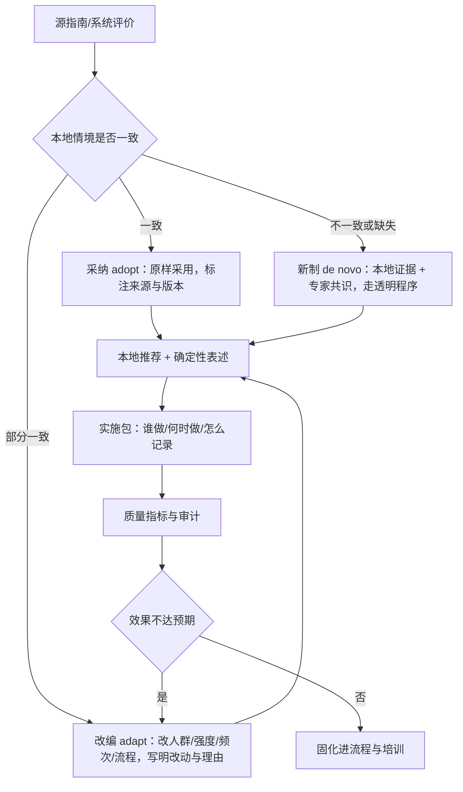

# 第 7 章 · 证据到实践的转化

> **层次**：本文件是**本库撰写层**（无底本表，不是源正文层）。依据是 WHO《Strengthening countries' capacities to adopt and adapt evidence-based guidelines》与 GRADE / JBI 相关条，条文登记于 `standards/huli-yanjiu-zhengxun/外源条文.json`（91 条，逐字可核）。
> **依据**：`standards/huli-yanjiu-zhengxun/补源登记.json`（`python scripts/build_huli_yanjiu_sources.py --check` 现算）。
> **免责**：本章为证据转化的教学整理，不构成诊断或治疗建议；本地实践改变须经机构论证、培训与质量监测。

---

## 本章要回答的问题

证据有了、等级也评了，为什么病房里还是照旧做？这个问题常被当成「执行力」问题，但 WHO 手册给了更硬的判断：

> 「There is no implementation without contextualization」（外源·Strengthening countries' capacities to adopt and adapt evidence 第7条）

没有本土化就没有落地实施。这句话把「转化」从宣教问题改成了**方法问题**：不把证据改写成适合本地人群、资源与流程的形态，它就不会被用。

## N.1 概念与出处

| 概念 | 依据 | 要点 |
|---|---|---|
| adolopment（采纳—改编—新制） | 外源·Strengthening countries' capacities to adopt and adapt evidence 第6条 | 系统、透明地采纳／改编／新制推荐，使其契合目标情境 |
| 无本土化则无实施 | 外源·Strengthening countries' capacities to adopt and adapt evidence 第7条 | 本土化是实施的前提，不是可选项 |
| 可信指南是基础 | 外源·Strengthening countries' capacities to adopt and adapt evidence 第8条 | 可信指南是循证建议的基石 |
| 证据前提 | 外源·Strengthening countries' capacities to adopt and adapt evidence 第4条 | 基于系统评价；确无证据时才用系统、透明的方式提取专家意见 |
| 确定性决定措辞 | 外源·How to GRADE the quality of the evidence 第5条 | 等级＝对效应估计的信心，措辞要与之匹配 |
| 推荐要面向实践 | 外源·JBI 系统评价核查表 第3条 | 理想情况下系统评价应给出政策与实践推荐 |
| 引用前判评价本身 | 外源·ROBIS Guidance on how to use ROBIS 第11条 | 总体偏倚判断影响「这条推荐能不能搬」 |

## N.2 为什么可以这样翻译：三步 adolopment

| 步骤 | 判据 | 依据 |
|---|---|---|
| 采纳 | 人群、干预强度、资源、价值取向四项基本一致 | 第6条 |
| 改编 | 写明改了什么（人群/剂量/频次/执行者）与为什么 | 第6条、第7条 |
| 新制 | 无可用证据时，用系统透明的方法提取专家意见 | 第4条 |
| 表述 | 推荐强度与证据确定性同时写出 | 第5条 |
| 实施 | 责任人、时点、记录方式、审计指标 | 第7条 |

判据要能留痕，否则「我们评估过」无法复核。建议用四行表记录，每行三格（本项目要求 / 源证据条件 / 本地实际），差异显著的格子在第四列写处置（照搬／调整／弃用）：

| 维度 | 本项目要求 | 源证据条件 | 本地实际 | 处置 |
|---|---|---|---|---|
| 人群 | 同一类患者 | 源研究纳入标准 | 本院收治结构 |  |
| 干预强度 | 人力与耗材可支撑 | 源方案频次/时长 | 排班与物资 |  |
| 资源 | 设备与经费可及 | 源方案所需设备 | 科室现有条件 |  |
| 价值取向 | 患者与家属可接受 | 源研究报告的偏好 | 本地访谈/投诉记录 |  |

**「四项一致」是本项目把第6条翻译成的操作判据**：人群（我的患者是否同一类）、干预强度（人力与耗材能否支撑）、资源（设备与经费）、价值取向（患者与家属的偏好是否接受）。四项里有任一项差异显著，就不能「采纳」，只能「改编」。

## N.3 这个翻译丢掉了什么

1. **不给实施科学框架**。i-PARIHS、CFIR 等框架能解释「为什么推不动」，本库无底本。
2. **不给成本效果分析**。改编方案的经济性评估不在 WHO 本条范围。
3. **不给审计指标集**。什么指标能反映「落实了」——本手册不给具体指标（如手卫生依从率的测法）。
4. **不给利益相关者参与的操作流程**。患者代表、一线护士如何参与改编，需要另找方法。
5. **不覆盖去实施（de-implementation）**。撤除低价值实践比推行新实践更难，本章无力处理。
6. **不给「改编到什么程度算变了样」的边界**。改编过度会失去原证据支撑，阈值需专业判断。

## N.4 与相邻学科的接口

| 去向 | 接口 |
|---|---|
| 第 1 章 选题与问题化 | 若选题来自「证据没被用」，本章负责解释差距（gap analysis） |
| 第 2 章 量性研究与设计类型 | 质量改进项目要选设计（前后对照/中断时间序列），并接受偏倚审视 |
| 第 3 章 质性研究与访谈分析 | 「推不动」的原因常需质性访谈才能查明（障碍与促进因素） |
| 第 4 章 量表的选择与信效度 | 审计指标需要可靠测量工具，否则改进无法验证 |
| 第 5 章 循证护理的证据分级 | 确定性决定推荐措辞的强弱 |
| 第 6 章 文献检索与系统评价 | 源证据的质量与新鲜度决定改编的必要性 |
| 第 8 章 伦理审查 | 改变临床实践的研究（如 QI 项目）是否需送审，见第 8 章 |

## N.5 争议与本项目立场

**争议一：指南能不能「拿来就用」。** 同语种、同级别医院间常直接沿用。本项目立场：**沿用也要留存四项一致的判断记录**——「我们评估过、一致」与「没想过」在审计时是两回事。

**争议二：本地数据缺乏时能不能改编。** 常见情形。本项目立场：**先做小样本可行性验证（可行性研究/预试验）**，再决定是否全量推行；不要用「反正没数据」当理由直接照搬。

**争议三：改到多大程度还算「同一推荐」。** 本项目立场：**改人群或改强度超过原证据覆盖范围，就不再是「采纳」，必须降级为「新制」并重新陈述证据基础**。这条边界比「改一点没关系」保守，但可审计。

**本项目立场**：转化章的产出不是一份培训通知，而是**四件套**：本地推荐（含确定性表述）、改编清单（改了什么/为什么）、实施包（责任人/时点/记录）、审计指标与复盘节点。四件齐，才叫「落地」，否则只是「发过文件」。

> **免责**：本章所列条文与判据不构成诊断或治疗建议；本地实践改变须经机构论证、培训与质量监测后实施。

## 小结

1. 没有本土化就没有实施（WHO 第7条）——转化是方法问题，不是宣教问题。
2. 三步：采纳（adopt）、改编（adapt）、新制（de novo），合称 adolopment。
3. 采纳的判据是四项一致：人群、干预强度、资源、价值取向。
4. 改编必须写明改了什么、为什么改；改出原证据覆盖范围就要转为新制。
5. 推荐措辞要与证据确定性匹配。
6. 落地四件套：本地推荐、改编清单、实施包、审计指标。

## 思考题

1. 一条来自 ICU 的早期活动证据要搬到老年病房。用「四项一致」逐项判断，哪一项最可能不一致？
2. 改编过度会失去证据支撑。你会用什么标准判断「改过头了」？
3. 若审计显示依从率只有 40%，你会先查哪三件事（依次）？
4. 去实施（撤除一项低价值常规）比推行新实践更难，你认为难在哪一步？

## 延伸阅读

- 外源·Strengthening countries' capacities to adopt and adapt evidence 第4、6、7、8 条
- 外源·How to GRADE the quality of the evidence 第5条
- 外源·JBI 系统评价核查表 第3条
- 本库缺口：[`standards/huli-yanjiu-zhengxun/缺口登记.md`](../../../standards/huli-yanjiu-zhengxun/缺口登记.md)（实施科学框架未入库）
