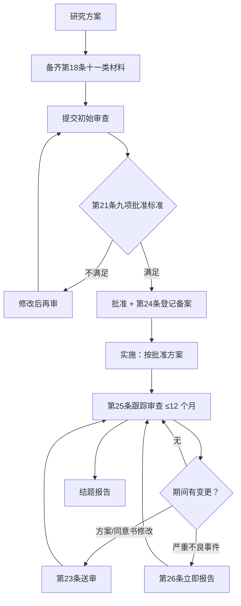

# 第 8 章 · 护理研究中的伦理审查

> **层次**：本文件是**本库撰写层**（无底本表，不是源正文层）。依据是《涉及人的生命科学和医学研究伦理审查办法》（国卫科教发〔2023〕4号），条文登记于 `standards/huli-yanjiu-zhengxun/外源条文.json`（91 条，逐字可核）。
> **依据**：`standards/huli-yanjiu-zhengxun/补源登记.json`（`python scripts/build_huli_yanjiu_sources.py --check` 现算）；引用格式见 [`补源约定.md`](../../../补源约定.md)。
> **免责**：本章为伦理审查流程的教学整理，不构成诊断或治疗建议，也不构成法律意见或伦理审查结论；具体研究须经本机构伦理审查委员会审查批准后实施。

---

## 本章要回答的问题

伦理审查常被当成「开题后的手续」。但《办法》的顺序不是这样：**先有方案，才有材料；先有审查，才能实施；实施中还要跟踪**。本章按这个顺序讲：原则 → 材料 → 批准标准 → 跟踪 → 知情同意。

一个提醒放在最前：本办法的用词不是「受试者」而是**「研究参与者」**。这不是修辞——它把保护范围从「被试验的人」扩到「提供生物样本、信息数据、健康记录、行为的个体」，因此**纯问卷研究、二手数据研究也在其中**。

## N.1 概念与出处

| 环节 | 依据 | 要点 |
|---|---|---|
| 基本原则 | 外源·伦理审查办法 2023 第4条 | 尊重研究参与者；有益、不伤害、公正；保护隐私权及个人信息 |
| 六项基本要求 | 外源·伦理审查办法 2023 第17条 | 控制风险、知情同意、公平公正、免费和补偿赔偿、保护隐私、特殊保护 |
| 初始审查材料 | 外源·伦理审查办法 2023 第18条 | 十一类材料：诚信承诺、申请表、资质与经费、方案、知情同意书、样本/数据来源证明… |
| 批准的基本标准 | 外源·伦理审查办法 2023 第21条 | 九项：价值、权利与隐私、方案科学、纳入排除公平、风险受益比、知情同意、胜任、发布、诚信 |
| 跟踪审查 | 外源·伦理审查办法 2023 第25条 | 进展、严重不良事件、方案偏离等报告；**跟踪审查间隔不超过 12 个月** |
| 知情同意（书面） | 外源·伦理审查办法 2023 第33条 | 自愿签署；无书面能力时口头 + 录音录像等过程记录 |
| 监护人与双重告知 | 外源·伦理审查办法 2023 第34条 | 无/限制民事行为能力人：监护人书面同意 **且** 在可理解范围内告知本人并征得其同意 |
| 再次获取同意 | 外源·伦理审查办法 2023 第38条 | 内容实质性变化、风险实质提高、行为能力等级提高 |

**第34条的「且」最容易被简化**：拿到监护人签字就以为完成，但条文要求同时向研究参与者本人告知并征得**其**同意。对认知障碍老人、学龄儿童尤其关键——他们的「不愿意」不能被监护人代答。

## N.2 为什么可以这样翻译：一条从方案到结题的链

| 阶段 | 可核判据 | 依据 |
|---|---|---|
| 送审前 | 十一类材料齐（含样本/数据来源证明、利益冲突申明） | 第18条 |
| 审查 | 九项标准逐项对应写清 | 第21条 |
| 实施 | 与批准方案一致；变更先送审 | 第23条 |
| 跟踪 | 报告节点（进展/SAE/偏离/结题）；间隔 ≤12 个月 | 第25条 |
| 同意 | 书面签署；特殊人群双重告知 | 第33条、第34条 |

**第17条与第21条的关系**：第17条是**研究必须满足的伦理底线**（怎么做才对），第21条是**委员会判断能不能批的标准**（凭什么批）。写方案时按第17条自查，送审时按第21条对照，两套条目一一对应。

## N.3 这个翻译丢掉了什么

1. **不给知情同意书的模板**。第36条列了应包含的十二项内容（本章未逐条取条文），但措辞、可读性、语言等级要靠各机构 SOP。
2. **不给「最小风险」的操作定义**。第31条简易程序以「不大于最小风险」为界，但最小风险如何判定留给委员会。
3. **不给免除审查的判断细则**。第32条列了四种可免除情形（公开数据、匿名化数据等），边界（是否涉敏感个人信息）仍需判断。
4. **不覆盖国际规范**。《赫尔辛基宣言》《CIOMS 指南》本库未入库；涉外或多中心研究常需对照。
5. **不给护理场景的特例**。护患权力关系、病房内招募、患者隐私与家属知情之间的张力，法规不细分，需要专业伦理判断。
6. **不给违规的处置尺度**。第44–46 条列了处罚情形，具体裁量在行政部门。

## N.4 与相邻学科的接口

| 去向 | 接口 |
|---|---|
| 第 1 章 选题与问题化 | 弱势人群选题（老年、儿童、认知障碍）在本章触发「特殊保护」（第17条） |
| 第 2 章 量性研究与设计类型 | 设计决定风险等级：干预性研究风险高于观察性 |
| 第 3 章 质性研究与访谈分析 | 访谈涉隐私与二次伤害；录音录像的保管与销毁须写进材料（第18条、第33条） |
| 第 4 章 量表的选择与信效度 | 量表版权与条目内容涉及第三方授权，送审时须说明 |
| 第 6 章 文献检索与系统评价 | 仅用公开文献的系统评价通常不涉人；但若用未发表个体数据，需审查 |
| 第 7 章 证据到实践的转化 | 质量改进项目是否属「研究」，决定要不要送审 |

## N.5 争议与本项目立场

**争议一：质量改进（QI）算不算研究。** 若目的是产生可推广的新知识、且涉及个体数据，通常要送审；若只是本地流程优化且不采集额外数据，可走「非研究」认定。本项目立场：**边界不清时先申请认定**，让委员会书面判断，而不是自己决定。

**争议二：知情同意能不能「一次签完」。** 第38条给了三种必须再次获取同意的情形。本项目立场：**把「是否触发再次同意」写进方案的变更管理流程**，否则团队换人后极易漏掉。

**争议三：数据二次利用要不要重新同意。** 第32条允许匿名化数据免审，但可识别数据的二次利用需在原同意范围内。本项目立场：**在首次同意时就写清二次利用范围**，避免后续无法回溯授权。

**本项目立场**：伦理章的产出不是一份签字页，而是**四件套**：伦理送审包（第18条材料）、批件号与有效期、跟踪审查日历（≤12 个月）、知情同意与再同意记录。四件套齐，研究才真正「合规在案」。

> **免责**：本章所列条文与判据不构成诊断或治疗建议，也不构成法律意见；研究须经本机构伦理审查委员会批准后实施，具体以现行法规与本机构 SOP 为准。

## 小结

1. 用词是「研究参与者」，范围含生物样本、信息数据、健康记录与行为。
2. 四项基本原则：尊重、有益、不伤害、公正；六项基本要求在第17条。
3. 送审材料十一类（第18条）；批准标准九项（第21条）。
4. 跟踪审查间隔不超过 12 个月；进展、SAE、方案偏离都要报（第25条）。
5. 知情同意须书面；无书面能力时口头 + 过程记录（第33条）。
6. 无/限制民事行为能力人：监护人书面同意 **且** 本人被告知并同意（第34条）。

## 思考题

1. 你的研究在养老院招募认知障碍老人。按第34条，「双重告知」在操作上应怎么落实？请写三步。
2. 研究进行到第 8 个月时，你决定把访谈时长从 40 分钟延长到 70 分钟。这触发第几条？要走什么流程？
3. 「质量改进项目」与「研究」的边界，你会用哪两条判据区分？
4. 跟踪审查间隔 12 个月的上限，对一项为期 3 年的纵向研究意味着什么？请写出报告日历。

## 延伸阅读

- 外源·伦理审查办法 2023 第4、17、18、21、25、33、34、38 条
- 本库缺口：[`standards/huli-yanjiu-zhengxun/缺口登记.md`](../../../standards/huli-yanjiu-zhengxun/缺口登记.md)（赫尔辛基宣言、CIOMS 指南、知情同意书模板尚未入库）
