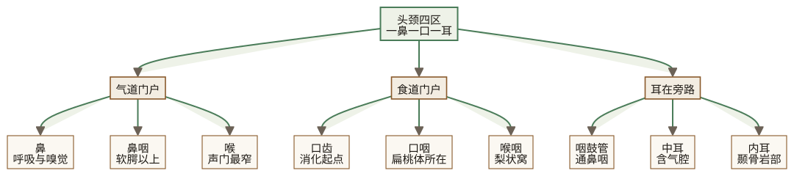
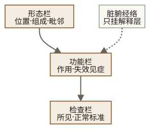

# 第 1 章 · 耳鼻咽喉的解剖概览

> **层次：** 撰写层——本章正文由课程正文改写并扩写，不是逐字搬运。扩写只做两件事：把散在十二个单元里的结构归并成可定位的几张表，把「为什么这样分」的判断说出来。课程正文没有的事实，本章不补。
> **本章要回答的问题：** 耳、鼻、咽喉、口齿四区各自独立成科，凭什么放进一本书里讲？把它们连成一片的是哪几个结构；而把「耳为肾之窍」这样一句话译成解剖语言，译到哪一步还站得住，从哪一步起开始失真？
> **覆盖：** 单元 6 个（01.01.01.01、01.01.01.02、01.01.02.01、01.01.02.02、01.01.03.01、01.01.03.02）｜ 课程章 `departments/08-wuguan/01-erbihou-jiepou-shengli/chapters/01-e11/docs/zh.md`（12 单元 / 12,711 汉字；本章取其四区结构、脏腑经络归属、读法三组内容，各区功能细节归第 7 章）｜ 本章正文 5,497 汉字
> **参考状态：** 课程正文是主源，也是唯一底本。外源课件《耳的解剖与生理——耳鼻喉[精品]课件》（原创力文档，62 页 / 约 2.12 万字）**只取到元数据，正文未取得**，登记在 `standards/erbihou-jiepou-shengli/reference-courseware.json`；本章不引它任何数值、图与条文，也不写「据某课件」。
> **引用口径：** 经典条文标篇名；解剖与生理事实标「课程正文 §1.x」，便于回查；课程正文没给到可核来源的量，一律写「随个体差异，本书不给具体数」。

---

## N.1 概念与出处

先立五个词：三个界定「讲的是哪一块身体」，一个界定它与脏腑经络的关系，一个界定本书的读法。凡不能落到出处的说法，本章不用。

| 概念 | 出处 | 一句定义 |
|---|---|---|
| 官窍 | 《素问·阴阳应象大论》「肾主耳……在窍为耳」；课程正文 §1.1「耳为清阳之窍」 | 头面部与外界直接相通的孔道及其附属器官；古人以「窍」称之，并把它的状态当作所属脏腑的外候 |
| 四区 | 本书用语，依课程正文 §1.1—§1.4 的四段分段 | 耳、鼻、咽喉、口齿四个解剖区域，合为一门课程讲授 |
| 两道门户 | 《素问·太阴阳明论》「喉主天气，咽主地气」；课程正文 §1.3 | 气道与食道在咽部共用的入口：一为气之所以上下，一为水谷之道 |
| 要道 | 本书用语，取课程正文 §1.3「呼吸道与消化道共同的通道」之义 | 数区共用的狭窄通路；一处受阻，数区同时受累 |
| 三栏 | 本书用语 | 形态、功能、检查三栏并置的写法；一个结构占一行，三栏都要填满 |

**四区不是四个器官，是四个入口。** 器官讲「它在体内占哪块地方」，入口讲「它朝外开着，外面的东西从这里进来」。全书结构都按入口来排：鼻是呼吸门户，咽喉是气道与食道共用的门户，口齿是消化道起点，而耳虽也开在头面两侧，收的却不是气，是波。

**为什么可以合为一门课。** 不是因为它们都在头上——头上还有眼。理由有两条，缺一不可。一是共享结构：咽鼓管把鼻咽与鼓室连起来，鼻咽既是鼻的后端又是咽的上段，喉咽既是喉的后方又是咽的下段；三处使四区彼此勾连。二是共享干线：四区的血供、神经、淋巴走在同一批通路上，一个区的病灶可沿干线走到另一区。

### 01.01.01.01 四区在整机中的位置

四区有一个共同的上限与下限：上不超过颅底，下不超过颈椎。讲「在整机中的位置」，要说的就是三件事——在哪、朝哪开门、与谁相邻。

| 区 | 位置 | 门户性质 | 直接相通的结构 | 课程正文 |
|---|---|---|---|---|
| 耳 | 头面两侧，颞骨内 | 收声波与头位变化，不与外界通气 | 经咽鼓管通鼻咽 | §1.1 |
| 鼻 | 面中央，外鼻呈三棱锥形 | 呼吸门户，兼司嗅觉 | 前鼻孔通外界，后鼻孔通鼻咽，经鼻泪管通眼 | §1.2 |
| 咽喉 | 颈前；咽为肌性管道，上起颅底、下达第六颈椎下缘续食管 | 气道与食道共用 | 上通鼻与口，下通喉与食管 | §1.3 |
| 口齿 | 口腔，前经口裂通外界，后经咽峡通咽 | 消化道起始 | 牙、舌、涎腺均在其中 | §1.4 |

**第一条判断：耳是四区里唯一的例外。** 其余三区都是「管子」，里外相通；耳不是——门户朝外，收的却是波不是气，「内」又被颞骨岩部包住，只能透过一层鼓膜看进去，再往里只能靠功能检查去推。这一条决定了四区疾病的「深浅」不同：外耳道疖肉眼可见，中耳炎要透过鼓膜看，内耳的病变在耳镜下什么也看不到。初学者以为耳病难，难的正是可视的边界更早断掉。

**第二条判断：四区的「相邻」比「位置」更重要。** 解剖学讲位置，临床讲相邻，因为并发症沿相邻走。鼻的邻近是眼眶与颅前窝，故鼻疔忌挤压——课程正文 §1.2 把鼻前庭疖肿单列出来讲，理由就是它位于面部危险三角区，挤压可使邪毒走散内陷。咽喉的邻近是咽旁间隙与喉腔，故咽痛伴张口受限、语言含糊、呼吸困难要按急症处理。耳的邻近是颅中窝与乙状窦，故中耳炎的并发症在颅内。位置表只记住「在哪」用处不大，记住「挨着谁」才知道病往哪走。

### 01.01.01.02 共享结构：咽鼓管·鼻咽·喉咽

三个结构，三种共享方式，要分清。

**咽鼓管是「管道式共享」。** 它连接鼓室与鼻咽部，平时关闭，吞咽时开放，作用是调节中耳气压、维持鼓膜两侧的压力平衡（课程正文 §1.1）。它一头属耳、一头属鼻咽，两区各占一半；临床意义全在「通」与「不通」上：不通则鼓膜两侧压力失平，出现耳闷、耳鸣、听力发闷；通得太容易则炎症循管上行。课程正文给了一条极重要的年龄差异——小儿咽鼓管较成人短、平、宽，故上呼吸道感染后炎症易循此蔓延而发生中耳炎。这是全书里「结构决定疾病」最干净的例子：同样是感冒，成人得咽炎，小儿得中耳炎，差别不在邪气，在管子的角度。

**鼻咽是「归属式共享」。** 它是鼻的后端，也是咽的上段，位于软腭平面以上。课程正文 §1.3 给了三个要点：顶后壁黏膜下有咽扁桃体（腺样体），儿童期较发达，可因炎症而肥大，影响呼吸与听力；两侧壁有咽鼓管咽口；咽鼓管咽口后上方有咽隐窝，是鼻咽癌的好发部位。三点对应三种病：腺样体肥大对应小儿打鼾与分泌性中耳炎，咽鼓管咽口对应中耳通气，咽隐窝对应肿瘤。而这三件事的初始症状，往往都记在「耳」的账上——单侧耳鸣耳闭、听力下降。这就是共享结构的第一条临床次序：**凡单侧耳闷、耳闭而耳镜检查无异常者，须查鼻咽。** 这句写在鼻咽段而非耳段，位置已说明问题。

**喉咽是「通道式共享」。** 它位于会厌上缘至环状软骨下缘之间，前通喉腔，两侧有梨状窝。吞咽时软腭上提封闭鼻咽、会厌遮盖喉口，食团经咽入食管而不误入气道（课程正文 §1.3）。两个动作必须同时完成，迟半步就是误吸——吞咽那一瞬，呼吸必须让路。梨状窝是异物易嵌顿之处，也是喉咽癌的常见起点，两件事都因为它是「窝」。

**图注**：四区的位置与两套门户的归属。出处：课程正文 §1.1—§1.4 的四段分段与 §1.3「呼吸道与消化道共同的通道」。读图要点：两支门户同出于咽部一处，耳则挂在旁路，只经咽鼓管与鼻咽相接——耳不在门户上，这是它与其余三区最根本的差别。按自上而下的顺序读：先认两支门户，再看耳从旁接入的位置。

## N.2 为什么可以这样翻译

本章要谈的「翻译」，是把中医的官窍归属译成解剖与生理的对应关系。这一步在教材里几乎不假思索就做了：「耳为肾之窍」后面直接接一段内耳与听神经的描述。这样接站得住，是因为它在三个层面都对得上号；哪里对不上，下一节再说。

### 01.01.02.01 耳肾·鼻肺脾·咽喉肺胃肾·口齿脾胃

先把归属列全。课程正文用八个单元（§1.5—§1.12）讲四区与脏腑、四区与经络的关系，其主干可压成一张表。

| 脏（腑） | 窍 | 原文 | 课程正文 | 可对上的临床指征 |
|---|---|---|---|---|
| 肾 | 耳 | 《素问·阴阳应象大论》「肾主耳……在窍为耳」；《灵枢·脉度》「肾气通于耳，肾和则耳能闻五音矣」 | §1.5 | 耳鸣如蝉、入夜尤甚、听力渐降，伴腰膝酸软 |
| 心 | 耳（寄窍） | 《素问·金匮真言论》「南方赤色，入通于心，开窍于耳」 | §1.5 | 失眠、焦虑之人耳鸣加重 |
| 肝（胆） | 耳 | 足少阳胆经入耳中；治以龙胆泻肝汤 | §1.5、§1.6 | 耳鸣耳聋突发，伴口苦、心烦、易怒 |
| 肺 | 鼻 | 《灵枢·脉度》「肺气通于鼻，肺和则鼻能知臭香矣」；《灵枢·五阅五使》「鼻者，肺之官也」 | §1.7 | 鼻塞流涕、嗅觉减退与肺气失宣同进退 |
| 脾（胃） | 鼻 | 《素问·通评虚实论》「头痛耳鸣，九窍不利，肠胃之所生也」 | §1.7 | 鼻渊久病、涕稠而缠绵 |
| 肺、胃 | 咽喉 | 《素问·太阴阳明论》「喉主天气，咽主地气」 | §1.9 | 咽痛首辨肺胃虚实，表证未解忌早用苦寒 |
| 肾（骨） | 齿 | 《素问·上古天真论》「五八，肾气衰，发堕齿槁」 | §1.11 | 牙齿松动、稀疏、咬物无力 |
| 脾 | 口 | 《素问·阴阳应象大论》「脾主口……在窍为口」 | §1.11 | 口淡无味、纳少腹胀，唇色淡 |

**译得通的第一条理由：位置可对。** 「窍」是开口，脏是里面那段管子。鼻与肺之间是气道，连续；咽喉与肺胃之间是气管与食管，连续；口齿与脾胃之间是食管，连续。古人讲的「窍」就是这根管子的外口，今人讲的「上呼吸道」「上消化道」就是这根管子的内段。三处归属译过来几乎不用换词——不是巧合，是同一根管子被两套语言各说了一遍。

**第二条理由：功能可对。** 肺主气司呼吸，鼻司呼吸与嗅觉；胃主受纳，咽为水谷之道；脾主运化，口能知五味——功能表几乎逐条咬合。课程正文 §1.7 讲肺与鼻，用「宣发」「失宣」「壅盛」，译成现代语言就是通气、分泌、黏膜充血与水肿：两套词描述同一组现象，只是解释层次不同。

**第三条理由：病候可验。** 每条归属后面都跟着一组症状与一首方：鼻鼽用温肺止流丹，鼻渊久病用参苓白术散，梅核气用半夏厚朴汤，肾虚耳鸣用耳聋左慈丸。归属不是空话，它有可观察的指征与可重复的治法；一个译法若只在对表时成立、临床一用就散，那只是修辞，能落到方证上才算译通。

**但有一处，译法必须换连接词：耳与肾。** 耳和肾之间没有管道——古人知道没有，今人更知道没有。他们用的连接词是「髓」：肾藏精，精生髓，髓聚于脑，脑为髓海，耳居头面而与脑相通（课程正文 §1.5）。用解剖语言重述，就是「内耳与听神经位于颞骨岩部内，与中枢同属一套由神经与血管维持的系统」。重述成立，但它换掉了连接词：从「精」换成「血供与神经」，从「髓海」换成「中枢」。换得对不对，正是下一节要处理的问题。这里只需记住：**四区里，鼻、咽喉、口齿的归属靠管道，耳的归属靠「髓」——一个是实线，一个是虚线。**

## N.3 这个翻译丢掉了什么

译成解剖与生理的对应关系，至少丢掉三样东西，每一件都对应一条真实的临床通路。

### 01.01.02.02 经络所过与「要道」的临床含义

**丢掉了经络。** 课程正文 §1.6 与 §1.10 把入耳、挟鼻、循咽喉的经脉列得很清楚：入耳者三——手太阳小肠经「至目锐眦，却入耳中」，手少阳三焦经「从耳后入耳中，出走耳前」，足少阳胆经同路；挟鼻者二——手阳明大肠经「上挟鼻孔」，足阳明胃经「起于鼻之交頞中」；循咽喉者七——手太阴肺、足阳明胃、足太阴脾、手少阴心、手太阳小肠、足少阴肾、足厥阴肝，另有任、督、冲三脉。经络的作用不是再画一遍线路，而是把「远处」接到「近处」：耳鸣取中渚、外关，耳聋取侠溪、足临泣，咽痛取少商、商阳点刺出血，鼻塞取迎香配印堂、合谷。这些穴位都不在病灶上。解剖学只有神经与血管的走向，没有这张「远—近」接线图；两套图不重合，所以译文里一个穴位也留不下。

**丢掉了「要道」。** 解剖学说咽是「呼吸道与消化道共同的通道」，说的是形态——两条路在这里重叠。中医说咽是「脏腑之镜」「肺胃之门户」，说的是分量——这里守不住，全线失守。差别在两个字：一个说「路过」，一个说「要冲」。课程正文 §1.9 把咽喉病的内因归为肺胃、外因归为风热风寒从口鼻而入，正因为它把这个位置当关口来守；而「关口」的意思，在「共同通道」四字里读不出来。临床上把喉痈、急性会厌炎、咽旁间隙感染当急症，依据不是「重叠」，是「要冲」。

**丢掉了「精」与「神」两个层级。** 《灵枢·海论》说「髓海不足，则脑转耳鸣」，《灵枢·决气》说「精脱者，耳聋」；心神不宁则耳鸣加重；肝气郁结则咽中如有物阻。三条各指一个层级：精、神、气。解剖学有神经递质、有边缘系统、有自主神经，但没有「精」与「神」这两个可下手的层级，也就没有「节欲养精」「恬淡虚无」「疏肝理气」这三类治法。丢掉这一层，耳鸣的治疗只剩改善循环与声治疗，梅核气只剩抑酸与心理疏导——不是这些没用，是它们答的不是同一个问题。

三样丢掉的东西有一个共同点：都不是「错」，而是「不在同一平面」；另有一层丢在时间上——课程正文说耳鸣「渐降」、鼻渊「缠绵」，都是慢变量，而解剖描述只说某一刻结构如何。所以本书的做法不是拒绝翻译，而是标出边界：形态与功能按现代语言写，经络与脏腑的解释放在「接口」一节。这条分工守不住，全书就会变成两套语言互相打补丁。

## N.4 与相邻学科的接口

本章给读者的最后一件工具，是一个格式：三栏。它的用处不是好看，是把「哪句话该由哪门学科负责」写死在纸面上。

### 01.01.03.01 形态—功能—检查三栏对应

| 栏 | 回答什么 | 由谁提供 | 耳的例 |
|---|---|---|---|
| 形态 | 在哪里、由什么组成、与谁相邻 | 解剖学（本书第 2—5 章） | 鼓膜紧张部前下方可见三角形光锥 |
| 功能 | 做什么、失效推出什么症状 | 生理学（本书第 7 章） | 鼓膜受声波而振动，经听骨链传至前庭窗 |
| 检查 | 怎么看见、正常所见是什么 | 检查法（本书第 8 章） | 耳镜下鼓膜半透明、光锥可见、无穿孔 |

三栏的次序不能颠倒。先有形态，功能才有主语——不知道鼓膜在哪，「鼓膜振动」这句话就是空的；先有功能，检查才有判据——不知道正常该是什么样，看见的异常便不成其为异常。课程正文走的正是这条链，每一环的判据都是「前一环答不上来，后一环就只能照着做而不知道为什么」。这也解释了为什么单背检查正常值没有用。

**接口契约。** 脏腑与经络只挂在功能栏的「解释层」，不占形态栏。凡形态栏能写的，就不用脏腑语言写；凡功能栏写不出的（为什么这个人恢复慢、为什么遇寒即发、为什么同一处反复发作），才交给 N.3 那一层。这条契约是保护而非限制：两套语言各有地盘，谁都不替对方下结论。教材最容易出的毛病，是把「肾虚」写进形态栏当病因，或把「鼓膜内陷」写进辨证当证候——两头都越界。

**四个接口。** 与解剖学：形态栏的校对者，术语、方位、毗邻以它为准，本书不另立名目。与生理学：功能栏的校对者，只讲到「作用与失效见症」。与检查学：检查栏的接管者，凡「怎么看」都归它。与针灸学及中医内科：经络与方证那一栏的接管者，本书只标接口在哪，不复述其内容。四者划清，本章的边界也就清楚了：管「四区怎么分、凭什么分、分完怎么读」，不管任何一区的细节。

**图注**：本书的读法格式。出处：课程正文「一、这一章的问题」所述「解剖 → 生理 → 检查」固定链，及 §1.1「以上解剖生理描述系『现代认识，不改经典原义』」的编写契约。读图要点：三栏是有向的链，不是并列的三块——形态定主语，功能定判据，检查定所见；虚线一支表示脏腑经络只挂功能栏的解释层，不进形态栏。

## N.5 争议与本项目立场

### 01.01.03.02 术语与方位统一表

一本教材的可信度，一半在术语是否前后一致。同一个结构在三章里叫三个名字，读者会以为那是三个结构。所以先把词定下来。

| 本书用 | 不采用 | 理由 |
|---|---|---|
| 耳郭 | 耳廓 | 课程正文与现行解剖学名词均作「耳郭」 |
| 鼓膜 | 耳膜 | 「耳膜」是俗称，且易与外耳道皮肤混称 |
| 听小骨、听骨链 | 听骨 | 规范名为「听小骨」；「听骨链」专指三骨连成的链 |
| 前庭蜗器 | 位听器 | 课程正文 §2.16 作「前庭蜗器」，「位听器」为旧称 |
| 螺旋器（Corti 器） | 柯替器 | 首次出现括注人名，其后只用「螺旋器」 |
| 咽鼓管 | 耳咽管、欧氏管 | 规范名为「咽鼓管」，且它确以咽为起点 |

方位一并定死。全书用解剖学方位，以被描述者自身为准：前为面向侧，后为枕侧，上为头顶侧，内为近中线，外为远中线。耳部另加两对：**浅／深**（自外耳道口向内）、**底／顶**（耳蜗自蜗底向蜗顶）。这两对最易混：「深面」在耳科语境里还有「朝岩部方向」之义，故本书一律写「内侧面（鼓室侧）」。

**争议一：鼓室是六壁还是五壁。** 课程正文 §2.16 列六壁：上、下、外侧、内侧、后、前。有的教材以「顶」「底」代上下壁，或以「盖壁」「颈静脉壁」称之，遂有五六壁之说。本书取六壁，理由不是它更正确，而是它把「邻接」写全：上壁邻颅中窝，内侧壁即迷路壁、上有前庭窗与蜗窗，后壁通乳突窦，前壁通咽鼓管——四面各通一处，正是并发症的路由表。数目是形式，邻接才是内容。

**争议二：数值到底写不写。** 课程正文全书只有两处可核的尺寸：外耳道「全长约 2.5～3.5 厘米」，咽「全长约 12 厘米」（§1.1、§1.3）。本项目立场：**已给且可核的，照录并注明出处与「约」字；未给的，一律写「随个体差异，本书不给具体数」。** 这条必须写死，否则后面的章会一处一处把数字补回来——鼓膜面积、耳蜗长度、鼻窦容积，每一个都「差不多是」，每一个都无从核对。可信度不靠数字多，靠每个数字都能追到出处。

> **免责声明：** 本章为教学材料，不构成诊疗建议。所述分区、归属与判断次序只用于建立解剖与辨证的框架；一切检查与处置须由具备资质的执业人员依现行规范与机构制度作出。凡遇单侧耳闷、回吸涕中带血、颈淋巴结肿大、咽痛伴呼吸困难者，按急症与肿瘤筛查路径转介。本章不给可照抄的操作参数与用药剂量。

## 思考题

1. 本章说「耳是四区里唯一的例外」——不与外界通气，可视的边界又最早断掉。请据此说明为什么耳病的诊断更依赖功能检查而非形态观察，并举出两个「耳镜下正常但患者确有症状」的情形。
2. 「耳为肾之窍」译成解剖语言时，连接词从「髓」换成了「血供与神经」。请说明这次替换在什么意义上成立、在什么意义上失效；若只用一句话向一位只受过现代医学训练的同行解释「肾虚耳鸣」，你会怎么说，又会漏掉什么。
3. 本章把「先形态、再功能、后检查」定为不可颠倒的次序。请以鼓膜为例，说明跳过形态栏直接背检查所见会在哪一步出错；跳过功能栏直接背形态，又会缺什么。

## 延伸阅读

- 《灵枢经》——《忧恚无言》论咽喉与发声，《口问》「耳者，宗脉之所聚也」，《经脉》载三经入耳、二经挟鼻、七经循咽之文，是本章经络部分的唯一出处。
- 《素问》——《阴阳应象大论》立「肾主耳」「肺主鼻」「脾主口」，《太阴阳明论》立「喉主天气，咽主地气」，《上古天真论》论齿与肾气盛衰，本章脏腑归属的条文全部出此。
- 《耳鼻咽喉头颈外科学》，人民卫生出版社，全国高等学校教材。——现代解剖与检查法的通行参照。本书形态描述以课程正文为准，此书只用于校对术语与方位，不用于取数。
