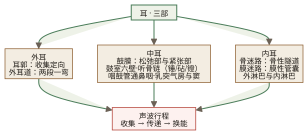
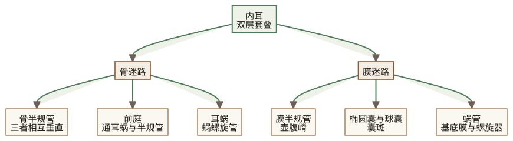

# 第 2 章 · 耳的应用解剖

> **层次：** 撰写层——本章把课程正文的耳部描述按「外—中—内」重排，补上三样课程正文没明说、结构本身已含的判断：外耳道为什么弯、鼓室为何记六壁、迷路为何分两层。课程正文没给的事实与数值，本章一律不补。
> **本章要回答的问题：** 声音从耳郭走到螺旋器，要过几道关？每一道关为什么长成那个样子——弯的、斜的、带杠杆的、两层套着的？把几个「为什么」说清之后，「耳痛为什么牵拉加重」「小儿为什么易得中耳炎」「眩晕与耳聋为什么常一起来」就不必背了。
> **覆盖：** 单元 8 个（01.02.01.01、01.02.01.02、01.02.02.01、01.02.02.02、01.02.02.03、01.02.03.01、01.02.03.02、01.02.03.03）｜ 课程章 `departments/08-wuguan/01-erbihou-jiepou-shengli/chapters/02-e12/docs/zh.md`（12 单元 / 20,441 汉字；本章只取 §2.16 外耳与中耳、§2.17 内耳、§2.18 听觉与位置觉感受器、§2.21 听觉通路四段；§2.13—§2.15 为眼与前庭蜗器总论，§2.19—§2.24 为观察描述的方法层）｜ 本章正文 5,492 汉字
> **参考状态：** 课程正文是主源，也是唯一底本。外源课件《耳的解剖与生理——耳鼻喉[精品]课件》**只取到元数据，正文未取得**；本章不引它任何数值、图与条文，也不写「据某课件」。
> **引用口径：** 耳的形态与感受器标「课程正文 §2.x」；§1.1 的补充（外耳道长度、小儿咽鼓管、光锥、乳突气房）标 §1.1；两处可核尺寸照录并注「约」；其余的量一律写「随个体差异，本书不给具体数」。

---

## N.1 概念与出处

先立三个词，都是后文反复要用的。

| 概念 | 出处 | 一句定义 |
|---|---|---|
| 前庭蜗器 | 课程正文 §2.16 | 位于颞骨内及其周围，由外耳、中耳、内耳组成；前二者收声传声，后者感受声波与头位变化 |
| 声传导 | 课程正文 §2.18 | 到内耳的两条路：气传导经耳郭、外耳道、鼓膜、听骨链、前庭窗；骨传导径由颅骨 |
| 迷路 | 课程正文 §2.17 | 内耳的双层结构：骨迷路为骨性隧道，膜迷路为其中的膜性管与囊；两层之间是外淋巴，膜迷路内是内淋巴 |

**一句总纲。** 耳的全部构造可按一句话读完：把空气的疏密波换成淋巴的波动，再换成神经的冲动。外耳收集与定向，中耳传递与放大，内耳换能与分析。三段的界面各是一层膜：外耳与中耳之间是鼓膜，中耳与内耳之间是镫骨底所封闭的前庭窗。后面每一节都在给它加细节。

**图注**：耳的三部与各自的构件。出处：课程正文 §2.16「外耳与中耳为收集声波与传导声波的结构，内耳为感受声波以及感受头部位置变化的结构」，及 §2.18 气传导三段的划分。读图要点：外耳与中耳之和只做「把振动送到窗口」一件事，真正的换能在内耳；鼓室里的听骨链向内传振动，咽鼓管向外通鼻咽，一条在内、一条在外，这正是中耳「既封闭又通气」的双重身份。按自上而下读：先认三部，再看每部的构件。

### 01.02.01.01 耳廓

耳郭位于头部两侧，由弹性软骨与皮肤构成，表面凹凸不平（课程正文 §2.16）。它的起伏都有名字：外缘的卷曲隆起为耳轮，耳轮与对耳轮之间的沟为耳舟，对耳轮上端分叉围成三角窝，耳轮脚以下的深窝为耳甲、正对耳道口，耳道口前方的突起为耳屏，其后方的突起为对耳屏。

**上下两半的差别，是一条必须记住的分界。** 耳郭上部以软骨为支架，下部无软骨，仅由皮肤与脂肪构成，称耳垂（课程正文 §2.16）。它决定三件事：耳垂可反复穿刺而不伤软骨，故采血与耳穴贴压取此处；软骨部一旦化脓，软骨血供差、修复极慢，且可遗留畸形；冻疮好发于耳轮与耳垂的远心端，因为 §1.1 说耳郭「皮下组织菲薄，血运较差，冬季易生冻疮」。三件事同一个原因：组织薄、血少。

### 01.02.01.02 外耳道：两段·弯度·血供神经

外耳道是自耳郭深部通向鼓膜的管道，由外向内分为软骨部与骨部：软骨部在外，壁由软骨构成；骨部在内，壁由骨构成（课程正文 §2.16）。§1.1 给了比例与长度：外 1/3 为软骨部、内 2/3 为骨部，全长约 2.5～3.5 厘米。这是全书仅有的两处可核尺寸之一，另一处是咽的长度。

两段的差别在皮肤：外段富有毛囊、皮脂腺与耵聍腺，分泌耵聍，故疖肿与耵聍栓塞好发于此；内段皮肤甚薄、紧贴骨膜、痛觉灵敏，发炎时肿胀无处可退，疼痛剧烈（课程正文 §1.1）。

**第一件：为什么它要弯。** 课程正文说外耳道「呈弯曲走行」。弯的后果是：不牵开耳郭、不把管道拉直，就看不到鼓膜。同一弯曲也是诊断依据——「外耳道疖肿时疼痛剧烈，牵拉耳廓或按压耳屏时疼痛加重」；这两个动作查的是皮肤是否被牵动，不是管道是否通畅。初学者常把耳痛一律当中耳炎，其实按压耳屏即痛、牵拉耳郭即痛，指的多是外耳道。

**第二件：外耳还有增益。** 课程正文说外耳道「尚具共振作用，可轻度增益声压」。这解释了为什么外耳道被堵住时，听力下降往往超过「堵住」本身给人的预期——被堵掉的不只是通道，还有那段共振。共振频率与增益数值不给：随个体差异。

## N.2 为什么可以这样翻译

本章要谈的「翻译」，是把结构名称译成力学动作。耳朵好学，就因为每个形态特征都能译成一句功能话：弯是为了保护，斜是为了对准，杠杆是为了增压。译得通，因为形态本就由功能塑造；译不通的地方，下一节说。

### 01.02.02.01 鼓膜与鼓室六壁

鼓膜位于外耳道与中耳之间，呈椭圆形半透明薄膜；外侧面朝外耳道，内侧面朝鼓室；分松弛部与紧张部，松弛部在上，紧张部占大部分；中心向内凹陷称鼓膜脐，其内面与锤骨柄相连；其位置与倾斜方向使其与外耳道及中耳关系密切（课程正文 §2.16）。§1.1 补了两笔：呈浅漏斗状向内凹陷，紧张部前下方可见三角形光锥；兼具传音与保护作用。

**鼓室是一个有六个面的盒子。** 课程正文 §2.16 说鼓室是颞骨岩部内的不规则含气腔，壁由骨构成，分上、下、外侧、内侧、后、前六壁。六壁的关键不在数目，在每一面挨着什么。

| 壁 | 名称 | 邻接或开口 | 为什么值得记 |
|---|---|---|---|
| 上壁 | 盖壁 | 与颅中窝相邻 | 骨薄，感染可上行入颅 |
| 下壁 | — | 朝颈静脉球方向 | 位置最低，积液先沉于此 |
| 外侧壁 | 鼓膜壁 | 以鼓膜与听小骨的大部分为界 | 检查的入口 |
| 内侧壁 | 迷路壁 | 中部隆凸称岬；岬后上方有前庭窗（镫骨底封闭）与蜗窗（膜封闭） | 换能的两个窗口都在这一面 |
| 后壁 | — | 有开口通乳突窦 | 感染向后走的路 |
| 前壁 | — | 有开口通咽鼓管 | 通气与引流的路 |

这张表的用法是「按邻接下诊断」：上壁邻颅中窝，所以中耳炎的颅内并发症不是罕见事；内侧壁两个窗，所以中耳的病变能直接扰动内耳，产生眩晕与感音障碍；前壁通咽鼓管，咽部感染能进来；后壁通乳突窦，炎症能退到乳突。四面各通一处——六壁写全，等于把并发症的四条路画了出来。这就是本书取六壁而不取五壁的实际理由（术语层面的讨论见第 1 章 §N.5）。

鼓室内还有韧带与神经（课程正文 §2.16），本书只记其存在，不逐一展开：分区属第 6 章。

### 01.02.02.02 听骨链与鼓室肌

听小骨有锤骨、砧骨、镫骨，三者以关节相连构成听小骨链；锤骨柄附于鼓膜，镫骨底封闭前庭窗（课程正文 §2.16）。§1.1 补了功能：听骨链具杠杆作用，可增益声压。

**为什么需要增益，一句话够。** 声波在空气里走，到内耳却要推动液体；空气轻、液体重，直接把空气中的振动交给液体，大部分会被反射掉。中耳要做的，就是把「力气小、位移大」的空气振动换成「力气大、位移小」的液体振动。听骨链的杠杆是这一转换的一个环节；课程正文只说「具杠杆作用，可增益声压」，不给倍数，本书照此——倍数随个体差异，各教材取值不一，写进教材只会多一个背了也没用的数。

**两块小肌是一对拮抗的刹车。** 鼓膜张肌与镫骨肌收缩可调整听小骨链的张力，进而影响声波传导效果（课程正文 §2.16）；§1.1 说得更直接：二肌能调节传音、保护内耳。一个拉紧鼓膜，一个牵住镫骨，共同效果是遇强声时把链子绷紧，减少传到内耳的能量。这是一套内置限幅器，反应有延迟，故对突如其来的爆震保护有限——这解释了强声损伤为什么常发生在「没来得及反应」的那一瞬。

**把中耳译成「变压器」，译到哪一步为止。** 到此为止都成立：鼓膜收面积、听骨链做杠杆、镫骨底把力集中到小小的前庭窗上，三者合起来完成阻抗转换；两块肌再加一层保护。但「变压器」有一个致命遗漏——变压器是封闭的，中耳不是。它是含气腔，气从哪来、往哪去，决定了它能不能工作。这一层，下一节讲。

## N.3 这个翻译丢掉了什么

把中耳译成「一台变压器」，丢掉的正是它作为「一个腔」的身份。

### 01.02.02.03 咽鼓管与乳突

**咽鼓管：中耳的通气孔。** 它连通鼓室与鼻咽部，由骨部（后外侧）与软骨部（前内侧）构成，内面黏膜与鼻咽及鼓室的黏膜相连续（课程正文 §2.16）。§1.1 补了三条：平时关闭、吞咽时开放；作用是调节中耳气压、维持鼓膜两侧压力平衡；小儿咽鼓管较成人短、平、宽，故上呼吸道感染后炎症易循此蔓延而发生中耳炎。

三条合起来可推出一串事实：鼓膜两侧压力须相等，否则它被推或被吸，张力改变，传音效率下降，耳闷与自听过强即由此来；「平时关闭」是保护，「吞咽时开放」是通气，一直开着则分泌物与气压直压鼓室，一直不开则腔内残气被吸收而成负压；黏膜连续意味着「通路」即「病路」——鼻咽的炎症顺着黏膜就能走到鼓室，小儿的短、平、宽只是让这条路更直。

**乳突：中耳的后院。** 乳突为鼓室后方的含气骨腔，与鼓室相通；乳突气房发育不良者易患慢性乳突炎（课程正文 §1.1）。§2.16 把它写作乳突小房与乳突窦，并指出鼓室后壁有开口通乳突窦。

「后院」不是修辞：乳突由一组互相连通的气房构成，全部经乳突窦与鼓室相通，与主屋共用一套空气。后果有二：气房发育好者，气房是一个大的缓冲容积，压力波动被摊薄，发育不良者缓冲小，病变更易积在鼓室里出不去——课程正文把「气房发育不良」与「慢性乳突炎」连在一句，正是此意；鼓室的感染向后走，第一站是乳突窦，故乳突区的压痛与红肿是感染「出了鼓室」的体征。

**翻译的断点，说白了：** 「变压器」只管「传」，不管「养」。中耳要工作需三样：结构完整、压力平衡、空间清洁；只有第一样是「变压器」能表达的。后两样要求把中耳看成一个有进有出的腔，其正常取决于它与鼻咽之间那条管子的开合节律——这就是本章把咽鼓管与乳突放在这一节的原因：它们不是中耳的附属部件，是它的生存条件。

## N.4 与相邻学科的接口

内耳是耳与其它学科交接最密的地方：它在颞骨岩部里，四壁皆骨，前有鼓室、后有颅后窝、上有颅中窝。谁要碰它，都得先跟别科打招呼。

### 01.02.03.01 骨迷路与膜迷路

内耳位于颞骨岩部内，由骨迷路与膜迷路组成：骨迷路为骨性隧道，膜迷路为其中的膜性管与囊；两者之间充满外淋巴，膜迷路内充满内淋巴；两套结构位置相互套叠，形状与走向大体一致（课程正文 §2.17）。

| 骨迷路 | 位置与形态 | 膜迷路 | 感受器 |
|---|---|---|---|
| 骨半规管 | 前、后、外三个，相互垂直；一端膨大称骨壶腹 | 膜半规管（膜壶腹） | 壶腹嵴：旋转变速 |
| 前庭 | 中部；外侧壁即鼓室内侧壁；前通耳蜗、后通骨半规管 | 椭圆囊与球囊，借椭圆球囊管相连 | 椭圆囊斑、球囊斑：直线变速与头位 |
| 耳蜗 | 前庭前方，形似蜗牛壳；蜗螺旋管绕蜗轴，起自前庭、终于蜗顶 | 蜗管，横断面呈三角形 | 螺旋器：声波 |

**三个部件，各解决一个问题。** 三个半规管互相垂直，等于三个平面上各放一枚旋转传感器，头朝任何方向转都至少带动一个管里的淋巴。前庭是枢纽：前通耳蜗、后通骨半规管，外侧壁又是鼓室的内侧壁，故它既是内耳的门厅，也是中耳与内耳之间的那堵墙。耳蜗解决「分频」：蜗螺旋管绕蜗轴盘上去，被骨螺旋板隔成前庭阶与鼓阶，两阶在蜗顶以蜗孔相通，淋巴才能一往一返。

**为什么必须两层。** 骨迷路硬、膜迷路软，中间垫一层外淋巴。这个构造解决两个矛盾：内耳既要固定又要能感受，骨给固定、膜给活动；内耳对压力极敏感，双层间的液体是缓冲垫，外来压力先被摊薄再传到膜迷路。课程正文说两者「形状与走向大体一致」，这句「大体」很重要：不一致处正是膜迷路悬在骨迷路里的细丝与通道。

**接口：与中医的「肾—髓」语言。** 第 1 章说过，耳与肾的归属靠「髓」这条虚线：肾藏精，精生髓，髓聚于脑，耳与脑相通。现在可以把这条虚线接到具体位置：内耳与听神经在颞骨岩部内，与中枢同处一个由神经与血管维持的系统。这是「髓」这一层语言最贴切的落点——它说的不是某个器官，而是一整套深在的、与中枢连着的组织。反过来，把「肾虚」直接说成「骨迷路的病」，就是把这层语言用错了地方：虚实讲全身状态，不是某一块骨。

**图注**：骨迷路与膜迷路的对应关系。出处：课程正文 §2.17「骨迷路为骨性隧道，膜迷路为位于骨迷路内的膜性管与囊，两者之间充满外淋巴，膜迷路内充满内淋巴」。读图要点：左右两列不是两个器官，是同一套结构的两层——右列每一件都装在左列对应的空腔里；三个感受器（壶腹嵴、囊斑、螺旋器）全在膜迷路一侧，骨迷路只提供外壳与通道。读时先对位，再看感受器的位置。

## N.5 争议与本项目立场

### 01.02.03.02 Corti 器与前庭感受器

蜗管下壁为鼓壁，又称基底膜，分隔蜗管与鼓阶；基底膜上有螺旋器，即听觉感受器，由支持细胞与毛细胞构成；毛细胞游离面有听毛，听毛与盖膜相接触（课程正文 §2.17）。基底膜自蜗底向蜗顶，宽度与结构发生变化，这一变化与声波振动类别的感受相对应；课程正文同时声明：只写结构的位置与类别，不写振动频率数值、听力阈值与听力损失分级。

**螺旋器做的是换能，不是放大。** 声波传入内耳引起淋巴振动，基底膜随之振动，毛细胞的听毛与盖膜接触而受刺激，产生冲动，经蜗神经传向脑（课程正文 §2.18）。三者都不需额外能量输入，故内耳是换能器而非放大器——感音性听力损失一旦发生，助听器只能把声音送得更响，不能把换能修好。

**「部位对应类别」是本章最该小心的一句。** 本书照课程正文办理，并写成立场：**不同部位对不同类别的振动起反应是结构事实；某段对应多少赫兹是测量结果，不在本书范围。** 理由有二：换算依赖标本与测量条件，写进教材就成了要背的数字；一旦给出刻度，读者会把它当诊断线，而听力判读属听力学专科。

前庭一侧有三个感受器，位置与分工一一对应（课程正文 §2.17、§2.18）：壶腹嵴在膜壶腹内，感受头部旋转变速运动；椭圆囊斑在椭圆囊内、球囊斑在球囊内，二者感受直线变速运动与头部位置变化。三个感受器的毛细胞排列方向与所在囊或壶腹的方位相对应；头位改变使内淋巴流动，毛细胞受刺激产生冲动，经前庭神经传出。

**前庭系统测的是「变化」，不是「位置」。** 站着不动时它几乎不放电，一转头就报数。所以前庭检查总要做「诱发」——转头、变位、冷热刺激都在制造变化；也所以前庭的病以「晕」为主诉。

**争议一：要不要给频率刻度与听力分级。** 有的教材讲基底膜时附频率定位图，标出各段响应范围。本书不附：图一旦画上刻度就成了要背的考点，而其判读标准随机构与设备而变；判读口径统一交给第 8 章，只给正常所见。

### 01.02.03.03 听神经到听觉中枢

蜗神经的纤维来自螺旋器内的毛细胞，前庭神经的纤维来自壶腹嵴与椭圆囊斑、球囊斑内的毛细胞，两者共同组成前庭蜗神经入脑（课程正文 §2.18）。入脑之后，两条通路分开走。

| 通路 | 次序 |
|---|---|
| 听觉 | 毛细胞 → 蜗神经 → 蜗神经核 → 部分交叉形成斜方体 → 外侧丘系 → 下丘 → 内侧膝状体 → 听辐射 → 颞叶听觉区 |
| 平衡觉 | 毛细胞 → 前庭神经 → 前庭神经核 → 小脑、脊髓及脑干多处；部分经丘脑中继至颞叶 |

**两条通路的结构差别，决定两类症状的差别。** 听觉通路有交叉与不交叉的纤维，使一侧中枢能接受双耳冲动；平衡觉通路则广泛散向小脑、脊髓与脑干。故一侧耳坏了通常不表现为一侧中枢失灵；前庭病变却易伴恶心、呕吐、出汗与姿势不稳，因为它的输出直接散到脑干与脊髓的运动核团。课程正文对后者只说「与脑干的多个部位以及小脑与脊髓发生联系」，本书不再往下推。

**争议二：能不能由通路推断定位。** 有一类教学法喜欢用「交叉在脑干」去推断脑干病变的听力表现。课程正文写得克制：听觉通路的联系方式「与声源方位的判断相关，其具体机制不在本书的表述范围之内」。本书取同一立场：**只写通路的层级与走向，不据单侧中枢病变推断听力后果**——解剖固定，症状却取决于范围、速度与代偿；把解剖图当定位图，是把「结构」当「诊断」。

**最后回到那两层膜。** 本章从耳郭讲到颞叶，只强调两件事：结构要把振动传好，也要把过强的挡住。鼓膜与前庭窗是链上的两个界面，中耳是变压器，内耳是换能器，通路是电缆。四段各有各的病与查法——这就是为什么下一章讲生理、再下一章讲检查，都要先有这一章的形态底子。

## N.6 与外源课件的对照

本章写作时参考过一份同题课件：《耳的解剖与生理——耳鼻喉[精品]课件》（原创力文档，62 页 / 约 2.12 万字）。
必须先说清**只取到了什么**，否则「参考过」三个字会变成一件很滑的事。

**取到的**：标题页（OCR 得「耳的解剖与生理 / anatomy and physiology of ear」）与元数据（62 页、约 2.12 万字）。
**没取到的**：其余 61 页正文。四条路都试过——桌面页 HTML、移动页、页面内 text API、分页变体，结果分别是「无正文」与「404」；
正文按页前端加载，需 VIP 下载，本项目没有绕付费墙。登记见 `standards/erbihou-jiepou-shengli/reference-courseware.json`。

因此这份课件在本章只起一个作用：**核对主题范围与写法取向**。

- **范围**：它的标题把「解剖」和「生理」并列，说明单器官的讲法不是「先讲完形态再另起一章讲功能」，而是把一个器官的结构与功能放在同一条线上讲。本书照此拆成两处：形态归本章（外耳—中耳—内耳—听神经），功能归第 7 章（声传导、感音、平衡），但两处的**器官边界完全对齐**——本章每提到一个构件，第 7 章都用同一名称指它，不换词。
- **取向**：本章按「形态 → 功能 → 接口」三段写，正是这条取向的落地；读者读完应能回答「这个结构在做什么」，而不只是「这个结构在哪」。

**它不能做的事**（写死，防止后来者误用）：不给任何数值——鼓膜面积、耳蜗长度、听阈这类数字本章一概不出现，
需要时写「随个体差异，本书不给具体数」；不给任何图——本章的两张图（`fig-03-耳的三部结构`、`fig-04-迷路双层`）是按本章正文自绘的 SVG，
可重画、可对账；也不作为引用来源——本章的引用只到课程正文（`chapters/02-e12/docs/zh.md`）、中医古籍书名·篇名与通行解剖学骨架三种。

一句话：**能核对范围，不能提供证据**。把「参考过一份课件」写成「据某课件」，就是拿标题当出处。

> **免责声明：** 本章为教学材料，不构成诊疗建议。所述结构与邻接只用于建立形态判断的框架；耳镜检查、听力学检查与影像判读须由具备资质的执业人员依现行规范与所在机构制度作出。凡耳痛伴发热、耳后红肿压痛、突发听力下降、眩晕伴呕吐者，按急症路径转介。本章不给尺寸、增益倍数与手术参数。

## 思考题

1. 外耳道的「弯」既是检查的障碍又是诊断的依据。请说明这两件事各依赖哪条解剖事实，并解释为什么「按压耳屏痛」指向外耳道而非中耳。
2. 本章说把中耳译成「变压器」会丢掉「它是有进有出的腔」这一层。请用咽鼓管与乳突各举一例，说明丢掉这一层会导致哪两个判断出错。
3. 基底膜「不同部位对不同类别的振动起反应」是结构事实，「某段对应多少赫兹」是测量结果。请说明本书为什么坚持把这两句分开写，并指出混写会在教学与临床各造成什么后果。

## 延伸阅读

- 《灵枢经·经脉》《灵枢·经筋》——手足少阳「从耳后入耳中，出走耳前」的原文，是耳周经络与耳部症状相关联的最早文本。
- 《耳鼻咽喉头颈外科学》，人民卫生出版社，全国高等学校教材。——外耳、中耳、内耳形态与听力学判读的通行参照；本书形态以课程正文为准，此书只用于校对术语，不用于取数。
- 《人体解剖学》，全国高等学校教材——颞骨、鼓室六壁与迷路的位置关系可与此书图谱对读；本书示意图只表邻接，不表比例。
