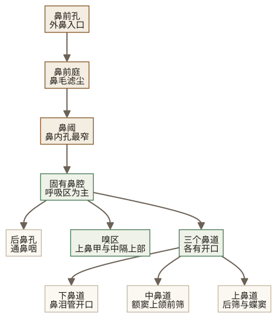
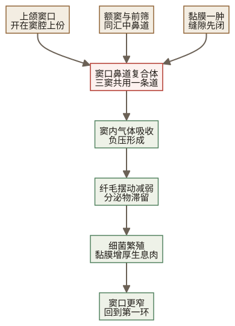

# 第 3 章 · 鼻与鼻窦

> **层次：** 撰写层——本章按四级编码 `01.03` 节重写为解剖章，七个单元按「外鼻—鼻腔—鼻窦—血供神经」落位，串成一条「鼻窦为什么容易滞留」的链。课程原文的临床病证只取其中能落到结构上的句子。
> **本章要回答的问题：** 一口空气从鼻前孔进、到后鼻孔出，中间要过哪几道窄门？四组鼻窦的开口为什么都挤在同一处？鼻出血为什么总落在鼻中隔前下方那一小块，而老年人的出血却在后头？
> **覆盖：** 课程章 `departments/08-wuguan/01-erbihou-jiepou-shengli/chapters/03-e13/docs/zh.md`（35 单元 / 27,724 汉字，七病：鼻疔、鼻疳、伤风鼻塞、鼻窒、鼻鼽、鼻渊、鼻衄）｜ 骨架取同课 `派生·第1章·1.2`（鼻部解剖生理概要）与本章病证篇的结构句 ｜ 单元 7 个：01.03.01.01 / .01.02 / .01.03 / 01.03.02.01 / .02.02 / 01.03.03.01 / .03.02。
> **参考状态：** 课程第 3 章是病证章，不是解剖章：七病各按五个栏目写满，可用的结构句散在各篇（利特尔区、窦口鼻道复合体、危险三角、上颌窦与牙根、额窦炎的定时痛）。本章把这些句子排成一条链；缺的环节按通行解剖学补，补的部分不假称出自课程。
> **引用口径：** 引课程单元写 `派生·第3章·3.x`（病证篇）与 `派生·第1章·1.x`（解剖概述篇）；引古籍只标书名与篇名，不标页码。课程正文给到的概略值随文注明来源，未给的一律写「随个体差异，本书不给具体数」。

---

## N.1 三个腔、两个门户：先把地界划清

鼻不是一根管子，是三个腔串起来的一条路：外鼻（入口的形状）、鼻腔（调温、调湿、过滤）、鼻窦（挂在鼻腔旁的四对含气空腔）。三者之间只有两个门户——鼻前孔与后鼻孔。鼻病的位置不出这三段，功能不出这两个门户。

先划地界，是因为「鼻塞」落在三段上意思不同：外鼻段是鼻阀塌陷，病人指得出位置；鼻腔段是鼻甲肿胀或中隔偏曲；鼻窦段是窦口闭塞而鼻腔未必堵，病人说的是「闷」「胀」「头重」。问一句「哪一侧、什么时候重、堵在哪儿」，答的其实是段位。

表 1 本章单元与出处

| 单元 | 主题 | 主要依据 |
|---|---|---|
| 01.03.01.01 | 外鼻支架与软组织 | `派生·第1章·1.2`；`派生·第3章·3.29`（危险三角） |
| 01.03.01.02 | 鼻腔四壁与鼻甲鼻道 | `派生·第1章·1.2`；`派生·第3章·3.42`（鼻甲肥大） |
| 01.03.01.03 | 嗅区与呼吸区黏膜 | `派生·第1章·1.2`；`派生·第3章·3.40`（嗅觉减退） |
| 01.03.02.01 | 四组窦的位置与开口 | `派生·第1章·1.2`；`派生·第3章·3.50`（鼻渊） |
| 01.03.02.02 | 窦口鼻道复合体 | `派生·第3章·3.51`、`3.54` |
| 01.03.03.01 | 血管与利特尔区 | `派生·第1章·1.2`；`派生·第3章·3.55`、`3.59` |
| 01.03.03.02 | 感觉与自主神经 | `派生·第3章·3.43`（药物性鼻炎）、`3.49`（鼻—支气管） |

### 01.03.01.01 外鼻支架与软组织

外鼻形似一个三棱锥体（课程 `派生·第1章·1.2`）：上端窄而连于额部为鼻根，中间为鼻梁，下端膨大为鼻尖，两侧展开为鼻翼，两翼下各一鼻前孔，孔间为鼻小柱。

支架分两段。上段是骨：成对的鼻骨，上接额骨鼻部，外侧接上颌骨额突。下段是软骨：鼻侧软骨、大翼软骨、小翼软骨，以结缔组织相连。接缝在鼻骨下缘，此处最薄，外伤后鼻梁塌陷最先出现于此。软骨段有活动度，故鼻翼能被吸气压差牵动——课程说的「鼻翼扇动」，即这段支架在小儿身上被负压牵动的体征，见于重症肺炎与喉阻塞。

软组织只记一件事：皮肤厚薄不均。鼻根、鼻梁薄而松弛；鼻尖、鼻翼骤厚，皮脂腺与汗腺密集，且与软骨膜贴紧——上段能捏起一层皮，下段捏不动。故鼻尖鼻翼的疖肿张力高、痛剧；鼻前庭毛囊一旦感染，脓不易外破，容易内走。

鼻前庭是鼻腔最前一段，由鼻翼内侧面包围，生有鼻毛，滤过较大尘粒（课程 `派生·第1章·1.2`）。其皮肤与软骨膜紧贴，皮下无松弛层，故此处的疖肿（中医称鼻疔）痛得格外厉害。

再外一层是「危险三角」：鼻根至两侧口角连线所围，面静脉无瓣膜（课程 `派生·第3章·3.29`）。血可逆行——挤压此区疖肿，细菌栓子可经面前静脉、眼静脉入海绵窦。「严禁挤压」这条红线，解剖理由就在这一个「无瓣膜」上。

三条判据：鼻梁偏斜、鼻骨下缘压痛、触之有骨擦感，在骨段；鼻尖鼻翼红肿界限清、触痛剧而无波动，在皮肤与毛囊；鼻前孔内红肿、鼻毛根部见脓点、牵拉鼻翼痛，在鼻前庭。分不清段位，会把鼻疔当酒齄鼻治，或把鼻骨骨折当挫伤观察。

## N.2 鼻腔：四壁、鼻甲鼻道与两片黏膜

鼻腔前起鼻阈，后止后鼻孔，由鼻中隔分为左右两半；每半又分前部的鼻前庭与后部的固有鼻腔（课程 `派生·第1章·1.2`）。讲鼻腔的通行办法是讲四壁，因为四壁各有各的病，也各有各的危险。

### 01.03.01.02 鼻腔四壁与鼻甲鼻道

**内侧壁是鼻中隔。** 由三块拼成：前为鼻中隔软骨，上后为筛骨垂直板，下后为犁骨。三块不在一个平面上，接缝处应力集中，故偏曲多发生在骨与软骨交界，形态多为「C」或「S」形，也可形成骨嵴与距状突。偏曲本身不是病；压迫鼻甲、堵塞窦口，才是病。

**顶壁是筛板。** 筛板多孔，嗅丝由此入颅前窝的嗅球。它薄，其上就是脑膜与脑脊液，故外伤、手术、甚至用力擤鼻都可能撕破而成脑脊液鼻漏——这是鼻腔唯一「上不封顶」的地方，上面不是骨，是颅腔。

**底壁是硬腭。** 上颌骨腭突与腭骨水平板合成，把鼻腔与口腔隔开；前部有切牙管，鼻腭神经与血管由此通过。后份与上颌窦底紧邻，这一层薄骨就是牙源性上颌窦炎的通道——课程说龋齿、牙周病可致鼻渊（`派生·第3章·3.53`），走的是这条路。

**外侧壁最复杂。** 六种骨拼成：上颌骨、泪骨、下鼻甲骨、筛骨、腭骨垂直板、蝶骨翼突内侧板。骨面向内突出三个鼻甲：下鼻甲独立成骨，中、上鼻甲是筛骨的突起。鼻甲下方即鼻道；上鼻甲后上方另有一隙，为蝶筛隐窝。三个开口要记住（课程 `派生·第1章·1.2`）：下鼻道前端有鼻泪管开口，眼泪由此进鼻腔；中鼻道是额窦、上颌窦与筛窦前中组的开口；上鼻道是筛窦后组的开口，蝶窦开口于蝶筛隐窝。

鼻甲不是装饰：它把鼻腔表面积做大，把气流分成片层，让空气贴着黏膜走完全程。下鼻甲最大，黏膜下有静脉构成的勃起组织，能胀能缩，是鼻阻力主要的调节器——交替性鼻塞就是它在昼夜间的涨落（鼻周期见 `01.07.02.02`）。中鼻甲则是筛窦的一部分，又是中鼻道的顶，位置决定窦口通不通。故下鼻甲管通气，中鼻甲管引流。

判据：鼻塞而鼻甲可收缩、对减充血剂有反应，病变在黏膜；鼻塞而不收缩、下鼻甲呈桑椹样，病变已到黏膜下与骨（课程 `派生·第3章·3.42` 用「鼻甲肥大暗红、表面凹凸不平」写这一层）；鼻塞而中鼻甲与中隔相贴，要想到窦口受累。

### 01.03.01.03 嗅区与呼吸区黏膜

鼻腔黏膜不是一片，是两片，交界在上鼻甲上缘一带。

**嗅区**在上鼻甲内侧面与相对应的鼻中隔上部，面积小。上皮为假复层柱状，含嗅细胞、支持细胞、基底细胞。嗅细胞是双极神经元，一端伸出嗅毛到黏膜表面，另一端成嗅丝穿筛板入嗅球。它没有施万细胞包裹，直接与中枢相连——这是全身唯一一处神经元暴露在外界空气中的地方。嗅腺分泌浆液，气味分子须先溶于此才能接触嗅毛；故鼻内干燥时嗅觉会钝，不是「嗅神经坏了」，是溶剂不够。

**呼吸区**占其余大部。上皮为假复层纤毛柱状，含杯状细胞，黏膜下有浆液腺与黏液腺。表面覆两层黏液毯：下层稀薄，纤毛在其中摆动；上层黏稠，粘住尘粒。纤毛摆动的方向是单向的——向后，朝后鼻孔，再入咽。这一点极关键：鼻腔与鼻窦的分泌物主要不是「擤出去」的，是靠纤毛「送出去」的，送到咽部再咽下或咳出。所谓鼻后滴漏，就是这条传送带在正常工作而量太大，或被感知到了。

两片黏膜的分工，决定了嗅觉减退的两种来源。一是**传导性**：气流到不了嗅区，见于鼻甲肿胀、鼻中隔高位偏曲、鼻息肉、脓涕覆盖；此时嗅细胞是好的，通开就好。二是**感觉性**：嗅上皮、嗅丝、嗅球本身受损，见于病毒感染后、颅脑外伤（筛板骨折）、长期接触化学气体；此时通得再开，也闻不到。

课程把鼻窒、鼻渊、鼻鼽的「嗅觉减退」并列写，机制却不同：三者发作时多为传导性，唯反复多年才可能混入感觉性。故问「闻得到醋还是完全闻不到」比问「嗅觉好不好」有用。

判据：单侧嗅觉丧失伴同侧鼻塞，先查阻塞；双侧丧失而鼻腔通畅，想到嗅上皮或嗅丝，须查颅底。

## N.3 鼻窦与窦口鼻道复合体：滞留是怎么形成的

前两节讲的是路，这一节讲挂在路边的四个房间，以及它们为什么容易积水。

### 01.03.02.01 四组窦的位置与开口

鼻窦是鼻腔周围颅面骨内的含气空腔，共四对，依所在骨命名：上颌窦、额窦、筛窦、蝶窦，均借窦口与鼻腔相通（课程 `派生·第1章·1.2`）。

**上颌窦**在上颌骨体内，是四组中窦腔最大的。窦口开在窦腔内侧壁上部，位置高，故它像一个竖着的瓶子：出水口在瓶肩而非瓶底，内容物只能靠纤毛逆重力上送。上颌窦感染机会最多，鼻窦炎以上颌窦炎最常见（课程原文）。底壁与上颌后牙牙根只隔一层薄骨，牙源性感染可直接上来——治不好的单侧上颌窦炎要查牙，理由在此。

**额窦**在额骨内、眼眶上方，窦口经额隐窝开口于中鼻道前端（课程）。引流道细长曲折，故额窦炎的症状有定时性：前额痛，晨起重、午后轻（课程原文）。理由在引流——卧位一夜，窦内积液最多；活动半日，引流渐畅，痛随之减。这个「定时」比「前额痛」值钱。

**筛窦**在筛骨内，形如蜂窝，分前、中、后三组；前中组开口于中鼻道，后组开口于上鼻道（课程）。其黏膜最易增生肥厚而生息肉（课程原文），理由在结构：小房多、开口小、骨壁薄，黏膜一水肿便彼此压迫，引流一断，息肉就长。

**蝶窦**在蝶骨体内，开口于蝶筛隐窝（课程）。位置最深，毗邻最险：上方是垂体与海绵窦，外侧是视神经与颈内动脉。故蝶窦病变痛则牵到头顶与眶后；一旦侵及骨壁，后果已不在鼻科之内。

四组窦的功能，课程给了三条：减轻颅骨重量、与鼻腔共同构成共鸣腔使发音洪亮、对吸入空气加温湿润并助嗅觉传导。三条都属「有之不觉」，故发现鼻窦病多因引流不畅。

要纠正一句常被说错的话：「四组窦的开口都朝上，所以容易积脓。」不对。只有上颌窦的开口在窦腔上份，额窦、筛窦、蝶窦的开口都在低位，引流本来是顺的。把四组说成一类，恰好抹掉了上颌窦的特殊性，也就解释不了上颌窦炎为什么最多。

### 01.03.02.02 窦口鼻道复合体

窦口鼻道复合体不是一块骨头，是一条通道：以中鼻道为中心，加上钩突、筛泡、半月裂、筛漏斗、上颌窦自然口、额隐窝，共同构成的引流走廊。要害在「共用」——额窦、上颌窦、筛窦前中组三家的出口，都汇进这一条走廊。

主链如下。

**一、入口窄。** 上颌窦口本身不宽，又开在高处。
**二、出口挤。** 三个窦共用一个中鼻道，而中鼻道被中鼻甲、钩突、筛泡围成几条缝隙。
**三、黏膜一肿就闭。** 感染、变应、冷空气、刺激性气体，任一原因引起水肿，缝隙先闭，窦腔后堵。
**四、闭了以后。** 窦内气体被黏膜吸收，形成负压，渗出增多；纤毛在低氧与酸性环境下摆动减弱。
**五、滞留。** 分泌物积在窦内，细菌繁殖，黏膜增厚，息肉形成，窦口更窄——回到第一环。

这条链解释三个事实。其一，鼻窦炎的症状是「涕多而难出」——分泌物在，路不通。其二，治疗靶点是通道而非窦腔：把中鼻道打开、窦口扩大，比反复穿刺抽脓更接近问题所在；课程说鼻渊之治「总以通窍排脓为要」「保持窦口引流通畅」（`派生·第3章·3.52`、`3.54`）。其三，儿童与成人的差别不在窦腔大小，而在窦口未发育完全、腺样体又堵在鼻咽。

判据：内镜看中鼻道有无脓、息肉、黏膜肿胀；影像看窦口鼻道复合体是否闭塞、窦腔是否浑浊。只报「上颌窦积液」而不报「中鼻道闭塞」，等于只说了结果，没说原因。

## N.4 血管与神经：为什么血总出在同一处

### 01.03.03.01 血管与利特尔区

鼻腔血供来自三路（课程只说「鼻中隔前下部血管丰富」，三路走行按通行解剖学补）：筛前、筛后动脉供鼻腔上部与鼻中隔上部；上颌动脉的蝶腭动脉经蝶腭孔入鼻腔，分出鼻后外侧动脉（供鼻甲与鼻道）与鼻后中隔动脉（供中隔后部）；上唇动脉的鼻中隔支供中隔前下部与鼻前庭。

三路在鼻中隔前下部的一小块黏膜下吻合，形成血管丛，即利特尔区。这块黏膜薄、血管表浅、又正对鼻前孔的气流冲击，故最易破裂。课程给的两句可直接用：鼻中隔前下部血管丰富，构成易出血区（利特尔区），是鼻衄最常见的出血部位，儿童与青少年尤为多见；老年人出血则多见于鼻后部（`派生·第3章·3.55`、`3.59`）。

「年龄—部位」是本章最实用的判据：儿童、青少年出血在前部，量不大、易止；中老年、高血压者出血在后部，量大、不易止，多来自蝶腭动脉的分支（课程原文：「后鼻孔出血多来自蝶腭动脉分支等深部血管」）。前部压得住，后部压不到——分岔只在一句「多大年纪」。

静脉再记一句：面前静脉无瓣膜，与眼静脉、海绵窦相通；鼻腔后部的静脉经蝶腭静脉入翼丛。故鼻部感染与鼻腔填塞都可能累及海绵窦与翼丛。

### 01.03.03.02 感觉与自主神经

感觉分两套。一套是嗅觉，走嗅神经：嗅丝→嗅球→嗅束→嗅三角，分内、外侧嗅纹到杏仁核、梨状皮质，部分经丘脑到眶额皮质。它越过丘脑直达边缘系统，故气味与情绪、记忆绑得紧。

另一套是普通感觉，走三叉神经：前部由眼神经的筛前神经支配，后部由上颌神经的鼻后上神经、鼻后下神经与鼻腭神经支配。痛、触、温觉与喷嚏反射的传入都在这一套里；喷嚏的传入支是三叉神经，传出支是迷走神经与膈神经。

自主神经是鼻黏膜的开关。交感一路：颈上神经节→颈内动脉丛→岩深神经→翼管神经→蝶腭神经节（穿过，不换元）→鼻后神经，使血管收缩、分泌减少。副交感一路：面神经的岩大神经→翼管神经→蝶腭神经节（在此换元）→鼻后神经，使血管扩张、分泌增多。两路交汇于蝶腭神经节，这是鼻黏膜一边肿一边消的结构基础。

减充血剂的作用点在交感端的 α 受体：喷上去血管收缩、鼻甲缩小，用久了受体下调，停药反跳性充血更重——课程说长期使用血管收缩滴鼻剂可致药物性鼻炎、连续使用不宜超过一周（`派生·第3章·3.43`）。

还有一条：鼻黏膜受刺激可引起支气管收缩，即鼻—支气管反射。这是鼻与下呼吸道之间的神经连线，也是课程说鼻鼽可与哮喘相互影响（`派生·第3章·3.49`）的解剖基础之一。

判据：单侧鼻塞伴同侧眶周痛，查鼻窦；喷嚏成串、清涕如水而黏膜苍白水肿，属副交感优势型；滴鼻剂依赖、越用越堵，属药物性鼻炎。

## N.5 接口、争议与立场

### 与脏腑经络的接口

课程 `派生·第1章·1.7`、`1.8` 已把这一层写定，本章只做对读，不改写。

**能对上的三处。** 其一，肺—鼻：肺开窍于鼻，《灵枢·脉度》谓「肺气通于鼻，肺和则鼻能知臭香矣」。对应在黏膜连续与气流共同调节——鼻腔与下呼吸道黏膜同为纤毛柱状上皮，同受自主神经支配，故鼻部炎症常向下延伸。其二，脾胃—鼻：脾主升清，清阳上奉则鼻窍通利；脾虚清阳不升、浊阴上泛，则涕稠鼻塞。类比在分泌与清除：分泌过多、清除不力即成「浊阴」；这是类比而非同构，但方向（健脾化湿）一致。其三，胆—鼻窦：《素问·气厥论》「胆移热于脑，则辛頞鼻渊」，课程据此把黄稠浊涕归于胆腑郁热。这是病机命名，不是解剖通路——不能说胆与鼻窦之间有管道；它的价值是把「脓涕、臭味、头痛剧烈」归到一个证上，从而给出清泄胆热的治法。

**对不上的两处。** 其一，经络的线不等于神经血管的走行：手阳明大肠经「上挟鼻孔」、足阳明胃经「下循鼻外」（课程 `派生·第1章·1.8`）讲的是经气所过，不是三叉神经的分支。其二，「鼻为肺窍」不能推成「鼻病即肺病」：鼻窦的骨性位置、窦口狭窄、牙源性感染，都在肺的管辖之外；把结构问题一律译成脏腑问题，会把该通的窦口耽误成慢性。

### 三处争议

**一、利特尔区是不是「鼻出血的部位」。** 是常见部位，不是唯一部位。教成「鼻衄＝利特尔区出血」，代价是漏掉后部出血。

**二、窦口小是否必然滞留。** 不必然。纤毛系统有相当代偿能力，窦口偏小而无黏膜病变者可终身不患鼻窦炎。故本章把链写成五环而非一因一果：解剖是底子，黏膜是扳机。

**三、鼻甲该切多少。** 本书不写。结构上能说的只有一句：下鼻甲黏膜下的静脉丛是鼻阻力的主体，切多了有空鼻感，切少了不通。

> **免责声明：** 本章为教学材料，不构成医学意见或治疗指导。文中不给尺寸、手术参数、用药剂量与疗程；一切检查与处置须由具备资质者依现行规范作出。凡见鼻出血量大不止、单侧涕中带血、眼球突出或视力改变者，先按转诊处理。

## 思考题

1. 一名十二岁男孩，左侧鼻塞三个月，鼻内镜见中鼻道有脓、下鼻甲对减充血剂反应好。请用五环链说明问题最可能在哪一环；只写「上颌窦积液」，漏掉了什么？
2. 鼻中隔前下部为什么成了血管丛？请从三路动脉的走行、这块黏膜的厚薄、它所在的位置三方面作答，并说明「老年人出血多在后部」的解剖依据。
3. 「四组鼻窦的开口都朝上，所以容易积脓」这句话错在哪里？改正之后，为什么反而能解释「上颌窦炎最常见」？

## 延伸阅读

- 课程 `派生·第1章·1.2`「鼻部解剖生理概要」——本章四壁、鼻甲鼻道、窦口位置、利特尔区的骨架句出于此。
- 《素问·气厥论》「胆移热于脑，则辛頞鼻渊」——鼻渊病名与胆热病机之据，见课程 `派生·第3章·3.50`。引时标篇名，不标页码。
- 课程 `派生·第3章·3.54`「鼻渊·按语」——窦口鼻道复合体阻塞与内镜鼻窦手术的叙述出于此，本章只取「通道」一层。
