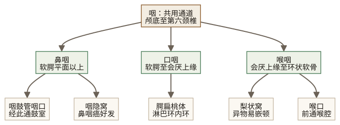
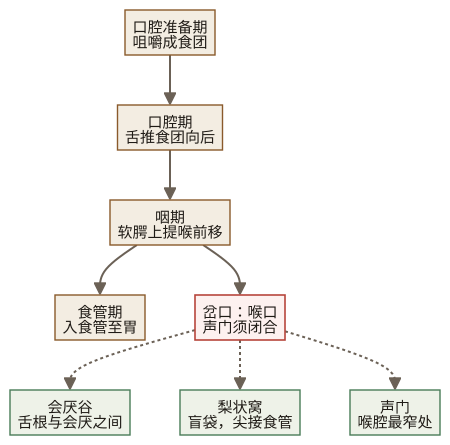

# 第 4 章 · 咽喉的解剖

> **层次：** 撰写层——本章按四级编码 `01.04` 节重写为解剖章，八个单元按「咽—喉—吞咽」落位，串成一条「异物为什么总卡在同一处」的链。课程原文的临床病证（喉痹、乳蛾、喉痈、急喉风、喉喑、梅核气）只取其中能落到结构上的句子。
> **本章要回答的问题：** 一根鱼刺为什么总停在那两三处，而不会停在别处？吞咽的那一秒里，气与食在哪个点分岔，谁负责关门？为什么左侧声带麻痹比右侧多见？
> **覆盖：** 课程章 `departments/08-wuguan/01-erbihou-jiepou-shengli/chapters/04-e14/docs/zh.md`（30 单元 / 25,985 汉字，六病：喉痹、乳蛾、喉痈、急喉风、喉喑、梅核气）｜ 骨架取同课 `派生·第1章·1.3`（咽喉部解剖生理概要）与本章病证篇的结构句 ｜ 单元 8 个：01.04.01.01–01.04.03.02。
> **参考状态：** 课程第 4 章是病证章：六病各按五个栏目写满，可用的结构句散在各篇（咽的三段、咽旁间隙三型脓肿、梨状窝、喉腔最狭窄处、声带麻痹）。本章把这些句子排成一条链；缺的环节（咽壁四层、咽旁间隙的茎突分界、声带五层、喉肌三组、吞咽四期）按通行解剖学补，补的部分不假称出自课程。
> **引用口径：** 引课程单元写 `派生·第4章·4.x`（病证篇）与 `派生·第1章·1.x`（解剖概述篇）；引古籍只标书名与篇名，不标页码。课程正文给到的概略值随文注明来源，未给的一律写「随个体差异，本书不给具体数」。

---

## N.1 三段与两个门户：一条共用的管子

咽是一条前后略扁的肌性管道，呼吸道与消化道共用，上起颅底，下达第六颈椎下缘续于食管，全长约十二厘米（课程 `派生·第1章·1.3` 原文）。这句话最要紧的是「共用」：既然共用，就必有交叉；有交叉，就必有卡点。本章后面的判断都从这两个字长出来。

「咽」与「喉」要分开：咽是通道，喉是岔口的门房。咽后面是椎前筋膜与颈椎，前面自上而下通鼻腔、口腔、喉腔；喉挂在咽的前壁下方，向上开口于喉咽。故一口饭要进胃，必须过喉口这个「没关好就进错门」的地方。

### 01.04.01.01 鼻咽·口咽·喉咽三段

咽腔按三个骨性标志分成三段（课程 `派生·第1章·1.3`）：

**鼻咽**在软腭平面以上。顶后壁黏膜下有咽扁桃体，即腺样体，儿童期较发达，可因炎症而肥大，影响呼吸与听力。两侧壁有咽鼓管咽口，经咽鼓管通中耳鼓室——故咽部感染可循此致中耳炎，这也是擤鼻要单侧交替的理由。咽鼓管咽口后上方有一凹陷，为咽隐窝，是鼻咽癌的好发部位。

**口咽**在软腭与会厌上缘之间。前经咽峡通口腔；咽峡由软腭、悬雍垂、腭舌弓、腭咽弓与舌根围成。侧壁的扁桃体窝内是腭扁桃体，后壁黏膜下有淋巴滤泡。

**喉咽**在会厌上缘至环状软骨下缘之间。前通喉腔，即喉口；两侧各有一梨状窝，为异物易嵌顿之处（课程原文）。梨状窝的尖向内下，接食管入口——这个「尖朝下、口朝上」的形状，后面专门说。

三段各管一段：鼻咽管「通气与引流耳」，口咽管「吞咽启动与共鸣」，喉咽管「分流」。病也各成一套：鼻咽多耳闷、回吸涕血；口咽多咽痛、吞咽痛；喉咽多异物感、梗噎、声嘶。

判据：单侧耳闷、回吸涕中带血、颈部无痛性肿块，三者有二，查鼻咽；咽痛而扁桃体红肿有脓点，病在口咽；吞咽时梗在颈根、或异物感固定在颈前一侧，病在喉咽。

## N.2 咽壁、间隙与淋巴环：管壁之外的三层危险

咽不只是一层黏膜。壁有四层，壁外有间隙，间隙里有大血管与脑神经——这三层决定了「咽痛」可以从一个小疖子走到纵隔。

### 01.04.01.02 咽壁与咽旁间隙

咽壁自内向外四层：黏膜、黏膜下（纤维层，即咽腱膜）、肌层、外膜（颊咽筋膜）。肌层分两组：三对咽缩肌（上、中、下）自上而下像叠瓦般重叠，收缩时把食团往下挤，下咽缩肌最厚；三对咽提肌（茎突咽肌、腭咽肌、咽鼓管咽肌）把咽与喉整体上提。**上提与收缩是一对相反的动作**：吞咽时先上提（喉前移、喉口抬到会厌后方），再收缩。次序错了，就会呛。

咽外的间隙有两个要记。

**咽旁间隙**在咽侧壁与翼内肌、腮腺之间，上达颅底，下至舌骨大角。它被茎突及其附着肌分成前后两半：茎突前间隙含腮腺深叶、上颌动脉与脂肪，与扁桃体窝只隔咽缩肌与咽筋膜——故扁桃体周围脓肿向外一蔓延，就是咽旁脓肿；茎突后间隙含颈内动脉、颈内静脉、第九至第十二对脑神经与颈交感干，故这里的感染或外伤，症状会跑到神经上去（声嘶、伸舌偏斜、Horner 综合征）。

**咽后间隙**在咽筋膜与椎前筋膜之间，上起颅底，下通后纵隔。这是「咽喉感染能要命」的解剖根据：咽后脓肿下破即成纵隔感染。

课程把咽部脓肿分三型，正对应三个位置（`派生·第4章·4.70`）：喉关痈即扁桃体周围脓肿，见张口困难、流涎；里喉痈即咽后脓肿，多见于三岁以下小儿，可突发呼吸困难；颌下痈即咽旁脓肿，见颈部肿胀、转颈受限。三型的危险度不同：里喉痈最急，因为它直接压迫气道；颌下痈最深，因为它紧邻颈内动脉。

判据：咽痛偏一侧、张口受限、悬雍垂被推向对侧，是喉关痈；小儿咽痛伴头后仰、哭声含糊、呼吸不畅，想到里喉痈；咽痛伴颈部肿胀、转颈受限，想到颌下痈。三条都不是「观察两天」的事。

### 01.04.01.03 咽淋巴环

咽的黏膜下有一圈淋巴组织，围成一个环，称咽淋巴环。内环自上前下：咽扁桃体（鼻咽顶后壁）、咽鼓管扁桃体（咽鼓管咽口周围）、腭扁桃体（口咽侧壁）、舌扁桃体（舌根），加上咽后壁与咽侧索的淋巴滤泡。外环是引流这一圈的淋巴结：咽后淋巴结、颈深上淋巴结等。

它的功能是黏膜免疫第一道：接触抗原、产生分泌型 IgA、把信息交给外环淋巴结。故儿童期这一圈最活跃，腭扁桃体也最大——**小儿的扁桃体大，多数是生理性的，不是病**。课程说腭扁桃体为免疫器官，小儿期功能活跃，不宜轻易切除（`派生·第1章·1.3`），依据在此。

环的结构解释三个现象。其一，咽部感染容易沿环扩散：一处发炎，邻近淋巴组织跟着肿。其二，外环淋巴结是「哨兵」：鼻咽癌、舌根癌最早的体征常是颈部无痛性肿块，因原发灶小而不痛，转移却先到颈深上淋巴结。其三，扁桃体反复发炎后隐窝引流不畅，即成慢性病灶——课程说慢性乳蛾多由急性反复发作或隐窝引流不畅演变而来（`派生·第4章·4.69`）。

判据：咽痛加扁桃体红肿，是内环的事；仅有颈部肿块而咽部检查无异常，要把内环从头到尾查一遍（鼻咽、舌根、梨状窝），不能只看腭扁桃体。

## N.3 喉的支架与腔：一个可以开合的盒子

喉在颈前正中，上通喉咽，下接气管，由软骨、韧带、肌肉与黏膜构成（课程 `派生·第1章·1.3`）。它的结构逻辑只有一句：用一个可变的架子，撑住一条可变的通道。

### 01.04.02.01 喉软骨与关节

喉的支架是四类软骨。

**甲状软骨**最大，左右两板在前方合成前角，前角上份向前突出即喉结；上缘正中有一凹陷，为甲状软骨切迹，是颈前正中线的体表标志。两侧上角与舌骨大角相连，故喉随舌骨上下移动。

**环状软骨**是喉与气管之间唯一的完整软骨环——前为弓，后为板。这一句要记牢：它是气道里唯一「整圈都是硬骨」的地方，故损伤即有塌陷之虞；也正因完整，环甲膜穿刺才能成为可靠的急救入口。

**会厌软骨**形如叶片，下端为会厌茎，附着于甲状软骨前角后面。它不被别的软骨包住，活动度最大——这正是它能「倾倒」的结构前提。

**杓状软骨**成对，底与环状软骨板上缘成关节，上面两个突起：声带突向前，声带后端附着于此；肌突向后外，喉内肌附着于此。另有小角软骨与楔状软骨，藏在杓会厌襞内。

两个关节各管一件事。**环甲关节**：甲状软骨下角与环状软骨侧面成关节，可旋转——甲状软骨前倾则环甲间距缩短、声带松弛，后倾则拉长、紧张。音调的高低调在这里。**环杓关节**：杓状软骨既能旋转（声带突内转即内收，外转即外展），又能滑动。声门的开合调在这里。

判据：音调上不去、发高音破，想到环甲肌与环甲关节；声门开不大、吸气有喉鸣，想到环杓关节与环杓后肌（课程把双侧声带麻痹列为喉阻塞病因之一，见 `派生·第4章·4.75`）。

### 01.04.02.02 喉腔分区与声带分层

喉腔以声带为界分三区（课程 `派生·第1章·1.3`）：**声门上区**（喉前庭，上界为喉口，下界为室带）、**声门区**（室带与声带之间）、**声门下区**（声带下缘至环状软骨下缘）。两侧声带之间的裂隙为声门，是喉腔最狭窄处（课程原文）。声门分两部：声带突以前的膜间部，是发声振动的主体；声带突以后的软骨间部，呼吸时开大主要在这里。

声带本身不是「一根带」，是五层（自浅至深）：

| 层 | 组织 | 力学角色 |
|---|---|---|
| 上皮层 | 复层鳞状上皮 | 耐磨，承受气流与摩擦 |
| 浅固有层 | 疏松结缔组织，即任克层 | 最松、少血管，振动时的「滑动面」 |
| 中固有层 | 弹力纤维，即声韧带 | 提供张力与弹性回位 |
| 深固有层 | 胶原纤维 | 限制过度伸展 |
| 声带肌 | 甲杓肌内侧部 | 主动调节张力与长度 |

五层再归成两层：上皮加浅固有层为**被覆层**，柔软、能振动；中、深固有层加声带肌为**体层**，坚硬、提供支撑。振动的是被覆层在体层上滑移。这个模型解释三件事：息肉与任克水肿长在浅层（那里最松、最易积液）；声带小结是浅层反复损伤后增厚；一旦浸润到声韧带，振动被「钉住」，声音变粗、音域变窄——喉部肿瘤分期看深度，理由在此。本书不给手术界限，只到「分层决定症状」这一层。

判据：声嘶而声带表面有半透明隆起，病变在浅层；声嘶而声带边缘有对称的小突起（多在膜间部中点），是长期摩擦；声嘶而一侧声带固定不动，问题不在黏膜，在神经或关节。

## N.4 喉肌、喉神经与会厌：谁关门，谁开门

### 01.04.02.03 喉肌与喉神经

喉肌按功能分三组。

**开大声门**：只有一块，环杓后肌。它收缩使杓状软骨的声带突向外转，声门开大。它是唯一的开大声门肌，故双侧麻痹即窒息——这是喉部最重要、也最容易被忘记的一块肌肉。

**关闭声门**：环杓侧肌（内收）、杓横肌与杓斜肌（使两侧杓状软骨靠拢）、甲杓肌（内收并缩短声带，降低音调）。发声时这一组把声门闭合，气流冲开被覆层而振动。

**调节张力**：环甲肌拉长、紧张声带，音调升高；甲杓肌缩短、松弛声带，音调降低。二者拮抗。另有杓会厌肌，收缩时下压会厌、协助关闭喉口。

神经只两条，但走法决定命运。

**喉上神经**（迷走神经分支）分两支：内支穿甲状舌骨膜入喉，司声门上区的感觉——它是吞咽时「感觉东西要进错门」的传入端，也是喉口关闭反射的起点；外支支配环甲肌。

**喉返神经**：右侧绕锁骨下动脉，左侧绕主动脉弓，沿气管食管沟上行，穿甲状软骨下角附近入喉。它支配除环甲肌以外的全部喉内肌，并司声门区与声门下区的感觉。左侧行程明显长于右侧且经过胸腔，故左侧声带麻痹远多于右侧；纵隔病变、主动脉弓瘤、甲状腺手术、食管癌，都可以先在声音上表现出来。

判据三条：声嘶伴进流质呛咳，想到喉返神经（声门区感觉也断了）；声嘶而音调低、高音上不去，想到喉上神经外支或环甲肌；声嘶伴吸气性喉鸣、活动后加重，想到双侧环杓后肌麻痹，按喉阻塞处理（课程 `派生·第4章·4.79` 以双侧声带麻痹为气管切开指征之一）。

### 01.04.03.01 会厌的双重角色

会厌要同时做两件事，而这两件事的要求相反。

**吞咽时它要关。** 喉上提、前移，舌根后压，会厌向后下倾倒，盖住喉口；同时声带与室带闭合、呼吸暂停。课程只用一句写它：「吞咽时会厌遮盖喉口，防止食物误入气道」（`派生·第1章·1.3`）。

**发声时它要开。** 会厌参与共鸣，影响音色；《灵枢·忧恚无言》说「会厌者，音声之户也」，把它列为发声的五件器物之一；《难经·四十四难》则把它列为七冲门之一，称「会厌为吸门」。

同一个叶片，一会儿当盖，一会儿当门。这就决定了它的两处弱点：其一，必须软——会厌软骨薄、黏膜下疏松，急性会厌炎可在数小时内肿胀成球堵住喉口（课程 `派生·第4章·4.75`、`4.79` 均列此病）；其二，必须动——而它依赖喉上提，老年人喉上提减弱、会厌倾倒不全，于是吞咽后梨状窝残留，夜间溢出而呛咳。**结构同一，功能对立，这就是会厌所有麻烦的来源。**

会厌前方是舌根，两者之间为会厌谷，也是异物停留处；会厌与甲状软骨之间为会厌前间隙，含脂肪，与舌根相通，故此处感染可上下蔓延。

## N.5 吞咽四期与误吸：为什么异物总卡在同一处

### 01.04.03.02 吞咽四期与误吸

吞咽不是「咽下去」一个动作，是四期（课程只给了一句「软腭上提封闭鼻咽，会厌遮盖喉口」，四期分法按通行生理学补）。

**一、口腔准备期。** 咀嚼、混唾液、把食物团成块。随意。
**二、口腔期。** 舌把食团向后推，软腭上提封闭鼻咽（课程），咽峡收窄。仍随意，约一秒。
**三、咽期。** 不随意。软腭封闭鼻咽→咽缩肌自上而下顺序收缩→喉上提、会厌后倾、声带闭合、呼吸暂停→食管上括约肌松弛→食团入食管。约一秒。
**四、食管期。** 食管蠕动加自身重力，贲门松弛。

误吸只发生在第三期。原因只有三类：**关门失败**（声门闭合不全、会厌功能障碍）、**启动延迟**（食团已到喉口而喉还没提起来，见于卒中、老年、镇静后）、**清除失败**（咽收缩无力，食团残留梨状窝，餐后溢出）。三类原因不同，处理也不同：第一类查神经与结构，第二类查中枢与意识，第三类查肌力与姿势。

现在回答本章的问题：**为什么异物总卡在同一处。**

第一，咽是共用通道，气与食在此交叉，交叉点就是风险点。
第二，咽壁上有几个「入口宽、出口窄、壁能挂住」的凹陷：腭扁桃体窝、会厌谷（舌根与会厌之间）、梨状窝（喉咽两侧）。鱼刺、骨片、枣核最常停在这三处。
第三，梨状窝最特别：它是喉口两侧的盲袋，尖向内下接食管入口，故**刺入后既不易退出，也不易咽下**；课程把它单列为「异物易嵌顿之处」，说的就是这个形状。
第四，异物较大则卡在声门——喉腔最狭窄处，立刻出现吸气性呼吸困难与喉鸣，即急喉风（课程 `派生·第4章·4.75` 把喉部异物嵌顿列为病因之一）。

所以「同一处」不是一处，是一组：**扁桃体窝、会厌谷、梨状窝**，加上一个「卡住就致命」的声门。四者共有的性质是「有兜、有窄、有弯」。

判据：异物感固定在颈前一侧、吞咽时加重、有明确进食鱼骨史，查梨状窝；异物感在舌根、空咽明显而进食反轻，多非异物——课程写梅核气正是「进食时异物感反觉减轻或消失，空咽时明显」（`派生·第4章·4.85`）。这一条把解剖与功能鉴别接上了：真的异物怕吞咽，假的感觉怕空咽。

### 与脏腑经络的接口

课程 `派生·第1章·1.9`、`1.10` 已把这一层写定，本章只做对读。

**能对上的三处。** 其一，喉为肺之门户：《素问·太阴阳明论》「喉主天气，咽主地气」，喉通肺而主纳天气，与喉为气道入口相符；肺经「从肺系横出腋下」，肺系即气管与喉。其二，咽为胃之系：咽下接食管、通胃，与「咽主地气」相符。其三，会厌开阖：《灵枢·忧恚无言》「会厌者，音声之户也」，与它在发声、吞咽间的双角色，是同一件事的两种说法。

**对不上的两处。** 其一，经络循行不等于神经走行。足厥阴肝经「循喉咙之后，上入颃颡」（课程 `派生·第1章·1.10`）与鼻咽位置相近，但经络是功能线，不能当解剖路径；胃经「循喉咙」也不等于喉返神经。其二，「咽为肺胃之门户」不能推成「咽病即肺胃病」：咽旁间隙脓肿、梨状窝异物、环杓关节固定，都在脏腑辨证的管辖之外。

### 三处争议

**一、腭扁桃体切与不切。** 课程给了现代适应证（反复急性发作、影响呼吸吞咽、并发风湿热或肾炎），本章不写手术。结构上只能说一句：它是咽淋巴环内环的一环，儿童期是免疫器官，故「大」不等于「该切」。

**二、吞咽分三期还是四期。** 有分为口腔、咽、食管三期的，把准备期并入口腔期。本章取四期：准备期出问题（牙列缺失、咀嚼无力）与咽期出问题（呛咳）的处置完全不同，合并会把两类混为一谈。

**三、会厌是否「一定」盖住喉口。** 现代观点认为，喉口关闭主要靠声门闭合、室带内收与喉前庭收缩，会厌后倾只是其中一环；会厌切除或倾倒不全者未必都误吸。把误吸全归咎于会厌，会漏掉声门与喉前庭这一层——本章因此把「关门」写成一串动作，而不是一个盖子。

> **免责声明：** 本章为教学材料，不构成医学意见或治疗指导。文中不给尺寸、手术参数、用药剂量与疗程；一切检查与处置须由具备资质者依现行规范作出。凡见吸气性呼吸困难、喉鸣、三凹征，咽痛伴张口困难或颈部肿胀，或异物嵌顿后流涎拒食者，按急症转诊。

## 思考题

1. 一名三岁小儿，发热咽痛两日，头后仰、哭声含糊、不肯吞咽，颈部无明显肿胀。按本章的三型脓肿，最可能是哪一型？为什么它比另外两型更急？
2. 声带分五层、归两层。请用「被覆层—体层」说明：为什么息肉长在浅层，而浸润到声韧带的病变会让音域变窄？
3. 「会厌盖住喉口，所以不会呛」缺了什么？请按吞咽第三期的动作顺序，说明关门是几个动作的合成。

## 延伸阅读

- 课程 `派生·第1章·1.3`「咽喉部解剖生理概要」——本章三段分界、咽鼓管与咽隐窝、梨状窝、喉软骨与喉腔分区、声门最狭窄的骨架句出于此。
- 《灵枢·忧恚无言》「咽喉者，水谷之道也；喉咙者，气之所以上下者也；会厌者，音声之户也」——会厌双角色的经典表述，见课程 `派生·第1章·1.10`。引时标篇名，不标页码。
- 课程 `派生·第4章·4.70`「喉痈·概述」与 `4.74`「按语」——喉关痈、里喉痈、颌下痈三型及咽旁间隙感染的现代叙述出于此。本章取其位置一层，不取切开引流的操作。
