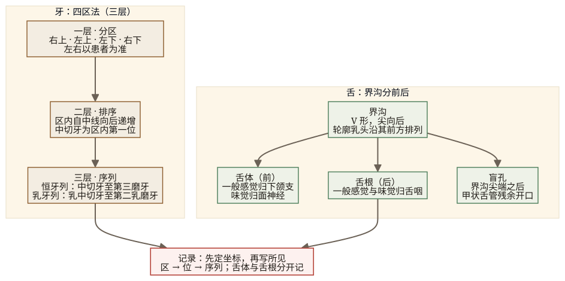
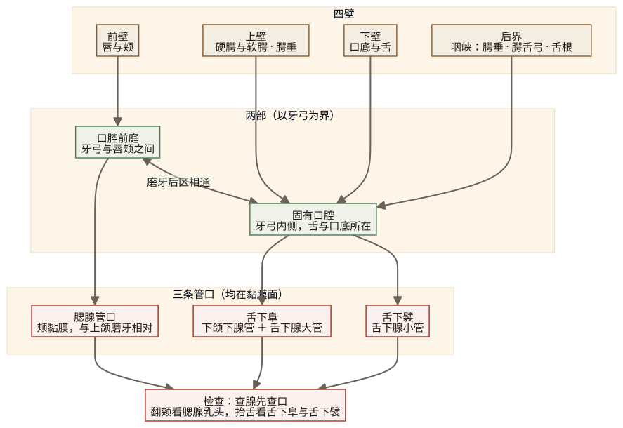

# 第 5 章 · 口腔与涎腺

> **层次**：本文件是**撰写层**——以课程第 5 章教学材料（`05-e15`，12 单元）中「口腔与咽与食管」「唾液腺的类别」两段的形态描述为骨架，改写为教材体；牙位记录的分区逻辑、口底间隙、口干的分步检查为本章按通行解剖学补写，条条写明是补写还是原文。
> **本章要回答的问题：** 口腔里同时跑着三套坐标——牙弓的、舌背的、腺管开口的。记不住坐标，看见的病灶就只是「嘴里有个地方」；记住坐标，才能一句话说清它在哪、归谁管、该从哪条管查起。
> **覆盖：** 课程第 5 章；四个四级单元 01.05.01.01–01.05.02.02，分属「口腔」「涎腺」两节。
> **真源状态：** 课程正文第 5 章实为消化系统一章，与章题只部分对应。本章只取其中口腔、腭、舌、唾液腺四段作形态骨架，其余（胃、肠、肝、腹膜）不取。凡课程未给而本章补写的判断，均在文中标注「本章补写」。
> **引用口径：** 牙位编号的对照表、唾液流量的数值、导管器械的规格，一律不引、不印；须给数处写「按所在规范，本章不给」。图全部自绘。

---

## N.1 概念与出处

口腔的解剖之所以难记，不在结构多，而在**坐标有三套**：牙用四区，舌用界沟，腺用管口。三套坐标各管一段，混着记就会把「右上第二磨牙」说成「右边上面那颗」，把「舌根」当成「舌体靠后的部分」。本章先把三套坐标立起来，再往里填结构。

| 概念 | 出处 | 一句定义 |
|---|---|---|
| 口腔前庭 | 课程 5.91 | 牙弓与唇、颊之间的马蹄形腔隙，后经磨牙后区通固有口腔 |
| 固有口腔 | 课程 5.91 | 牙弓内侧、舌与口底所在的腔，后界为咽峡 |
| 咽峡 | 课程 5.91 | 腭垂、两侧腭舌弓与舌根围成的口咽分界 |
| 牙位四区法 | 本章补写 | 以中线与上下牙列的分界把牙列划四区，区内自中线向后递增；恒牙列与乳牙列各一套序列 |
| 牙周四件 | 本章补写 | 牙龈、牙周膜、牙槽骨、牙骨质；牙借牙周膜悬于牙槽窝，非骨性融合 |
| 界沟 | 课程 5.91 | 舌背的 V 形沟，尖向后，把舌分为舌体（前）与舌根（后） |
| 大涎腺 | 课程 5.95 | 腮腺、下颌下腺、舌下腺三对，位于口腔壁外，借导管开口于黏膜 |
| 小涎腺 | 课程 5.95 | 唇腺、颊腺、腭腺、舌腺等，位于黏膜与黏膜下层，直接开口于黏膜面 |
| 口干 | 本章补写 | 自觉口腔干燥的主诉；可为分泌量减少、成分改变或感觉异常，三者不等 |

**全章骨架一句话：一腔两部、两套坐标、三条管口。** 一腔两部，是前庭与固有口腔，靠牙弓分、靠磨牙后区通；两套坐标，是牙的四区与舌的界沟；三条管口，是腮腺管开口于颊黏膜、下颌下腺管开口于舌下阜、舌下腺的管开口于舌下阜与舌下襞。本章两张图即这三句的展开：图 5-1 画坐标，图 5-2 画壁与口。

还有一条读法要先立：**口腔的「壁」比「腔」重要。** 腔是空的，壁才有结构：前壁唇与颊，上壁硬腭与软腭，下壁口底与舌，后界咽峡。四壁各有各的黏膜、腺体与神经，也各有各的走向。只记「一个腔」，遇到问题无处落手。

## N.2 牙与牙周：一套能反推的坐标

牙是口腔里唯一有硬坐标的结构。软组织可以描述成「颊黏膜近口角处」，牙不行：牙必须能用一个短代号指认，否则复诊、会诊、影像对照三处对不上。这一节给的不是代号表，是代号的读法。

牙本身分三部：露在口内的牙冠、被牙龈包绕的牙颈、埋在牙槽窝内的牙根。牙冠外覆釉质，其内为牙本质，牙根外覆牙骨质；三者围出中心的牙髓腔。牙周则是把牙固定在骨里的四件：牙龈（上皮与结缔组织的封套）、牙周膜（连接牙骨质与牙槽骨的纤维层）、牙槽骨（容纳牙根的骨）、牙骨质（牙根的外衣）。

关键在牙周膜**不是骨性融合**。牙与骨之间隔着一层可压缩的纤维膜，所以牙有生理性动度，咬合力经这层膜缓冲后传到骨。这层「软连接」是理解牙松动、咬合创伤与牙周炎进展的结构前提：骨吸收到一定程度，膜还在，牙就开始晃；膜一旦被炎症破坏，晃就变成移位。

### 01.05.01.01 牙与牙周：记录用的编号与分区

牙位记录的逻辑只有三层。三层记住，任何一套编号系统都能读；三层记不住，背表也会抄错版本。

**第一层，分区。** 以面部中线（两颗中切牙之间）与上下牙列的分界，把全口牙划为四区：右上、左上、左下、右下。**这里的左右是患者的左右，不是观察者的左右。** 检查者面对患者时，患者的右上落在观察者的左手边。这一步颠倒，后面全错——牙位记录里最常见的差错不是不懂编号，而是把观察者方位当成了患者方位。同理，方位词一律以患者为准：写「近中」是靠近中线的一侧，写「远中」是远离中线的一侧，与检查者站在哪边无关。

**第二层，区内排序。** 每一区自中线向后依次递增：最靠近中线的一颗是区内第一位，向后依次为第二位、第三位……所以一个完整的牙位由「区」与「位」两段构成，缺一段就不成立。这解释了为什么牙位代号总是成对出现：前一段说在哪个象限，后一段说在该象限的第几位。

**第三层，双序列。** 恒牙列与乳牙列各有一套序列：乳牙列自乳中切牙起，到第二乳磨牙止；恒牙列自中切牙起，到第三磨牙止。两套序列长度不同，又要在乳恒牙交替的数年里共存于同一副牙列，因此**记录时必须写明这是乳牙列还是恒牙列，或者写明所用的是哪一套记录系统**。临床上三套系统并存（部位描述、两位数字、连续编号），各有适用场合，混用是差错的主要来源。

> 【边界】具体的编号对照表、牙位代号与影像标记法不在本章。表属规范文件的内容，教材印出来，读者抄的是版本，不是逻辑。本章只要求一件事：看到一串代号，能反推三件事——在哪个区、区内第几位、恒牙还是乳牙。反推得出，坐标就掌握了；反推不出，背表也没用。

牙周记录同理，单位是位点，不是牙。每颗牙的颊（唇）面与舌（腭）面、近中与远中，各成一个位点，探诊与出血按位点登记。位点的数目、探诊深度的判读界限属牙周专科规范，本章不给；本章只强调那条常被跳过的规矩：写「右上第一磨牙牙周袋」而不写位点，等于把一条线报成了一个点，复诊时无法比。

牙的功能也不止咀嚼。前牙参与齿音与唇齿音；牙列维持面下部高度与唇颊支撑，牙一掉，唇就塌；咬合面引导下颌运动型，一侧后牙缺失，下颌会习惯性偏向便利的一侧。所以「后牙缺了不影响说话」只对一半：它不影响构音，却改变支撑与引导。

## N.3 舌与口底：一条界沟，两套支配

舌是口腔里活动度最大的结构，也是唯一「一块肌被两层黏膜覆盖」的器官。肌分两组：舌内肌（纵、横、垂直三向纤维）改变形状，舌外肌（颏舌肌、舌骨舌肌、茎突舌骨肌、腭舌肌）改变位置。**颏舌肌是唯一能使舌前伸的肌**，所以一侧颏舌肌无力，伸舌时舌尖偏向患侧。这个动作是第 6 章舌下神经检查的落点，本章先记住结构与其归属。

### 01.05.01.02 舌与口底

舌背的分区只有一条线：**界沟**。界沟呈 V 形，尖向后；沟之前是舌体（通称舌前三分之二），之后是舌根（舌后三分之一）；沟尖端后方的小凹是舌盲孔，为甲状舌管残余的开口。这条线的意义远超形态：界沟前后黏膜来源不同、神经支配不同、淋巴回流不同，所以「舌根」不是「舌体靠后的部分」，它是另一个部位，另一个归属，另一套病。

舌背黏膜上有四类乳头，位置关系本身就是一张地图。**丝状乳头**遍布舌背前部，上皮角化，不含味蕾，是舌苔的主要构成；**菌状乳头**散在舌尖与舌缘，红色小点，含味蕾；**叶状乳头**位于舌侧缘后部，呈纵行皱襞；**轮廓乳头**沿界沟前方排成一列 V 形，体积最大，含味蕾最多。落到观察上：苔看丝状，红点看菌状，V 形一排看轮廓。

味觉要在这里说清一句常被画错的图。旧图把舌面分成「甜在舌尖、苦在舌根、酸在两侧、咸在舌前两侧」四块，流传极广，但**分区专司并不成立**：各区味蕾都能感受多种味质，差别只在敏感性高低。本书取「广泛分布、敏感性有差异」的说法，并标明这是现代认识——它与古医籍「舌之分部应脏腑」不是同一件事，后者讲诊法分区，不是味觉生理。另有一件常混的：「辣」不是味觉，是辣椒素作用于痛觉与温度觉感受器产生的复合感觉，故不在味觉图上；「麻」更不是。

舌腹与口底是本章第二套坐标的落点。舌腹黏膜光滑，正中线上有舌系带，系带两侧各有一个隆起叫**舌下阜**；舌下阜向后外延伸的皱襞叫**舌下襞**。抬起舌尖看口底，看到的是：中间一条系带，两旁两个阜，阜外两条襞——这条视线就是口底检查的全部路线。

口底的构成按「三面夹一隙」记。上面是口底黏膜，下面是下颌舌骨肌与颏舌骨肌、二腹肌前腹构成的肌性底，中间是疏松结缔组织，夹着下颌下腺深部、导管、血管与神经。下颌舌骨肌像一块肌性的膈，但**后缘是游离的**：舌下间隙与下颌下间隙在此相通。所以口底的感染不是「一个封闭腔里的脓肿」，而是可以顺这条后缘向下、向咽旁扩散的通道。口底水肿之所以凶险也在这里：组织疏松、间隙相通，肿起来先推舌向后上，再压会厌。这是「口底间隙感染按急症看待」的解剖依据；处置属专科，本章不写。

**图注**：图分两块。一块是牙的四区法：按患者方位分四区，区内自中线向后排序，注明恒牙列还是乳牙列——三层缺一层，坐标不成立。另一块是舌的分区：界沟把舌背分成舌体与舌根，轮廓乳头沿界沟排列，盲孔在界沟尖端之后。两块共用一句：**记录先定坐标，再写所见**。出处：本章 §N.1 表与 §N.2、§N.3。

## N.4 涎腺：三对腺与三条管口

涎腺分大小两类。大涎腺三对，腺体在口腔壁外，借长导管开口于黏膜的固定位置；小涎腺成片分布在黏膜与黏膜下层，没有长导管，直接开口于黏膜面。**大腺靠「管口」定位，小腺靠「区域」定位**——这是两类腺在记录上的根本差别，也是本节的分界线。

### 01.05.02.01 三对大涎腺与导管开口

**腮腺**在耳前下方、下颌支后方的下颌后窝内。按位置分浅、深两部：浅部贴咬肌表面，上抵颧弓下方；深部突向咽侧壁，构成所谓「腮腺床」的一部。腮腺管自腺体前缘发出，横过咬肌表面前行，至咬肌前缘处转向内侧，穿颊肌，开口于与上颌磨牙相对的颊黏膜上的小乳头。所以查腮腺管口的位置很好记：**翻颊，对着上颌磨牙，见一个小乳头**。

腮腺最要紧的毗邻不是骨，是穿过它的面神经。面神经出茎乳孔后进入腮腺，在腺内分上、下两干，再分颞、颧、颊、下颌缘、颈五组分支，从腺体前缘散出。**腺是「包着神经的腺」，不是「挨着神经的腺」**，所以腮腺区的风险不落在「切到腺」，落在「切到穿过腺的神经」（入路本章不写）。腮腺的分泌以刺激时为盛，进食、咀嚼、酸味都使它增量。

**下颌下腺**在下颌下三角内，分浅、深两部：浅部在下颌舌骨肌浅面，深部绕过该肌后缘进入舌下区。导管自腺体发出后前行于口底黏膜下，开口于舌下阜。**所以下颌下腺的导管走的是「一条贴着口底的长路」**：从颌下绕到口底，再向前到舌下阜。路上有两处容易出问题：绕过下颌舌骨肌后缘的转折处，与开口附近的狭窄段。导管内的结石、炎症多在这两处发作，表现为进食时该侧颌下肿胀、胀痛，食后渐消——「涎绞痛」说的就是这条管的力学。

**舌下腺**在口底黏膜下、下颌舌骨肌上方，是三对里最小的一对，形态最散。它**没有一条主导管**：多数小管直接开口于舌下襞，另有一部分汇入下颌下腺导管，与之共开口于舌下阜。记住这一句，就记住了两个隆起的分别：**舌下阜是「合用口」，舌下襞是「独用口」**。

三条管口连起来是一条由后向前的线：颊黏膜（腮腺，对着上颌磨牙）→ 舌下阜（下颌下腺与舌下腺大管）→ 舌下襞（舌下腺小管）。记为「颊上一点，口底两阜，襞上数孔」。位置记住了，检查动作才有落点：查腮腺要翻颊，查下颌下腺要抬舌，两条管不在一个面上，手法也不同。

### 01.05.02.02 小涎腺分布

小涎腺按所在部位命名：唇腺、颊腺、腭腺、舌腺，另有磨牙后腺。它们位于黏膜与黏膜下层，腺体小、数目多、分布广，各自以短管直接开口于所在黏膜面。**没有长导管，就没有「固定的管口」可指认**，因此小涎腺的病在记录上只能按区域写：「硬腭中线偏左黏膜下」。

分布上有两处值得记住。**一是腭腺最密**：硬腭黏膜下几乎全是腺体，黏膜与骨膜结合紧密，故硬腭黏膜薄、不易移动、感觉敏锐；腭部小涎腺也因此成为「腭部无痛性肿块」的常见来源。**二是唇腺可及**：下唇内侧黏膜下能隔黏膜触到成串腺体，是少数可直接触诊的小涎腺，专科活检多取此处（本章不写入路）。

小涎腺的功能与大涎腺一致，但**基础分泌的份额不可忽略**：大涎腺在刺激时出力，小涎腺在静止时持续渗润。这解释了两种不同的口干——大腺导管阻塞者「平时不觉干、进食时干」；小腺广泛萎缩者「整天干、黏膜发黏、说话要含水」。同一句主诉，落点不同。

**口干先查哪一条，按四步走。** 第一步问时间与诱因：静止时（夜间、晨起）干，还是进食时干。静止时干，先想下颌下腺与小涎腺的基础分泌；进食时干、需汤水下咽，先想腮腺的分泌与导管。第二步问侧别：单侧、进食后肿大、食后渐消，指该侧导管阻塞，查导管走行与开口；双侧、持续、渐重，指腺体实质或全身因素。第三步看开口：翻颊看腮腺乳头，抬舌看舌下阜与舌下襞，看有无红肿、挤压后有无溢脓、有无可触及的硬结——**这一步是「查哪一条」的动作落点**，两条管在两个面上，必须分开查。第四步摸腺体：质地、边界、双侧对称与否。

> 【边界】「口干」不等于「唾液少」。自觉口干可以是分泌量减少，也可以是成分改变（黏稠、润滑不足）、黏膜感觉异常或长期张口呼吸所致——中医讲津液输布时所说的「腺体流量正常而口干者大有人在」，指的正是后三类。唾液流量的测定与判读界限属唾液腺专科，本章不给数值、不给判读。

**图注**：图上半是四壁（前壁唇与颊、上壁硬腭与软腭、下壁口底与舌、后界咽峡），下半是三条管口的落点：腮腺管口在颊黏膜、对着上颌磨牙；下颌下腺管与舌下腺大管共同开口于舌下阜；舌下腺小管开口于舌下襞。中间标出前庭与固有口腔经磨牙后区相通。读图要点是「管口都在黏膜面上，不在腺体上」。出处：本章 §N.1 骨架与 §N.4。

## N.5 争议与本项目立场

**争议一：牙位记录用哪一套系统。** 三套系统各有拥护者，各有历史包袱。本项目不选边，只立一条纪律：**写明系统，不混用**。教材不印对照表，理由见 §N.2 的边界——表会被抄成版本。

**争议二：舌面味觉地图还算不算数。** 旧图仍见于许多科普与教材插图。一派认为它作为「敏感性差异」的示意仍有教学价值，一派认为已被证伪。本项目取后者，但保留一句限定：**分区专司不成立，敏感性有差异成立。** 不写这句，读者会把「舌尖对甜更敏感」读成「舌尖只能尝甜」。

**争议三：涎腺的「三大对加小涎腺」二分够不够用。** 从定位与记录看够用：大腺靠管口，小腺靠区域，两线不交叉。从病理看不够：小涎腺的肿瘤类型与大涎腺并不重合，腭部小涎腺尤其不能按腮腺的经验套。本项目取「形态用二分，病理另立」。

**本项目立场三条。** 其一，本章只写形态、位置、毗邻与开口，不写手术入路、不写导管扩张器械的规格与参数；这些属口腔颌面外科与唾液腺专科。其二，不写唾液流量、腺体大小的数值与判读界限；须给数处一律写「按所在规范，本章不给」。其三，口底间隙感染、涎石、口干的分步检查，本章只给解剖依据与检查次序，不给处置方案——**解剖学能告诉你「为什么这里危险」，不能告诉你「该怎么处理」。**

> **免责声明：** 本章为教学材料，不构成诊断或治疗建议。文中的分区、管口位置与检查次序只用于建立判断框架；一切检查、用药与处置，须由具备资质的执业人员依现行规范与所在机构制度作出。口腔内久不愈的溃疡、不明原因的肿块、持续单侧腮腺或颌下肿胀、进行性口干者，须经口腔科或耳鼻咽喉科检查，不在此框架内自行判断。本章不给剂量、不给疗程、不含研究数据与疗效结论。

## 思考题

1. 牙位记录中「左右颠倒」为什么是最常见的差错？请说明记录为何必须采用患者方位，并给出一个可在椅旁执行的自查方法。
2. 舌的界沟把舌背分成前后两半。这两半在黏膜来源、一般感觉与味觉的神经归属上各有什么不同？为什么「舌后三分之一麻木」不能按舌前三分之二的神经去解释？
3. 患者主诉口干。请按「时间—侧别—开口—腺体」四步给出检查次序，并说明哪一步能把「唾液分泌减少」与「自觉口干」区分开。

## 延伸阅读

- 课程正文第 5 章（`departments/08-wuguan/01-erbihou-jiepou-shengli/chapters/05-e15/docs/zh.md`）5.91、5.95 两段——「口腔与咽与食管」给出腭、舌、口底的形态与咽峡的界限，「唾液腺的类别」给出腮腺浅深部、下颌下腺导管与舌下阜的表述；本章形态部分以此为据。
- 《口腔解剖生理学》，口腔局部解剖「口腔」「唾液腺」两章——牙位记录的三套系统、腮腺床、口底间隙的通行表述可与之对读；本书只标章目，不引页码与图表。
- 《口腔颌面外科学》，涎腺疾病章与口腔颌面部感染章——「涎绞痛」的力学、口底多间隙感染的扩散路径可与之对读；本章只取解剖依据，不引处置方案与手术入路。
